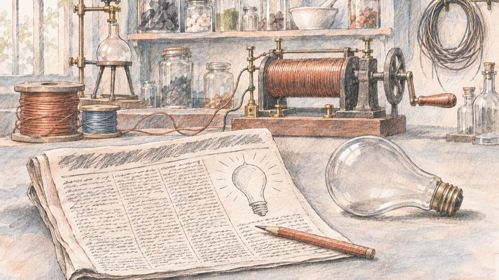
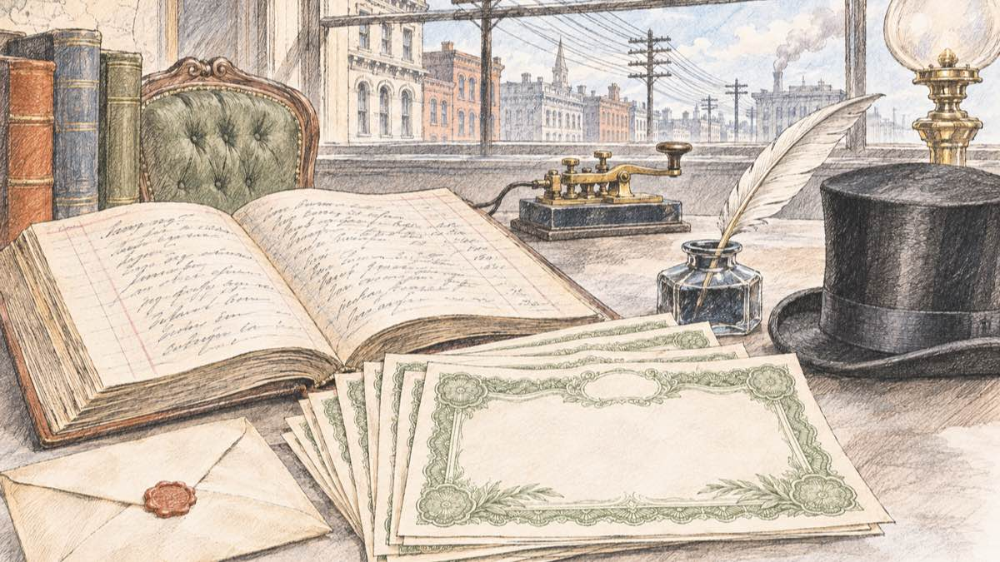
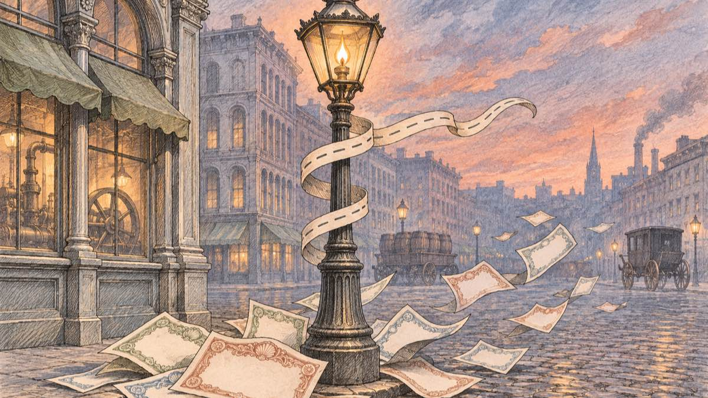
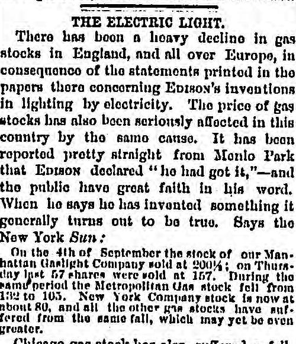
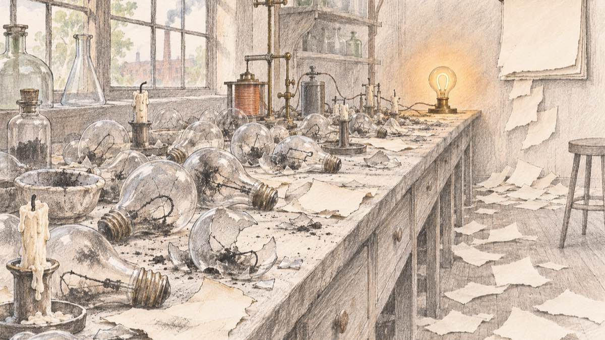

<!-- Long-file rationale: a claim-by-claim history essay keeps its narrative and per-claim reference anchors in one file so the citation chain stays stable. -->

1878 年 9 月 16 日，星期一，《纽约太阳报》（*New York Sun*）登出一篇报道，标题是“爱迪生的最新奇迹”（Edison's Newest Marvel）。报道说，爱迪生找到了把电灯光“细分”成许多盏小灯的办法；按报道的说法，此前研究这个问题的科学家[“收效甚微”](#ref-sun-1878)。记者描述了前一个星期六在新泽西州门洛帕克（Menlo Park）实验室里的情景：爱迪生一边摇着感应线圈的手柄，一边说：[“I have it now!”（我搞定了！）](#ref-sun-1878)

爱迪生还说得更远。他说，电灯有多亮、多便宜，公众[“再过几个星期，或者等我把这套方法完全保护好”](#ref-sun-1878)就能看到，到那时煤气照明“将被淘汰”。他还说，十五到二十台发电机就能照亮整个曼哈顿下城。

可是爱迪生手里并没有这样一盏灯。能连续亮半天以上的灯，要到十三个月之后才出现；公开演示，要到十五个月之后。我翻回当年秋天的信件、合同和报纸，想弄清楚一件事：产品还不存在就先宣布，到底能换来什么，又要付出什么。爱迪生这件事的史料保存得格外完整，答案可以从有日期的文件里读出来，不必依靠传说。

## 爱迪生宣布了一个他还没有拿到的结果

<figure>
  
  <figcaption>宣布在前，灯在后。概念插画。</figcaption>
</figure>

时间线很短。罗格斯大学“爱迪生文献”项目（Thomas A. Edison Papers）编的年表记载，爱迪生从西部旅行回来后，[1878 年 8 月 27 日才开始做电灯实验](#ref-chronology-1878)。9 月 8 日，他去康涅狄格州安索尼亚（Ansonia）参观了华莱士（William Wallace）的发电机作坊；9 月 13 日到 16 日之间，他宣布自己已经解决了白炽电灯的问题。

也就是说，《太阳报》上的说法只建立在大约三个星期的工作之上。报道本身也透露出结果有多单薄。它说爱迪生的努力在 9 月 13 日星期五[“大功告成”](#ref-sun-1878)，又给出一笔账：纽约人花 2.5 到 3 美元买 1000 立方英尺煤气得到的光，用爱迪生的办法只要 12 到 15 美分。报道没有给出这笔账背后的任何测量。不到一个月，伦敦的一份周刊就指出，这个价格只是[“归在他名下的说法，就我们所见，并没有他的签字作证”](#ref-spectator-blow)。

爱迪生真正拥有的是名声。他前一年发明了留声机。同一份伦敦周刊解释了英国公众为什么相信他：[“他确实发明了留声机。”](#ref-spectator-blow)

## 投资人三天后就上门了

<figure>
  
  <figcaption>资金比灯先到。概念插画。</figcaption>
</figure>

资本的反应很快。爱迪生文献的年表记载，报道见报三天后，也就是 9 月 19 日，爱迪生[开始收到潜在电灯投资人的报价](#ref-chronology-1878)。

上门的是[和西部联合电报公司（Western Union）有关系的一批人](#ref-supporting-work)，这家公司早就熟悉爱迪生的本事。爱迪生的律师洛瑞（Grosvenor Lowrey）同时也是西部联合的律师。9 月 28 日，洛瑞写信给爱迪生，说在这次谈判里他将[“完全和你站在一起、替你办事”](#ref-lowrey-sept-28)，自己不要任何好处。10 月 3 日，爱迪生回了一张短笺，把谈判全权交给洛瑞：[“我眼下只要有钱，能让电灯快点往前推。”](#ref-edison-oct-3)两天后，公司还没有影子，洛瑞先垫给爱迪生三百美元做电灯开支，按文献编者的注释，其中大部分用来交专利费。

1878 年 10 月 16 日，[爱迪生电灯公司（Edison Electric Light Company）在纽约注册成立](#ref-supporting-work)。发起人包括西部联合总裁格林（Norvin Green），他出任电灯公司总裁；代表岳父范德比尔特（William H. Vanderbilt）利益的特旺布利（Hamilton Twombly）；两位西部联合股东；一位金融家；洛瑞的三位律所合伙人；以及德雷克塞尔－摩根公司（Drexel, Morgan & Co.）的合伙人法布里（Egisto Fabbri）。同一篇文献还提到，范德比尔特是[西部联合的最大股东，“也大量投资煤气公司”](#ref-supporting-work)。也就是说，资助新电灯的家族之一，同时持有这盏灯要威胁的生意。

一个星期后，洛瑞报告说[“申请纷至沓来”](#ref-lowrey-oct-23)，其中有缝纫机厂商惠勒－威尔逊（Wheeler & Wilson）请求马上给它在布里奇波特的工厂装灯。

合同在 11 月 15 日签字。公司同意[把 30 万美元股本中的 25 万美元发给爱迪生](#ref-agreement-1878)，另付他 3 万美元现金，其中 2.5 万美元要花在实验上。剩下的六分之一归出资认股的人：史密森学会的展览稿说，电报界的投资人和德雷克塞尔－摩根[出了 5 万美元，换取六分之一的股份](#ref-smithsonian)；合同本身也写明，公司在付给爱迪生后续 10 万美元之前，先预留最多 5 万美元，[“偿还认股人以现金缴付的款项”](#ref-agreement-1878)。

从“I have it now!”算起不到两个月，一个还没有可用电灯的人，已经有了一家有资金的公司、一份用股票和现金换取他电灯发明的合同，以及实验室的经费。此后两年半里，公司[一共拿出约 13 万美元做研发](#ref-supporting-work)。

## 伦敦和纽约的煤气股都跌了

<figure>
  
  <figcaption>对手行业也听到了消息。概念插画。</figcaption>
</figure>

这次宣布的第二批听众是煤气业。《太阳报》的报道传过了大西洋。10 月 8 日星期二，伦敦《泰晤士报》登出爱迪生的一封信，信里说他已经解决了电灯的细分问题，同时转载了《太阳报》的描述。四天后，《旁观者》（*The Spectator*）报道了后果：[“这一消息引发了煤气股恐慌，许多煤气股已经下跌了百分之五到百分之十。”](#ref-spectator-oct-12)

纽约的煤气股也跌了。10 月 17 日，《芝加哥论坛报》（*Chicago Daily Tribune*）在社论“电灯”（The Electric Light）里引用了《太阳报》的行情数字。

<figure>
  
  <figcaption>《芝加哥论坛报》，1878 年 10 月 17 日，第 4 版。美国国会图书馆 Chronicling America。公有领域。</figcaption>
</figure>

引文说，[曼哈顿煤气灯公司（Manhattan Gaslight）的股票 9 月 4 日成交价是 200¼](#ref-tribune-oct-17)，“上星期四”有 57 股以 157 成交；同一时期，大都会煤气公司（Metropolitan Gas）从 132 跌到 105。扫描件上，157 的中间一位也可以读成 6，105 的末位也可以读成 3。无论按哪种读法，两只股票都跌掉了大约六分之一到五分之一。社论也给出了自己的解释：爱迪生宣称[“他搞定了”，而公众非常相信他的话](#ref-tribune-oct-17)。

上面这些是当年报纸印出来的数字。一些现代文章写煤气股整体“跌了 15%”，我在 1878 年的史料里没有找到这样一个全市场的百分比。

有些文章还多加了一步：爱迪生借煤气股恐慌拉到了投资。日期不支持这个说法。投资人 9 月 19 日就开始报价，月底洛瑞已经在谈判，而伦敦的恐慌 10 月 8 日才开始。在我读到的信件里，投资人担心的是专利，不是煤气股价。股价下跌和投资到位，是同一条新闻引出的两个结果。我没有找到任何文件把两者连成因果。

## 期限拖了一年多

<figure>
  
  <figcaption>“几个星期”变成了一年多。概念插画。</figcaption>
</figure>

“几个星期”没有兑现。当年秋天，投资人的耐心就受到了考验。年表记载，10 月 30 日，投资人担心发明家索耶（William Sawyer）和曼（Albon Man）对电灯的优先权主张，[爱迪生为此大为恼火](#ref-chronology-1878)。11 月 13 日，他雇了数学家厄普顿（Francis Upton）检索技术文献，[“以消除爱迪生电灯公司投资人的疑虑”](#ref-chronology-1878)。到了 1879 年 1 月，洛瑞还在宽慰他，说那几位银行家合伙人[“一旦拿定主意，不会轻易被吓跑”](#ref-supporting-work)。

能用的灯在第二年秋天才出现。1879 年 10 月 22 日，爱迪生的助手巴彻勒（Charles Batchelor）记录了一盏用碳化棉线做灯丝的真空灯：[从凌晨一点半亮到下午三点，共 13 个半小时](#ref-batchelor-oct-22)，之后玻璃泡裂开。1879 年 11 月 16 日，厄普顿写信告诉父亲，爱迪生[“做出了第一盏符合我们要求的灯”](#ref-upton-nov-16)，灯丝是烧焦的硬纸板。他在同一封信里说，有人出价 400 美元买电灯公司的股票，却没有人肯卖。

12 月 27 日，公司投资人看了演示；[1879 年除夕](#ref-demonstration)，门洛帕克举行了公开演示，铁路加开了列车，几百人冒着风雨赶来。

从《太阳报》的报道到碳化棉线灯，用了十三个月；到公开演示，用了十五个半月。《太阳报》上印的是“几个星期”。

## 我从这段历史里读到三点

我是以创业者的身份读这段历史的。这只是一位发明家、一个秋天的事，所以我只敢得出几条小结论。

这次宣布起到了测试需求的作用。三天之内，愿意为这个想法出钱的人有了反应；一个月之内，会因为这个想法受损的人也有了反应。两种反应都带着信息，而只盯着客户的人，很容易忽略第二种。

这次测试并不便宜，也有前提。爱迪生能这样做，是因为他已经发明了留声机；《旁观者》和《论坛报》都白纸黑字地写过，公众相信他，是因为他过去的成绩。一个没有名气的创业者发出同样的宣布，得到的反应会弱得多，而这种弱反应反映的可能是他的名气，未必是需求。

宣布还欠下了一笔债。“几个星期”立了一个期限，爱迪生晚了一年多才兑现。文件记下了拖延的代价：投资人担心对手的优先权主张、爱迪生为此恼火，一位部分是为了安抚投资人而招来的雇员，还有律师一封接一封的安慰信。爱迪生付得起这笔债，是因为灯最后做成了。索耶和曼也声称发明了电灯，今天知道他们名字的人却少得多。我们反复讲的“先宣布”的故事，大多是最后做出了产品的那一些。

## 参考资料与延伸阅读

本文的资料查证在 2026 年 11 月 11 日完成。正文里每一处说法都链接到下面的一条参考资料，每条参考资料再链接到原始出处。下列资料我都逐一读过；引文都对照了原件或爱迪生文献的排印本，正文中的中文译文是我的翻译，英文原文见各条目。插图是通过 Codex 调用 OpenAI 图像模型生成的概念插画；报纸剪影是美国国会图书馆的扫描件。有现成存档的出处，抓取日期链接到存档；这次我没能为其余出处新建存档，所以不少日期是纯文本。

有两种流传很广的说法，本文有意没有采用。我没有找到 1878 年的史料支持煤气股“跌了 15%”这个单一数字，也没有找到任何文件说煤气股下跌帮助爱迪生拉到了投资。我也没有找到一手证据证明摩根（J. P. Morgan）本人在 1878 年认购了股票；史料提到的是他的银行德雷克塞尔－摩根公司和该行合伙人法布里。

**《太阳报》报道。** "Edison's Newest Marvel," *New York Sun*，1878 年 9 月 16 日第 [3] 版，排印本见 [*The Papers of Thomas A. Edison* 第 4 卷 Doc. 1439](https://edison.sas.rutgers.edu/images/archive/innovations/TAEBdocs/Doc1439_NYSun_9-16-78_linked.pdf#page=2)，第 502–505 页（Johns Hopkins University Press，1998）。编者认为这篇未署名文章“最有可能”出自卡明斯（Amos Cummings）。印刷页第 502 页："Many scientific men have worked assiduously in that direction, but with little success." 第 503 页（PDF 第 2 页）："On Friday last his efforts were crowned with success"；"'I have it now!' he said, on Saturday"；"which will be in a few weeks, or just as soon as I can thoroughly protect the process—illumination by carbureted hydrogen gas will be discarded." 第 504 页："twelve to fifteen cents" 对比 "$2.50 to $3"。抓取于 2026-11-11。

**爱迪生文献年表，1878 年。** Thomas A. Edison Papers，罗格斯大学，[Chronology 1878](https://edison.rutgers.edu/edit-chronology/chronology-details/1871---1880/1878#:~:text=Begins%20electric%20light%20experiments)。8 月 27 日（"Begins electric light experiments"）、9 月 8 日、9 月 13–16 日、9 月 19 日（"Begins to receive offers from prospective electric lighting investors"）、10 月 16 日、10 月 30 日、11 月 13 日（"in order to allay fears of Edison Electric Light Co. investors"）、11 月 15 日各条。抓取于 2026-11-11。

**洛瑞致爱迪生，1878 年 9 月 28 日。** [*Papers of Thomas A. Edison* 第 4 卷 Doc. 1459](https://edison.sas.rutgers.edu/images/archive/innovations/TAEBdocs/Doc1459_Lowrey_9-28-78_linked.pdf)："I should act with and for you, entirely; and I shall therefore decline to be interested." 编者注指出，想要入股的一方是埃德森（Tracy Edson）和班克（James Banker）。抓取于 2026-11-11。

**爱迪生致洛瑞，1878 年 10 月 3 日。** [*Papers of Thomas A. Edison* 第 4 卷 Doc. 1471](https://edison.sas.rutgers.edu/images/archive/innovations/TAEBdocs/Doc1471_TAEtoLowrey_10-3-78_linked.pdf)，第 551 页："All I want at present is to be provided with funds to push the light rapidly." 注 2 记载洛瑞 "advanced Edison three hundred dollars for electric light expenses"，其中两百美元用于专利开支。抓取于 2026-11-11。

**公司成立、发起人和资金。** Thomas A. Edison Papers，[“Supporting the Work”](https://edison.rutgers.edu/life-of-edison/biographical-essays/lighting/supporting-the-work#:~:text=incorporated%20in%20New%20York%20City%20on%2016%20October)，传记文章。原文："several figures connected with Western Union Telegraph who already held him in high regard as an inventor"；"Grosvenor Lowrey, the Western Union attorney"；"incorporated in New York City on 16 October"；特旺布利 "represented the interests of his father-in-law William H. Vanderbilt, the principal shareholder in Western Union and a heavy investor in gas utilities"；"Edison Electric would provide $130,000"；洛瑞 1879 年 1 月："not to be very easily frightened away from a thing they once made up their mind to." 抓取于 [2026-11-11](http://web.archive.org/web/20260416145326/https://edison.rutgers.edu/life-of-edison/biographical-essays/lighting/supporting-the-work)。

**洛瑞致爱迪生，1878 年 10 月 23 日。** [*Papers of Thomas A. Edison* 第 4 卷 Doc. 1520](https://edison.sas.rutgers.edu/images/archive/innovations/TAEBdocs/Doc1520_LowreytoTAE_10-23-78_linked.pdf)，第 638 页："The applications come pouring in— I have to-day an urgent application from Wheeler & Wilson to put the thing at once in their great factory at Bridgeport." 信中还提到 "an important meeting of the Board of Directors"，说明公司在 11 月签约之前已经存在。抓取于 2026-11-11。

**合同。** 爱迪生与爱迪生电灯公司协议，1878 年 11 月 15 日，[*Papers of Thomas A. Edison* 第 4 卷 Doc. 1576](https://edison.sas.rutgers.edu/images/archive/innovations/TAEBdocs/Doc1576_EELCoAgreement_linked.pdf#page=4)，第 712–716 页。第五条（第 715 页，PDF 第 4 页）：公司同意 "to issue to said Edison two hundred and fifty thousand dollars of its Capital Stock of three hundred thousand dollars, and to pay him ... the sum of thirty thousand dollars in cash"，其中 "twenty five thousand dollars" 用于实验。第六条（第 716 页，PDF 第 5 页）："remaining after reserving fifty thousand dollars, or so much thereof as may be required to repay the sums paid in cash by the subscribers to its Capital Stock." 公司方由总裁格林签字。抓取于 2026-11-11。

**认股人的份额。** 史密森学会国家美国历史博物馆，*Lighting a Revolution*，[“19th Century Promotion”](https://americanhistory.si.edu/lighting/scripts/s19c.htm#:~:text=paid%20%2450%2C000%20for%201%2F6%20share)："In 1878, they and the banking house of Drexel-Morgan paid $50,000 for 1/6 share in the Edison Electric Light Co. Edison held the other 5/6 share." 抓取当天原网页无法打开，我读的是存档。抓取于 [2026-11-11](http://web.archive.org/web/20260927234820/https://americanhistory.si.edu/lighting/scripts/s19c.htm)。

**伦敦的恐慌。** *The Spectator*，1878 年 10 月 12 日第 2 页，[“The gas interest has this week received a heavy shock”](https://archive.spectator.co.uk/article/12th-october-1878/2/the-gas-interest-has-this-week-received-a-heavy-sh)，The Spectator Archive。原文："On Tuesday the Times published a 'telegram'—it was really a letter"；"As Mr. Edison is the inventor of the phonograph, this announcement caused a panic in gas shares, which have in many instances fallen from five to ten per cent." 抓取于 2026-11-11。

**公众为什么相信他。** *The Spectator*，1878 年 10 月 12 日第 5 页，[“The Blow to Gas Shareholders”](https://archive.spectator.co.uk/article/12th-october-1878/6/the-blow-to-gas-shareholders)，The Spectator Archive。原文："He did invent the phonograph"；公众相信了 "a statement attributed to him, but not, so far as we see, authenticated by his signature, that he could produce his light at 15 cents. per $3 of gas." 抓取于 2026-11-11。

**纽约煤气股价。** "The Electric Light," 社论，*Chicago Daily Tribune*，1878 年 10 月 17 日，[第 4 版](https://www.loc.gov/resource/sn84031492/1878-10-17/ed-1/?sp=4)，美国国会图书馆 Chronicling America；[股价段落原图裁切](https://tile.loc.gov/image-services/iiif/service:ndnp:dlc:batch_dlc_michigan_ver01:data:sn84031492:no_reel:1878101701:0004/1550,1900,750,900/full/0/default.jpg)。社论自己的话："the public have great faith in his word. When he says he has invented something it generally turns out to be true." 接着引用《纽约太阳报》："On the 4th of September the stock of our Manhattan Gaslight Company sold at 200¼; on Thursday last 57 shares were sold at 157. During the same period the Metropolitan Gas stock fell from 132 to 105. New York Company stock is now at about 80." 扫描件上 157 和 105 难以辨认（也可能是 167 和 103）。我没有找到《太阳报》的原始行情报道。抓取于 2026-11-11。

**碳化棉线灯。** 巴彻勒笔记，1879 年 10 月 22 日，[*Papers of Thomas A. Edison* 第 5 卷 Doc. 1831](https://edison.sas.rutgers.edu/images/archive/innovations/TAEBdocs/Doc1831_EL_10-22-79_linked.pdf#page=2)，第 447–449 页。第 447 页："we took a piece of 6 cord thread No 24s ... we carbonized it"；第 448 页："On from 1.30 AM till 3 pm 13½ hour and was then raised to 3 gas jets for 1 hour then cracked glass & busted." 抓取于 2026-11-11。

**厄普顿的信。** Francis Upton 致 Elijah Upton，1879 年 11 月 16 日，[*Papers of Thomas A. Edison* 第 5 卷 Doc. 1847](https://edison.sas.rutgers.edu/images/archive/innovations/TAEBdocs/Doc1847_Upton_11-16-79_linked.pdf)，第 489–490 页。原文："During the past week Mr. Edison has succeeded in obtaining the first lamp that answers the purpose we have wished it for"；"The light is obtained from a piece of charred paper"；"The making of such a burner has made the stock of the Electric Light Co. advance in value, $400 has been offered for shares"（手稿接着写 "no takers"，"takers" 被划掉，改写为 "sellers"）。抓取于 2026-11-11。

**两次演示。** Thomas A. Edison Papers，[“Demonstrating the New Light”](https://edison.rutgers.edu/life-of-edison/biographical-essays/lighting/demonstrating-the-new-light#:~:text=New%20Year%27s%20Eve%20demonstration)，传记文章："the successful demonstration for the Electric Light Company investors on December 27"；引《纽约先驱报》描述 "New Year's Eve demonstration"："Extra trains were run from east and west, and notwithstanding the stormy weather, hundreds of persons availed themselves of the privilege." 抓取于 [2026-11-11](http://web.archive.org/web/20261005190719/https://edison.rutgers.edu/life-of-edison/biographical-essays/lighting/demonstrating-the-new-light)。
