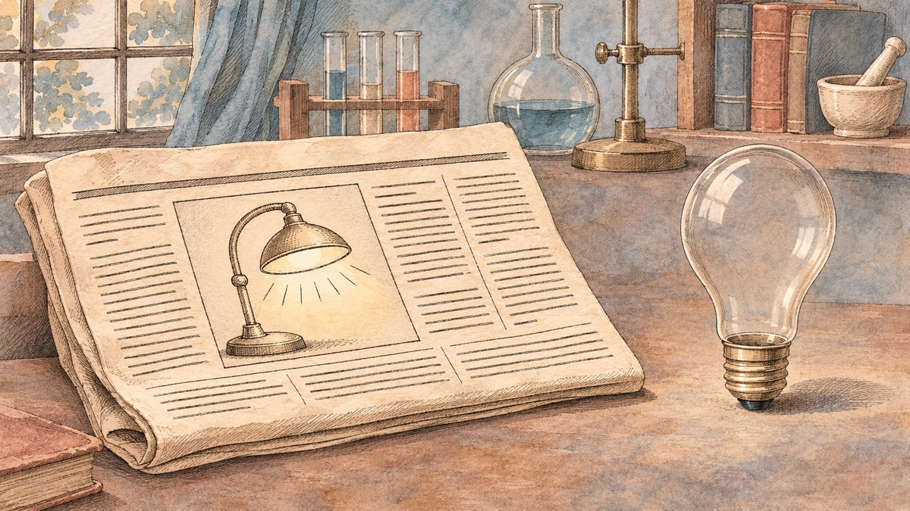
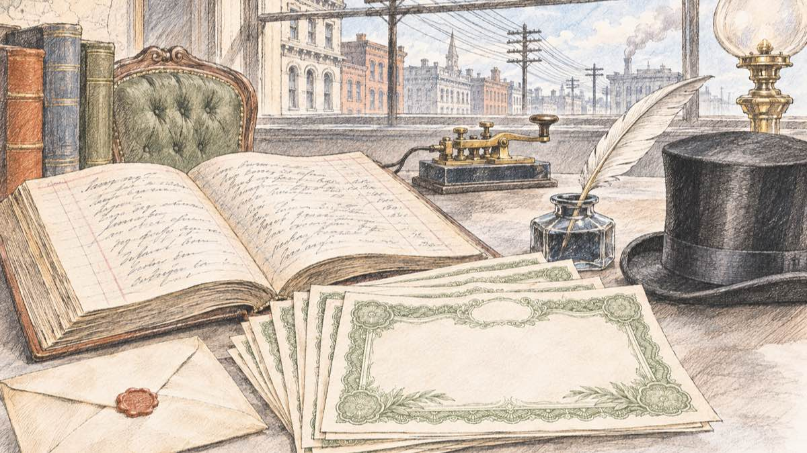
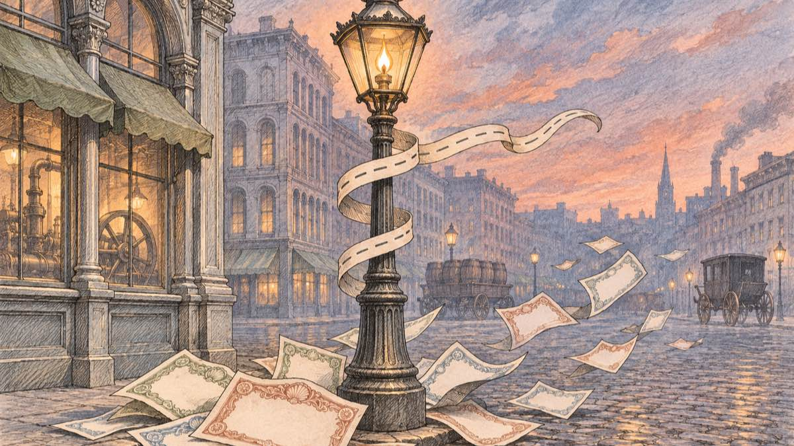
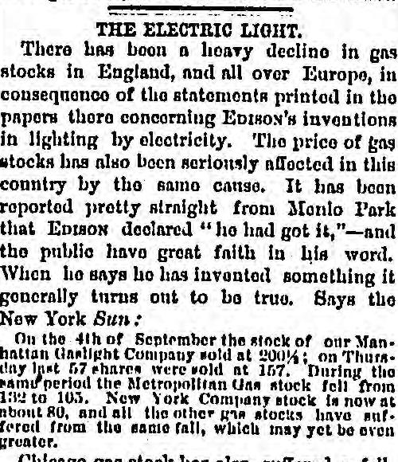
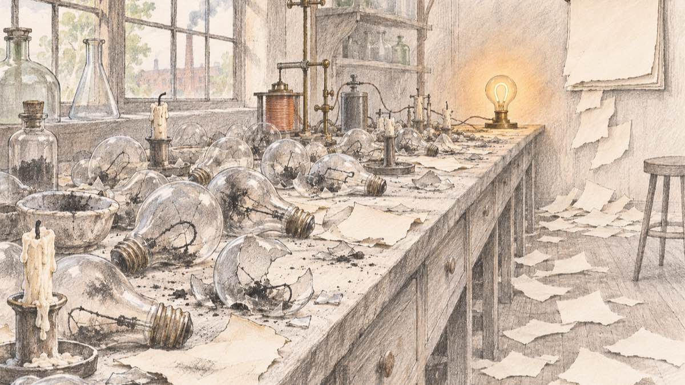

<!-- Long-file rationale: a claim-by-claim history essay keeps its narrative and per-claim reference anchors in one file so the citation chain stays stable. -->

On Monday, September 16, 1878, readers of the *New York Sun* found a story headlined "Edison's Newest Marvel." Thomas Edison, it reported, had found a way to divide electric light into many small lamps, a problem on which many scientific men had worked "with little success." The reporter quoted him at his laboratory in Menlo Park, New Jersey, the previous Saturday, cranking a large induction coil: ["I have it now!"](#ref-sun-1878)

Edison went further. The public would see how bright and cheap the new light was ["in a few weeks, or just as soon as I can thoroughly protect the process,"](#ref-sun-1878) and then gas lighting "will be discarded." Fifteen or twenty dynamos, he said, could light all of lower Manhattan.

Edison did not have that lamp. A lamp that burned for more than half a day came thirteen months later. The public demonstration came fifteen months later. I went back to the letters, the contract, and the newspapers of that autumn because I wanted to know what an announcement made before the product exists actually buys, and what it costs. Edison's case is unusually well documented, so the answer can be read in dated documents rather than in legend.

## Edison announced a result he did not yet have

<figure>
  
  <figcaption>The announcement came before the lamp. Conceptual illustration.</figcaption>
</figure>

The timeline is short. According to the chronology kept by the Thomas A. Edison Papers project at Rutgers, Edison [began his electric light experiments on August 27, 1878](#ref-chronology-1878), after a summer trip to the West. On September 8 he visited William Wallace's dynamo shop in Ansonia, Connecticut. Between September 13 and 16 he announced that he had solved the problem of incandescent electric lighting.

So the claim in the *Sun* rested on about three weeks of work. The article itself hints at how thin the result was. It says that Edison's efforts ["were crowned with success"](#ref-sun-1878) on Friday, September 13, and it gives a cost estimate: light equal to 1,000 cubic feet of gas, which cost New Yorkers $2.50 to $3, would cost twelve to fifteen cents with Edison's process. The article cites no measurement behind that number. A London weekly noticed this within a month, calling the price claim [a statement "not, so far as we see, authenticated by his signature."](#ref-spectator-blow)

What Edison did have was a reputation. He had invented the phonograph the year before, and the same London weekly explained why the British public took him at his word: ["He did invent the phonograph."](#ref-spectator-blow)

## Investors called within three days

<figure>
  
  <figcaption>Capital arrived before the lamp did. Conceptual illustration.</figcaption>
</figure>

The response from money was fast. The Edison Papers chronology records that on September 19, three days after the article, Edison [began to receive offers from prospective electric lighting investors](#ref-chronology-1878).

The interested parties were [men connected with Western Union](#ref-supporting-work), the telegraph company that already knew Edison's work. Edison's lawyer, Grosvenor Lowrey, was also Western Union's attorney. On September 28 he wrote to Edison that in this negotiation he would [act "with and for you, entirely"](#ref-lowrey-sept-28) and decline any interest of his own. On October 3 Edison handed him the negotiation in a short note: ["All I want at present is to be provided with funds to push the light rapidly."](#ref-edison-oct-3) Two days later, before any company existed, Lowrey advanced Edison three hundred dollars for light expenses, most of it for patent fees, according to the editors' note to that letter.

On October 16, 1878, [the Edison Electric Light Company was incorporated in New York](#ref-supporting-work). The incorporators included Western Union's president, Norvin Green, who became the company's president; Hamilton Twombly, representing his father-in-law William H. Vanderbilt; two Western Union stockholders; a financier; three of Lowrey's law partners; and Egisto Fabbri, a partner at Drexel, Morgan & Co. The same Edison Papers essay notes that Vanderbilt was [the principal shareholder in Western Union "and a heavy investor in gas utilities."](#ref-supporting-work) One of the families backing the new light also owned a stake in the business it threatened.

A week later Lowrey reported that ["The applications come pouring in,"](#ref-lowrey-oct-23) including a request from the sewing-machine maker Wheeler & Wilson to light its factory in Bridgeport.

The contract was signed on November 15. The company agreed to [issue Edison $250,000 of its $300,000 capital stock](#ref-agreement-1878) and to pay him $30,000 in cash, of which he was to spend $25,000 on the experiments. The outside subscribers' cash was the remaining sixth: the Smithsonian's account says the telegraph men and Drexel, Morgan [paid $50,000 for a one-sixth share](#ref-smithsonian), and the contract itself reserves up to $50,000 to repay ["the sums paid in cash by the subscribers"](#ref-agreement-1878) before Edison's further $100,000 payment.

Within two months of "I have it now!", a man without a working lamp had a funded company, a contract that assigned it his electric-light inventions in exchange for stock and cash, and money for his laboratory. Over the next two and a half years the company [provided about $130,000 for research and development](#ref-supporting-work).

## Gas shares fell in London and New York

<figure>
  
  <figcaption>The rival industry heard the news too. Conceptual illustration.</figcaption>
</figure>

The second audience for the announcement was the gas industry. The *Sun* story crossed the Atlantic. On Tuesday, October 8, *The Times* of London printed a letter in which Edison said he had solved the subdivision of the electric light, along with the *Sun*'s description. The *Spectator* reported the result four days later: ["this announcement caused a panic in gas shares, which have in many instances fallen from five to ten per cent."](#ref-spectator-oct-12)

New York gas stocks fell too. On October 17 the *Chicago Daily Tribune* quoted the *Sun*'s market figures in an editorial titled "The Electric Light."

<figure>
  
  <figcaption><em>Chicago Daily Tribune</em>, October 17, 1878, page 4. Library of Congress, Chronicling America. Public domain.</figcaption>
</figure>

The quoted passage says that [Manhattan Gaslight stock sold at 200¼ on September 4](#ref-tribune-oct-17) and that 57 shares sold "on Thursday last" at 157; in the same period Metropolitan Gas fell from 132 to 105. On the scan, the middle digit of 157 can also be read as a 6, and the last digit of 105 as a 3. Either way, both stocks lost between about a sixth and a fifth of their price. The editorial gave its own reading of why: Edison had declared ["he had got it,"—and the public have great faith in his word.](#ref-tribune-oct-17)

These are the numbers the newspapers printed. I found no 1878 source for a single market-wide percentage, such as the "15 percent" that some modern retellings give.

Some retellings add one more step: Edison used the gas panic to raise his money. The dates do not support it. Investors made their first offers on September 19 and Lowrey was negotiating by the end of the month, while the London panic began on October 8. In the letters I read, the investors worried about patents, not gas prices. The stock drop and the investment were two results of the same news. I found no document that links one to the other.

## The deadline slipped by more than a year

<figure>
  
  <figcaption>"A few weeks" became more than a year. Conceptual illustration.</figcaption>
</figure>

"In a few weeks" did not happen. The investors' patience was tested within the same autumn. On October 30, the chronology records, Edison was [angered by investors' concern over a rival priority claim](#ref-chronology-1878) by the inventors William Sawyer and Albon Man. On November 13 he hired the mathematician Francis Upton to search the technical literature ["in order to allay fears of Edison Electric Light Co. investors."](#ref-chronology-1878) In January 1879 Lowrey was still reassuring him that the banking partners were ["not to be very easily frightened away from a thing they once made up their mind to."](#ref-supporting-work)

The working lamp came the following autumn. On October 22, 1879, Edison's assistant Charles Batchelor recorded a lamp with a carbonized cotton thread in a vacuum: ["On from 1.30 AM till 3 pm 13½ hour"](#ref-batchelor-oct-22) before the glass cracked. On November 16, 1879, Upton wrote to his father that Edison had ["succeeded in obtaining the first lamp that answers the purpose we have wished it for,"](#ref-upton-nov-16) with a filament of charred cardboard. In the same letter he reported that $400 had been offered for shares of the Electric Light Company and that nobody would sell.

The company's investors saw the system on December 27, and the public demonstration at Menlo Park took place on [New Year's Eve, 1879](#ref-demonstration), with extra trains bringing hundreds of visitors through stormy weather.

From the *Sun* article to the cotton-thread lamp took thirteen months, and to the public demonstration fifteen and a half. The *Sun* had printed "a few weeks."

## Here is what I take from the story

I read this story as a founder. It is one inventor in one autumn, so I keep the lessons small.

The announcement worked as a test of demand. It drew a response from the people who would pay for the idea, within three days, and from the people who would lose by it, within a month. Both responses carried information, and the second is easy to overlook if you only watch for customers.

The test was not cheap, and it was not free of conditions. Edison could make it because he had already invented the phonograph; the *Spectator* and the *Tribune* both said in print that people believed him because of his record. An unknown founder who makes the same announcement gets a weaker response, and the weak response may say more about the founder's reputation than about demand.

And the announcement created a debt. "A few weeks" set a deadline that Edison missed by more than a year, and the documents show what the delay cost: Edison's anger at investors' worries over a rival claim, a hire made partly to calm those investors, and a lawyer writing reassurance letters. Edison could pay because the lamp eventually worked. Sawyer and Man also claimed the electric light, and their names are much less familiar today. The stories we retell about early announcements are mostly the ones that ended with a working product.

## Sources and further reading

The research for this essay was done on November 11, 2026. Each claim above links to an entry below, and each entry links to the original source. I read every source listed here; quotations were checked word for word against the original or the Edison Papers transcription. The illustrations are conceptual artwork generated with OpenAI's image model through Codex; the newspaper clipping is a scan from the Library of Congress. Where an archived copy of a source exists, the fetch date links to it; I could not create new archive snapshots for this essay, so many dates are plain text.

Two claims that circulate widely are left out on purpose. I found no 1878 source for a single "15 percent" fall in gas stocks, and no document that says the gas-stock fall helped Edison raise money. I also found no primary evidence that J. P. Morgan personally bought shares in 1878; the sources name his firm, Drexel, Morgan & Co., and its partner Egisto Fabbri.

**The *Sun* article.** "Edison's Newest Marvel," *New York Sun*, September 16, 1878, page [3], as transcribed in [*The Papers of Thomas A. Edison*, vol. 4, Doc. 1439](https://edison.sas.rutgers.edu/images/archive/innovations/TAEBdocs/Doc1439_NYSun_9-16-78_linked.pdf#page=2), pp. 502–505 (Johns Hopkins University Press, 1998). The editors attribute the anonymous article "most likely" to Amos Cummings. Printed p. 502: "Many scientific men have worked assiduously in that direction, but with little success." Printed p. 503 (PDF p. 2): "On Friday last his efforts were crowned with success"; "'I have it now!' he said, on Saturday"; "which will be in a few weeks, or just as soon as I can thoroughly protect the process—illumination by carbureted hydrogen gas will be discarded." Printed p. 504: the cost estimate of "twelve to fifteen cents" against "$2.50 to $3." Fetched 2026-11-11.

**Edison Papers chronology, 1878.** Thomas A. Edison Papers, Rutgers University, [Chronology 1878](https://edison.rutgers.edu/edit-chronology/chronology-details/1871---1880/1878#:~:text=Begins%20electric%20light%20experiments). Entries for 27 August ("Begins electric light experiments"), 8 September, 13–16 September, 19 September ("Begins to receive offers from prospective electric lighting investors"), 16 October, 30 October, 13 November ("in order to allay fears of Edison Electric Light Co. investors"), and 15 November. Fetched 2026-11-11.

**Lowrey to Edison, September 28, 1878.** [*Papers of Thomas A. Edison*, vol. 4, Doc. 1459](https://edison.sas.rutgers.edu/images/archive/innovations/TAEBdocs/Doc1459_Lowrey_9-28-78_linked.pdf): "I should act with and for you, entirely; and I shall therefore decline to be interested." The editors' notes identify Tracy Edson and James Banker as the parties seeking an interest. Fetched 2026-11-11.

**Edison to Lowrey, October 3, 1878.** [*Papers of Thomas A. Edison*, vol. 4, Doc. 1471](https://edison.sas.rutgers.edu/images/archive/innovations/TAEBdocs/Doc1471_TAEtoLowrey_10-3-78_linked.pdf), p. 551: "All I want at present is to be provided with funds to push the light rapidly." Note 2 records that Lowrey "advanced Edison three hundred dollars for electric light expenses," two hundred of it for patent expenses. Fetched 2026-11-11.

**Incorporation, incorporators, and funding.** Thomas A. Edison Papers, ["Supporting the Work"](https://edison.rutgers.edu/life-of-edison/biographical-essays/lighting/supporting-the-work#:~:text=incorporated%20in%20New%20York%20City%20on%2016%20October), biographical essay. Passages: "several figures connected with Western Union Telegraph who already held him in high regard as an inventor"; "Grosvenor Lowrey, the Western Union attorney"; "incorporated in New York City on 16 October"; Twombly "represented the interests of his father-in-law William H. Vanderbilt, the principal shareholder in Western Union and a heavy investor in gas utilities"; "Edison Electric would provide $130,000"; Lowrey in January 1879: "not to be very easily frightened away from a thing they once made up their mind to." Fetched [2026-11-11](http://web.archive.org/web/20260416145326/https://edison.rutgers.edu/life-of-edison/biographical-essays/lighting/supporting-the-work).

**Lowrey to Edison, October 23, 1878.** [*Papers of Thomas A. Edison*, vol. 4, Doc. 1520](https://edison.sas.rutgers.edu/images/archive/innovations/TAEBdocs/Doc1520_LowreytoTAE_10-23-78_linked.pdf), p. 638: "The applications come pouring in— I have to-day an urgent application from Wheeler & Wilson to put the thing at once in their great factory at Bridgeport." The letter also mentions "an important meeting of the Board of Directors," confirming the company existed before the November contract. Fetched 2026-11-11.

**The contract.** Agreement between Edison and the Edison Electric Light Company, November 15, 1878, [*Papers of Thomas A. Edison*, vol. 4, Doc. 1576](https://edison.sas.rutgers.edu/images/archive/innovations/TAEBdocs/Doc1576_EELCoAgreement_linked.pdf#page=4), pp. 712–716. Fifth article (p. 715, PDF p. 4): the company agrees "to issue to said Edison two hundred and fifty thousand dollars of its Capital Stock of three hundred thousand dollars, and to pay him ... the sum of thirty thousand dollars in cash," of which Edison is to spend "twenty five thousand dollars" on the experiments. Sixth article (p. 716, PDF p. 5): earnings "remaining after reserving fifty thousand dollars, or so much thereof as may be required to repay the sums paid in cash by the subscribers to its Capital Stock." Signed for the company by Norvin Green, president. Fetched 2026-11-11.

**Subscribers' share.** Smithsonian National Museum of American History, *Lighting a Revolution*, ["19th Century Promotion"](https://americanhistory.si.edu/lighting/scripts/s19c.htm#:~:text=paid%20%2450%2C000%20for%201%2F6%20share): "In 1878, they and the banking house of Drexel-Morgan paid $50,000 for 1/6 share in the Edison Electric Light Co. Edison held the other 5/6 share." The live page was unavailable on the fetch date; I read the archived copy. Fetched [2026-11-11](http://web.archive.org/web/20260927234820/https://americanhistory.si.edu/lighting/scripts/s19c.htm).

**The London panic.** *The Spectator*, October 12, 1878, page 2, ["The gas interest has this week received a heavy shock"](https://archive.spectator.co.uk/article/12th-october-1878/2/the-gas-interest-has-this-week-received-a-heavy-sh), The Spectator Archive. Passage: "On Tuesday the Times published a 'telegram'—it was really a letter"; "As Mr. Edison is the inventor of the phonograph, this announcement caused a panic in gas shares, which have in many instances fallen from five to ten per cent." Fetched 2026-11-11.

**Why the public believed him.** *The Spectator*, October 12, 1878, page 5, ["The Blow to Gas Shareholders"](https://archive.spectator.co.uk/article/12th-october-1878/6/the-blow-to-gas-shareholders), The Spectator Archive. Passages: "He did invent the phonograph"; the public believed "a statement attributed to him, but not, so far as we see, authenticated by his signature, that he could produce his light at 15 cents. per $3 of gas." Fetched 2026-11-11.

**New York gas prices.** "The Electric Light," editorial, *Chicago Daily Tribune*, October 17, 1878, [page 4](https://www.loc.gov/resource/sn84031492/1878-10-17/ed-1/?sp=4), Library of Congress, Chronicling America; [price paragraph, image crop](https://tile.loc.gov/image-services/iiif/service:ndnp:dlc:batch_dlc_michigan_ver01:data:sn84031492:no_reel:1878101701:0004/1550,1900,750,900/full/0/default.jpg). The editorial's own text: "the public have great faith in his word. When he says he has invented something it generally turns out to be true." It then quotes the *New York Sun*: "On the 4th of September the stock of our Manhattan Gaslight Company sold at 200¼; on Thursday last 57 shares were sold at 157. During the same period the Metropolitan Gas stock fell from 132 to 105. New York Company stock is now at about 80." The digits 157 and 105 are hard to read on the scan (possible readings 167 and 103). I did not find the *Sun*'s original market report. Fetched 2026-11-11.

**The cotton-thread lamp.** Charles Batchelor, notebook entry, October 22, 1879, [*Papers of Thomas A. Edison*, vol. 5, Doc. 1831](https://edison.sas.rutgers.edu/images/archive/innovations/TAEBdocs/Doc1831_EL_10-22-79_linked.pdf#page=2), pp. 447–449. Printed p. 447: "we took a piece of 6 cord thread No 24s ... we carbonized it"; p. 448: "On from 1.30 AM till 3 pm 13½ hour and was then raised to 3 gas jets for 1 hour then cracked glass & busted." Fetched 2026-11-11.

**Upton's letter.** Francis Upton to Elijah Upton, November 16, 1879, [*Papers of Thomas A. Edison*, vol. 5, Doc. 1847](https://edison.sas.rutgers.edu/images/archive/innovations/TAEBdocs/Doc1847_Upton_11-16-79_linked.pdf), pp. 489–490. Passages: "During the past week Mr. Edison has succeeded in obtaining the first lamp that answers the purpose we have wished it for"; "The light is obtained from a piece of charred paper"; "The making of such a burner has made the stock of the Electric Light Co. advance in value, $400 has been offered for shares" (the manuscript then reads "no takers," with "takers" struck through and "sellers" written in). Fetched 2026-11-11.

**The demonstrations.** Thomas A. Edison Papers, ["Demonstrating the New Light"](https://edison.rutgers.edu/life-of-edison/biographical-essays/lighting/demonstrating-the-new-light#:~:text=New%20Year%27s%20Eve%20demonstration), biographical essay: "the successful demonstration for the Electric Light Company investors on December 27"; quoting the *New York Herald* on the "New Year's Eve demonstration": "Extra trains were run from east and west, and notwithstanding the stormy weather, hundreds of persons availed themselves of the privilege." Fetched [2026-11-11](http://web.archive.org/web/20261005190719/https://edison.rutgers.edu/life-of-edison/biographical-essays/lighting/demonstrating-the-new-light).
