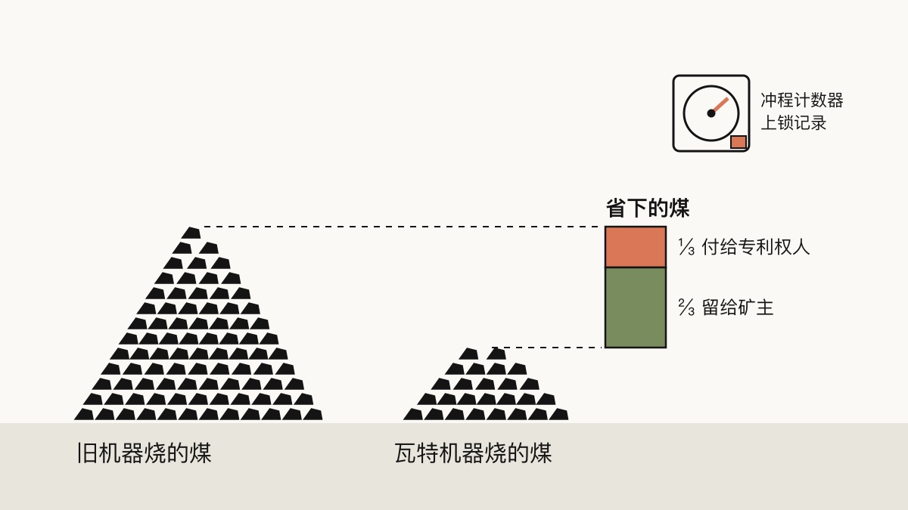

<!-- “风投诞生之前的创业者”系列之一。每条史实都链接到文末的参考条目，参考条目给出定位和原始出处。 -->

1776 年 3 月 22 日，星期五，博斯韦尔（James Boswell）陪约翰逊（Samuel Johnson）到了伯明翰。当天，约翰逊的老同学赫克托（Edmund Hector）带博斯韦尔去看[一个叫 Soho 的地方的工厂](#ref-boswell-soho)，离城大约两英里。工厂主人博尔顿（Matthew Boulton）亲自领他参观。博斯韦尔记下了博尔顿的一句话：

> “I sell here, Sir, what all the world desires to have—POWER.”
>
> （笔者译：先生，我这里卖的，是全世界都想要的东西——动力。）

博斯韦尔还写道，博尔顿手下[“大约有七百人在干活”](#ref-boswell-soho)。他没有说博尔顿指的是哪一样产品。POWER 可以指博尔顿和合伙人瓦特（James Watt）刚开始出售的蒸汽机，也可能只是一句双关。后来的作者，例如 1865 年的斯迈尔斯（Samuel Smiles），[按第一种意思来读](#ref-smiles-boswell-variant)。

本文讲的是这门生意在“创业公司”这个说法出现之前怎样运转。那时没有风险投资基金，没有投资条款清单，也没有 A 轮。有的只是一个负债的发明人，一个拿专利份额抵债的债主，一部议会法案，以及一份只看一个数字的价目表：客户少烧了多少煤。

## 客户手里早有一台费煤的机器

瓦特没有发明蒸汽机。他 1769 年 1 月 5 日获得的专利，保护的是一种[“减少火力机蒸汽和燃料消耗”的方法](#ref-act-1775)。当时的矿主早已用这种“火力机”（fire engine）[把被水淹的矿井抽干](#ref-smiles-bill-1775)。瓦特的改进让同样的活儿花更少的钱。

这一点决定了市场的样子。买主并不是第一次需要动力的人，他们每天都在为煤付钱，瓦特能给他们一张更小的账单。

瓦特的第一位出资人是罗巴克（John Roebuck）。1767 年，罗巴克答应[替瓦特还清大约 1,000 英镑的债务](#ref-smiles-roebuck-1767)，并负担后续实验和申请专利的费用，换取这项发明三分之二的权益。

罗巴克随后想小规模地拉博尔顿入伙。他在 1768 年 12 月 12 日的信里，只肯分给博尔顿[沃里克、斯塔福德和德比三个郡](#ref-boulton-1769-letter)的份额。博尔顿在 1769 年 2 月 7 日给瓦特的回信里拒绝了，这封信读起来很像今天的市场规模论证：

> “It would not be worth my while to make for three counties only; but I find it very well worth my while to make for all the world.”
>
> （笔者译：只为三个郡造机器，不值得我花这份力气；为全世界造，就很值得。）

博尔顿在同一封信里讲了自己想怎么做：在他自己的工厂旁边、[运河边上另建一座制造厂](#ref-boulton-1769-letter)，培训工人，配齐好工具，把发动机做得“便宜 20%”，精度也高得多。他不愿意让一群外行按授权去造质量差的机器，坏了这项发明的名声。

## 一笔坏账换来了三分之二的专利

这对合伙人是从一桩破产开始的。1773 年，罗巴克的生意垮了。他欠博尔顿大约 1,200 英镑，博尔顿[提出拿罗巴克名下三分之二的专利份额抵这笔债](#ref-smiles-roebuck-1773)。据斯迈尔斯记述，债权人觉得这台机器一文不值，瓦特自己也说这是“拿一笔坏账去抵另一笔坏账”。

博尔顿本人也没有把握。他在 1773 年 3 月 29 日写信给瓦特说：[“这东西现在只是个影子，还只存在于想象中”](#ref-smiles-roebuck-1773)，要把它变成真东西，得花时间也得花钱。斯迈尔斯说，博尔顿为这三分之二份额前后付给罗巴克[大约 2,200 英镑](#ref-smiles-roebuck-total)，其中一部分在发动机还没赚钱时就已付清。

博尔顿和瓦特之间的条款，说明了风险由谁来扛。斯迈尔斯引用的一封瓦特来信列出了这些条款：瓦特把[发明的三分之二权益转让给博尔顿](#ref-smiles-partnership)；博尔顿负担议会法案的费用和今后的实验费用，这笔钱“不计利息，沉没不还”；瓦特从利润中取三分之一。用今天的话说，博尔顿既是经营者也是投资人，他用承担成本换来了股份。

博尔顿担得起，是因为 Soho 本身已经是一门大生意。斯迈尔斯记载，博尔顿在 1760 年代为扩建工厂[向朋友借了 5,000 英镑，又以妻子的产业筹了 3,000 英镑](#ref-smiles-soho-capital)；到 1770 年，Soho 雇了[七百到八百人](#ref-smiles-soho-capital)。

## 议会给了这对合伙人二十五年

1769 年的专利期限是[十四年](#ref-act-1775)，到 1783 年就会到期。瓦特担心[整个专利期都过完了](#ref-smiles-bill-1775)，发动机还没有普及，花出去的钱也收不回来。于是两人去找议会要更长的期限。

议案在 [1775 年 2 月 28 日](#ref-smiles-bill-1775)提交议会。矿业利益方喊出“反对垄断”（No monopoly）的口号，斯迈尔斯还点名说伯克（Edmund Burke）是反对者之一。瓦特给议员们印发了一份陈情书（Case），用一个定价论证回应“垄断”的指责：

> “he cannot expect that any person will make use of his contrivance, unless he can prove to them that savings will take place, and that his demand for the privilege of using the invention will amount only to a reasonable part of them.”
>
> （笔者译：除非他能向人们证明确实能省下钱，而且他为使用这项发明所要的报酬只占所省之数的合理一部分，否则他不能指望任何人用他的装置。）

法案在 1775 年通过，把在大不列颠及各殖民地制造、销售这种发动机的独占权授予瓦特，[期限二十五年](#ref-act-1775)。这样一来，独占期从 1783 年延到了 1800 年。

## 两人只收所省燃煤价值的三分之一

瓦特在议会说的那句话，后来就成了价目表。1776 年，他接下法夫郡 Torryburn 煤矿的一台订单，条件是[收取新机器比原有机器所省费用的三分之一](#ref-smiles-torryburn)。

这套条款花了几年才定型。最早在康沃尔装的几台发动机，[安装前并没有谈定条件](#ref-smiles-terms)。等机器把矿井抽干，康沃尔的矿主就不明白自己为什么还要一直付钱：机器是他们买的，归他们所有。瓦特在 1778 年 8 月 29 日写信给博尔顿：

> “Until an engine is ordered, our power is greater than that of the Lord Chancellor.”
>
> （笔者译：发动机订下来之前，我们的权力比大法官还大。）

他要求博尔顿先谈定条件，再动笔画图。此后，公司要求开工前先签书面协议。协议通常规定：发动机由矿主出钱安装；专利权人收取[比普通发动机所省燃料价值的三分之一](#ref-smiles-terms)。

为了量出省了多少，瓦特造了一个[叫“计数器”（Counter）的钟表装置](#ref-smiles-terms)，装在主横梁上，上锁记录冲程次数。公司按这个数字计算做了多少功、省了多少煤。

三分之一并不是铁律。1854 年整理出版瓦特文献的缪尔黑德（J. P. Muirhead）写道，公司对[每天运转不足十二小时的发动机，或者煤价低于每吨四先令的地方](#ref-muirhead-exceptions)另作安排。瓦特自己也向博尔顿抱怨，他们[“只给自己留了三分之一”](#ref-smiles-watt-one-third)，而且为了“应付时局的压力”，这一份后来还降过。

## 用今天的话说，这是按价值、按用量计费

上面几节写的是有据可查的史实，这一节的说法是笔者的解读。

博尔顿和瓦特不按成本定价。他们拿客户心里本来就有数的东西做基准：旧机器的煤钱。客户自己留下三分之二的收益，买不买就很好算。今天这叫**按价值定价**（value-based pricing）。

他们还计量用量。计数器把一句容易扯皮的话（“你这机器没你说的那么省”）变成双方都能读的数字。今天这叫有可信计量表的**按用量计费**（usage-based billing）。

今天最接近的合同形式，是节能绩效合同（energy savings performance contract）。美国联邦法律把它描述为：承包商实施节能措施，[“换取由此节省的能源费用中的一部分”](#ref-doe-espc)。两者有一点不同：节能绩效合同由承包商垫付前期投入；而在康沃尔，矿主既出钱装机器，又付专利费。

最后，这门生意的主体其实是授权。博尔德林（Michele Boldrin）和莱文（David K. Levine）引用经济学家谢勒（F. M. Scherer）的结论：这家公司的利润[大部分来自发动机的使用费](#ref-bl-scherer)，而不是卖零部件；到 1790 年代后期专利快要到期时，公司才转向制造和服务。软件公司在核心专利或其他主要优势快要失效时，也常有类似的转向。

## 几种流行说法经不起查证

**“瓦特发明了蒸汽机。”** 1775 年的法案在序言里就写明，1769 年的专利是为了[“减少火力机蒸汽和燃料消耗”](#ref-act-1775)。机器早已存在，瓦特卖的是改进，而这份改进就是价格的来源。

**“博尔顿是带博斯韦尔看蒸汽机时说的这句话。”** 博斯韦尔原文把名字拼作 “Bolton”，没有提到任何产品，这段记载归在 [1776 年 3 月 22 日星期五](#ref-boswell-soho)的条目下。斯迈尔斯 1865 年引用这句话时，加了博斯韦尔原文里没有的 [“when surveying the works”](#ref-smiles-boswell-variant)（巡视厂房时）几个字，还把拼写改成了 “Boulton”。笔者找到的这句话的出处，只有博斯韦尔这一处。

**“议会把专利延长了二十四年。”** 斯迈尔斯写的是[“二十四年”](#ref-smiles-bill-1775)，法案原文写的是自法案通过起[二十五年](#ref-act-1775)。本文以法案原文为准。

**“客户一律付三分之一。”** 三分之一是标准条款，但康沃尔最早的几台机器没有谈条件，公司有例外，瓦特也说这一份降过。笔者没有找到可靠出处证明每个客户都付同一个固定比例。

**“延长专利成就了工业革命。”** 这是一场争论，不是定论。博尔德林和莱文认为，1769 年、尤其是 1775 年的专利[“很可能推迟了蒸汽机的大规模采用”](#ref-bl-delay)；斯迈尔斯则站在仰慕者的立场，认为瓦特苦干了[“整整十五年”](#ref-smiles-bill-1775)，理应得到回报。本文不对这场争论下结论。

## 创业者可以从 Soho 带走什么

笔者看到四条启发。它们适用于开发者工具、域名，也适用于大多数替代客户现有开支的产品。

1. **拿客户已经在付的账单定价。** 一个能缩短构建时间或降低云开支的开发者工具，可以直接用客户自己的发票说明省了多少。博尔顿和瓦特没有让客户凭信心买单，他们要的是一个买方能自己核对的数字里的一份。
2. **先做计量表，再谈价格。** 计数器本身就是一件产品。客户核对不了用量，每次续约都会变成一场争执。
3. **先谈条件，再交付价值。** 康沃尔的水抽干以后，矿主就没有理由再签字了。瓦特由此学会：条件没盖章，图纸一张不画。
4. **接单之前先算市场有多大。** 罗巴克只给三个郡，博尔顿要的是“全世界”，拿不到就宁可不做。

还有一条提醒。分享收益的定价，只有在客户还相信那条基准线时才行得通。等到没人记得旧机器烧多少煤，专利费看上去就像收租。斯迈尔斯把康沃尔围绕专利费的争吵称作[“一长串争执，直到专利权本身终止才结束”](#ref-smiles-terms)。

## 参考资料

- James Boswell，*Life of Johnson*，George Birkbeck Norman Hill 编，第 2 卷（牛津，1887），Project Gutenberg 电子书 #9072，[“Friday, March 22”（1776 年）条目，伯明翰与 Soho](https://www.gutenberg.org/cache/epub/9072/pg9072-images.html#:~:text=I%20sell%20here%2C%20Sir%2C%20what%20all%20the%20world%20desires%20to%20have)。一手史料。原文：“I shall never forget Mr. Bolton's expression to me: 'I sell here, Sir, what all the world desires to have—POWER.' He had about seven hundred people at work.” 该条目以 “On Friday, March 22, having set out early from Henley … we arrived at Birmingham about nine o'clock” 开头，前后所录书信均署 1776 年 3 月。检索于 2026-11-11；[存档快照 2026-10-28](https://web.archive.org/web/20261028200137/https://www.gutenberg.org/cache/epub/9072/pg9072-images.html)
- 1775 年法案 15 Geo. III c. 61，“An Act for vesting in James Watt, Engineer, … the sole use and property of certain steam engines, commonly called fire engines, of his invention …”，收入 J. P. Muirhead 编，*The Origin and Progress of the Mechanical Inventions of James Watt*，第 3 卷（伦敦，1854），[印刷页 17](https://archive.org/details/india.history.resource.111682/page/n35/mode/1up)（序言复述 1769 年 1 月 5 日专利证书，“for lessening the consumption of steam and fuel in fire engines … for the term of fourteen years”）和[印刷页 22](https://archive.org/details/india.history.resource.111682/page/n40/mode/1up)（在大不列颠及各殖民地 “for and during the term of twenty-five years” 的授权条款）。一手史料（法案文本，1854 年印本）。检索于 2026-11-11；未制作存档快照
- 博尔顿致瓦特，Soho，1769 年 2 月 7 日（第 43 号信），收入 Muirhead 编，*Origin and Progress*，第 1 卷（伦敦，1854），[印刷页 41–42](https://archive.org/details/india.history.resource.111611/page/n342/mode/2up)。一手史料。原文：罗巴克来信 “dated the 12th December, offering me a share … as far as respects the counties of Warwick, Stafford, and Derby”；“my idea was to settle a manufactory near to my own, by the side of our canal”；“20 per cent. cheaper”；“It would not be worth my while to make for three counties only; but I find it very well worth my while to make for all the world.” 检索于 2026-11-11；未制作存档快照
- Samuel Smiles，*Lives of Boulton and Watt*（伦敦：John Murray，1865），第 VIII 章，[第 141 页](https://www.gutenberg.org/cache/epub/52069/pg52069-images.html#Page_141)。二手文献。原文：罗巴克 “in 1767 … undertook to pay debts to the amount of 1000l. which Watt had incurred … In return for this outlay Roebuck was to have two-thirds of the property in the invention.” 检索于 2026-11-11；[电子书条目存档快照 2026-09-07](https://web.archive.org/web/20260907223309/https://www.gutenberg.org/ebooks/52069)
- Smiles，*Lives of Boulton and Watt*，第 X 章，[第 196–197 页](https://www.gutenberg.org/cache/epub/52069/pg52069-images.html#Page_197)，引博尔顿致瓦特，1773 年 3 月 29 日（Boulton MSS）。二手文献引一手信件。原文：“He owed some 1200l. to Boulton, who, rather than claim against the estate, offered to take Roebuck’s two-thirds share in the engine patent in lieu of the debt. The creditors did not value the engine as worth one farthing … ‘paying one bad debt with another.’ … ‘The thing is now a shadow; ’tis merely ideal.’” 检索于 2026-11-11；[电子书条目存档快照 2026-09-07](https://web.archive.org/web/20260907223309/https://www.gutenberg.org/ebooks/52069)
- Smiles，*Lives of Boulton and Watt*，第 XI 章，[第 212 页](https://www.gutenberg.org/cache/epub/52069/pg52069-images.html#Page_212)及注 141。二手文献。原文：“making about 2200l. in all paid by Boulton to Roebuck for his two-thirds of the patent”；注文说博尔顿付清债券 “long before any profits had been derived”。检索于 2026-11-11
- Smiles，*Lives of Boulton and Watt*，第 XII 章注 146，引瓦特致博尔顿信（斯迈尔斯未注日期）。二手文献引一手信件。原文：“1. I to assign to you two-thirds of the property of the invention. 2. You to pay all expenses of the Act … and also the expense of future experiments, which money is to be sunk without interest by you … 4. I to draw one-third of the profits.” [全文](https://www.gutenberg.org/cache/epub/52069/pg52069-images.html#:~:text=I%20to%20assign%20to%20you%20two)。检索于 2026-11-11
- Smiles，*Lives of Boulton and Watt*，第 IX 章，[第 177–179 页](https://www.gutenberg.org/cache/epub/52069/pg52069-images.html#Page_177)。二手文献。原文：“He raised 3000l. on his wife’s estate; he borrowed 5000l. from his friend Baumgarten”；1770 年博尔顿 “described the manufactory at Soho as in full progress, from 700 to 800 persons being employed”。检索于 2026-11-11
- Smiles，*Lives of Boulton and Watt*，第 XI 章，[第 209–212 页](https://www.gutenberg.org/cache/epub/52069/pg52069-images.html#Page_209)。二手文献；长引文出自瓦特 1775 年印发给下院议员的陈情书（Case）。原文：“The mining interest had looked forward to Watt’s invention as a means of … clearing the drowned mines of water”；“he was afraid that the whole term granted by his patent would expire before the engines should have come into general use”；“for fifteen long years”；“The Bill was introduced to Parliament on the 28th of February, 1775”；“the cry of ‘No monopoly’”；“among the most strenuous we find the name of Edmund Burke”；“unless he can prove to them that savings will take place”；“Parliament passed an Act extending Watt’s patent right for the further term of twenty-four years.” 检索于 2026-11-11
- Smiles，*Lives of Boulton and Watt*，第 XII 章，[第 219 页](https://www.gutenberg.org/cache/epub/52069/pg52069-images.html#Page_219)。二手文献。原文：瓦特 “undertook to supply one for the Torryburn Colliery, in Fife, on the terms of receiving one-third of the savings effected by it compared with the engine then at work.” 前后书信署 1776 年。检索于 2026-11-11
- Smiles，*Lives of Boulton and Watt*，第 XIII 章，[第 243–245 页](https://www.gutenberg.org/cache/epub/52069/pg52069-images.html#Page_243)，引瓦特致博尔顿，1778 年 8 月 29 日、9 月 6 日（Boulton MSS）。二手文献引一手信件。原文：“Here was the beginning of a long series of altercations, which ended only with the patent right itself”；“a form of agreement was drawn up and required to be executed before any future engine was commenced. It usually provided …”；“The first Cornish engines were, however, erected without any condition as to terms”；“Until an engine is ordered, our power is greater than that of the Lord Chancellor”；“the patentees were to take … one-third of the value of the fuel saved by it compared with the consumption of the ordinary engine”；“Watt contrived an ingenious piece of clockwork, termed the Counter, which, being attached to the main beam, accurately marked and registered, under lock and key, the number of its vibrations.” 检索于 2026-11-11
- J. P. Muirhead，“Introductory Memoir”，收入 *Origin and Progress*，第 1 卷（伦敦，1854），[印刷页 ccvii](https://archive.org/details/india.history.resource.111611/page/n224/mode/1up)。瓦特文献编者所写的二手文献。原文：许可费 “fixed at only one-third of the savings of fuel … The only exceptions to that rule were in cases where the engine worked less than twelve hours a day, or where coals were cheaper than four shillings a ton.” 检索于 2026-11-11；未制作存档快照
- Smiles，*Lives of Boulton and Watt*，第 XIV 章，[第 279 页](https://www.gutenberg.org/cache/epub/52069/pg52069-images.html#Page_279)，引瓦特致博尔顿信；斯迈尔斯说此信写于合伙满六年之后。二手文献引一手信件。原文：“Have we not given over to them two-thirds of the advantages derivable from its use in the saving of fuel, and reserved only one-third to ourselves, though even that has been still further reduced to meet the pressure of the times?” 检索于 2026-11-11
- Smiles，*Lives of Boulton and Watt*，第 XXIII 章，[第 479 页](https://www.gutenberg.org/cache/epub/52069/pg52069-images.html#Page_479)。二手文献，此处用来记录引文异文。原文：博斯韦尔 “visited Soho in 1776, shortly after the manufacture of steam-engines had been begun there”；“‘I shall never forget,’ he says, ‘Mr. Boulton’s expression to me when surveying the works.’” 请与第一条参考资料中博斯韦尔的原文对照。检索于 2026-11-11
- Michele Boldrin、David K. Levine，*Against Intellectual Monopoly*（Cambridge University Press，2008），[第 1 章，PDF 第 4–5 页](http://www.dklevine.com/papers/imbookfinal01.pdf#page=4)，引 F. M. Scherer（其注 8 引作 Scherer 1984, pp. 24–25，正文则称“1986 examination”）。二手文献转引二手文献。原文：“Most of the firm’s profits were derived from royalties on the use of engines rather than from the sale of manufactured engine components … The alternative would have been to emphasize manufacturing and service activities … which in fact was the policy adopted when the expiration date of the patent for the separate condenser drew near in the late 1790s.” 检索于 2026-11-11；未制作存档快照
- Boldrin、Levine，*Against Intellectual Monopoly*，[第 1 章，PDF 第 3 页](http://www.dklevine.com/papers/imbookfinal01.pdf#page=3)。二手文献，立场为反对专利。原文：“the granting of the 1769 and especially of the 1775 patents likely delayed the mass adoption of the steam engine.” 检索于 2026-11-11；未制作存档快照
- 美国能源部联邦能源管理计划（FEMP），[*Practical Guide to Savings and Payments in FEMP ESPC Task Orders*，Rev. 3（2009 年 1 月），§2，印刷页 1](https://www.energy.gov/sites/prod/files/2013/10/f3/practguide_sav_paymnts.pdf#page=4)，引 42 U.S.C. § 8287(a)(1)。原文：“the contractor shall incur costs of implementing energy savings measures . . . in exchange for a share of any energy savings directly resulting from implementation of such measures.” 检索于 2026-11-11；[存档快照 2026-04-04](https://web.archive.org/web/20260404095350/https://www.energy.gov/sites/prod/files/2013/10/f3/practguide_sav_paymnts.pdf)
