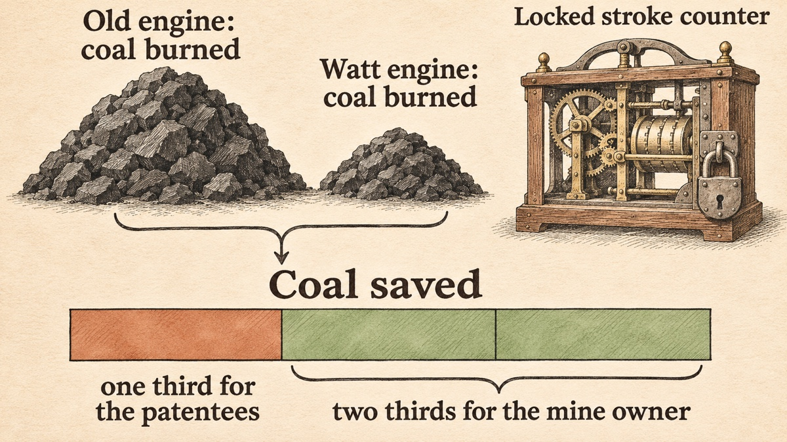

<!-- Part of the "Founders Before VC" series. Every factual claim links to a local reference item; the reference item carries the locator and the original source. -->

On Friday, 22 March 1776, James Boswell arrived in Birmingham with Samuel Johnson. Boswell went with Edmund Hector, an old schoolfellow of Johnson, to see [the works of a manufacturer at a place called Soho](#ref-boswell-soho), about two miles out of town. The owner, Matthew Boulton, showed him around in person. Boswell wrote down one sentence from that visit:

> “I sell here, Sir, what all the world desires to have—POWER.”

Boswell added that Boulton [“had about seven hundred people at work”](#ref-boswell-soho). He did not say which product Boulton meant. The word could refer to the steam engines that Boulton and his partner James Watt had just started to sell, or it could be a pun. Later writers, such as Samuel Smiles in 1865, [took it as the first meaning](#ref-smiles-boswell-variant).

This article is about how that business worked before anyone called it a startup. There was no venture fund, no term sheet and no Series A. There was a broke inventor, a creditor who took a patent instead of cash, an Act of Parliament, and a price list built on one number: how much coal the customer stopped burning.

## The Customers Already Owned Engines That Wasted Fuel

Watt did not invent the steam engine. His patent, granted on 5 January 1769, covered a method [“for lessening the consumption of steam and fuel in fire engines”](#ref-act-1775). Mine owners already used these “fire engines” to [pump water out of drowned mines](#ref-smiles-bill-1775). Watt's improvement made the same work cheaper.

That fact defined the market. The buyer was not a person who needed power for the first time. The buyer already paid for coal every day, and Watt could offer a lower bill.

The first backer was Dr John Roebuck. In 1767 Roebuck [agreed to pay about £1,000 of Watt's debts](#ref-smiles-roebuck-1767) and to fund the experiments and the patent. In return he took two thirds of the invention.

Roebuck then tried to bring in Boulton on a small scale. In a letter of 12 December 1768 he offered Boulton a share that covered only [three counties: Warwick, Stafford and Derby](#ref-boulton-1769-letter). Boulton refused on 7 February 1769. His letter to Watt reads like a modern market-sizing argument:

> “It would not be worth my while to make for three counties only; but I find it very well worth my while to make for all the world.”

In the same letter Boulton described what he would build instead: [a manufactory near his own, beside the canal](#ref-boulton-1769-letter), with trained workmen and tools good enough to make the engine “20 per cent. cheaper” and far more accurate. He did not want licensed amateurs to build bad engines and damage the reputation of the invention.

## A Bad Debt Bought Two Thirds of the Patent

The partnership began with a bankruptcy. In 1773 Roebuck's affairs collapsed. He owed Boulton about £1,200, and Boulton [offered to take Roebuck's two-thirds share of the patent instead of the debt](#ref-smiles-roebuck-1773). According to Samuel Smiles, the creditors did not think the engine was worth a farthing. Watt called the deal “paying one bad debt with another.”

Boulton was not confident either. He wrote to Watt on 29 March 1773 that [“The thing is now a shadow; ’tis merely ideal”](#ref-smiles-roebuck-1773), and that it would cost time and money to make it real. Smiles reports that the final settlement with Roebuck came to [about £2,200 in all](#ref-smiles-roebuck-total), part of it paid long before the engines made any profit.

The terms between Boulton and Watt show who carried the risk. In a letter that Smiles quotes, Watt listed them. Watt assigned Boulton [two thirds of the invention](#ref-smiles-partnership). Boulton paid for the Act of Parliament and for future experiments, and that money was “to be sunk without interest.” Watt took one third of the profits. In today's words, Boulton was both the operator and the investor, and his equity was the price of carrying the costs.

Boulton could do this because Soho was already a large business. Smiles reports that Boulton had [borrowed £5,000 from a friend and raised £3,000 on his wife's estate](#ref-smiles-soho-capital) to grow the works in the 1760s, and that by 1770 Soho employed [from 700 to 800 people](#ref-smiles-soho-capital).

## Parliament Gave the Partners Twenty-Five Years

The 1769 patent ran for [fourteen years](#ref-act-1775), so it would expire in 1783. Watt feared that [the whole term would pass](#ref-smiles-bill-1775) before the engines came into general use and repaid his costs. So the partners asked Parliament for more time.

The Bill went to Parliament on [28 February 1775](#ref-smiles-bill-1775). The mining interest opposed it with the cry “No monopoly,” and Smiles names Edmund Burke among the opponents. In a printed “Case” for the members, Watt answered the monopoly charge with a pricing argument:

> “he cannot expect that any person will make use of his contrivance, unless he can prove to them that savings will take place, and that his demand for the privilege of using the invention will amount only to a reasonable part of them.”

The Act passed in 1775. It vested in Watt the sole right to make and sell the engines in Great Britain and the colonies [for twenty-five years](#ref-act-1775). So the monopoly would now run to 1800 instead of 1783.

## The Partners Charged One Third of the Coal Saved

Watt's sentence to Parliament became the price list. In 1776 he took an order for the Torryburn Colliery in Fife [for one third of the savings compared with the engine already at work](#ref-smiles-torryburn).

The terms took a few years to settle. The first engines in Cornwall [went up without any agreement on terms](#ref-smiles-terms). After they had drained the mines, the Cornish owners did not see why they should keep paying. They had bought the engines, and the engines were theirs. Watt wrote to Boulton on 29 August 1778:

> “Until an engine is ordered, our power is greater than that of the Lord Chancellor.”

He asked Boulton to settle terms before any drawing was made. After that, the firm required a written agreement before work began. The form usually said that the mine owner paid to erect the engine, and that the patentees took [one third of the value of the fuel saved](#ref-smiles-terms) compared with an ordinary engine.

To measure the saving, Watt built [a clockwork “Counter”](#ref-smiles-terms) that was fixed to the main beam. It recorded the number of strokes under lock and key, and the firm calculated the work done and the fuel saved from that count.

The one-third rule was not absolute. John Patrick Muirhead, who edited Watt's papers in 1854, wrote that the firm made exceptions [for engines that worked less than twelve hours a day, or where coal cost less than four shillings a ton](#ref-muirhead-exceptions). Watt himself complained to Boulton that they had [“reserved only one-third to ourselves”](#ref-smiles-watt-one-third), and that even this share had been reduced “to meet the pressure of the times.”

## The Model Looks Like Value-Based, Metered Pricing Today

The facts above are documented. The labels in this section are my interpretation.

Boulton and Watt did not price by cost. They priced by a baseline the customer already knew: the coal bill of the old engine. The customer kept two thirds of the gain, so the purchase was easy to justify. Today we would call this **value-based pricing**.

They also metered the use. The Counter turned a disputed claim (“your engine saves us less than you say”) into a number that both sides could read. Today we would call this **usage-based billing** with a trusted meter.

The closest modern contract is the energy savings performance contract. US federal law describes it as a contract in which the contractor implements energy measures [“in exchange for a share of any energy savings”](#ref-doe-espc). One difference matters. In such a contract the contractor pays the upfront cost. In Cornwall, the mine owners paid to build the engine and then also paid the royalty.

Finally, the business was mostly a licence. Economist F. M. Scherer, as quoted by Michele Boldrin and David Levine, concluded that [most of the firm's profits came from royalties](#ref-bl-scherer) rather than from selling engine parts, and that the firm turned to manufacturing and service as the patent's expiry came near in the late 1790s. Software companies make a similar move when a core patent or other main advantage is about to run out.

## Several Popular Claims Do Not Survive the Sources

**“Watt invented the steam engine.”** The 1775 Act itself recites that the 1769 patent was for [lessening the consumption of steam and fuel in fire engines](#ref-act-1775). The engines existed. Watt sold an improvement, and the improvement was the price.

**“Boulton said it while showing Boswell his steam engines.”** Boswell's text spells the name “Bolton,” gives no product, and dates the visit to the entry for [Friday, 22 March 1776](#ref-boswell-soho). Smiles, in 1865, quotes the line with the words [“when surveying the works”](#ref-smiles-boswell-variant), which are not in Boswell, and changes the spelling to “Boulton.” Boswell's sentence is the only source I found for the quotation.

**“Parliament extended the patent by twenty-four years.”** Smiles says [“twenty-four years”](#ref-smiles-bill-1775). The text of the Act says [twenty-five years](#ref-act-1775) from its passing. I follow the Act.

**“Customers always paid one third.”** The one-third share was the standard term, but the first Cornish engines had no terms, the firm made exceptions, and Watt said the share was reduced. I did not find a reliable source for a single fixed royalty paid by every customer.

**“The patent extension made the Industrial Revolution possible.”** This is a debate, not a fact. Boldrin and Levine argue that the 1769 and especially the 1775 patents [“likely delayed the mass adoption of the steam engine”](#ref-bl-delay). Smiles, writing as an admirer, argues that Watt deserved a reward for [“fifteen long years”](#ref-smiles-bill-1775) of work. I do not settle the debate here.

## What a Founder Can Take from Soho

I see four lessons. They apply to developer tools, to domain names, and to most products that replace something the customer already pays for.

1. **Price against the bill the customer already pays.** A developer tool that cuts build minutes or cloud spend can quote the saving in the customer's own invoice. Boulton and Watt did not ask for faith. They asked for a share of a number the buyer could check.
2. **Build the meter before you argue about the price.** The Counter was a product in its own right. If the customer cannot verify usage, every renewal becomes a dispute.
3. **Agree the terms before you deliver the value.** After the Cornish pumps had drained the mines, the owners had no reason to sign. Watt learned to make no drawing until the terms were sealed.
4. **Size the market before you take the deal.** Roebuck offered three counties. Boulton wanted “all the world,” and he walked away until he could get it.

There is also a warning. A gain-sharing price works only while the customer believes the baseline. When the baseline is old enough that nobody remembers it, the royalty starts to look like rent. Smiles calls the Cornish quarrel over the dues [“a long series of altercations, which ended only with the patent right itself”](#ref-smiles-terms).

## References

- James Boswell, *Life of Johnson*, ed. George Birkbeck Norman Hill, vol. 2 (Oxford, 1887), Project Gutenberg eBook #9072 — [entry for “Friday, March 22” (1776), Birmingham and Soho](https://www.gutenberg.org/cache/epub/9072/pg9072-images.html#:~:text=I%20sell%20here%2C%20Sir%2C%20what%20all%20the%20world%20desires%20to%20have). Primary source. Supporting passage: “I shall never forget Mr. Bolton's expression to me: 'I sell here, Sir, what all the world desires to have—POWER.' He had about seven hundred people at work.” The entry opens “On Friday, March 22, having set out early from Henley … we arrived at Birmingham about nine o'clock”; the surrounding letters are dated March 1776. — fetched 2026-11-11; [archive snapshot 2026-10-28](https://web.archive.org/web/20261028200137/https://www.gutenberg.org/cache/epub/9072/pg9072-images.html)
- Act 15 Geo. III c. 61 (1775), “An Act for vesting in James Watt, Engineer, … the sole use and property of certain steam engines, commonly called fire engines, of his invention …”, printed in J. P. Muirhead (ed.), *The Origin and Progress of the Mechanical Inventions of James Watt*, vol. 3 (London, 1854), [printed p. 17](https://archive.org/details/india.history.resource.111682/page/n35/mode/1up) (preamble reciting the letters patent of 5 January 1769 “for lessening the consumption of steam and fuel in fire engines … for the term of fourteen years”) and [printed p. 22](https://archive.org/details/india.history.resource.111682/page/n40/mode/1up) (the grant “for and during the term of twenty-five years” within Great Britain and the colonies). Primary source (statute text, 1854 printing). — fetched 2026-11-11; no archive snapshot made
- Matthew Boulton to James Watt, Soho, 7 February 1769 (letter No. 43), printed in Muirhead (ed.), *Origin and Progress*, vol. 1 (London, 1854), [printed pp. 41–42](https://archive.org/details/india.history.resource.111611/page/n342/mode/2up). Primary source. Supporting passages: Roebuck's letter “dated the 12th December, offering me a share … as far as respects the counties of Warwick, Stafford, and Derby”; “my idea was to settle a manufactory near to my own, by the side of our canal”; “20 per cent. cheaper”; “It would not be worth my while to make for three counties only; but I find it very well worth my while to make for all the world.” — fetched 2026-11-11; no archive snapshot made
- Samuel Smiles, *Lives of Boulton and Watt* (London: John Murray, 1865), ch. VIII, [p. 141](https://www.gutenberg.org/cache/epub/52069/pg52069-images.html#Page_141). Secondary source. Supporting passage: Roebuck “in 1767 … undertook to pay debts to the amount of 1000l. which Watt had incurred … In return for this outlay Roebuck was to have two-thirds of the property in the invention.” — fetched 2026-11-11; [archive snapshot of the eBook record, 2026-09-07](https://web.archive.org/web/20260907223309/https://www.gutenberg.org/ebooks/52069)
- Smiles, *Lives of Boulton and Watt*, ch. X, [pp. 196–197](https://www.gutenberg.org/cache/epub/52069/pg52069-images.html#Page_197), citing Boulton to Watt, 29 March 1773 (Boulton MSS). Secondary source quoting a primary letter. Supporting passage: “He owed some 1200l. to Boulton, who, rather than claim against the estate, offered to take Roebuck’s two-thirds share in the engine patent in lieu of the debt. The creditors did not value the engine as worth one farthing … ‘paying one bad debt with another.’ … ‘The thing is now a shadow; ’tis merely ideal.’” — fetched 2026-11-11; [archive snapshot of the eBook record, 2026-09-07](https://web.archive.org/web/20260907223309/https://www.gutenberg.org/ebooks/52069)
- Smiles, *Lives of Boulton and Watt*, ch. XI, [p. 212](https://www.gutenberg.org/cache/epub/52069/pg52069-images.html#Page_212) and note 141. Secondary source. Supporting passage: “making about 2200l. in all paid by Boulton to Roebuck for his two-thirds of the patent”; the note says Boulton paid the bonds “long before any profits had been derived.” — fetched 2026-11-11
- Smiles, *Lives of Boulton and Watt*, ch. XII, note 146, quoting Watt to Boulton (undated in Smiles). Secondary source quoting a primary letter. Supporting passage: “1. I to assign to you two-thirds of the property of the invention. 2. You to pay all expenses of the Act … and also the expense of future experiments, which money is to be sunk without interest by you … 4. I to draw one-third of the profits.” [Full text](https://www.gutenberg.org/cache/epub/52069/pg52069-images.html#:~:text=I%20to%20assign%20to%20you%20two). — fetched 2026-11-11
- Smiles, *Lives of Boulton and Watt*, ch. IX, [pp. 177–179](https://www.gutenberg.org/cache/epub/52069/pg52069-images.html#Page_177). Secondary source. Supporting passages: “He raised 3000l. on his wife’s estate; he borrowed 5000l. from his friend Baumgarten”; in 1770 Boulton “described the manufactory at Soho as in full progress, from 700 to 800 persons being employed.” — fetched 2026-11-11
- Smiles, *Lives of Boulton and Watt*, ch. XI, [pp. 209–212](https://www.gutenberg.org/cache/epub/52069/pg52069-images.html#Page_209). Secondary source; the long quotation is from Watt's printed “Case” for members of the House of Commons (1775). Supporting passages: “The mining interest had looked forward to Watt’s invention as a means of … clearing the drowned mines of water”; “he was afraid that the whole term granted by his patent would expire before the engines should have come into general use”; “for fifteen long years”; “The Bill was introduced to Parliament on the 28th of February, 1775”; “the cry of ‘No monopoly’”; “among the most strenuous we find the name of Edmund Burke”; “unless he can prove to them that savings will take place”; “Parliament passed an Act extending Watt’s patent right for the further term of twenty-four years.” — fetched 2026-11-11
- Smiles, *Lives of Boulton and Watt*, ch. XII, [p. 219](https://www.gutenberg.org/cache/epub/52069/pg52069-images.html#Page_219). Secondary source. Supporting passage: Watt “undertook to supply one for the Torryburn Colliery, in Fife, on the terms of receiving one-third of the savings effected by it compared with the engine then at work.” The surrounding letters are dated 1776. — fetched 2026-11-11
- Smiles, *Lives of Boulton and Watt*, ch. XIII, [pp. 243–245](https://www.gutenberg.org/cache/epub/52069/pg52069-images.html#Page_243), citing Watt to Boulton, 29 August 1778 and 6 September 1778 (Boulton MSS). Secondary source quoting primary letters. Supporting passages: “Here was the beginning of a long series of altercations, which ended only with the patent right itself”; “a form of agreement was drawn up and required to be executed before any future engine was commenced. It usually provided …”; “The first Cornish engines were, however, erected without any condition as to terms”; “Until an engine is ordered, our power is greater than that of the Lord Chancellor”; owners erect the engine at their expense and “the patentees were to take … one-third of the value of the fuel saved by it compared with the consumption of the ordinary engine”; “Watt contrived an ingenious piece of clockwork, termed the Counter, which, being attached to the main beam, accurately marked and registered, under lock and key, the number of its vibrations.” — fetched 2026-11-11
- J. P. Muirhead, “Introductory Memoir,” in *Origin and Progress*, vol. 1 (London, 1854), [printed p. ccvii](https://archive.org/details/india.history.resource.111611/page/n224/mode/1up). Secondary source by the editor of Watt's papers. Supporting passage: the licence was “fixed at only one-third of the savings of fuel … The only exceptions to that rule were in cases where the engine worked less than twelve hours a day, or where coals were cheaper than four shillings a ton.” — fetched 2026-11-11; no archive snapshot made
- Smiles, *Lives of Boulton and Watt*, ch. XIV, [p. 279](https://www.gutenberg.org/cache/epub/52069/pg52069-images.html#Page_279), quoting a letter from Watt to Boulton written, by Smiles's account, after the partnership had run six years. Secondary source quoting a primary letter. Supporting passage: “Have we not given over to them two-thirds of the advantages derivable from its use in the saving of fuel, and reserved only one-third to ourselves, though even that has been still further reduced to meet the pressure of the times?” — fetched 2026-11-11
- Smiles, *Lives of Boulton and Watt*, ch. XXIII, [p. 479](https://www.gutenberg.org/cache/epub/52069/pg52069-images.html#Page_479). Secondary source, used here to document a variant. Supporting passages: Boswell “visited Soho in 1776, shortly after the manufacture of steam-engines had been begun there”; “‘I shall never forget,’ he says, ‘Mr. Boulton’s expression to me when surveying the works.’” Compare Boswell's own text in the first reference. — fetched 2026-11-11
- Michele Boldrin and David K. Levine, *Against Intellectual Monopoly* (Cambridge University Press, 2008), [ch. 1, PDF pp. 4–5](http://www.dklevine.com/papers/imbookfinal01.pdf#page=4), quoting F. M. Scherer (their note 8 cites Scherer 1984, pp. 24–25; their text calls it his “1986 examination”). Secondary source quoting a secondary source. Supporting passage: “Most of the firm’s profits were derived from royalties on the use of engines rather than from the sale of manufactured engine components … The alternative would have been to emphasize manufacturing and service activities … which in fact was the policy adopted when the expiration date of the patent for the separate condenser drew near in the late 1790s.” — fetched 2026-11-11; no archive snapshot made
- Boldrin and Levine, *Against Intellectual Monopoly*, [ch. 1, PDF p. 3](http://www.dklevine.com/papers/imbookfinal01.pdf#page=3). Secondary source; a polemic against patents. Supporting passage: “the granting of the 1769 and especially of the 1775 patents likely delayed the mass adoption of the steam engine.” — fetched 2026-11-11; no archive snapshot made
- US Department of Energy, Federal Energy Management Program, [*Practical Guide to Savings and Payments in FEMP ESPC Task Orders*, Rev. 3 (January 2009), §2, printed p. 1](https://www.energy.gov/sites/prod/files/2013/10/f3/practguide_sav_paymnts.pdf#page=4), quoting 42 U.S.C. § 8287(a)(1). Supporting passage: “the contractor shall incur costs of implementing energy savings measures . . . in exchange for a share of any energy savings directly resulting from implementation of such measures.” — fetched 2026-11-11; [archive snapshot 2026-04-04](https://web.archive.org/web/20260404095350/https://www.energy.gov/sites/prod/files/2013/10/f3/practguide_sav_paymnts.pdf)
