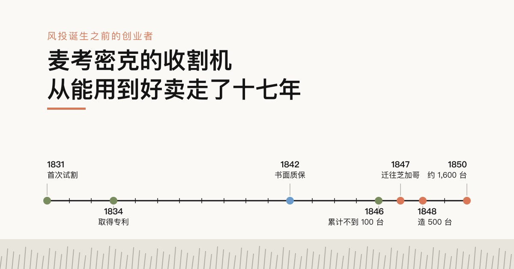

这一系列写的是风险投资还没有成为一个行业之前的创业者。每一篇问同样几个问题：当时的市场是什么样子，创业者实际做了什么，这些做法放到今天的创业语境里该叫什么名字。

说起赛勒斯·麦考密克（Cyrus McCormick），人们通常记得他“发明了收割机”。档案里的故事要慢得多，也有用得多。他的机器 1831 年第一次割下庄稼；到 1846 年底，他一共只卖出[不到 100 台](#ref-whs-bio-sales)。搬到芝加哥之后，不到两个收获季，他的工厂就按几百台的规模造收割机了。麦考密克生涯里最值得看的，正是中间这一段，以及他怎样把这段距离走完。

## 能割麦子的机器，还不是能卖的产品

1831 年 7 月下旬，麦考密克的机器在弗吉尼亚州罗克布里奇县（Rockbridge County）一位邻居的地里割了[大约六英亩燕麦](#ref-hutchinson-p83-steele)。当时没有报纸报道这次试割。传记作者哈钦森（William T. Hutchinson）为写 1930 年出版的传记通读过麦考密克家族的档案，他承认[没有重要的同时代记录留下来](#ref-hutchinson-p79-sources)：那个夏天的经过，是靠 1848 年的证词拼起来的，其中不少证词是宣誓后作出的，还受过竞争对手的交叉询问。后来被回忆为在场的人里，有麦考密克家[奴役的乔·安德森（Jo Anderson）和安东尼（Anthony）](#ref-hutchinson-p83-anderson)，机器在地里哐当作响的时候，是他们拉住了马。

接下来的十几年，麦考密克自己说得很直白。1851 年，英国评审员皮由兹（Philip Pusey）请他写一段经历，他写道：[“1840 年以前一台机器也没卖出去”](#ref-jury-p231-statement)，而且“直到 1845 年第二项专利的改进之后，机器才有多少实用价值”。他也点出了进展缓慢的原因：收割机的发明人[每年只有收获季那几个星期](#ref-jury-p231-statement)可以试验。设计上的每一个毛病，都要等上整整一年才能再试。

市场本身也难。农民见过太多[“纸上完美”](#ref-hutchinson-p335-guarantee)、一下地就失灵的收割机。买主还得学会磨刀、调拨禾轮、把割下的麦子从平台上耙下来，所以卖机器的人既要推销，也要教学。麦考密克也不是独一家。辛辛那提的胡赛（Obed Hussey）拿到了一项收割机专利，日期是 [1833 年 12 月 31 日](#ref-patent-hussey)；麦考密克自己的专利日期是 [1834 年 6 月 21 日](#ref-patent-mccormick-1834)。

制造也是问题。1845 年，麦考密克授权外州的作坊按他的设计造收割机。哈钦森对那一季的总结是：这些制造商[没有履行合同](#ref-hutchinson-p224-licensees)，做出来的机器质量差，交货又迟。

## 第一招：把风险从农民身上拿走

1842 年以前，麦考密克[不对收割机的性能作担保](#ref-hutchinson-p335-guarantee)。1841 年收获季之后，他改了做法。他在广告里说，1842 年的机器如果不够结实耐用，或者一天割不到十五英亩、每英亩不能比用摇篮镰少掉一蒲式耳麦粒，买主可以[退货](#ref-hutchinson-p336-warranty)。

付款条件也在同步放宽。按哈钦森对当年广告的梳理，到 1842 年收获季结束为止，通常要[货到付现](#ref-hutchinson-p337-terms)，一般价格是在自家农场交货 100 美元。1843 年和 1844 年，他给四个月的赊期。1846 年，他表示愿意“凭附息票据赊销”。到 1847 年，价格是现金 115 美元、赊购 120 美元。McCormick, Ogden & Co. 1849 年的一张海报写得最清楚：[交货时付 30 美元，余款 12 月 1 日付清](#ref-hutchinson-p337-terms)，从 7 月 1 日起按 6% 计息。

12 月 1 日这个日子在收获之后。中西部的种粮户常常靠[卖玉米和猪肉](#ref-hutchinson-p368-collections)筹钱，偿付收割机票据。也就是说，农民在机器干完活之后才付清尾款。

用今天的话说，这是风险逆转（risk reversal）加上与客户现金流匹配的融资：一份写明性能指标的免费试用，外加客户拿到价值之后才到期的付款。这套做法的代价，今天的创业者也不陌生：回款又慢又不均匀。哈钦森写道，每个收获季之后都[拖欠着数以千计的美元](#ref-hutchinson-p369-borrowing)，麦考密克常常要在芝加哥或纽约借钱维持工厂运转，全靠每台机器的高利润，生意才撑得下去。他手下也有代理商不喜欢这份质保。一位代理商在 1854 年写道，[“在质保之下做生意，是毁掉任何一种机器名声的必由之路”](#ref-hutchinson-p336-agent-complaint)，因为农民一遇到小毛病就不肯再用下去。

## 第二招：把工厂建在客户身边

伊利诺伊和威斯康星的农民对收割机的[欢迎程度超过任何其他地区](#ref-hutchinson-p251-chicago)。伊利诺伊夹在五大湖和密西西比河之间，机器既可以走水路往东运，也可以顺流运往南方和西部。哈钦森也指出，选中芝加哥在当时[并不是一目了然的事](#ref-hutchinson-p250-why)：麦考密克此前更看好布罗克波特（Brockport）、罗切斯特、匹兹堡或辛辛那提。

1847 年 8 月 30 日，麦考密克与芝加哥的制造商[格雷（Charles M. Gray）合伙](#ref-hutchinson-p259-gray)。这次合伙最后闹上了法庭，但数字很清楚：为 1848 年收获季造的 500 台收割机，[只剩 13 台没卖掉](#ref-hutchinson-p263-1848)。那一年麦考密克从芝加哥生意中得到的净收益[似乎超过 3 万美元](#ref-hutchinson-p265-profit)。新公司计划为 1849 年[造 1,500 台](#ref-hutchinson-p265-profit)，1850 年实际造了[大约 1,600 台](#ref-hutchinson-p268-1850)。1851 年，麦考密克告诉皮由兹，销量[“现在每年一千多台”](#ref-jury-p231-statement)。

搬到芝加哥一举两得：生产贴近了[迅速西移](#ref-hutchinson-p251-chicago)的小麦产区，他也不再依赖那些他检查不了出品质量的授权制造商。直到 1855 年，芝加哥工厂每年出产的收割机里，仍有[四分之三卖在伊利诺伊、威斯康星、艾奥瓦和密苏里](#ref-hutchinson-p352-agents)四个州。

## 第三招：代理商负责装机，也负责收钱

1843 年以前，收割机[只由麦考密克家里人推销](#ref-hutchinson-p350-family)。第一批正式雇用的代理商[出现在 1845 年](#ref-hutchinson-p351-first-agents)。搬到芝加哥之后，代理网络迅速扩张，到 1855 年以前已经[覆盖了美国大多数州和加拿大](#ref-hutchinson-p352-agents)。

1849 年与皮奥里亚（Peoria）的 Phelps & Bourland 签的合同，可以看出麦考密克对代理商的要求。他们要在冬春两季跑遍指定的产麦县，只向“可靠、守信的农民”推销，并且[负责组装、启动机器并让它下地干活](#ref-hutchinson-p356-contract)；现金首付由他们收取，农民的票据也由他们收回。公司每卖出一台付 6 美元，但佣金取决于回款：一台机器如果[只收回 55 美元或更少](#ref-hutchinson-p357-commission)，这一单代理商一分钱也拿不到。

服务是这套体系的一部分。代理商手里有备件，收割机坏了，农民不必在收获季中途往芝加哥寄信等零件。1853 年，麦考密克的机器因为齿轮有毛病而工作不良，第二年冬天，公司给[每一位买主免费寄去替换件](#ref-hutchinson-p364-service)。工厂还在冬天派机械师下乡，赶在下一季之前把机器修好。哈钦森称这套代理体系[“在当时没有先例”](#ref-hutchinson-p364-service)。这是他的评价，并不是有文献证明的“第一”。

今天的说法是渠道伙伴（channel partner）加客户成功（customer success）。最值得照搬的是激励设计：代理商的佣金跟着收回的现金走。

## 第四招：田间比赛和奖牌，以及“跑分”的局限

收割机厂商靠公开比赛争夺注意力。人群跟着机器在麦田里走，有时还有乐队助阵，赢家会把结果[写进下一季的海报](#ref-hutchinson-p339-trials)。哈钦森自己的结论是：作为比较两台收割机优劣的公平测试，这类比赛[“是失败的”](#ref-hutchinson-p339-trials)。比赛时间短，意外常常决定胜负，参赛的样机又由训练有素的人马驾驶。

麦考密克和胡赛的第一次比赛在 1843 年。评委公布的措辞是：[“委员会很难在两者之间作出取舍，但总体而言，更偏向麦考密克的机器”](#ref-hutchinson-p341-1843)。1848 年，芝加哥机械学会（Chicago Mechanics' Institute）把金奖颁给了麦考密克的对手埃斯特利（George Esterly），而评审委员会自己承认，[委员中没有一个人在田里见过任何一台参赛机器干活](#ref-hutchinson-p347-esterly)。麦考密克发公开信反驳，埃斯特利再回敬，报纸两边都登。

也有更隐蔽的推广。1854 年，艾奥瓦的一位代理商以优惠价把收割机卖给杜比克县农业协会的会长洛弗尔法官，并许诺他每帮忙卖出一台就[给他五美元](#ref-hutchinson-p345-lovell)。按这位代理商的说法，法官“并不以代理商的身份为人所知”。放到今天，这就是没有披露的付费代言。

最大的舞台是 1851 年伦敦万国博览会。官方评审报告记载，麦考密克的“收割机”[获得了一枚议会奖章（Council Medal）](#ref-jury-p241-medal)。同一份报告也说明，这枚奖章能证明的东西，比海报上暗示的要少。撰写报告的皮由兹写道：在蒂普特里庄园（Tiptree Hall）的第一次试割时麦子还青，所以评审团特地获准，如果两台机器都够格，就[颁发两枚议会奖章，各给一台](#ref-jury-p232-trials)。麦考密克的机器表现很好，拿到了奖章；胡赛的机器被堵住了。接着皮由兹补充说，后来的试验中胡赛的机器表现良好，按他个人的意见，那台机器[也配得上一枚议会奖章](#ref-jury-p232-trials)。

比赛是营销，麦考密克是个营销高手。可是作为证据，比赛很弱。今天的大多数跑分（benchmark）也是这样。

## 几种流行说法经不起查证

**“奥格登欢迎麦考密克来芝加哥，并投了 2.5 万美元。”** 卡森（Herbert Casson）1909 年的传记里，奥格登（William B. Ogden）对麦考密克说：[“我出 25,000 美元买一半股份”](#ref-casson-ogden)。哈钦森依据麦考密克起诉格雷一案的诉讼文书写道，这个传说[“毫无事实根据”](#ref-hutchinson-p266-ogden)。奥格登是 1848 年 1 月经格雷介绍入股的，[麦考密克事先并不知情](#ref-hutchinson-p263-1848)。麦考密克、奥格登和琼斯（William E. Jones）三人的合伙只维持了一个收获季。1849 年 9 月 10 日，奥格登和琼斯以 [65,000 美元把股份卖给了麦考密克](#ref-hutchinson-p266-ogden)。

**“麦考密克发明了收割机。”** 他取得了一项收割机专利，而他的对手更早取得专利：胡赛的专利[日期是 1833 年 12 月 31 日](#ref-patent-hussey)，比麦考密克早大约半年。麦考密克的“发明在先”依据的是 1831 年的那次试割，而那次试割只见于后来的证词。1848 年，胡赛本人也[承认麦考密克在 1831 年收获季就已经让收割机下地干活](#ref-hutchinson-p79-sources)。家族内部对功劳也有争议。赛勒斯的弟弟利安德（Leander McCormick）后来力挺父亲罗伯特（Robert McCormick）才是发明人。他在 1898 年写道：[“请放心，我哥哥 C. H. 不是它的发明人，但还是别用我的名字”](#ref-hutchinson-p123-leander)。哈钦森站在赛勒斯一边，但读者应当知道，他的研究是在麦考密克家族自己的档案里做的。

**“退款保证是麦考密克首创的革命性做法。”** 卡森称这一做法[“在当时是新颖而革命性的”](#ref-casson-guarantee)。可是胡赛在 1844 年就[担保他的收割机一天能割二十英亩](#ref-hutchinson-p336-warranty)，埃斯特利也是[带着担保和推荐信](#ref-hutchinson-p347-esterly)来卖机器的。麦考密克把质保用得很好，但我没有找到可靠出处证明他是第一个。

**“第一次田间比赛是 1844 年在里士满附近。”** 卡森把它[定在 1844 年](#ref-casson-field-test)。哈钦森引 1843 年 7 月 4 日的《里士满问询报》（*Richmond Enquirer*），把麦考密克与胡赛的第一次比赛定在 [1843 年](#ref-hutchinson-p341-1843)。

**“麦考密克发明了分期付款销售。”** 麦考密克从 1843 年起赊销，从 1846 年起附息赊销，[前文已经引过](#ref-hutchinson-p337-terms)。但我没有找到可靠出处证明他是第一个这样做的制造商，所以正文不采用这个说法。

## 今天的创业者可以从中拿走什么

麦考密克没有现代意义上的投资人。他的钱来自格雷、奥格登、琼斯这样的合伙人，来自授权制造商交的专利费，也来自借款。哈钦森提到，农民还欠着收割机钱的时候，麦考密克常常要借钱维持工厂运转。每赊出一台机器，占用的都是他自己借来的钱。

麦考密克的做法里，有几条适用于任何向怀疑的用户推销新工具的人，开发者工具也不例外：

- **原型能用，只是工作的开始。** 麦考密克的机器 1831 年就能割麦，市场到 1845 年以后才来。
- **把承诺写下来，并且可以测量。** “一天十五英亩”是农民自己就能核对的指标。
- **把付款时间放在客户拿到价值之后。** 对农民来说是收获之后；对很多软件产品来说，是用量发生之后，或者在生产环境里第一次见效之后。
- **按回款和留存给渠道付钱，而不是按签单。**
- **把跑分和奖项当作注意力，而不是证明。** 1851 年的评审报告自己就说，没拿到奖章的那台收割机也是好机器。
- **教学也是销售的一部分。** 麦考密克从 1842 年起就随机器附上[印刷的使用说明](#ref-hutchinson-p358-directions)。

对卖名字、域名，或者其他要等买主用起来才见价值的工具的创业者来说，问题是同一个：你的产品写成文字的“一天十五英亩”是什么？你的客户什么时候才算“收完麦子”？

## 关于出处的说明

本文的主要二手来源是哈钦森《赛勒斯·霍尔·麦考密克》第一卷（1930）。哈钦森用的是麦考密克历史协会（McCormick Historical Association）的档案，这批档案后来转给了威斯康星历史学会（Wisconsin Historical Society）。他在书中引用并注明了当年的广告、信件、合同和诉讼文书，本文注出他的页码；这些原件我没有亲自核对。卡森 1909 年的传记只在它是某个流行说法的出处时才引用。我直接读过的一手材料是两份专利和 1852 年出版的万国博览会《评审团报告》。

## 参考资料

- Wisconsin Historical Society，[“A Brief Biography of Cyrus Hall McCormick (1809–1884)”](https://web.archive.org/web/20260316154720/https://www.wisconsinhistory.org/Records/Article/CS3399)，历史随笔，第 3 段：“By the end of 1846, however, he had sold fewer than 100 machines.” 第 4 段：1847 年迁往芝加哥。原网址（`https://www.wisconsinhistory.org/Records/Article/CS3399`）在 2026-11-11 返回 404，链接指向 2026-03-16 的 Wayback 存档。检索于 2026-11-11。
- William T. Hutchinson，*Cyrus Hall McCormick: Seed-Time, 1809–1856*（New York: Century, 1930），[第 79 页](https://archive.org/details/cyrushallmccormi007444mbp/page/79/mode/1up)：“no important contemporary record survives”；多年后的证词常经宣誓并受对手交叉询问；胡赛“admitted to the United States Patent Extension Board in 1848 that his most feared competitor had first operated his reaper in the harvest of 1831.” Internet Archive 扫描本，检索于 2026-11-11。
- Hutchinson，*Seed-Time*，[第 83 页](https://archive.org/details/cyrushallmccormi007444mbp/page/83/mode/1up)：“the machine cut about six acres of oats on the neighboring farm of John Steele in late July, 1831.” 检索于 2026-11-11。
- Hutchinson，*Seed-Time*，[第 83 页注 29](https://archive.org/details/cyrushallmccormi007444mbp/page/83/mode/1up)，引 W. J. Hanna 1885 年的访谈笔记：“‘Old Joe’ Anderson, and Anthony, slaves of Cyrus and Robert McCormick, held the horses.” 检索于 2026-11-11。
- Hutchinson，*Seed-Time*，[第 123 页](https://archive.org/details/cyrushallmccormi007444mbp/page/123/mode/1up)：利安德·麦考密克 1898 年 6 月 2 日致 Henry F. Mann：“Rest assured that my Brother C. H. was not its [the reaper's] inventor, but again don't use my name.” 检索于 2026-11-11。
- Hutchinson，*Seed-Time*，[第 224 页](https://archive.org/details/cyrushallmccormi007444mbp/page/224/mode/1up)：1845 年收获季之后，“The failure of his manufacturers to fulfil their contracts, the poor construction of the machines … and the tardiness with which this defective output was placed upon the market.” 检索于 2026-11-11。
- Hutchinson，*Seed-Time*，[第 250 页](https://archive.org/details/cyrushallmccormi007444mbp/page/250/mode/1up)：“the reasons which led him to choose Chicago … are not at once apparent”；此前布罗克波特、罗切斯特、匹兹堡和辛辛那提都曾被他看好。检索于 2026-11-11。
- Hutchinson，*Seed-Time*，[第 251 页](https://archive.org/details/cyrushallmccormi007444mbp/page/251/mode/1up)：“The people of Illinois and Wisconsin had given the reaper a more cordial reception than those of any other section”；伊利诺伊是“an isthmus between the Great Lakes … and the Mississippi”；小麦主产区“had recently moved westward very rapidly”。检索于 2026-11-11。
- Hutchinson，*Seed-Time*，[第 259 页](https://archive.org/details/cyrushallmccormi007444mbp/page/259/mode/1up)：“the inventor entered a partnership with Gray on August 30, 1847.” 检索于 2026-11-11。
- Hutchinson，*Seed-Time*，[第 263 页](https://archive.org/details/cyrushallmccormi007444mbp/page/263/mode/1up)：格雷“about mid-January, 1848”找到奥格登和 William E. Jones；麦考密克称自己“knew nothing of this deal until late July, 1848”；“All but thirteen of the five hundred reapers were sold that season.” 依据麦考密克在 *McCormick v. Gray and Ogden* 一案中的起诉状。检索于 2026-11-11。
- Hutchinson，*Seed-Time*，[第 265 页](https://archive.org/details/cyrushallmccormi007444mbp/page/265/mode/1up)：“McCormick's net return from the Chicago enterprise seems to have exceeded $30,000”；1848 年 10 月 7 日的 *Gem of the Prairie* 宣布成立 McCormick, Ogden & Co.，“fifteen hundred reapers were to be made for the harvest of 1849.” 检索于 2026-11-11。
- Hutchinson，*Seed-Time*，[第 266 页](https://archive.org/details/cyrushallmccormi007444mbp/page/266/mode/1up)：“The tradition that Ogden welcomed the inventor to Chicago and that the latter sought a partnership with him, has no basis of fact”；“On September 10, 1849, Ogden and Jones sold out to McCormick for $65,000.” 检索于 2026-11-11。
- Hutchinson，*Seed-Time*，[第 268 页](https://archive.org/details/cyrushallmccormi007444mbp/page/268/mode/1up)：“About sixteen hundred reapers were made for the harvest of 1850”；注 45 指出关于售出数量的证词互相矛盾。检索于 2026-11-11。
- Hutchinson，*Seed-Time*，[第 335 页](https://archive.org/details/cyrushallmccormi007444mbp/page/335/mode/1up)：“So many reapers had seemed perfect on paper and had proved to be worthless in practice”；“Prior to 1842, Cyrus McCormick did not warrant the performance of his reaper.” 检索于 2026-11-11。
- Hutchinson，*Seed-Time*，[第 336 页](https://archive.org/details/cyrushallmccormi007444mbp/page/336/mode/1up)：1841 年之后，1842 年的机器如果不能“cut fifteen acres a day and save one bushel of wheat per acre”即可退货；“In 1844, Hussey warranted his reaper to cut twenty acres a day.” 检索于 2026-11-11。
- Hutchinson，*Seed-Time*，[第 336 页注 24](https://archive.org/details/cyrushallmccormi007444mbp/page/336/mode/1up)，引里士满代理商 H. M. Smith 1854 年 8 月 18 日的信：“To work under a guarantee is a sure mode to kill the reputation of any machine.” 检索于 2026-11-11。
- Hutchinson，*Seed-Time*，[第 337 页](https://archive.org/details/cyrushallmccormi007444mbp/page/337/mode/1up)：1842 年收获季以前货到付现；“$100 at Walnut Grove”；1843、1844 年赊期四个月；1846 年“on time for good paper drawing interest”；1847 年“$115 cash or $120 on time”。注 31：McCormick, Ogden & Co. 1849 年海报，“$115 cash, or $120 when $30 is paid on delivery and balance on Dec. 1, 6% interest from July 1.” 检索于 2026-11-11。
- Hutchinson，*Seed-Time*，[第 338–339 页](https://archive.org/details/cyrushallmccormi007444mbp/page/339/mode/1up)：田间比赛有乐队和人群；赢家把结果写进“his advertisements and posters for the next harvest”；“As a fair test of the merits of two or more reapers these exhibitions were a failure.” 检索于 2026-11-11。
- Hutchinson，*Seed-Time*，[第 341 页](https://archive.org/details/cyrushallmccormi007444mbp/page/341/mode/1up)：1843 年在 Hutchinson 农场举行的胡赛—麦考密克比赛；评委：“The committee feel great reluctance in deciding between them, but upon the whole, prefer McCormick's.” 注 34 引 *Richmond Enquirer*，1843 年 7 月 4 日。检索于 2026-11-11。
- Hutchinson，*Seed-Time*，[第 345 页](https://archive.org/details/cyrushallmccormi007444mbp/page/345/mode/1up)，引代理商 D. R. Burt 1854 年谈杜比克县农业协会会长洛弗尔法官：“He [Lovell] is not known as an Agent”；“I shall give him five dollars for each Reaper which he may assist me in selling.” 检索于 2026-11-11。
- Hutchinson，*Seed-Time*，[第 346–347 页](https://archive.org/details/cyrushallmccormi007444mbp/page/347/mode/1up)：1848 年芝加哥机械学会博览会；评委写道“No one of the Committee having seen any one of the machines … in actual operation in the field”；奖章颁给埃斯特利，条件是他的机器能“in accordance with its inventor's guarantee and the testimonials”工作。检索于 2026-11-11。
- Hutchinson，*Seed-Time*，[第 350 页](https://archive.org/details/cyrushallmccormi007444mbp/page/350/mode/1up)：“Prior to 1843 the members of the McCormick family were the sole agents for the sale of the reaper.” 检索于 2026-11-11。
- Hutchinson，*Seed-Time*，[第 351 页](https://archive.org/details/cyrushallmccormi007444mbp/page/351/mode/1up)：“The first regularly employed agents appeared in 1845.” 检索于 2026-11-11。
- Hutchinson，*Seed-Time*，[第 352 页](https://archive.org/details/cyrushallmccormi007444mbp/page/352/mode/1up)：“Before 1855 the network of agencies covered most of the States of the Union and Canada”；“as late as 1855 three fourths of all the reapers annually produced by McCormick at his Chicago factory were sold in Illinois, Wisconsin, Iowa, and Missouri.” 检索于 2026-11-11。
- Hutchinson，*Seed-Time*，[第 356 页](https://archive.org/details/cyrushallmccormi007444mbp/page/356/mode/1up)：1849 年与皮奥里亚 Phelps & Bourland 的合同：“Responsible and trustworthy farmers only”；代理商要致力于“putting up, starting and setting to work the said Reapers, to receiving the cash payments”；“$6 for each machine.” 检索于 2026-11-11。
- Hutchinson，*Seed-Time*，[第 357 页](https://archive.org/details/cyrushallmccormi007444mbp/page/357/mode/1up)：“If no more than $55 were collected on a machine, the agent would receive nothing for that sale.” 检索于 2026-11-11。
- Hutchinson，*Seed-Time*，[第 358 页](https://archive.org/details/cyrushallmccormi007444mbp/page/n399/mode/1up)：“As early as 1842, McCormick used printed directions to aid the purchaser in operating his reaper.” 检索于 2026-11-11。
- Hutchinson，*Seed-Time*，[第 364 页](https://archive.org/details/cyrushallmccormi007444mbp/page/364/mode/1up)：1853 年“each purchaser was sent replacements free of charge”；冬季派机械师下乡；“this highly organized agency system, unexampled in its day.” 检索于 2026-11-11。
- Hutchinson，*Seed-Time*，[第 368 页](https://archive.org/details/cyrushallmccormi007444mbp/page/368/mode/1up)：“Grain-growers often relied upon the sale of corn and pork to raise the funds necessary to meet their reaper notes on December 1.” 检索于 2026-11-11。
- Hutchinson，*Seed-Time*，[第 369 页](https://archive.org/details/cyrushallmccormi007444mbp/page/369/mode/1up)：“Arrears in payments totaling thousands of dollars followed each harvest and only the very large profits made on each sale allowed the business to go on”；麦考密克“was often forced to borrow funds in Chicago or New York”。检索于 2026-11-11。
- Obed Hussey，[美国专利 X7928，“Improvement in machines for reaping and cutting grain”](https://patents.google.com/patent/USX7928/en)，“Letters Patent dated December 31, 1833.” Google Patents，检索于 2026-11-11（未能制作存档快照）。
- Cyrus H. McCormick，[美国专利 X8277，“Improvement in machines for reaping small grain”](https://patents.google.com/patent/USX8277/en)，“Patented June 21, 1834.” Google Patents，检索于 2026-11-11（未能制作存档快照）。
- Great Exhibition of 1851，*Reports by the Juries on the Subjects in the Thirty Classes into Which the Exhibition Was Divided*（London, 1852），第九类，Philip Pusey 撰写，[第 231 页](https://archive.org/details/reportsbyjurieso00grea/page/231/mode/1up)，刊出麦考密克应皮由兹之请写的自述：“limited also to a few weeks in each year”；“No machines were sold until 1840”；“not of much practical value until the improvements of my second patent, 1845”；销量“now more than a thousand yearly”。Internet Archive 扫描本，检索于 2026-11-11。
- *Reports by the Juries*，第九类，[第 232 页](https://archive.org/details/reportsbyjurieso00grea/page/232/mode/1up)：“special leave was obtained from the Council of Chairmen to give two Council Medals, one to each Reaper”；麦考密克的机器“received a Council Medal. Mr. Hussey's sometimes became clogged”；皮由兹“own individual opinion that the merits of the machine are such as entitle it to a Council Medal.” 检索于 2026-11-11。
- *Reports by the Juries*，第九类，[第 241 页](https://archive.org/details/reportsbyjurieso00grea/page/241/mode/1up)，“Jury Awards, Class IX. Council Medal”：“United States … M'Cormick, C. H. … Reaping machine.” 检索于 2026-11-11。
- Herbert N. Casson，*Cyrus Hall McCormick: His Life and Work*（Chicago: McClurg, 1909），[第五章](https://www.gutenberg.org/cache/epub/41953/pg41953-images.html#:~:text=%2425%2C000%20for%20a%20half%20interest)：奥格登说“I'll give you $25,000 for a half interest”。Project Gutenberg 电子书 #41953，检索于 [2026-11-11](https://web.archive.org/web/20250823031929/https://www.gutenberg.org/cache/epub/41953/pg41953-images.html)。
- Casson，*Cyrus Hall McCormick*，[第五章](https://www.gutenberg.org/cache/epub/41953/pg41953-images.html#:~:text=was%20at%20that%20time%20new%20and%20revolutionary)：免费试用和退款“was at that time new and revolutionary”。检索于 [2026-11-11](https://web.archive.org/web/20250823031929/https://www.gutenberg.org/cache/epub/41953/pg41953-images.html)。
- Casson，*Cyrus Hall McCormick*，[第五章](https://www.gutenberg.org/cache/epub/41953/pg41953-images.html#:~:text=The%20first%20of%20these%20field%20tests%20occurred%20near%20Richmond%20in%201844)：“The first of these field tests occurred near Richmond in 1844.” 检索于 [2026-11-11](https://web.archive.org/web/20250823031929/https://www.gutenberg.org/cache/epub/41953/pg41953-images.html)。
