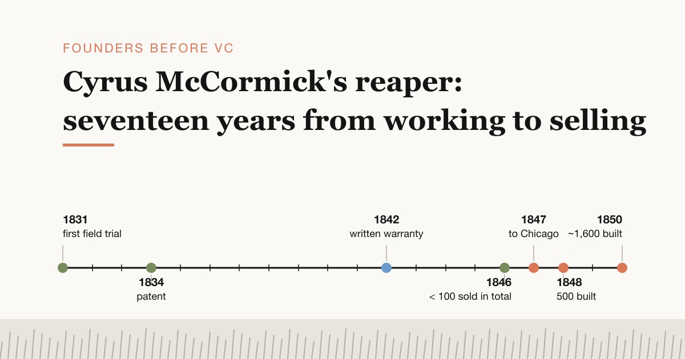

This post is part of a series on founders who built companies before venture capital existed as an industry. The question for each one is the same: what did the market look like, what did the founder actually do, and which of today's startup words fits the move?

Cyrus McCormick is usually remembered as the man who invented the reaper. The documents tell a slower and more useful story. His machine first cut grain in 1831. By the end of 1846 he had sold [fewer than 100 machines](#ref-whs-bio-sales). Then, within two harvests of moving to Chicago, his factory was building reapers by the hundreds. The interesting part of McCormick's career is that gap, and what he did to close it.

## A machine that cut grain was not yet a product

In late July 1831, McCormick's machine cut [about six acres of oats](#ref-hutchinson-p83-steele) on a neighbor's farm in Rockbridge County, Virginia. There is no newspaper report of the trial. His biographer William T. Hutchinson, who worked through the McCormick family's papers for his 1930 biography, notes that [no important contemporary record survives](#ref-hutchinson-p79-sources): the story of that summer was rebuilt from testimony given in 1848, much of it under oath and cross-examined by rivals. Among the people later remembered as present were Jo Anderson and Anthony, [enslaved by the McCormicks](#ref-hutchinson-p83-anderson), who held the horses while the machine rattled through the field.

McCormick himself was blunt about what came next. In 1851 the British juror Philip Pusey asked him for a short history, and he wrote that [“no machines were sold until 1840”](#ref-jury-p231-statement), and that the reapers “were not of much practical value until the improvements of my second patent, 1845.” He also named the constraint that made progress slow: an inventor of a harvest machine could test it only [“a few weeks in each year”](#ref-jury-p231-statement). Every design flaw cost a full year.

The market was hard in other ways too. Farmers had seen many reapers that [“seemed perfect on paper”](#ref-hutchinson-p335-guarantee) and failed in the field. A buyer also had to learn to sharpen the knife, set the reel and rake the cut grain off the platform, so the seller had to teach as well as sell. And McCormick was not alone. Obed Hussey of Cincinnati received a reaper patent dated [December 31, 1833](#ref-patent-hussey); McCormick's own patent was dated [June 21, 1834](#ref-patent-mccormick-1834).

Making the machines was a problem as well. In 1845 McCormick licensed shops in other states to build his reaper. Hutchinson's summary of that harvest: the manufacturers [failed to fulfil their contracts](#ref-hutchinson-p224-licensees), built poor machines and delivered them late.

## Move one: take the risk off the farmer

Before 1842, McCormick [did not warrant his reaper's performance](#ref-hutchinson-p335-guarantee). After the 1841 harvest he changed that. He advertised that buyers of the 1842 machines could [return them](#ref-hutchinson-p336-warranty) if they were not strong and durable, or if they did not cut fifteen acres a day and save a bushel of wheat per acre that the cradle-scythe would have shaken loose.

Payment terms moved the same way. According to Hutchinson's reading of the advertisements, until the end of the 1842 harvest [cash was expected on delivery](#ref-hutchinson-p337-terms), and the usual price was $100 at the family farm. In 1843 and 1844 he gave four months' credit. In 1846 he offered to sell “on time for good paper drawing interest.” By 1847 the price was $115 cash or $120 on time. A McCormick, Ogden & Co. poster for 1849 spelled it out: [$30 on delivery, the balance on December 1](#ref-hutchinson-p337-terms), with 6% interest from July 1.

The December 1 due date fell after the harvest. Grain growers in the Midwest often paid their reaper notes by [selling corn and pork](#ref-hutchinson-p368-collections). In effect, the farmer paid the balance after the machine had done its work.

In today's language, this is risk reversal plus financing that matches the customer's cash flow: a free trial with a written performance spec, and a payment due after the customer gets the value. It also had a cost that founders will recognize. Collections were slow and uneven. Hutchinson writes that arrears of thousands of dollars [followed each harvest](#ref-hutchinson-p369-borrowing), that McCormick often borrowed in Chicago or New York to run the factory, and that only the large profit on each sale let the business go on. Some of his own agents disliked the warranty. One wrote in 1854 that [“to work under a guarantee is a sure mode to kill the reputation of any machine”](#ref-hutchinson-p336-agent-complaint), because farmers gave up at the first small failure.

## Move two: build the factory where the customers are

The farmers of Illinois and Wisconsin had given the reaper [a warmer reception than any other region](#ref-hutchinson-p251-chicago). Illinois sat between the Great Lakes and the Mississippi, so machines could ship east by water or float south and west. Hutchinson also notes that the choice of Chicago was [not obvious at the time](#ref-hutchinson-p250-why): McCormick had earlier favored Brockport, Rochester, Pittsburgh or Cincinnati.

On August 30, 1847, McCormick formed a partnership with the Chicago manufacturer [Charles M. Gray](#ref-hutchinson-p259-gray). The partnership ended in a lawsuit, but the numbers were clear. Of the 500 reapers made for the 1848 harvest, [all but thirteen were sold](#ref-hutchinson-p263-1848). McCormick's net return from the Chicago business that year [seems to have exceeded $30,000](#ref-hutchinson-p265-profit). The new firm planned [fifteen hundred reapers for 1849](#ref-hutchinson-p265-profit), and about [sixteen hundred were made for 1850](#ref-hutchinson-p268-1850). In 1851 McCormick told Pusey that sales were [“more than a thousand yearly”](#ref-jury-p231-statement).

The move did two things at once. It put production next to the wheat country, which had been [moving west very rapidly](#ref-hutchinson-p251-chicago), and it ended his dependence on licensees whose machines he could not inspect. As late as 1855, [three fourths of the reapers](#ref-hutchinson-p352-agents) from the Chicago factory were sold in Illinois, Wisconsin, Iowa and Missouri.

## Move three: agents who set up machines and collected the cash

Before 1843 the McCormick family [were the only salesmen](#ref-hutchinson-p350-family). The first regularly employed agents [appeared in 1845](#ref-hutchinson-p351-first-agents). After the move to Chicago the network grew until, before 1855, it [covered most of the States and Canada](#ref-hutchinson-p352-agents).

The 1849 contract with Phelps & Bourland of Peoria shows what McCormick asked of an agent. They had to travel the wheat counties during the winter and spring, sell only to “responsible and trustworthy farmers,” and [put up, start and set the reapers to work](#ref-hutchinson-p356-contract). They collected the cash payments and took the farmers' notes. The company paid them $6 per machine, but the commission depended on collection: if [no more than $55 was collected](#ref-hutchinson-p357-commission) on a machine, the agent got nothing for that sale.

Service was part of the system. Agents carried spare parts. When a reaper broke, the farmer did not have to send to Chicago in the middle of the harvest. In 1853 the McCormick machine worked poorly because of faulty gearing, and the next winter [each purchaser was sent replacements free](#ref-hutchinson-p364-service). The factory also sent mechanics out in winter to put machines in order before the next season. Hutchinson calls this agency system [“unexampled in its day”](#ref-hutchinson-p364-service). That is his judgment, not a documented first.

The modern names are channel partners and customer success. The detail worth copying is the incentive: the agent was paid on cash collected, not on orders written.

## Move four: field trials, medals and the limits of a benchmark

Reaper makers fought for attention with public contests. Crowds followed the machines through the grain, sometimes with a band, and the winner [put the result into next year's posters](#ref-hutchinson-p339-trials). Hutchinson's own verdict is that as a fair test of two reapers, these exhibitions [“were a failure”](#ref-hutchinson-p339-trials): the contests were short, accidents decided results, and showpiece machines were driven by trained teams.

The first McCormick–Hussey contest took place in 1843. The judges' published wording was [“great reluctance in deciding between them, but upon the whole, prefer McCormick's.”](#ref-hutchinson-p341-1843) In 1848 the Chicago Mechanics' Institute gave its gold medal to McCormick's rival George Esterly, after a committee that admitted [none of its members had seen any of the machines working in the field](#ref-hutchinson-p347-esterly). McCormick answered with public letters; Esterly answered back; the newspapers printed both.

Some promotion was quieter. In 1854 an Iowa agent sold a reaper at a reduced price to Judge Lovell, the president of the Dubuque County Agricultural Society and promised him [five dollars for each reaper](#ref-hutchinson-p345-lovell) he helped sell. In the agent's words, the judge was “not known as an Agent.” Today that would be an undisclosed paid endorsement.

The biggest stage was the 1851 Great Exhibition in London. The official jury report records a [Council Medal for McCormick's “reaping machine”](#ref-jury-p241-medal). The same report shows why the medal settled less than the posters suggested. Pusey, the reporter, wrote that at the first trial at Tiptree Hall the corn was green, so the jury got leave to award [two Council Medals, one to each reaper](#ref-jury-p232-trials), if both deserved one. McCormick's worked well and won. Hussey's clogged. Then Pusey added that in later trials Hussey's machine had worked well, and that in his own opinion it [deserved a Council Medal too](#ref-jury-p232-trials).

A contest was marketing, and McCormick was good at it. As evidence, it was weak. The same is true of most benchmarks now.

## Several popular claims do not hold up

**“William B. Ogden welcomed McCormick to Chicago and put up $25,000.”** Herbert Casson's 1909 biography has Ogden say [“I'll give you $25,000 for a half interest”](#ref-casson-ogden). Hutchinson, working from the court records of McCormick's suit against Gray, writes that this tradition [“has no basis of fact”](#ref-hutchinson-p266-ogden). Ogden came in through Gray, in January 1848, [without McCormick's knowledge](#ref-hutchinson-p263-1848). The partnership of McCormick, Ogden and William E. Jones lasted one season. On September 10, 1849, Ogden and Jones [sold out to McCormick for $65,000](#ref-hutchinson-p266-ogden).

**“McCormick invented the reaper.”** He patented one, and his rival patented first: Hussey's patent is [dated December 31, 1833](#ref-patent-hussey), about six months before McCormick's. The case for McCormick's priority rests on the 1831 field trial. That trial is known from later testimony, and in 1848 Hussey himself [accepted that McCormick had operated his reaper in the harvest of 1831](#ref-hutchinson-p79-sources). Inside the family the credit was also disputed. Cyrus's brother Leander later backed their father Robert as the inventor. In 1898 he wrote, [“Rest assured that my Brother C. H. was not its inventor, but again don't use my name”](#ref-hutchinson-p123-leander). Hutchinson sides with Cyrus, but readers should know that his research was done in the family's own archive.

**“The money-back guarantee was McCormick's revolutionary idea.”** Casson called it [“at that time new and revolutionary”](#ref-casson-guarantee). Hussey [warranted his reaper to cut twenty acres a day](#ref-hutchinson-p336-warranty) in 1844, and Esterly also sold with a [guarantee and testimonials](#ref-hutchinson-p347-esterly). McCormick used the warranty well. I found no reliable source that shows he was the first.

**“The first field test was near Richmond in 1844.”** Casson [dates it to 1844](#ref-casson-field-test). Hutchinson places the first McCormick–Hussey contest [in 1843](#ref-hutchinson-p341-1843), citing the *Richmond Enquirer* of July 4, 1843.

**“McCormick invented installment selling.”** McCormick did sell on credit from 1843 and on time with interest from 1846, [as shown above](#ref-hutchinson-p337-terms). I found no reliable source that he was the first manufacturer to do so, and I have left the claim out.

## What a founder can take from this

McCormick had no investors in the modern sense. His money came from partners such as Gray, Ogden and Jones, from patent fees paid by licensees, and from loans. Hutchinson notes that he often borrowed to run the factory while farmers still owed him for their reapers. Each sale on credit tied up money he had borrowed himself.

A few of McCormick's practices apply to anyone selling a new tool to skeptical users, including developer tools:

- **A working prototype is the start of the work, not the end.** McCormick's machine cut grain in 1831; the market arrived after 1845.
- **Put your promise in writing and make it measurable.** “Fifteen acres a day” is a spec a farmer could check.
- **Time the payment to the customer's value event.** For a farmer it was after the harvest. For many software products it is after usage or after the first result in production.
- **Pay your channel on what is collected and retained, not on what is signed.**
- **Treat benchmarks and awards as attention, not proof.** The 1851 jury report itself says the reaper that missed the medal was good too.
- **Teaching is part of selling.** McCormick sent [printed directions](#ref-hutchinson-p358-directions) with the machine from 1842.

For founders who sell names, domains or other tools whose value shows up only after the buyer uses them, the same question applies: what would a written “fifteen acres a day” look like for your product, and when does your customer's harvest come in?

## A note on the sources

The main secondary source here is volume one of William T. Hutchinson's *Cyrus Hall McCormick* (1930). Hutchinson worked from the papers of the McCormick Historical Association, the collection that later went to the Wisconsin Historical Society. He quotes and cites the original advertisements, letters, contracts and court filings, and I give his page numbers. I have not checked those originals myself. Casson's 1909 biography is cited only where it is the source of a popular claim. The primary sources I read directly are the two patents and the 1852 *Reports by the Juries* of the Great Exhibition.

## References

- Wisconsin Historical Society, [“A Brief Biography of Cyrus Hall McCormick (1809–1884)”](https://web.archive.org/web/20260316154720/https://www.wisconsinhistory.org/Records/Article/CS3399), historical essay, paragraph 3: “By the end of 1846, however, he had sold fewer than 100 machines.” Paragraph 4: he moved to Chicago in 1847. The original URL (`https://www.wisconsinhistory.org/Records/Article/CS3399`) returned 404 on 2026-11-11; the link goes to the 2026-03-16 Wayback snapshot. Fetched 2026-11-11.
- William T. Hutchinson, *Cyrus Hall McCormick: Seed-Time, 1809–1856* (New York: Century, 1930), [p. 79](https://archive.org/details/cyrushallmccormi007444mbp/page/79/mode/1up): “no important contemporary record survives”; testimony given years later, often under oath and cross-examined by rivals; Hussey “admitted to the United States Patent Extension Board in 1848 that his most feared competitor had first operated his reaper in the harvest of 1831.” Internet Archive scan, fetched 2026-11-11.
- Hutchinson, *Seed-Time*, [p. 83](https://archive.org/details/cyrushallmccormi007444mbp/page/83/mode/1up): “the machine cut about six acres of oats on the neighboring farm of John Steele in late July, 1831.” Fetched 2026-11-11.
- Hutchinson, *Seed-Time*, [p. 83, footnote 29](https://archive.org/details/cyrushallmccormi007444mbp/page/83/mode/1up), citing W. J. Hanna's 1885 interview notes: “‘Old Joe’ Anderson, and Anthony, slaves of Cyrus and Robert McCormick, held the horses.” Fetched 2026-11-11.
- Hutchinson, *Seed-Time*, [p. 123](https://archive.org/details/cyrushallmccormi007444mbp/page/123/mode/1up): Leander J. McCormick to Henry F. Mann, June 2, 1898, “Rest assured that my Brother C. H. was not its [the reaper's] inventor, but again don't use my name.” Fetched 2026-11-11.
- Hutchinson, *Seed-Time*, [p. 224](https://archive.org/details/cyrushallmccormi007444mbp/page/224/mode/1up): after the 1845 harvest, “The failure of his manufacturers to fulfil their contracts, the poor construction of the machines … and the tardiness with which this defective output was placed upon the market.” Fetched 2026-11-11.
- Hutchinson, *Seed-Time*, [p. 250](https://archive.org/details/cyrushallmccormi007444mbp/page/250/mode/1up): “the reasons which led him to choose Chicago … are not at once apparent”; Brockport, Rochester, Pittsburgh and Cincinnati had seemed desirable earlier. Fetched 2026-11-11.
- Hutchinson, *Seed-Time*, [p. 251](https://archive.org/details/cyrushallmccormi007444mbp/page/251/mode/1up): “The people of Illinois and Wisconsin had given the reaper a more cordial reception than those of any other section”; Illinois as “an isthmus between the Great Lakes … and the Mississippi”; the wheat center “had recently moved westward very rapidly.” Fetched 2026-11-11.
- Hutchinson, *Seed-Time*, [p. 259](https://archive.org/details/cyrushallmccormi007444mbp/page/259/mode/1up): “the inventor entered a partnership with Gray on August 30, 1847.” Fetched 2026-11-11.
- Hutchinson, *Seed-Time*, [p. 263](https://archive.org/details/cyrushallmccormi007444mbp/page/263/mode/1up): Gray approached Ogden and William E. Jones “about mid-January, 1848”; McCormick said he “knew nothing of this deal until late July, 1848”; “All but thirteen of the five hundred reapers were sold that season.” Based on McCormick's Bill of Complaint in *McCormick v. Gray and Ogden*. Fetched 2026-11-11.
- Hutchinson, *Seed-Time*, [p. 265](https://archive.org/details/cyrushallmccormi007444mbp/page/265/mode/1up): “McCormick's net return from the Chicago enterprise seems to have exceeded $30,000”; the *Gem of the Prairie*, October 7, 1848, announced McCormick, Ogden & Co. and “fifteen hundred reapers were to be made for the harvest of 1849.” Fetched 2026-11-11.
- Hutchinson, *Seed-Time*, [p. 266](https://archive.org/details/cyrushallmccormi007444mbp/page/266/mode/1up): “The tradition that Ogden welcomed the inventor to Chicago and that the latter sought a partnership with him, has no basis of fact”; “On September 10, 1849, Ogden and Jones sold out to McCormick for $65,000.” Fetched 2026-11-11.
- Hutchinson, *Seed-Time*, [p. 268](https://archive.org/details/cyrushallmccormi007444mbp/page/268/mode/1up): “About sixteen hundred reapers were made for the harvest of 1850”; footnote 45 notes conflicting testimony on how many were sold. Fetched 2026-11-11.
- Hutchinson, *Seed-Time*, [p. 335](https://archive.org/details/cyrushallmccormi007444mbp/page/335/mode/1up): “So many reapers had seemed perfect on paper and had proved to be worthless in practice”; “Prior to 1842, Cyrus McCormick did not warrant the performance of his reaper.” Fetched 2026-11-11.
- Hutchinson, *Seed-Time*, [p. 336](https://archive.org/details/cyrushallmccormi007444mbp/page/336/mode/1up): after 1841, reapers for 1842 could be returned if they would not “cut fifteen acres a day and save one bushel of wheat per acre”; “In 1844, Hussey warranted his reaper to cut twenty acres a day.” Fetched 2026-11-11.
- Hutchinson, *Seed-Time*, [p. 336, footnote 24](https://archive.org/details/cyrushallmccormi007444mbp/page/336/mode/1up), quoting agent H. M. Smith of Richmond, August 18, 1854: “To work under a guarantee is a sure mode to kill the reputation of any machine.” Fetched 2026-11-11.
- Hutchinson, *Seed-Time*, [p. 337](https://archive.org/details/cyrushallmccormi007444mbp/page/337/mode/1up): cash on delivery until the 1842 harvest; “$100 at Walnut Grove”; four months' credit in 1843 and 1844; “on time for good paper drawing interest” in 1846; “$115 cash or $120 on time” in 1847. Footnote 31: poster of McCormick, Ogden & Co., 1849, “$115 cash, or $120 when $30 is paid on delivery and balance on Dec. 1, 6% interest from July 1.” Fetched 2026-11-11.
- Hutchinson, *Seed-Time*, [pp. 338–339](https://archive.org/details/cyrushallmccormi007444mbp/page/339/mode/1up): field contests with bands and crowds; the winner used them “in his advertisements and posters for the next harvest”; “As a fair test of the merits of two or more reapers these exhibitions were a failure.” Fetched 2026-11-11.
- Hutchinson, *Seed-Time*, [p. 341](https://archive.org/details/cyrushallmccormi007444mbp/page/341/mode/1up): the Hussey–McCormick contest at the Hutchinson farm in 1843; judges: “The committee feel great reluctance in deciding between them, but upon the whole, prefer McCormick's.” Footnote 34 cites the *Richmond Enquirer*, July 4, 1843. Fetched 2026-11-11.
- Hutchinson, *Seed-Time*, [p. 345](https://archive.org/details/cyrushallmccormi007444mbp/page/345/mode/1up), quoting agent D. R. Burt, 1854, on Judge Lovell of the Dubuque County Agricultural Society: “He [Lovell] is not known as an Agent”; “I shall give him five dollars for each Reaper which he may assist me in selling.” Fetched 2026-11-11.
- Hutchinson, *Seed-Time*, [pp. 346–347](https://archive.org/details/cyrushallmccormi007444mbp/page/347/mode/1up): the 1848 Chicago Mechanics' Institute fair; the judges wrote, “No one of the Committee having seen any one of the machines … in actual operation in the field”; the medal went to Esterly if his machine would operate “in accordance with its inventor's guarantee and the testimonials.” Fetched 2026-11-11.
- Hutchinson, *Seed-Time*, [p. 350](https://archive.org/details/cyrushallmccormi007444mbp/page/350/mode/1up): “Prior to 1843 the members of the McCormick family were the sole agents for the sale of the reaper.” Fetched 2026-11-11.
- Hutchinson, *Seed-Time*, [p. 351](https://archive.org/details/cyrushallmccormi007444mbp/page/351/mode/1up): “The first regularly employed agents appeared in 1845.” Fetched 2026-11-11.
- Hutchinson, *Seed-Time*, [p. 352](https://archive.org/details/cyrushallmccormi007444mbp/page/352/mode/1up): “Before 1855 the network of agencies covered most of the States of the Union and Canada”; “as late as 1855 three fourths of all the reapers annually produced by McCormick at his Chicago factory were sold in Illinois, Wisconsin, Iowa, and Missouri.” Fetched 2026-11-11.
- Hutchinson, *Seed-Time*, [p. 356](https://archive.org/details/cyrushallmccormi007444mbp/page/356/mode/1up): the 1849 contract with Phelps & Bourland of Peoria: “Responsible and trustworthy farmers only”; agents to devote themselves “to putting up, starting and setting to work the said Reapers, to receiving the cash payments”; “$6 for each machine.” Fetched 2026-11-11.
- Hutchinson, *Seed-Time*, [p. 357](https://archive.org/details/cyrushallmccormi007444mbp/page/357/mode/1up): “If no more than $55 were collected on a machine, the agent would receive nothing for that sale.” Fetched 2026-11-11.
- Hutchinson, *Seed-Time*, [p. 358](https://archive.org/details/cyrushallmccormi007444mbp/page/n399/mode/1up): “As early as 1842, McCormick used printed directions to aid the purchaser in operating his reaper.” Fetched 2026-11-11.
- Hutchinson, *Seed-Time*, [p. 364](https://archive.org/details/cyrushallmccormi007444mbp/page/364/mode/1up): in 1853 “each purchaser was sent replacements free of charge”; winter mechanics; “this highly organized agency system, unexampled in its day.” Fetched 2026-11-11.
- Hutchinson, *Seed-Time*, [p. 368](https://archive.org/details/cyrushallmccormi007444mbp/page/368/mode/1up): “Grain-growers often relied upon the sale of corn and pork to raise the funds necessary to meet their reaper notes on December 1.” Fetched 2026-11-11.
- Hutchinson, *Seed-Time*, [p. 369](https://archive.org/details/cyrushallmccormi007444mbp/page/369/mode/1up): “Arrears in payments totaling thousands of dollars followed each harvest and only the very large profits made on each sale allowed the business to go on”; McCormick “was often forced to borrow funds in Chicago or New York.” Fetched 2026-11-11.
- Obed Hussey, [US Patent X7928, “Improvement in machines for reaping and cutting grain”](https://patents.google.com/patent/USX7928/en), “Letters Patent dated December 31, 1833.” Google Patents, fetched 2026-11-11 (no archive snapshot made).
- Cyrus H. McCormick, [US Patent X8277, “Improvement in machines for reaping small grain”](https://patents.google.com/patent/USX8277/en), “Patented June 21, 1834.” Google Patents, fetched 2026-11-11 (no archive snapshot made).
- Great Exhibition of 1851, *Reports by the Juries on the Subjects in the Thirty Classes into Which the Exhibition Was Divided* (London, 1852), Class IX, report by Philip Pusey, [p. 231](https://archive.org/details/reportsbyjurieso00grea/page/231/mode/1up), printing McCormick's own statement written at Pusey's request: “limited also to a few weeks in each year”; “No machines were sold until 1840”; “not of much practical value until the improvements of my second patent, 1845”; sales “now more than a thousand yearly.” Internet Archive scan, fetched 2026-11-11.
- *Reports by the Juries*, Class IX, [p. 232](https://archive.org/details/reportsbyjurieso00grea/page/232/mode/1up): “special leave was obtained from the Council of Chairmen to give two Council Medals, one to each Reaper”; McCormick's “received a Council Medal. Mr. Hussey's sometimes became clogged”; Pusey's “own individual opinion that the merits of the machine are such as entitle it to a Council Medal.” Fetched 2026-11-11.
- *Reports by the Juries*, Class IX, [p. 241](https://archive.org/details/reportsbyjurieso00grea/page/241/mode/1up), “Jury Awards, Class IX. Council Medal”: “United States … M'Cormick, C. H. … Reaping machine.” Fetched 2026-11-11.
- Herbert N. Casson, *Cyrus Hall McCormick: His Life and Work* (Chicago: McClurg, 1909), [chapter V](https://www.gutenberg.org/cache/epub/41953/pg41953-images.html#:~:text=%2425%2C000%20for%20a%20half%20interest): Ogden says, “I'll give you $25,000 for a half interest.” Project Gutenberg eBook #41953, fetched [2026-11-11](https://web.archive.org/web/20250823031929/https://www.gutenberg.org/cache/epub/41953/pg41953-images.html).
- Casson, *Cyrus Hall McCormick*, [chapter V](https://www.gutenberg.org/cache/epub/41953/pg41953-images.html#:~:text=was%20at%20that%20time%20new%20and%20revolutionary): the free trial and refund “was at that time new and revolutionary.” Fetched [2026-11-11](https://web.archive.org/web/20250823031929/https://www.gutenberg.org/cache/epub/41953/pg41953-images.html).
- Casson, *Cyrus Hall McCormick*, [chapter V](https://www.gutenberg.org/cache/epub/41953/pg41953-images.html#:~:text=The%20first%20of%20these%20field%20tests%20occurred%20near%20Richmond%20in%201844): “The first of these field tests occurred near Richmond in 1844.” Fetched [2026-11-11](https://web.archive.org/web/20250823031929/https://www.gutenberg.org/cache/epub/41953/pg41953-images.html).
