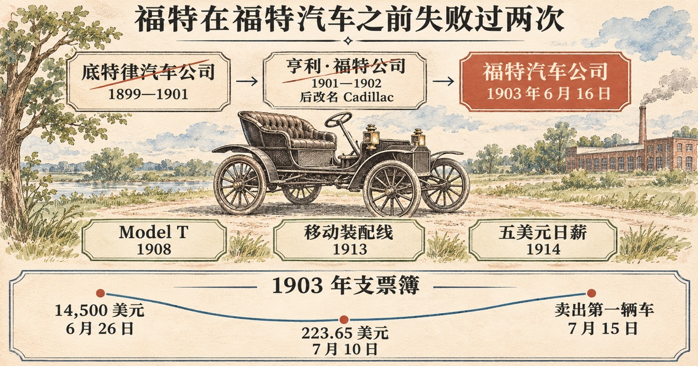

本文属于“风投诞生之前的创业者”系列。系列每篇写一位风投机构出现之前的创业者，只问一个问题：他们的哪一招最像今天的创业者？

福特（Henry Ford）是最容易想到的名字。常见的讲法从 Model T 讲起，本文往前推，从两家失败的公司讲起，时间只取 1899 年到 1914 年，不写完整传记。福特后来的一段历史必须如实交代：从 1920 年 5 月起，他的报纸《迪尔伯恩独立报》（*Dearborn Independent*）[连续刊登反犹文章](#ref-adl-international-jew)；后来他在一场诽谤官司中[公开道歉](#ref-adl-international-jew)，官司于 [1927 年 7 月 16 日庭外和解](#ref-adl-international-jew)。

文中每条史实都对照了能打开的出处，大多是一手材料。最主要的两类：一是亨利·福特博物馆（The Henry Ford）自己的馆藏页面；二是福特 1922 年与克劳瑟（Samuel Crowther）合写的回忆录《我的生活与工作》（*My Life and Work*）。回忆录能说明福特希望别人怎么看他，但日期不可靠，下文专门有一节说明原因。

## 福特的第一家公司按单定制，不到十八个月就关门了

1899 年，福特在底特律的爱迪生照明公司[担任总工程师](#ref-thf-stockholders)。他于 [1899 年 8 月 15 日离职](#ref-thf-chronology)，去一家新公司底特律汽车公司（Detroit Automobile Company）当主管。这家公司[成立于 1899 年 7 月](#ref-thf-letterhead)。公司信纸上印着：总裁是布莱克（Clarence A. Black），福特的头衔是[机械主管](#ref-thf-letterhead)。福特是领薪水、有头衔的雇员，说了不算。

公司的第一件产品是一辆送货卡车。博物馆说公司[一共造出的卡车和轿车不超过 20 辆](#ref-thf-letterhead)，[存续不超过十八个月](#ref-thf-truck)。关于公司何时结束，博物馆给了两个日期：一处说[1901 年 1 月停业](#ref-thf-truck)，一份较早的博物馆年表说[1900 年 11 月停业](#ref-thf-chronology)。本文无法判定哪个对。

二十多年后，福特把问题归结为控制权。按他的说法，投资人想[按订单生产，每辆车尽量卖高价](#ref-mlw-ch2)，公司[不是实现我想法的工具](#ref-mlw-ch2)。这是功成名就之后的说法，仍然是有用的线索：第一家公司少量出售昂贵的定制车，设计车的人却无权决定造什么车。

## 一场赛车赢来了第二家公司，投资人随后把福特挤走

福特拿到第二家公司，靠的不是顾客，而是一场比赛。[1901 年 10 月 10 日](#ref-thf-failures-set)，在底特律附近的格罗斯波因特赛道，福特驾驶“Sweepstakes”赛车对阵温顿（Alexander Winton）。温顿当时是全美最有名的汽车制造商之一。[温顿的车出了机械故障](#ref-thf-failures-set)，福特赢了。博物馆说，[这场胜利和随之而来的报道](#ref-thf-failures-set)让金主愿意支持福特的第二家公司。

亨利·福特公司（Henry Ford Company）于 [1901 年 11 月 30 日注册成立](#ref-thf-chronology)。[1902 年 1 月 6 日](#ref-thf-bryant-letter)，福特用新公司的信纸给朋友布莱恩特（Milton Bryant）写信，信里看得出他的心思在哪里：“[My Company will kick about me following racing but they will get the advertising and I expect to make $ where I cant make (cents) at manufacturing.](#ref-thf-bryant-letter)”大意是：公司会对我去赛车有意见，但他们会得到广告；赛车能挣大钱，造车只能挣小钱。

投资人果然有意见。博物馆说，福特热衷赛车，[和亨利·福特公司的投资人闹翻](#ref-thf-bryant-letter)。年表记载他于 [1902 年 3 月 10 日离开](#ref-thf-chronology)。工厂留在投资人手里，公司[在利兰（Henry Leland）主持下改名为 Cadillac](#ref-thf-bryant-letter)。福特的第二家公司确实成了一家成功的汽车厂，只是福特已经不在了。

## 福特的回忆录改写了这三年

关于福特的许多流行故事出自他的回忆录，所以值得拿上面的档案对照一下。有三处对不上。

第一，回忆录说[底特律汽车公司后来成了 Cadillac 公司](#ref-mlw-ch2)。博物馆档案显示，成为 Cadillac 的是第二家公司亨利·福特公司。回忆录还把 1902 年 3 月的离职放进第一家公司的故事里，两家公司就这样并成了一家。

第二，回忆录说[我从来不把赛车当回事](#ref-mlw-ch2-racing)。可是 1902 年写给布莱恩特的信说，福特指望赛车比造车更挣钱。

第三，回忆录说“999”赛车获胜之后，[比赛过去一周，我就成立了福特汽车公司](#ref-mlw-ch3)。博物馆年表把“999”战胜温顿记在 [1902 年](#ref-thf-chronology)，把福特汽车公司注册记在 [1903 年 6 月 16 日](#ref-thf-chronology)。中间隔了好几个月，不是一周。

这些出入不改变大的轮廓：福特失败两次，然后成功。但它们说明，创始人自己讲的故事会随着时间越讲越顺：两次失败合成一次，几个月缩成一周。

## 第三家公司由一位煤商出资，供应商也成了股东

福特的第三位合伙人是底特律煤商马尔科姆森（Alexander Malcomson）。马尔科姆森[资助过福特早年的几个项目，包括“999”赛车，并于 1902 年与福特签订合伙协议](#ref-thf-stockholders)，名号是 Ford & Malcomson。

福特汽车公司成立时，博物馆整理的 [1903 年 6 月 16 日公司章程](#ref-thf-stockholders)列出十二名股东，共 1,000 股：

| 股东 | 股数 | 身份（据亨利·福特博物馆） |
| --- | ---: | --- |
| Henry Ford | 255 | 工程师 |
| Alexander Malcomson | 255 | 煤商 |
| John S. Gray | 105 | 马尔科姆森的长辈亲属（uncle），德美银行总裁 |
| John F. Dodge | 50 | 机械厂老板，供应商 |
| Horace E. Dodge | 50 | 机械厂老板，供应商 |
| Albert Strelow | 50 | 承包商，把厂房租给福特和马尔科姆森 |
| Vernon Fry | 50 | 马尔科姆森的堂表亲（cousin） |
| Charles H. Bennett | 50 | Daisy 气枪公司总裁 |
| John Anderson | 50 | 马尔科姆森的律师 |
| Horace Rackham | 50 | Anderson 的律所合伙人 |
| James Couzens | 25 | 马尔科姆森办公室的职员 |
| Charles Woodall | 10 | 马尔科姆森的簿记员 |

出处：[亨利·福特博物馆股东研究指南](#ref-thf-stockholders)。1919 年密歇根州最高法院 *Dodge v. Ford Motor Co.* 判决书说库曾斯（James Couzens）[认购了 50 股](#ref-dodge-v-ford-signers)；博物馆则说他的 25 股里有一部分[代表他姐妹 Rosetta Couzens 投的 100 美元](#ref-thf-stockholders)。表中采用博物馆的数字，并注明这处出入。

这份名单里没有职业投资人，只有一位商人、他的亲戚、雇员、律师、房东，一位本地厂商，加上两位供应商。道奇兄弟（John F. Dodge 和 Horace E. Dodge）开机械厂，1903 年初福特[和他们签约，由他们供应底盘、变速箱和车桥](#ref-thf-stockholders)。供应商成了客户公司的股东。流行说法给出了道奇合同的具体条款，例如底盘数量和单价；本文没有找到能打开的一手出处，所以不写。

现金到底有多少，说法不一。1919 年判决书引述的公司章程把股本定为 [15 万美元](#ref-dodge-v-ford-capital)，并写明已认购并实缴 10 万美元，其中[现金 4.9 万美元，其他财产 5.1 万美元](#ref-dodge-v-ford-capital)。福特回忆录则说[以现金认购的总额约为两万八千美元](#ref-mlw-ch3-cash)。两个数字都列在这里，本文无法判断哪个才是实际到账的钱。

公司的第一本支票簿说明钱有多紧。账户[1903 年 6 月 26 日以 14,500 美元开户](#ref-thf-failures-set)，开出 60 张支票后，[到 7 月 10 日只剩 223.65 美元](#ref-thf-failures-set)。7 月 15 日，公司[卖出第一辆车，售价 850 美元](#ref-thf-failures-set)，此后余额才开始回升。

## Model T 是单一产品，价格逐年下降

福特于 [1908 年 10 月 1 日开始生产 Model T](#ref-thf-chronology)。1908—1909 销售季，公司还在卖别的车型，但按福特的说法，Model T [把它们一扫而空](#ref-mlw-ch4)。那一季公司卖出 10,607 辆车，旅行车售价 [850 美元](#ref-mlw-ch4)。

随后福特砍掉了产品线。1909 年，他[某天早上事先毫无预告地宣布](#ref-mlw-ch4-black)，公司今后只造 Model T。同一段里有那句至今还在流传的话：“[Any customer can have a car painted any colour that he wants so long as it is black.](#ref-mlw-ch4-black)”（顾客想要什么颜色都行，只要是黑色。）这句话出自福特本人的书，不算张冠李戴；但它是 1922 年对 1909 年一句话的回忆，不是 1909 年当场留下的记录。

福特也说明了自己怎么定价：价格依据的是[对最大数量的人愿意付、付得起多少钱的估计](#ref-mlw-ch10)，不看需求，也不看竞争对手。他自己的表格列出了旅行车的结果：

| 销售季 | 旅行车售价 | 产量（辆） |
| --- | ---: | ---: |
| 1909—10 | $950 | 18,664 |
| 1910—11 | $780 | 34,528 |
| 1911—12 | $690 | 78,440 |
| 1912—13 | $600 | 168,220 |
| 1913—14 | $550 | 248,307 |
| 1914—15 | $490 | 308,213 |
| 1915—16 | $440 | 533,921 |
| 1916—17 | $360 | 785,432 |

出处：[《我的生活与工作》第十章](#ref-mlw-ch10)。这些是福特自己公布的数字。

## 移动装配线先解决了产量问题，五美元日薪再解决人手问题

移动装配线是从小处试起的。博物馆年表记载：1913 年 [4 月 1 日，福特第一条生产磁电机的装配线投入运行](#ref-thf-chronology)。福特自己给的数字是：过去一名工人装一台飞轮磁电机大约要 20 分钟；拆成 29 道工序放上移动线后，[降到 13 分 10 秒](#ref-mlw-ch5)，后来降到 5 分钟。底盘方面，固定工位最好的成绩是每台 12 小时 28 分钟；用绳子和绞盘拖着底盘走的试验降到 5 小时 50 分钟；1914 年初抬高装配线后，[每台底盘的工时降到 1 小时 33 分钟](#ref-mlw-ch5)。

活干得快了，人却留不住。亨利·福特博物馆的两处页面给出的 1913 年员工流失率分别是 [370%](#ref-thf-five-dollar) 和 [380%](#ref-thf-crowd)。

[1914 年 1 月 5 日](#ref-thf-five-dollar)，福特和已任副总裁的库曾斯宣布，公司将按每天五美元付薪。博物馆一处页面说旧工资是[每天 2.30 美元](#ref-thf-five-dollar)，另一处说是[九小时工作日 2.34 美元](#ref-thf-crowd)。新工资是[八小时工作日五美元](#ref-thf-crowd)。这不是单纯涨薪：博物馆称之为[利润分享计划](#ref-thf-five-dollar)，福特也称之为[一种利润分享计划](#ref-mlw-ch8)，工人要满足“某些条件”才能拿到全额。博物馆说，福特这样做[很可能是在库曾斯的敦促之下](#ref-thf-crowd)。库曾斯就是当年马尔科姆森办公室里的那位职员。

## 1919 年的官司把创始人和投资人的分歧摆上了台面

福特很快就想要控制权。他写道，公司成立时他[持有 25.5%](#ref-mlw-ch3-cash)，本以为少数股权也行得通，结果“[很快就发现我必须掌握控制权](#ref-mlw-ch3-control)”。马尔科姆森 [1906 年把 255 股卖给了福特](#ref-thf-stockholders)。

道奇兄弟一直持股，1916 年把公司告上法庭。判决书引述了福特见报的一段话：“[My ambition is to employ still more men](#ref-dodge-v-ford-ambition) ... To do this, we are putting the greatest share of our profits back into the business.”（我的志向是雇更多的人……为此，我们把大部分利润投回企业。）1919 年，密歇根州最高法院回答：“[A business corporation is organized and carried on primarily for the profit of the stockholders.](#ref-dodge-v-ford-holding)”（商业公司的组织和经营，首先是为了股东的利润。）1903 年入股的两位供应商，此时成了逼公司分红的小股东。

## “更快的马”不是福特说的

福特最有名的一句关于顾客的话是：“如果我问顾客想要什么，他们会说要一匹更快的马。”亨利·福特博物馆说，这句话[从未令人满意地追溯到福特本人](#ref-thf-quotations)，而且[直到 21 世纪初才开始出现](#ref-thf-quotations)。Quote Investigator [没有找到可信证据证明这句话出自福特](#ref-qi-faster-horse)。它找到的最早与福特挂钩的版本，出自 1999 年一期 *The Cruise Industry News Quarterly*：一位发言人设想，如果福特去问大家，[人们大概会告诉他，他们真正想要的是一匹更快的马](#ref-qi-faster-horse)。

这句话常被用来证明问顾客没用。有据可查的记录要复杂一些：福特的第一家公司按投资人能卖出的最高价造车，失败了；Model T 的价格则按最多数人付得起的水平来定，越降价卖得越多。福特拒绝增加车型，但他没有忽视买家付得起多少钱。

## 用今天的话说，福特 1899 年到 1914 年走的是一条熟悉的创业路

本节是笔者的解读，不是有出处的史实。

- **底特律汽车公司**：还没做出人们想要的产品，就开始卖了。高价定制，造产品的人对产品没有发言权。
- **1901 年那场比赛**：相当于一次 demo。它没有证明这辆车对顾客有用，只证明福特能当众造出一台能跑的东西，这对投资人已经够了。
- **亨利·福特公司**：创始人和投资人目标错位。投资人要汽车生意，创始人要赛车，最后公司归了投资人。
- **福特汽车公司的第一轮**：来自一位商人人脉圈的天使轮，加上供应商入股：道奇兄弟既供货，又持有一成股份。1903 年 6 月到 7 月的支票簿，就是一张跑道（runway）图。
- **Model T**：产品收得很窄，价格按福特想要的市场规模来定，而不是成本加成；每次降价都换来更大的销量。
- **五美元日薪**：流程改造让工作变得更难熬之后，一次针对留人的补救。

对今天做开发者工具或者卖域名的人，有两点可以借鉴。demo 能融到钱，但说明不了谁会付钱。给你供零件、供基础设施或者带来第一批渠道的人，可能变成你的股东，日后利益未必和你一致。

## 档案还没有解决这几个问题

- 底特律汽车公司停业的确切时间：1900 年 11 月还是 1901 年 1 月。
- 福特汽车公司 1903 年实际收到多少现金：章程写 4.9 万美元，福特说约 2.8 万美元，银行开户存入 1.45 万美元。
- 1903 年道奇合同的条款，以及道奇兄弟入股付的是现金还是零件：本文没有找到能打开的一手出处。
- 亨利·福特公司改名 Cadillac 的确切日期。

## 参考资料

- The Henry Ford — [Henry Ford chronology](https://ophelia.sdsu.edu:8443/henryford_org/03-25-2015/exhibits/hf/Chronology.asp.html)，1899、1900、1901、1902、1903、1908、1913、1914 年条目。原文：“Henry Ford Company, his second car company, is incorporated on November 30”；“Leaves Henry Ford Company (later becomes Cadillac) on March 10”；“Ford Motor Company is incorporated on June 16”。thehenryford.org/exhibits/hf/Chronology.asp 原页面已下线，此链接为圣迭戈州立大学保存的 2015 年副本 — 2026-11-11 读取；[原页面 Wayback 存档，2016-02-25](http://web.archive.org/web/20160225005239/http://www.thehenryford.org/exhibits/hf/Chronology.asp)
- The Henry Ford — [Letterhead of the Detroit Automobile Company, 1899-1901](https://www.thehenryford.org/collections/explore/artifact/366440#:~:text=was%20formed%20in%20July%201899)，藏品编号 P.D.354.A，藏品说明 — 2026-11-11 读取；[2026-07-18 存档](http://web.archive.org/web/20260718132908/https://www.thehenryford.org/collections/explore/artifact/366440)
- The Henry Ford — [Detroit Automobile Company Delivery Truck outside Factory, 1899-1900](https://www.thehenryford.org/collections/explore/artifact/223416#:~:text=the%20company%20lasted%20no%20more%20than%20eighteen%20months)，藏品编号 84.1.1660.928，藏品说明 — 2026-11-11 读取；[2026-07-16 存档](http://web.archive.org/web/20260716010355/https://www.thehenryford.org/collections/explore/artifact/223416)
- The Henry Ford — [Henry Ford: Henry Ford's Failures](https://www.thehenryford.org/collections/explore/sets/detail/henry-ford-henry-fords-failures#:~:text=The%20bank%20account%20started%20with)，2013 年编成的专题藏品集；条目“Henry Ford and Ed (Spider) Huff Driving the Ford Sweepstakes Racer at Grosse Pointe, Michigan, October 10, 1901”与“Ford Motor Company Checkbook, 1903” — 2026-11-11 读取；[2026-07-15 存档](http://web.archive.org/web/20260715223154/https://www.thehenryford.org/collections/explore/sets/detail/henry-ford-henry-fords-failures)
- The Henry Ford — [Letter from Henry Ford to Milton Bryant Concerning Auto Racing, 1902](https://www.thehenryford.org/collections/explore/artifact/364244#:~:text=My%20Company%20will%20kick%20about%20me%20following%20racing)，藏品编号 64.167.1.408，信件日期 1902 年 1 月 6 日；转录文本与藏品说明 — 2026-11-11 读取；[2026-07-16 存档](http://web.archive.org/web/20260716010351/https://www.thehenryford.org/collections/explore/artifact/364244)
- The Henry Ford, Benson Ford Research Center — [Research Guide: Ford Motor Company Stockholders and Stock, 1903-1956](https://askus.thehenryford.org/researchguides/faq/414680#:~:text=Ford%20Motor%20Company%20Articles%20of%20Association)，“The Original Stockholders”一节及股份买卖年表 — 2026-11-11 读取；[2026-10-17 存档](http://web.archive.org/web/20261017071301/https://askus.thehenryford.org/researchguides/faq/414680)
- Michigan Supreme Court — [*Dodge v. Ford Motor Co.*, 204 Mich. 459 (1919)](https://static.case.law/mich/204/html/0459-01.html#:~:text=in%20cash%20and%20%2451%2C000%20in%20other%20property)，事实部分关于公司章程的段落，哈佛法学院 Caselaw Access Project 提供。原文：“the capital stock is fixed at the sum of $150,000 ... $49,000 in cash and $51,000 in other property” — 2026-11-11 读取；[2026-11-07 存档](http://web.archive.org/web/20261107132159/https://static.case.law/mich/204/html/0459-01.html)
- 同一判决书 — [章程认购人名单](https://static.case.law/mich/204/html/0459-01.html#:~:text=who%20each%20subscribed%20for%2050%20shares)。原文：“James Couzens, who each subscribed for 50 shares” — 2026-11-11 读取
- 同一判决书 — [起诉书引述的福特言论](https://static.case.law/mich/204/html/0459-01.html#:~:text=is%20to%20employ%20still%20more%20men) — 2026-11-11 读取
- 同一判决书 — [法院关于商业公司目的的论述](https://static.case.law/mich/204/html/0459-01.html#:~:text=A%20business%20corporation%20is%20organized%20and%20carried%20on%20primarily%20for%20the%20profit%20of%20the%20stockholders) — 2026-11-11 读取
- Henry Ford、Samuel Crowther — [*My Life and Work*（1922），第二章“What I Learned About Business”](https://www.gutenberg.org/cache/epub/7213/pg7213-images.html#:~:text=was%20not%20a%20vehicle%20for%20realizing%20my%20ideas)，古登堡计划电子书 #7213。原文：“to make to order and to get the largest price possible for each car”；“In March, 1902, I resigned”；“The Detroit Automobile Company later became the Cadillac Company” — 2026-11-11 读取；[2026-09-06 存档](http://web.archive.org/web/20260906114837/https://www.gutenberg.org/cache/epub/7213/pg7213-images.html)
- 同书第二章 — [关于赛车](https://www.gutenberg.org/cache/epub/7213/pg7213-images.html#:~:text=I%20never%20thought%20anything%20of%20racing)。原文：“I never thought anything of racing” — 2026-11-11 读取
- 同书第三章“Starting the Real Business” — [“999”赛车与公司成立](https://www.gutenberg.org/cache/epub/7213/pg7213-images.html#:~:text=A%20week%20after%20the%20race%20I%20formed%20the%20Ford)。原文：“A week after the race I formed the Ford Motor Company” — 2026-11-11 读取
- 同书第三章 — [股本与现金认购](https://www.gutenberg.org/cache/epub/7213/pg7213-images.html#:~:text=The%20total%20amount%20subscribed%20in%20cash)。原文：“of this I owned 25 1/2 per cent”；“The total amount subscribed in cash was about twenty-eight thousand dollars” — 2026-11-11 读取
- 同书第三章 — [关于控制权](https://www.gutenberg.org/cache/epub/7213/pg7213-images.html#:~:text=I%20very%20shortly%20found%20I%20had%20to%20have%20control)。原文：“I very shortly found I had to have control” — 2026-11-11 读取
- 同书第四章“The Secret of Manufacturing and Serving” — [1908—1909 季的 Model T 销量](https://www.gutenberg.org/cache/epub/7213/pg7213-images.html#:~:text=We%20sold%2010%2C607%20cars)。原文：“We sold 10,607 cars ... The price for the touring car was $850” — 2026-11-11 读取
- 同书第四章 — [只造一种车型的宣布](https://www.gutenberg.org/cache/epub/7213/pg7213-images.html#:~:text=Any%20customer%20can%20have%20a%20car%20painted)。原文：“Therefore in 1909 I announced one morning, without any previous warning” — 2026-11-11 读取
- 同书第五章“Getting into Production” — [最早的移动装配线](https://www.gutenberg.org/cache/epub/7213/pg7213-images.html#:~:text=we%20first%20tried%20the%20experiment%20of%20an%20assembly)。原文：“cut down the assembly time to thirteen minutes, ten seconds”；“cut down the labour time per chassis to one hour thirty-three minutes” — 2026-11-11 读取
- 同书第八章“Wages” — [1914 年的计划](https://www.gutenberg.org/cache/epub/7213/pg7213-images.html#:~:text=a%20kind%20of%20profit%2Dsharing%20plan)。原文：“a kind of profit-sharing plan in which the minimum wage for any class of work and under certain conditions was five dollars a day” — 2026-11-11 读取
- 同书第十章“How Cheaply Can Things Be Made?” — [定价方针与价格产量表](https://www.gutenberg.org/cache/epub/7213/pg7213-images.html#:~:text=estimate%20of%20what%20the%20largest%20possible%20number) — 2026-11-11 读取
- Matt Anderson, The Henry Ford — [Ford's Five-Dollar Day](https://www.thehenryford.org/collections/explore/articles/fords-five-dollar-day#:~:text=labor%20turnover%20rate%20of%20370%20percent)，2014 年 1 月 3 日 — 2026-11-11 读取；[2026-10-17 存档](http://web.archive.org/web/20261017022345/https://www.thehenryford.org/collections/explore/articles/fords-five-dollar-day)
- The Henry Ford — [Crowd of Applicants outside Highland Park Plant after Five Dollar Day Announcement, January 1914](https://www.thehenryford.org/collections/explore/artifact/35765#:~:text=previous%20rate%20had%20been%20%242.34%20for%20a%20nine%2Dhour%20day)，藏品说明 — 2026-11-11 读取；[2026-07-17 存档](http://web.archive.org/web/20260717161632/https://www.thehenryford.org/collections/explore/artifact/35765)
- Rebecca Bizonet, The Henry Ford — [Henry Ford's Quotations](https://www.thehenryford.org/collections/explore/articles/henry-fords-quotations#:~:text=has%20never%20been%20satisfactorily%20traced%20to%20Henry%20Ford)，2013 年 3 月 12 日 — 2026-11-11 读取；[2026-07-15 存档](http://web.archive.org/web/20260715204535/https://www.thehenryford.org/collections/explore/articles/henry-fords-quotations)
- Quote Investigator — [My Customers Would Have Asked For a Faster Horse](https://quoteinvestigator.com/2011/07/28/ford-faster-horse/#:~:text=has%20not%20yet%20located%20compelling%20evidence)，2011 年 7 月 28 日，2025 年 3 月 6 日更新 — 2026-11-11 读取；未找到存档快照
- Anti-Defamation League — [The International Jew: 1920s Antisemitism Revived Online](https://www.adl.org/resources/backgrounders/the-international-jew-1920s-antisemitism-revived-online#:~:text=first%20attacked%20Jews%20in%20its%20May%2022%2C%201920%20issue)。原文：“The Dearborn Independent first attacked Jews in its May 22, 1920 issue”；“Ford issued public statements and apologies to individuals and Jews as a group”；“On July 16, 1927, an out-of-court settlement of the Sapiro suit was announced” — 2026-11-11 读取；[2024-08-30 存档](http://web.archive.org/web/20240830201350/https://www.adl.org/resources/backgrounders/the-international-jew-1920s-antisemitism-revived-online)
