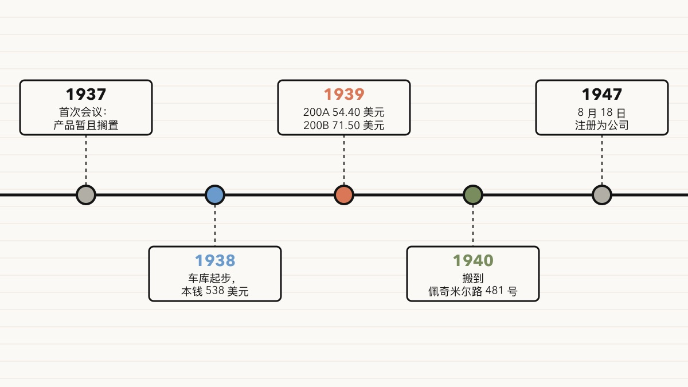

1937 年 8 月 23 日，休利特（Bill Hewlett）和帕卡德（Dave Packard）开了第一次正式的商务会议。会议记录写明，两人要设计和制造电子产品，但[“做什么产品的问题暂且搁置”](#ref-hpca-creating-company)。拟定的公司名叫“The Engineering Service Company”，意思是“工程服务公司”。

本文属于“风投诞生之前的创业者”系列。现代风险投资一般从 1946 年 ARD 成立算起，这个系列写的是此前的创业者。惠普的故事很像今天的创业故事：两个工程师，一位推着他们往前走的教授，一间车库，第一个产品卖给别的工程师。

车库年代的史料大多出自惠普自己。惠普公司档案馆（Hewlett-Packard Company Archives）、hp.com 和 hpe.com 都是公司的说法，帕卡德的《惠普之道》（*The HP Way*）是创始人回忆录。本文没有读《惠普之道》。某条史实只有公司出处时，正文会注明。本文用到的独立文献有四份：一篇 1939 年的期刊论文、一则 1939 年的杂志广告、一项专利，以及 2007 年这处房产列入美国国家史迹名录（National Register of Historic Places）时的提名文件。

## 当时的市场是动辄几百美元的实验室仪器

音频振荡器每次产生一个纯音。工程师拿它测试放大器、电话、收音机和录音设备。20 世纪 30 年代后期，实验室里做这件事的常用仪器是差频振荡器（beat-frequency oscillator）。

休利特在斯坦福研究的是另一种电路。HPE 的展品页说，200A [起源于休利特在斯坦福的硕士论文](#ref-hpe-200a-gallery)，在文氏电桥（Wien bridge）电路里用一只灯泡稳定输出，同时避免失真。1939 年 10 月，特曼（Frederick Terman）、休利特和另外两位斯坦福作者在《无线电工程师学会会刊》（*Proceedings of the I.R.E.*）上发表论文，讨论负反馈在实验室仪器里的用法。论文摘要用一句话讲清了市场机会：阻容振荡器[“是差频振荡器简单而廉价的替代品，性能相当”](#ref-ire-1939)。

休利特在 [1939 年 7 月 11 日申请了“可变频率振荡发生器”专利，1942 年 1 月 6 日获批](#ref-patent-us2268872)。惠普的博物馆页面说，休利特把这项专利[转让给了他和帕卡德的合伙企业](#ref-hp-museum-200a)。

价格差距出自惠普自己的数字。惠普博物馆页面说，200A [售价 54.40 美元](#ref-hp-museum-200a)，竞争对手的同类设备卖 200 到 600 美元。本文没有找到 1939 年竞品的独立价目表，所以“200 到 600 美元”只能算惠普的说法。

## 两人的招数是在租来的车库里给工程师造便宜的工具

特曼不只是授课老师。惠普的车库年表说，1938 年夏天[特曼为帕卡德安排了一份斯坦福奖学金](#ref-hp-garage-timeline)，帕卡德向通用电气请了假，回来和休利特“放手一搏”（make a run for it）。休利特替帕卡德夫妇找房子，挑中帕洛阿尔托艾迪生大街 367 号（367 Addison Avenue），[理由是房子带一间车库](#ref-hp-garage-timeline)，两人可以在里面干活。1938 年 9 月，帕卡德夫妇搬进一楼的公寓，休利特住进屋后的小棚子。

本钱很少。惠普车库年表说，两人开始兼职干活时有 [538 美元营运资金，包括现金和一台二手的 Sears Craftsman 钻床](#ref-hp-garage-timeline)。惠普的 30 年代年表金额相同，却把这台钻床写成[二手的 Sears-Roebuck 钻床](#ref-hp-timeline-30s)。这 538 美元来自两位创始人自己的现金和工具，没有外人投资。

车库起步时并没有单一的产品。国家史迹名录提名文件引用了一本 1984 年的书：两人“设计了各种电器小玩意儿，[接一些特曼教授帮忙找来的零活](#ref-nrhp-nomination)”。同一份文件列出的项目有：给帕洛阿尔托医院做的透热治疗机、帮汉密尔顿山（Mount Hamilton）天文台的大望远镜精确定位的驱动装置、保龄球馆的犯规线指示器，以及一台用电击减肥的机器。惠普档案馆也展出了两人寻找市场时做过的[犯规线指示器、自动冲水器和电动减肥机](#ref-hpca-freelancing)。提名文件还说，露西尔·帕卡德（Lucile Packard）[在斯坦福注册处上班，给这个家提供固定收入](#ref-nrhp-nomination)，晚上替公司记账。

后来，振荡器成了正式产品。惠普 30 年代年表引用帕卡德的话：产品叫 200A，[“是因为我们觉得这个名字能让我们看上去像老字号”](#ref-hp-timeline-30s)。HPE 一个已存档的页面说，两人定价 54.40 美元[不是算成本算出来的](#ref-hpe-200a-gallery)，而是因为这个数字让他们想起 1844 年美国西北边界争端里的口号“54°40′ 或开战！”（“54-40 or Fight!”）。这个解释是公司流传的故事，本文没有找到 1939 年的文件说明定价理由。

接着来了那位著名的客户。华特迪士尼制片厂要求修改 200A，结果就是 [200B 型。迪士尼订了八台](#ref-hp-timeline-30s)，用来给 1940 年放映《幻想曲》（*Fantasia*）的影院测试声道、录音设备和扬声器。HPE 一个已存档的页面给出的单价是[每台 71.50 美元](#ref-hpe-200b-gallery)。这个价格有独立文献佐证：惠普的第一则杂志广告登在 [1939 年 11 月号《Electronics》](#ref-hpca-first-ad)上，主推“Model 200B”，标价[“$71.50 net FOB Palo Alto”（帕洛阿尔托离岸净价 71.50 美元）](#ref-electronics-1939-11)，回信地址印的是艾迪生大街 367 号。

[1939 年 1 月 1 日，两人正式签订合伙协议，并用抛硬币决定公司名称](#ref-hp-garage-timeline)。惠普 30 年代年表给出的第一年成绩是[营收 5369 美元，员工 2 人](#ref-hp-timeline-30s)。国家史迹名录提名文件补充说，从 1938 年秋到 1939 年秋，两人在这处房产里造了[大约 200 台振荡器，利润 1563 美元](#ref-nrhp-nomination)。1940 年，公司[搬进佩奇米尔路 481 号的租用厂房](#ref-hp-garage-timeline)。惠普在 [1947 年 8 月 18 日注册为公司](#ref-hpe-timeline)，距离抛硬币已经过了八年。

## 放在今天，这叫自筹资金、客户养活的大学衍生公司

本节是笔者的解读，不是出处里的史实。

用今天的话说，休利特和帕卡德做了四件事，今天的创业者还在照着做。

1. **把研究变成产品。** 振荡器出自特曼门下的斯坦福研究，同一个想法既写进了期刊论文，也写进了专利。今天这叫大学衍生公司（university spinout），不过本文没有找到斯坦福持股的出处。
2. **用低价打开市场。** 1939 年的论文把这种电路定位成性能相当的廉价替代品，惠普自己的数字也说 200A 只卖竞品的零头。这是典型的颠覆式进入：关键指标打平，发票上便宜得多。
3. **让客户出研发的钱。** 本文读过的出处里，没有一份提到车库年代有外部投资人。这些出处里的钱只有四笔来源：538 美元本钱、露西尔的工资、零活收入，以及迪士尼这样的订单。
4. **把定制需求变成目录产品。** 200B 起初是为一个客户做的改动，到 1939 年 11 月已经成了第一则杂志广告里的主打产品。今天的说法是：设计合作伙伴（design partner）塑造了第二版。

车库年代也说明了“产品市场匹配”（product-market fit）这个词出现之前的样子。两人给医院、保龄球馆和天文台做过小玩意儿，这些活能挣钱，却不能重复。振荡器能重复：各地的工程师有同样的需求，同一台仪器就能满足。

## 几种流行说法经不起查证

**“迪士尼买下了惠普最早的振荡器。”** 惠普把迪士尼订单称为[公司的第一笔大生意](#ref-hp-museum-200a)，不是第一笔生意，买的也是改过的 200B。日期同样说不清：HPE 展品页说是 [1938 年的一笔销售](#ref-hpe-200b-gallery)，惠普档案馆把这件展品标为[约 1939 年](#ref-hpca-disney)，而 200B 的第一则广告登在 1939 年 11 月。

**“帕卡德赢了抛硬币。”** 本文读过的惠普年表只说[公司名称由抛硬币决定](#ref-hp-garage-timeline)。各种转述对谁赢了说法不一。本文没有找到写明赢家的原始出处，所以不写。

**“振荡器是帕卡德的论文课题。”** 国家史迹名录提名文件说，可变频率振荡器是[帕卡德的硕士论文课题](#ref-nrhp-nomination)。专利上的[发明人是休利特](#ref-patent-us2268872)，HPE 也说 200A [起源于休利特的硕士论文](#ref-hpe-200a-gallery)。提名文件在这一点上写错了。这份文件还有一处把地址写成“376 Addison”，应为 367 号。

**“1938 年 11 月，两人带着振荡器去了波特兰。”** 国家史迹名录提名文件说，1938 年 11 月两人带着样机[去波特兰参加无线电工程师学会的会议](#ref-nrhp-nomination)。1939 年的论文却注明，论文在 [1938 年 8 月 11 日波特兰的太平洋沿岸大会上宣读](#ref-ire-1939)。两个日期对不上，本文把“11 月”当作未经证实。

**“车库是硅谷的诞生地。”** 这句话是纪念用语，不是研究结论。加州在 [1987 年 8 月 13 日把车库登记为第 976 号历史地标](#ref-ohp-976)，官方说明称之为“世界上第一个高科技地区的诞生地”。惠普年表给出的登记日期是 [1987 年 8 月 7 日](#ref-hp-garage-timeline)，牌匾揭幕是 1989 年 5 月 19 日。2018 年，IEEE 在山景城原肖克利半导体实验室旧址立了一座里程碑，名字也叫[“硅谷诞生地，1956”](#ref-ethw-shockley)。“硅谷”这个名字第一次见于印刷品是 [1971 年 1 月 11 日的《Electronic News》](#ref-chm-sv50)，那时惠普离开车库已经三十多年。

**“538 美元是种子轮。”** 惠普把这笔钱称为[包括一台钻床在内的营运资金](#ref-hp-garage-timeline)。这不是投资人的融资。惠普自己的两份年表连钻床的牌子都写得不一样。

## 给工程师造工具的创业者今天仍可照搬这套打法

1939 年的音频振荡器就是那个年代的开发者工具。买家是造其他产品的工程师。惠普的第一则广告推销 200B，列的是频率范围、失真度、输出功率和价格。有三条经验至今适用。

- **在客户读的地方发表想法。** 《无线电工程师学会会刊》和《Electronics》正是惠普的客户找工具的地方。论文讲清电路为什么好用，广告写明价格和地址。
- **为买家的信任起名字。** 两人先拟了一个泛泛的服务公司名，后来改用自己的姓，又把第一个型号叫“200A”，好显得像老字号。客户还没试用产品，先看到名字。型号、公司名和域名都是这个道理。
- **能重复的定制活要留下。** 迪士尼要的改动变成了 200B，200B 又成了广告主推的产品。一个客户提的需求，只要下一个客户也用得上，就值得做进产品目录。

## 参考文献

以下出处均在 2026-11-11 读取。存档链接指向笔者找到的最近一份 Wayback Machine 快照，链接文字里的日期是快照日期。

- 惠普公司档案馆（公司出处）—— [“Creating a Company”](https://www.hewlettpackardhistory.com/item/creating-a-company/#:~:text=the%20question%20of%20what%20to%20manufacture%20was%20postponed)，展品日期 1937 年 8 月 23 日。原文：“the two men agreed that their mission would involve designing and manufacturing electronics, but ‘the question of what to manufacture was postponed.’” —— 读取于 2026-11-11；[存档 2026-04-18](http://web.archive.org/web/20260418170754/https://www.hewlettpackardhistory.com/item/creating-a-company/)
- Hewlett Packard Enterprise（公司出处）—— [Innovation Gallery: Model 200A audio oscillator](https://www.hpe.com/us/en/about/history/innovation-gallery/002-product.html)。原网址现已跳转到不含这段文字的年表页，请读存档。原文：“The Model 200A began as the subject of Bill Hewlett's master's thesis at Stanford University”；“priced the 200A at $54.40 not because of cost calculations but because it reminded them of ‘54.40' or Fight!’” —— 读取于 2026-11-11；[存档 2025-12-09](http://web.archive.org/web/20251209145626/https://www.hpe.com/us/en/about/history/innovation-gallery/002-product.html)
- F. E. Terman、R. R. Buss、W. R. Hewlett、F. C. Cahill —— [“Some Applications of Negative Feedback with Particular Reference to Laboratory Equipment”，*Proceedings of the I.R.E.*，1939 年 10 月，第 649–655 页](https://www.hpmemoryproject.org/an/pdf/hp200_IRE_article.pdf)，扫描件由 HP Memory Project 托管。第 649 页摘要：“Such resistance-capacitance oscillators represent a simple and inexpensive substitute for beat-frequency oscillators, and have comparable performance.” 第 649 页脚注：“Presented, Thirteenth Annual Convention, New York, N. Y., June 16, 1938, and Pacific Coast Convention, Portland, Ore., August 11, 1938.” —— 读取于 2026-11-11；[存档 2023-10-23](http://web.archive.org/web/20231023172659/https://hpmemoryproject.org/an/pdf/hp200_IRE_article.pdf)
- Google Patents —— [US 2,268,872，“Variable frequency oscillation generator”，发明人 William R. Hewlett](https://patents.google.com/patent/US2268872A/en)。申请号 US283301A，1939-07-11 申请，1942-01-06 授权。—— 读取于 2026-11-11；[存档 2025-12-13](http://web.archive.org/web/20251213174603/https://patents.google.com/patent/US2268872A/en)
- HP（公司出处）—— [虚拟博物馆：HP 200A 历史](https://www.hp.com/hpinfo/abouthp/histnfacts/museum/earlyinstruments/0002/0002history.html#:~:text=It%20sold%20for%20%2454.40)。原文：“It sold for $54.40. Similar equipment built by competitors cost between $200 and $600”；“The company's first big sale was an order of eight model 200B audio oscillators to the Walt Disney Company”；专利转让给 “Hewlett-Packard Company of Palo Alto, California a co-partnership consisting of William R. Hewlett and David Packard.” —— 读取于 2026-11-11；[存档 2026-07-15](http://web.archive.org/web/20260715171306/https://www.hp.com/hpinfo/abouthp/histnfacts/museum/earlyinstruments/0002/0002history.html)
- HP（公司出处）—— [HP Garage Timeline](https://www.hp.com/hpinfo/abouthp/histnfacts/garage/timeline.html#:~:text=%24538%20in%20working%20capital)，1938、1939、1940、1987、1989 年条目。原文：“Fred Terman arranges a Stanford fellowship for Dave”；“specifically chooses 367 Addison Avenue because it has a garage that the two of them can work in”；“The $538 consists of cash and a used Sears Craftsman drill press”；“January 1, Bill and Dave formalize their partnership. They decide the company’s name with a coin toss”；“Having outgrown the garage, Hewlett-Packard moves to a rented building at 481 Page Mill Road”；“1987, August 7 Garage is granted California State Landmark status as California Registered Landmark No. 976”；“1989, May 19 Garage is dedicated as a state historic landmark.” —— 读取于 2026-11-11；[存档 2026-11-01](http://web.archive.org/web/20261101172843/https://www.hp.com/hpinfo/abouthp/histnfacts/garage/timeline.html)
- HP（公司出处）—— [HP timeline — 1930s](https://www.hp.com/hpinfo/abouthp/histnfacts/timeline/hist_30s.html#:~:text=used%20Sears%2DRoebuck%20drill%20press)。原文：“The $538 consists of cash and a used Sears-Roebuck drill press”；“The HP Model 200A is so named ‘because we thought the name would make us look like we'd been around for awhile,’ says Dave later”；“HP creates its second product—the Model 200B audio oscillator—and Disney orders eight of them”；“Revenue: $5369. Employees: 2.” —— 读取于 2026-11-11；[存档 2026-10-30](http://web.archive.org/web/20261030100907/http://www.hp.com/hpinfo/abouthp/histnfacts/timeline/hist_30s.html)
- 美国国家公园管理局 —— [国家史迹名录登记表：Hewlett-Packard House and Garage](https://npgallery.nps.gov/GetAsset/7b6f8587-d458-4bf6-8d0e-1d260e60dee5)，NRIS 07000307，第 8 节续页第 6–9 页。登记表引用了惠普档案、帕卡德的《惠普之道》和 Rogers 与 Larsen 的《Silicon Valley Fever》（1984），部分属于二手出处。原文（第 7 页）：“odd job work that Professor Terman helped them find”；“Lucile Packard provided a regular income from her job in the Registrar's Office at Stanford University”；“a variable frequency oscillator (a master's thesis project of Packard's)”；“In November 1938, they built a working model of an audio oscillator and took it to Portland, Oregon, to an Institute of Radio Engineers conference.”（第 8 页）：“approximately 200 audio oscillators”；“revenues of $5369 and had made $1563 in profit.”（第 9 页）：“the house and garage at 376 Addison in 1938.” —— 读取于 2026-11-11；[存档 2025-09-18](http://web.archive.org/web/20250918115718/https://npgallery.nps.gov/GetAsset/7b6f8587-d458-4bf6-8d0e-1d260e60dee5)
- 惠普公司档案馆（公司出处）—— [“Freelancing in Their Spare Time”](https://www.hewlettpackardhistory.com/item/freelancing-in-their-spare-time/#:~:text=an%20automatic%20toilet%20flusher)。原文：“Among the devices they pursued were an automatic toilet flusher, an electric weight-loss machine and this device, an electric foul-line indicator they developed for a local bowling alley.” —— 读取于 2026-11-11；[存档 2026-06-14](http://web.archive.org/web/20260614232809/https://www.hewlettpackardhistory.com/item/freelancing-in-their-spare-time/)
- Hewlett Packard Enterprise（公司出处）—— [Innovation Gallery: Model 200B Audio Oscillator](https://www.hpe.com/us/en/about/history/innovation-gallery/008-product.html)。原网址现已跳转，请读存档。原文：“A 1938 sale to Disney of eight oscillators required enough modifications in the original design for the result to be the Model 200B”；“Disney ordered eight of the Model 200B at $71.50 each.” —— 读取于 2026-11-11；[存档 2026-07-10](http://web.archive.org/web/20260710193527/https://www.hpe.com/us/en/about/history/innovation-gallery/008-product.html)
- 惠普公司档案馆（公司出处）—— [“A Fantastic First Ad”](https://www.hewlettpackardhistory.com/item/a-fantastic-first-ad/#:~:text=November%201939%20issue%20of%20Electronics)。原文：“Hewlett-Packard’s first magazine ad appeared in the November 1939 issue of Electronics, showcasing the Model 200B audio oscillator.” —— 读取于 2026-11-11；[存档 2026-06-15](http://web.archive.org/web/20260615113658/https://www.hewlettpackardhistory.com/item/a-fantastic-first-ad/)
- 《Electronics》第 12 卷第 11 期，1939 年 11 月 —— [Hewlett-Packard Co. 广告 “Resistance Tuned Audio Oscillators”](https://www.worldradiohistory.com/Archive-Electronics/30s/Electronics-1939-11.pdf#page=97)，印刷页码第 95 页，PDF 第 97 页，扫描件由 World Radio History 托管。广告原文：“MODEL 200B … $71.50 net FOB Palo Alto … HEWLETT-PACKARD CO. 367 ADDISON AVENUE PALO ALTO, CALIFORNIA.” —— 读取于 2026-11-11；[存档 2026-02-03](http://web.archive.org/web/20260203103924/https://www.worldradiohistory.com/Archive-Electronics/30s/Electronics-1939-11.pdf)
- 惠普公司档案馆（公司出处）—— [“A Deal with Disney: HP 200B Oscillator”](https://www.hewlettpackardhistory.com/item/a-deal-with-disney/#:~:text=Disney%20ordered%20eight%20of%20them)，展品日期约 1939 年。原文：“Disney ordered eight of them for use in the audio production of Fantasia, most famously in the installation of Fantasound.” —— 读取于 2026-11-11；[存档 2026-07-27](http://web.archive.org/web/20260727210646/https://www.hewlettpackardhistory.com/item/a-deal-with-disney/)
- Hewlett Packard Enterprise（公司出处）—— [Growth and innovation 年表](https://www.hpe.com/us/en/about/history/timeline/timeline-growth-innovations.html#:~:text=HP%20is%20incorporated%20on%20August%2018)，“1947–HP incorporates” 条目。原文：“HP is incorporated on August 18. Dave is named president, Bill vice president.” —— 2026-11-11 用浏览器读取；未记录存档快照
- 加州历史保护办公室 —— [加州历史地标第 976 号 “Birthplace of Silicon Valley”](https://ohp.parks.ca.gov/ListedResources/Detail/976#:~:text=This%20garage%20is%20the%20birthplace)。原文：“This garage is the birthplace of the world's first high-technology region, ‘Silicon Valley.’”；“Registration Date: 8/13/1987.” —— 读取于 2026-11-11；[存档 2026-08-01](http://web.archive.org/web/20260801155615/https://ohp.parks.ca.gov/ListedResources/Detail/976)
- Engineering and Technology History Wiki（IEEE）—— [Milestones: Birthplace of Silicon Valley, 1956](https://ethw.org/Milestones:Birthplace_of_Silicon_Valley,_1956#:~:text=At%20this%20location%2C%20391%20San%20Antonio%20Road)，2018/08/15 揭幕。铭文：“At this location, 391 San Antonio Road, the Shockley Semiconductor Laboratory manufactured the first silicon devices in what became known as Silicon Valley.” —— 读取于 2026-11-11；[存档 2026-09-16](http://web.archive.org/web/20260916053725/https://ethw.org/Milestones:Birthplace_of_Silicon_Valley,_1956)
- 计算机历史博物馆，David A. Laws —— [“Silicon Valley Turns 50”](https://computerhistory.org/blog/silicon-valley-turns-50/#:~:text=First%20use%20of%20the%20name)。封面图说明：“First use of the name ‘Silicon Valley’ in print. Electronic News, January 11, 1971 page 1.” —— 读取于 2026-11-11；[存档 2026-06-09](http://web.archive.org/web/20260609150354/https://computerhistory.org/blog/silicon-valley-turns-50/)

## 延伸阅读

- 加州历史保护办公室 —— [Hewlett-Packard House and Garage](https://ohp.parks.ca.gov/ListedResources/Detail/N2361)，国家史迹名录登记日期 2007/4/20。—— 读取于 2026-11-11；[存档 2026-06-15](http://web.archive.org/web/20260615075132/https://ohp.parks.ca.gov/ListedResources/Detail/N2361)
- 惠普公司档案馆（公司出处）—— [“The Father of Silicon Valley”](https://www.hewlettpackardhistory.com/item/the-father-of-silicon-valley/)，讲特曼的作用。—— 读取于 2026-11-11；[存档 2026-04-18](http://web.archive.org/web/20260418161145/https://www.hewlettpackardhistory.com/item/the-father-of-silicon-valley/)
- David Packard，《惠普之道》（*The HP Way*，HarperBusiness，1995）。创始人回忆录，本文未读。
