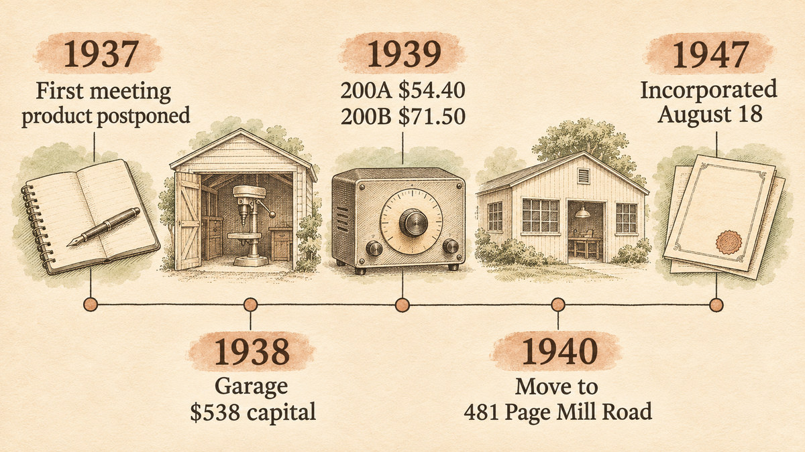

On August 23, 1937, Bill Hewlett and Dave Packard held their first formal business meeting. The minutes say that the company would design and manufacture electronics, but ["the question of what to manufacture was postponed."](#ref-hpca-creating-company) The proposed name was "The Engineering Service Company."

This post is part of a series about founders who worked before modern venture capital, which is usually dated from the founding of ARD in 1946. Their story looks a lot like a startup story today: two engineers, a professor who pushed them, a garage, and a first product that sold to other engineers.

Most of what we know about the garage years comes from the company itself. The Hewlett-Packard Company Archives, hp.com and hpe.com are corporate sources, and Packard's book *The HP Way* is a founder's memoir. I did not read *The HP Way* for this post. Where a claim rests only on a company source, I say so. The independent documents I used are a 1939 journal paper, a 1939 magazine advertisement, a patent, and the 2007 National Register of Historic Places nomination for the property.

## The market was laboratory instruments that cost hundreds of dollars

An audio oscillator generates one pure tone at a time. Engineers used it to test amplifiers, telephones, radios and recording equipment. In the late 1930s, the common laboratory instrument for this job was the beat-frequency oscillator.

Hewlett worked on a different design at Stanford. HPE's gallery page says the 200A [began as the subject of Hewlett's master's thesis](#ref-hpe-200a-gallery) and used a light bulb in a Wien bridge circuit to control the output without distortion. In October 1939, Fred Terman, Hewlett and two other Stanford authors published a paper in the *Proceedings of the I.R.E.* about negative feedback in laboratory equipment. The summary makes the market argument in one sentence: resistance-capacitance oscillators ["represent a simple and inexpensive substitute for beat-frequency oscillators, and have comparable performance."](#ref-ire-1939)

Hewlett filed a patent for a "variable frequency oscillation generator" on [July 11, 1939, and it was granted on January 6, 1942](#ref-patent-us2268872). HP's museum page says that Hewlett [assigned the patent to the partnership](#ref-hp-museum-200a) of William R. Hewlett and David Packard.

HP's own figures describe the price gap. HP's museum page says that the 200A [sold for $54.40](#ref-hp-museum-200a), and that similar equipment from competitors cost between $200 and $600. I did not find an independent 1939 price list for the competing instruments, so the $200 to $600 range is HP's claim.

## Their move was a cheap tool for engineers, built in a rented garage

Terman did more than teach. HP's garage timeline says that in the summer of 1938 [Terman arranged a Stanford fellowship](#ref-hp-garage-timeline) for Packard, and that Packard took a leave of absence from General Electric to "make a run for it" with Hewlett. Hewlett chose 367 Addison Avenue in Palo Alto [because it had a garage](#ref-hp-garage-timeline) that the two men could work in. The Packards moved into the ground-floor flat in September 1938, and Hewlett moved into a shed behind the house.

The capital was small. HP's garage timeline says that they began part-time work with [$538 in working capital, made up of cash and a used Sears Craftsman drill press](#ref-hp-garage-timeline). HP's 1930s timeline gives the same amount but calls the tool a [used Sears-Roebuck drill press](#ref-hp-timeline-30s). The $538 was not an investment from anyone else. It was the founders' cash and equipment.

The garage did not start with one product. The National Register nomination quotes a 1984 book: the two men "devised a variety of electrical gadgets and did [odd job work that Professor Terman helped them find](#ref-nrhp-nomination)." The same document lists a diathermy machine for the Palo Alto Hospital, a drive for a telescope on Mount Hamilton, a bowling-alley foul-line indicator and a weight-reducing machine. The HP archives show the [foul-line indicator, an automatic toilet flusher and an electric weight-loss machine](#ref-hpca-freelancing) as projects from the search for a market niche. The nomination also says that Lucile Packard [provided a regular income from her job in the Stanford Registrar's Office](#ref-nrhp-nomination) and kept the company's books in the evenings.

The oscillator then became the product. HP's 1930s timeline says that Packard named it the 200A ["because we thought the name would make us look like we'd been around for awhile."](#ref-hp-timeline-30s) An archived HPE page says that the founders chose $54.40 [not because of cost calculations](#ref-hpe-200a-gallery) but because the number reminded them of the 1844 slogan "54-40 or Fight!" That explanation is company lore. I did not find a 1939 document that explains the price.

The famous customer came next. Walt Disney Studios wanted changes to the 200A, and the result was the [Model 200B. Disney ordered eight of them](#ref-hp-timeline-30s) and used them to test channels, recording equipment and speakers for the theaters that showed *Fantasia* in 1940. An archived HPE page gives the price as [$71.50 each](#ref-hpe-200b-gallery). An independent document agrees with that price. HP's first magazine advertisement, in the [November 1939 issue of *Electronics*](#ref-hpca-first-ad), offered the "Model 200B" for ["$71.50 net FOB Palo Alto"](#ref-electronics-1939-11) and printed the return address as 367 Addison Avenue.

On [January 1, 1939, they formalized the partnership and chose the company name with a coin toss](#ref-hp-garage-timeline). HP's 1930s timeline gives the result of the first year as [revenue of $5,369 and 2 employees](#ref-hp-timeline-30s). The National Register nomination adds [$1,563 in profit and approximately 200 oscillators](#ref-nrhp-nomination) built at the property from the fall of 1938 to the fall of 1939. In 1940 the company [moved to a rented building at 481 Page Mill Road](#ref-hp-garage-timeline). HP was [incorporated on August 18, 1947](#ref-hpe-timeline), eight years after the coin toss.

## Today we would call this a bootstrapped, customer-funded university spinout

This section is my interpretation, not a sourced fact.

In today's terms, Hewlett and Packard did four things that founders still copy.

1. **They turned research into a product.** The oscillator came out of Stanford work under Terman, and the same idea appeared in a journal paper and in a patent. Today we would call this a university spinout, although I found no source that says Stanford held a stake.
2. **They used price as the wedge.** The 1939 paper sold the idea as an inexpensive substitute with comparable performance. HP's own numbers put the 200A at a fraction of the competitors' prices. That is the classic disruptive entry: equal on the specification that matters, much cheaper on the invoice.
3. **They let customers pay for development.** None of the sources I read mention an outside investor in the garage years. The money in those sources is the $538, Lucile Packard's salary, odd-job income and orders such as Disney's.
4. **They turned a custom request into a catalog product.** The 200B started as changes for one customer. By November 1939 it was the lead product in their first magazine advertisement. Today we would say that a design partner shaped version two.

The garage years also show what product-market fit looked like before the phrase existed. The founders tried gadgets for a hospital, a bowling alley and an observatory. Those projects paid but did not repeat. The oscillator repeated: engineers in many places had the same need, and the same instrument met it.

## Several popular claims do not survive a check of the sources

**"Disney bought the first HP oscillators."** HP calls the Disney order the [company's first big sale](#ref-hp-museum-200a), not its first sale, and the instrument was the modified 200B. The date is also unclear. The HPE gallery says it was [a 1938 sale](#ref-hpe-200b-gallery), the HP archives date the item [ca. 1939](#ref-hpca-disney), and the first advertisement for the 200B appeared in November 1939.

**"Packard won the coin toss."** The HP timelines that I read say only that the [name was decided with a coin toss](#ref-hp-garage-timeline). Retellings disagree about who won. I did not find a primary source that names the winner, so I leave it out.

**"The oscillator was Packard's thesis."** The National Register nomination says the variable frequency oscillator was [a master's thesis project of Packard's](#ref-nrhp-nomination). The patent names [William R. Hewlett as the inventor](#ref-patent-us2268872), and HPE describes the 200A as the [subject of Hewlett's master's thesis](#ref-hpe-200a-gallery). The nomination is wrong on this point. It also gives the address once as "376 Addison", which is a typo for 367.

**"They showed the oscillator in Portland in November 1938."** The National Register nomination says that in November 1938 they took a working model [to an Institute of Radio Engineers conference in Portland](#ref-nrhp-nomination). The 1939 paper says it was presented at the [Pacific Coast Convention in Portland on August 11, 1938](#ref-ire-1939). I could not reconcile the two dates, and I treat the November date as unconfirmed.

**"The garage is where Silicon Valley was born."** That phrase is a commemoration, not a finding. California registered the garage as [Landmark No. 976 on August 13, 1987](#ref-ohp-976), and the official description calls it "the birthplace of the world's first high-technology region." HP's timeline gives [August 7, 1987](#ref-hp-garage-timeline) for the registration and May 19, 1989 for the plaque dedication. In 2018, IEEE dedicated a milestone called ["Birthplace of Silicon Valley, 1956"](#ref-ethw-shockley) at the former Shockley Semiconductor Laboratory site in Mountain View. The name "Silicon Valley" first appeared in print in [*Electronic News* on January 11, 1971](#ref-chm-sv50), more than thirty years after HP left the garage.

**"The $538 was seed money."** HP describes it as [working capital that included a drill press](#ref-hp-garage-timeline). It was not a round from investors, and HP's two timelines do not agree on the brand of the drill press.

## Founders who build tools for builders can still use this playbook

An audio oscillator in 1939 was a developer tool. Its customers were engineers who built other products. HP's first advertisement sold the 200B on specifications: frequency range, distortion, output and price. Three lessons carry over.

- **Publish the idea where your customers read.** The *Proceedings of the I.R.E.* and *Electronics* were where HP's customers looked for tools. The paper explained why the design worked, and the advertisement gave the price and the address.
- **Name the product for the buyer's trust.** The founders first proposed a generic service name, then used their own surnames, and called the first model "200A" to look established. A name is a signal to the customer before the customer tests anything. This applies to model numbers, company names and domain names alike.
- **Keep the custom work if it repeats.** The Disney changes became the 200B, and the 200B became the advertised product. A request from one customer is worth building into the catalog when the next customer needs the same thing.

## References

All sources were fetched on 2026-11-11. The archive links point to the most recent existing Wayback Machine snapshot that I found, and the date in each archive link is the snapshot date.

- Hewlett-Packard Company Archives (corporate source) — [“Creating a Company”](https://www.hewlettpackardhistory.com/item/creating-a-company/#:~:text=the%20question%20of%20what%20to%20manufacture%20was%20postponed), item dated August 23, 1937. Supporting passage: “the two men agreed that their mission would involve designing and manufacturing electronics, but ‘the question of what to manufacture was postponed.’” — fetched 2026-11-11; [archived 2026-04-18](http://web.archive.org/web/20260418170754/https://www.hewlettpackardhistory.com/item/creating-a-company/)
- Hewlett Packard Enterprise (corporate source) — [Innovation Gallery: Model 200A audio oscillator](https://www.hpe.com/us/en/about/history/innovation-gallery/002-product.html). The live URL now redirects to a timeline page without this text, so read the archived copy. Supporting passages: “The Model 200A began as the subject of Bill Hewlett's master's thesis at Stanford University”; “priced the 200A at $54.40 not because of cost calculations but because it reminded them of ‘54.40' or Fight!’” — fetched 2026-11-11; [archived 2025-12-09](http://web.archive.org/web/20251209145626/https://www.hpe.com/us/en/about/history/innovation-gallery/002-product.html)
- F. E. Terman, R. R. Buss, W. R. Hewlett and F. C. Cahill — [“Some Applications of Negative Feedback with Particular Reference to Laboratory Equipment,” *Proceedings of the I.R.E.*, October 1939, pp. 649–655](https://www.hpmemoryproject.org/an/pdf/hp200_IRE_article.pdf), scan hosted by the HP Memory Project. Summary on p. 649: “Such resistance-capacitance oscillators represent a simple and inexpensive substitute for beat-frequency oscillators, and have comparable performance.” Footnote on p. 649: “Presented, Thirteenth Annual Convention, New York, N. Y., June 16, 1938, and Pacific Coast Convention, Portland, Ore., August 11, 1938.” — fetched 2026-11-11; [archived 2023-10-23](http://web.archive.org/web/20231023172659/https://hpmemoryproject.org/an/pdf/hp200_IRE_article.pdf)
- Google Patents — [US 2,268,872, “Variable frequency oscillation generator,” William R. Hewlett](https://patents.google.com/patent/US2268872A/en). Application US283301A filed 1939-07-11; granted 1942-01-06. — fetched 2026-11-11; [archived 2025-12-13](http://web.archive.org/web/20251213174603/https://patents.google.com/patent/US2268872A/en)
- HP (corporate source) — [Virtual museum: HP 200A history](https://www.hp.com/hpinfo/abouthp/histnfacts/museum/earlyinstruments/0002/0002history.html#:~:text=It%20sold%20for%20%2454.40). Supporting passages: “It sold for $54.40. Similar equipment built by competitors cost between $200 and $600”; “The company's first big sale was an order of eight model 200B audio oscillators to the Walt Disney Company”; the patent was assigned “to Hewlett-Packard Company of Palo Alto, California a co-partnership consisting of William R. Hewlett and David Packard.” — fetched 2026-11-11; [archived 2026-07-15](http://web.archive.org/web/20260715171306/https://www.hp.com/hpinfo/abouthp/histnfacts/museum/earlyinstruments/0002/0002history.html)
- HP (corporate source) — [HP Garage Timeline](https://www.hp.com/hpinfo/abouthp/histnfacts/garage/timeline.html#:~:text=%24538%20in%20working%20capital), entries for 1938, 1939, 1940, 1987 and 1989. Supporting passages: “Fred Terman arranges a Stanford fellowship for Dave”; “specifically chooses 367 Addison Avenue because it has a garage that the two of them can work in”; “The $538 consists of cash and a used Sears Craftsman drill press”; “January 1, Bill and Dave formalize their partnership. They decide the company’s name with a coin toss”; “Having outgrown the garage, Hewlett-Packard moves to a rented building at 481 Page Mill Road”; “1987, August 7 Garage is granted California State Landmark status as California Registered Landmark No. 976”; “1989, May 19 Garage is dedicated as a state historic landmark.” — fetched 2026-11-11; [archived 2026-11-01](http://web.archive.org/web/20261101172843/https://www.hp.com/hpinfo/abouthp/histnfacts/garage/timeline.html)
- HP (corporate source) — [HP timeline — 1930s](https://www.hp.com/hpinfo/abouthp/histnfacts/timeline/hist_30s.html#:~:text=used%20Sears%2DRoebuck%20drill%20press). Supporting passages: “The $538 consists of cash and a used Sears-Roebuck drill press”; “The HP Model 200A is so named ‘because we thought the name would make us look like we'd been around for awhile,’ says Dave later”; “HP creates its second product—the Model 200B audio oscillator—and Disney orders eight of them”; “Revenue: $5369. Employees: 2.” — fetched 2026-11-11; [archived 2026-10-30](http://web.archive.org/web/20261030100907/http://www.hp.com/hpinfo/abouthp/histnfacts/timeline/hist_30s.html)
- National Park Service — [National Register of Historic Places Registration Form: Hewlett-Packard House and Garage](https://npgallery.nps.gov/GetAsset/7b6f8587-d458-4bf6-8d0e-1d260e60dee5), NRIS 07000307, Section 8, continuation pages 6–9. The form cites the HP archives, Packard's *The HP Way* and Rogers and Larsen's *Silicon Valley Fever* (1984), so it is partly a secondary source. Supporting passages (p. 7): “odd job work that Professor Terman helped them find”; “Lucile Packard provided a regular income from her job in the Registrar's Office at Stanford University”; “a variable frequency oscillator (a master's thesis project of Packard's)”; “In November 1938, they built a working model of an audio oscillator and took it to Portland, Oregon, to an Institute of Radio Engineers conference.” (p. 8): “approximately 200 audio oscillators”; “revenues of $5369 and had made $1563 in profit.” (p. 9): “the house and garage at 376 Addison in 1938.” — fetched 2026-11-11; [archived 2025-09-18](http://web.archive.org/web/20250918115718/https://npgallery.nps.gov/GetAsset/7b6f8587-d458-4bf6-8d0e-1d260e60dee5)
- Hewlett-Packard Company Archives (corporate source) — [“Freelancing in Their Spare Time”](https://www.hewlettpackardhistory.com/item/freelancing-in-their-spare-time/#:~:text=an%20automatic%20toilet%20flusher). Supporting passage: “Among the devices they pursued were an automatic toilet flusher, an electric weight-loss machine and this device, an electric foul-line indicator they developed for a local bowling alley.” — fetched 2026-11-11; [archived 2026-06-14](http://web.archive.org/web/20260614232809/https://www.hewlettpackardhistory.com/item/freelancing-in-their-spare-time/)
- Hewlett Packard Enterprise (corporate source) — [Innovation Gallery: Model 200B Audio Oscillator](https://www.hpe.com/us/en/about/history/innovation-gallery/008-product.html). The live URL now redirects, so read the archived copy. Supporting passages: “A 1938 sale to Disney of eight oscillators required enough modifications in the original design for the result to be the Model 200B”; “Disney ordered eight of the Model 200B at $71.50 each.” — fetched 2026-11-11; [archived 2026-07-10](http://web.archive.org/web/20260710193527/https://www.hpe.com/us/en/about/history/innovation-gallery/008-product.html)
- Hewlett-Packard Company Archives (corporate source) — [“A Fantastic First Ad”](https://www.hewlettpackardhistory.com/item/a-fantastic-first-ad/#:~:text=November%201939%20issue%20of%20Electronics). Supporting passage: “Hewlett-Packard’s first magazine ad appeared in the November 1939 issue of Electronics, showcasing the Model 200B audio oscillator.” — fetched 2026-11-11; [archived 2026-06-15](http://web.archive.org/web/20260615113658/https://www.hewlettpackardhistory.com/item/a-fantastic-first-ad/)
- *Electronics*, vol. 12, no. 11, November 1939 — [Hewlett-Packard Co. advertisement “Resistance Tuned Audio Oscillators”](https://www.worldradiohistory.com/Archive-Electronics/30s/Electronics-1939-11.pdf#page=97), printed page 95, PDF page 97, scan hosted by World Radio History. Ad text: “MODEL 200B … $71.50 net FOB Palo Alto … HEWLETT-PACKARD CO. 367 ADDISON AVENUE PALO ALTO, CALIFORNIA.” — fetched 2026-11-11; [archived 2026-02-03](http://web.archive.org/web/20260203103924/https://www.worldradiohistory.com/Archive-Electronics/30s/Electronics-1939-11.pdf)
- Hewlett-Packard Company Archives (corporate source) — [“A Deal with Disney: HP 200B Oscillator”](https://www.hewlettpackardhistory.com/item/a-deal-with-disney/#:~:text=Disney%20ordered%20eight%20of%20them), item dated ca. 1939. Supporting passage: “Disney ordered eight of them for use in the audio production of Fantasia, most famously in the installation of Fantasound.” — fetched 2026-11-11; [archived 2026-07-27](http://web.archive.org/web/20260727210646/https://www.hewlettpackardhistory.com/item/a-deal-with-disney/)
- Hewlett Packard Enterprise (corporate source) — [Growth and innovation timeline](https://www.hpe.com/us/en/about/history/timeline/timeline-growth-innovations.html#:~:text=HP%20is%20incorporated%20on%20August%2018), entry “1947–HP incorporates.” Supporting passage: “HP is incorporated on August 18. Dave is named president, Bill vice president.” — fetched 2026-11-11 in a browser; no archive snapshot recorded
- California Office of Historic Preservation — [California Historical Landmark No. 976, “Birthplace of Silicon Valley”](https://ohp.parks.ca.gov/ListedResources/Detail/976#:~:text=This%20garage%20is%20the%20birthplace). Supporting passages: “This garage is the birthplace of the world's first high-technology region, ‘Silicon Valley.’”; “Registration Date: 8/13/1987.” — fetched 2026-11-11; [archived 2026-08-01](http://web.archive.org/web/20260801155615/https://ohp.parks.ca.gov/ListedResources/Detail/976)
- Engineering and Technology History Wiki (IEEE) — [Milestones: Birthplace of Silicon Valley, 1956](https://ethw.org/Milestones:Birthplace_of_Silicon_Valley,_1956#:~:text=At%20this%20location%2C%20391%20San%20Antonio%20Road). Dedicated 2018/08/15. Citation: “At this location, 391 San Antonio Road, the Shockley Semiconductor Laboratory manufactured the first silicon devices in what became known as Silicon Valley.” — fetched 2026-11-11; [archived 2026-09-16](http://web.archive.org/web/20260916053725/https://ethw.org/Milestones:Birthplace_of_Silicon_Valley,_1956)
- Computer History Museum, David A. Laws — [“Silicon Valley Turns 50”](https://computerhistory.org/blog/silicon-valley-turns-50/#:~:text=First%20use%20of%20the%20name). Cover image caption: “First use of the name ‘Silicon Valley’ in print. Electronic News, January 11, 1971 page 1.” — fetched 2026-11-11; [archived 2026-06-09](http://web.archive.org/web/20260609150354/https://computerhistory.org/blog/silicon-valley-turns-50/)

## Further reading

- California Office of Historic Preservation — [Hewlett-Packard House and Garage](https://ohp.parks.ca.gov/ListedResources/Detail/N2361), National Register listing dated 4/20/2007. — fetched 2026-11-11; [archived 2026-06-15](http://web.archive.org/web/20260615075132/https://ohp.parks.ca.gov/ListedResources/Detail/N2361)
- Hewlett-Packard Company Archives (corporate source) — [“The Father of Silicon Valley”](https://www.hewlettpackardhistory.com/item/the-father-of-silicon-valley/), on Fred Terman's role. — fetched 2026-11-11; [archived 2026-04-18](http://web.archive.org/web/20260418161145/https://www.hewlettpackardhistory.com/item/the-father-of-silicon-valley/)
- David Packard, *The HP Way* (HarperBusiness, 1995). Founder's memoir; not read for this post.
