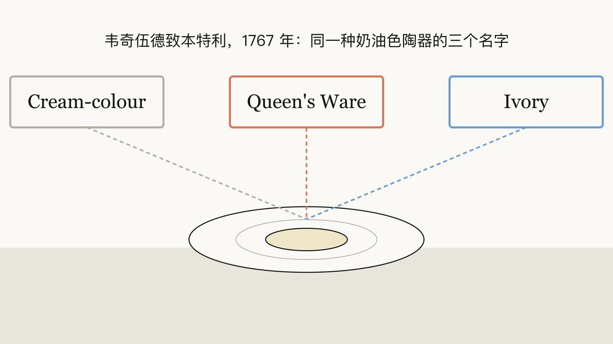

本文属于“风投诞生之前的创业者”系列。这个系列写的是风险投资还没有成为一个行业的时候就把公司做起来的人，每篇只问一个问题：他们的哪些做法，今天的创业者一看就认得出来？

乔赛亚·韦奇伍德（Josiah Wedgwood，1730–1795）是英格兰中部斯塔福德郡的陶工。奶油色陶器不是他发明的，他也没有外部投资人。他对今天创业者的用处在于，他把自己的盘算写进了信里。他写给弟弟约翰（John Wedgwood）和合伙人托马斯·本特利（Thomas Bentley）的大量书信，有许多收进了梅特亚德（Eliza Meteyard）1865–1866 年出版的两卷本《韦奇伍德传》（*The Life of Josiah Wedgwood*）。本文主要依据这些书信；凡是出自后世史家的说法，文中都会注明。

## 韦奇伍德接下了一张他认为别的陶工都推掉了的宫廷订单

常见的说法是：1762 年威尔士亲王出生时，韦奇伍德向夏洛特王后献上一套产妇喝的甜酒（caudle）器具，从此得到王室青睐。梅特亚德读过韦奇伍德家族的文书，她说这个故事[“纯属传说”](#ref-meteyard-v1-myth)，她查不到任何献礼的记录，而书信讲的是另一回事。

1765 年，韦奇伍德在信里告诉弟弟，[圣詹姆斯宫来了一张订单](#ref-meteyard-v1-chetwynd)。下单的是王后身边负责缝纫和浆洗的女官切特温德（Deborah Chetwynd），她要一套茶具。订单经纽卡斯尔一位斯莫尔伍德先生转到韦奇伍德手里，韦奇伍德自己的解释是：“我想是因为别人都不肯接。”这张订单很难做：金色底子上要凸起绿色的花。韦奇伍德从没在自己的陶器上烧过金。他请约翰去打听，金子要像切尔西瓷器那样烧进釉里，还是只用清漆粘上去；还嘱咐约翰“穿上你这辈子最好的一套衣服”，进宫去问。

几个星期后，韦奇伍德从同一张订单里又看到一个机会。他写道，[“能给王后送一箱样品，我会深感荣幸”](#ref-meteyard-v1-patterns)，样品里要放两套花瓶。他打算把手头现成的铜版画配到花瓶上，让人看起来像是“专为王室设计的——你千万别说漏嘴”。

用今天创业圈的话说，这是一张来自挑剔客户的高难度首单，而且韦奇伍德认为竞争对手都推掉了。韦奇伍德先把它当成产品问题（金怎么烧上去），再把它当成销售渠道（给王后送一箱样品）。

## 韦奇伍德在信里写明了王室名号为什么管用

到了 1767 年，这种陶器也有了一个带王室色彩的名字。韦奇伍德当年写给本特利的信里说：[“这种奶油色陶器，又叫王后陶（Queen's Ware），又叫象牙瓷，需求还在增长。”](#ref-meteyard-v2-queensware)这句话说明三个名字同时在用，却说明不了“王后陶”这个名字是谁起的、哪一天起的。

关于王室名号起什么作用，这封信也是最好的证据。韦奇伍德自问：这种陶器卖得好，有多少要归功于“它被引荐给市场的方式”，有多少要归功于“它本身的实用和美观”？接着他写下自己的结论：

> if a Royal or Noble introduction be as necessary to the sales of an article of Luxury as real Elegance & beauty, then the Manufacturer, if he consults his own inter[est], will bestow as much pains & expence too, if necessary, in gaining the favour of these advantages as he wo[ul]d in bestowing the latter.

这段话的意思是：如果对奢侈品来说，王室或贵族的引荐和真正的雅致美观一样不可或缺，那么厂家为自身利益计，就该在争取前者上花同样多的心血，必要时也花同样多的钱。今天的创业者会把这叫作标杆客户或者社会认同。韦奇伍德的说法比口号谨慎：他没说名号可以代替质量，他说的是对奢侈品而言，背书和质量可能缺一不可，两样都得投入。

## 伦敦展厅的设计本意就是隔几天换一次陈列

韦奇伍德在格罗夫纳广场附近的查尔斯街已经有一间展室。1767 年春，他想换一间更大的。帕尔摩街有一间大厅，此前办过拍卖和画展，本特利反对租它，韦奇伍德也同意。他的理由在顾客身上：[“贵族和绅士们互相推荐，来我的展室”](#ref-meteyard-v2-showroom)，而一间谁都能随便逛进去的屋子，会把这批客人挡在门外。

他要大房间，不是为了囤货。他要在“两排桌子，至少六到八张”上摆出整套的餐具和甜点器具，墙上陈列成套的花瓶，而且要经常重新摆放：

> Every new show, Exhibition, or rarity soon grows stale in London, & is no longer regarded after the first sight, unless utility, or some such variety as I have hinted at above, continue to recommend it to their notice.

大意是：在伦敦，任何新展览、新奇物件看过一眼就不新鲜了，除非有实用价值，或者像他说的那样不断变换花样，才能持续吸引人。他还报告了效果：重新摆放之后，[“头两天就卖出三整套花瓶，每套二到三几尼”](#ref-meteyard-v2-showroom)，另外还卖了好多对。其中有些花瓶已经在展室里放了六个月、五个月，有的放了十二个月，“缺的只是摆法”。这封信没有写日期，梅特亚德根据内容把它定在 1767 年 5 月。

展厅这一招后来被一再使用。1772 年，公司在温泉城巴斯的西门楼（Westgate Buildings）[筹备展厅](#ref-meteyard-v2-bath)，赶社交季。1774 年 4 月，公司在伦敦苏豪区希腊街[新展厅开张](#ref-meteyard-v2-greekstreet)。同年 6 月，俄国女皇叶卡捷琳娜二世订制的大型奶油色餐具在这里展出，[凭票入场](#ref-meteyard-v2-russian)。德拉尼夫人（Mary Delany）6 月 7 日去看了，她写道，[“楼下三间、楼上两间都摆满了，铺在桌上”](#ref-delany-1774)，又说这对厂家是好事，“他的巧思和勤奋值得鼓励”。

希腊街这场展出，今天会叫发布会。1767 年那封信描述的更像一张不断做测试的产品页：同样的库存，换个摆法，卖得更快。

## 一本印刷目录让没见过货的买家也能挑选

1773 年，韦奇伍德和本特利印了一本《浮雕宝石、凹雕、纪念章和浅浮雕目录，附花瓶等装饰品概述》。序言把问题说得很直白：他们的许多朋友还没见过这些新品，[“许许多多爱好艺术、有品位的人还从没听说过”](#ref-catalogue-1773)，所以需要一份说明或者目录，“这既是可取的，也是必要的”。1774 年出了[增订第二版](#ref-catalogue-1774)，同年还有一本[法文版](#ref-catalogue-1774-fr)，书名页写明货品在伦敦希腊街的店里出售。

这本目录收的是装饰类陶器，不是日常用的王后陶。目录最后一页给要买日用陶器的顾客指了唯一的去处：王后陶[“照常在他位于大纽波特街拐角、面对长亩街的货栈出售，伦敦别无他处”](#ref-catalogue-1773-queensware)。创业者会认出它同时干了两件事：既是产品文档，又是分发渠道。买家不必跑一趟伦敦，就能照着目录挑货。

## 本特利和韦奇伍德一个守市场、一个守工厂

合伙开始时，本特利还住在利物浦。两人的合伙一开始范围就很窄。梅特亚德解释说，这个合伙[只管装饰类陶器](#ref-meteyard-v2-partnership-scope)，日用陶器仍由韦奇伍德的亲戚托马斯·韦奇伍德（Thomas Wedgwood）作为合伙人兼经理负责。1768 年 11 月，韦奇伍德写信说，[“合伙账簿应在 14 日星期一开账”](#ref-meteyard-v2-books)，因为那一天第一批陶工要在新厂伊特鲁里亚（Etruria）开工。梅特亚德记载工厂在 [1769 年 6 月 13 日](#ref-meteyard-v2-etruria)正式开工，不过她特意说明这是“流传下来”的说法，不是书信里的记录。

这种划分后来惹了麻烦。茶壶做成古典造型、画上伊特鲁里亚人物以后，谁也说不清它算日用陶器还是装饰陶器，也就说不清归哪一个合伙。梅特亚德花了不少篇幅讲[这个难题](#ref-meteyard-v2-partnership-scope)。把一家公司按产品线拆给不同的人负责的创业者，对这种麻烦都不陌生。

本特利后来搬到了伦敦。据梅特亚德记载，他在切尔西主持公司的上釉彩绘工场，替公司物色到希腊街的房子，并在 [1774 年 7 月把家从切尔西搬了过去](#ref-meteyard-v2-greekstreet)。

## 1772 年，工厂造出的货超过了富人愿意买的量

1772 年前后日子不好过。梅特亚德一句话概括了问题：[“库存的精美装饰陶器，比富人愿意买的还多。”](#ref-meteyard-v2-overproduction)根据书信，她认为出路是给不那么富裕的买家做一类便宜些的花瓶。韦奇伍德则先停了装饰品车间的加班。1772 年 9 月 8 日他写道：“正常工时我们都没活给他们干。”熟练工人扬言要投奔对手。信里把对手写作“P 太太”，梅特亚德点名的对手是帕尔默（Palmer）。韦奇伍德不愿意“把我们最好的工人放走，去成全对手的生意”。

这一时期最常被人提起的，是韦奇伍德的成本核算。研究这个题目的标准文献是麦肯德里克（Neil McKendrick）1970 年的论文[《韦奇伍德与工业革命中的成本核算》](#ref-mckendrick-1970)。本文没能找到这篇论文或者它所引 1772 年书信的公开版本，所以不转述其中的任何数字和引文。梅特亚德书中的信件能说明的，是 1772 年的经营处境：库存卖不动，熟练工人没活干，拟议的对策是推出一条更便宜的产品线。

## 有几种流行说法经不起查证

- **1762 年献甜酒器具。**梅特亚德称王后产子时受赠一套甜酒器具的故事[纯属传说](#ref-meteyard-v1-myth)。现存书信显示的是 1765 年一张找上门来的订单。
- **“韦奇伍德为了营销，用王后的名字给陶器命名。”**1767 年的信只能证明这个名字已经存在，并且韦奇伍德认为王室引荐有助于销售。V&A 引用了一句没有注明出处的话，说王后[“下令称之为王后陶”](#ref-vam-intro)，并把这件事放在 1766 年；V&A 的另一条藏品记录则把[王后的青睐和这个名字都定在 1765 年](#ref-vam-mug)。梅特亚德另外指出，韦奇伍德 [1766 年 10 月 18 日](#ref-meteyard-v1-invoice)给一位书商开发票时，“还没有得到‘王后陶工’的任命”。本文没有找到韦奇伍德或王后亲自定名的书信，所以这个名字是哪一年、由谁定下的，仍然没有定论。
- **免费送货和不满意退款。**维多利亚与阿尔伯特博物馆（V&A）说，韦奇伍德提供[“从工厂到伦敦免费送货，运输途中打碎的免费补换”](#ref-vam-intro)。V&A 的页面没有注明出处，本文也没有找到当年写明这些条款的书信。这类销售条款通常引用麦肯德里克 [1960 年研究韦奇伍德推销手法的论文](#ref-mckendrick-1960)，但本文找不到可以公开查阅的版本。至于“不满意退款”，本文没有找到任何可靠出处，所以不采用这个说法。
- **“最早的焦点小组”。**科恩（Nancy Koehn）在 2001 年的一次访谈里说，韦奇伍德就新花瓶[“做了有记录以来最早的一批焦点小组”](#ref-koehn-hbs)，对象是贵族和乡绅。本文引用的书信能证明的事情范围更窄，证据也更扎实：韦奇伍德重新布置了展室，并且记下了随后卖出多少。

## 韦奇伍德的招数仍然对得上今天的创业打法

这些类比只是大致对应，十八世纪的陶器市场也不是软件市场。不过，韦奇伍德有四招在今天都找得到对应物。

1. **接下难做的首单。**他认为别人都推掉了的宫廷订单，他接了，为了交货还着手学烧金。早期客户提出的难题，往往正好指出产品还缺什么。
2. **把背书为什么管用写下来。**韦奇伍德没有把王室青睐当成运气。他追问销量究竟来自名号还是质量，结论是两样都要。一个开发者工具在官网上列出知名用户时，也该问同样的问题。
3. **把橱窗当成产品来做。**韦奇伍德打算让展厅隔几天换一次陈列，还记下了一次换陈列之后卖出多少。落地页、注册商的搜索结果页、文档首页，都可以这样测试。
4. **让负责经营的合伙人贴近市场。**本特利在伦敦，离买家近；韦奇伍德在斯塔福德郡管工厂。两人各管一摊，但一开始划得太窄的合伙范围，后来引出了争执。

对卖名字的人，比如卖域名的人来说，韦奇伍德谈名字的那封信最有用。“奶油色陶器”“王后陶”“象牙瓷”指的是同一种产品。韦奇伍德把三个名字写进同一句话，接着追问销量里有多少要归功于这种陶器被引荐给市场的方式。

## 参考资料

- Eliza Meteyard，《The Life of Josiah Wedgwood》第 1 卷（伦敦：Hurst and Blackett，1865）——原始出处：[第 369–370 页](https://archive.org/details/lifeofjosiahwedg0001eliz_l6l4/page/369/mode/1up?q=%22mere+myth%22)。梅特亚德写道，1762 年威尔士亲王出生时向夏洛特王后献甜酒器具一事“is a mere myth”；第 370 页脚注称“nothing can be discovered bearing out the assertion”——抓取于 2026-11-11（原始出处本身就是互联网档案馆的扫描件，故未另做 Wayback 快照）
- 乔赛亚·韦奇伍德致约翰·韦奇伍德，未署日期（邮戳“A. P. 17”，梅特亚德据后来的信件定为 1765 年），收于梅特亚德第 1 卷——原始出处：[第 370–372 页](https://archive.org/details/lifeofjosiahwedg0001eliz_l6l4/page/370/mode/1up?q=%22Sempstress+and+Laundress%22)。原文：“An ord[er] from St James's for a service of Staffordshire ware”；“Miss Deborah, alias Deb Chetwynd, Sempstress and Laundress to the Queen”；“I believe because nobody else wo[ul]d undertake it”；“Pray put on the best suit of cloathes you ever had in your life, & take the first opportunity of going to Court”——抓取于 2026-11-11（原始出处本身就是互联网档案馆的扫描件，故未另做 Wayback 快照）
- 乔赛亚·韦奇伍德致约翰·韦奇伍德，1765 年 7 月 6 日，收于梅特亚德第 1 卷——原始出处：[第 373 页](https://archive.org/details/lifeofjosiahwedg0001eliz_l6l4/page/373/mode/1up?q=%22box+of+patterns%22)。原文：“I shall be very proud of the honour of sending a box of patterns to the Queen … so that the design and they will appear to be made for each other, & intended for Royalty—nor must you hint to the contrary”——抓取于 2026-11-11（原始出处本身就是互联网档案馆的扫描件，故未另做 Wayback 快照）
- 梅特亚德第 1 卷，韦奇伍德致贝克特（Becket）先生发票的脚注，伯斯勒姆，1766 年 10 月 18 日——原始出处：[第 478 页](https://archive.org/details/lifeofjosiahwedg0001eliz_l6l4/page/478/mode/1up?q=%22Potter+to+her+Majesty%22)。原文：该发票“will show the retail prices then given for cream-ware, as also the important fact that Mr. Wedgwood had not yet received his appointment of Potter to her Majesty”——抓取于 2026-11-11（原始出处本身就是互联网档案馆的扫描件，故未另做 Wayback 快照）
- 乔赛亚·韦奇伍德致托马斯·本特利，1767 年（未注月日），收于梅特亚德第 2 卷（1866）——原始出处：[第 56 页](https://archive.org/details/lifeofjosiahwedg0002eliz_n3z5/page/56/mode/1up?q=%22Royal+or+Noble%22)。原文：“The demand for the s[ai]d Cream-colour, alias Queen's Ware, alias Ivory, still increases”；“if a Royal or Noble introduction be as necessary to the sales of an article of Luxury as real Elegance & beauty …”——抓取于 2026-11-11（原始出处本身就是互联网档案馆的扫描件，故未另做 Wayback 快照）
- 乔赛亚·韦奇伍德致托马斯·本特利，未署日期，写于 Baptist Head 咖啡馆，梅特亚德定为 1767 年 5 月，收于梅特亚德第 2 卷——原始出处：[第 32–34 页](https://archive.org/details/lifeofjosiahwedg0002eliz_n3z5/page/32/mode/1up?q=%22recommend+one+another%22)。原文：“the nobility & gentry recommend one another to my rooms”；“Every new show, Exhibition, or rarity soon grows stale in London”；“The two first days after the alteration, we sold three complete setts of Vases, at 2 & 3 Guineas a sett”——抓取于 2026-11-11（原始出处本身就是互联网档案馆的扫描件，故未另做 Wayback 快照）
- 乔赛亚·韦奇伍德致托马斯·本特利，1768 年 11 月 6 日，收于梅特亚德第 2 卷——原始出处：[第 83 页](https://archive.org/details/lifeofjosiahwedg0002eliz_n3z5/page/83/mode/1up?q=%22Partnership+books%22)。原文：“The Partnership books should be opened on Monday the 14th inst., as some hands (Potters) will begin there at that time”——抓取于 2026-11-11（原始出处本身就是互联网档案馆的扫描件，故未另做 Wayback 快照）
- 梅特亚德第 2 卷——原始出处：[第 110 页](https://archive.org/details/lifeofjosiahwedg0002eliz_n3z5/page/110/mode/1up?q=%22June+13%2C+1769%22)。原文：“It is handed down, that on this bright summer's morning, June 13, 1769 …”——抓取于 2026-11-11（原始出处本身就是互联网档案馆的扫描件，故未另做 Wayback 快照）
- 梅特亚德第 2 卷——原始出处：[第 190 页](https://archive.org/details/lifeofjosiahwedg0002eliz_n3z5/page/190/mode/1up?q=%22only+to+ornamental+ware%22)。原文：“the partnership between Wedgewood and Bentley related only to ornamental ware, Mr. Thomas Wedgewood still remaining at the head of the ‘Useful Works’ as partner and manager”——抓取于 2026-11-11（原始出处本身就是互联网档案馆的扫描件，故未另做 Wayback 快照）
- 梅特亚德第 2 卷，引韦奇伍德致本特利，1772 年 6 月 2 日——原始出处：[第 254 页](https://archive.org/details/lifeofjosiahwedg0002eliz_n3z5/page/254/mode/1up?q=%22Westgate+Buildings%22)。原文：“The show-rooms in Westgate Buildings, Mr. Bentley had chosen early in the year were not yet opened”——抓取于 2026-11-11（原始出处本身就是互联网档案馆的扫描件，故未另做 Wayback 快照）
- 梅特亚德第 2 卷，引韦奇伍德致本特利，1772 年 9 月 8 日——原始出处：[第 263–264 页](https://archive.org/details/lifeofjosiahwedg0002eliz_n3z5/page/263/mode/1up?q=%22cheaper+class%22)。原文：“more fine ornamental ware was in stock than the rich would buy”；“to manufacture a cheaper class of vases to meet the ornamental needs of the less wealthy”；韦奇伍德：“we have not work for them the common hours”；“I do not think it is in such a desperate way that we should set our best hands adrift to the establishment of our antagonists”——抓取于 2026-11-11（原始出处本身就是互联网档案馆的扫描件，故未另做 Wayback 快照）
- 梅特亚德第 2 卷——原始出处：[第 290–291 页](https://archive.org/details/lifeofjosiahwedg0002eliz_n3z5/page/290/mode/1up?q=%22dissecting+room%22)。原文：韦奇伍德致本特利，1772 年 11 月 14 日，“I like the idea of the dissect[ing] room if a gallery can be had to it”；梅特亚德：“In April 1774 the show rooms though yet incomplete were opened; and in July Mr. and Mrs. Bentley removed their household hither from Chelsea”；“we find Bentley and his enamellers at work upon a grand scale”——抓取于 2026-11-11（原始出处本身就是互联网档案馆的扫描件，故未另做 Wayback 快照）
- 梅特亚德第 2 卷——原始出处：[第 293 页](https://archive.org/details/lifeofjosiahwedg0002eliz_n3z5/page/293/mode/1up?q=%22admission+was+by+tickets%22)。原文：“advertisements were inserted in the chief papers to the effect that the service was on show at the new rooms of Wedgwood and Bentley in Greek Street, Soho, and that admission was by tickets”；脚注称广告于“the month of June 1774”刊登在 *St. James's Chronicle*、*Gazetteer* 和 *Public Advertiser* 上——抓取于 2026-11-11（原始出处本身就是互联网档案馆的扫描件，故未另做 Wayback 快照）
- 德拉尼夫人致伊勒姆（Ilam）的波特夫人（Mrs Port），1774 年 6 月 7 日写于圣詹姆斯坊，收于 Lady Llanover 编《The Autobiography and Correspondence of Mary Granville, Mrs. Delany》第二辑第 1 卷（伦敦：Richard Bentley，1862）——原始出处：[第 593–595 页](https://archive.org/details/autobiographycor01delauoft/page/594/mode/1up?q=%22Portland+House%22)。原文：“I am just returned from viewing the Wedgewood-ware that is to be sent to the Empress of Russia”；“there are three rooms below and two above filled with it, laid out on tables”；“it is well for the manufacturer, which I am glad of, as his ingenuity and industry deserve encouragement”——抓取于 2026-11-11（原始出处本身就是互联网档案馆的扫描件，故未另做 Wayback 快照）
- Wedgwood and Bentley，《A Catalogue of Cameos, Intaglios, Medals, and Bas-Reliefs; with a General Account of Vases and Other Ornaments, after the Antique》（伦敦，1773）——原始出处：[序言](https://archive.org/details/bim_eighteenth-century_a-catalogue-of-cameos-i_wedgwood-and-bentley_1773/page/n2/mode/1up?q=Multitudes)，扫描第 3 张。原文（长 s 已改为现代拼写）：“Multitudes of Persons of Curiosity and Taste in the Works of Art have never heard of, render some Account or Catalogue of them desirable, and even necessary”——抓取于 2026-11-11（原始出处本身就是互联网档案馆的扫描件，故未另做 Wayback 快照）
- Wedgwood and Bentley，《A Catalogue of Cameos, Intaglios, Medals, Busts, Small Statues, and Bas-Reliefs …》，“The second edition, with additions”（伦敦，1774）——原始出处：[书名页](https://archive.org/details/bim_eighteenth-century_a-catalogue-of-cameos-i_wedgwood-and-bentley_1774)——抓取于 2026-11-11（原始出处本身就是互联网档案馆的扫描件，故未另做 Wayback 快照）
- Wedgwood and Bentley，《Catalogue de camées, intaglios, médailles, bustes, petites statues, et bas-reliefs …》，“qui se vendent à leur magazin dans Greek-Street, Soho, à Londres”（1774）——原始出处：[目录记录与扫描件](https://archive.org/details/bim_eighteenth-century_catalogue-de-cames-int_wedgwood-and-bentley_1774)——抓取于 2026-11-11（原始出处本身就是互联网档案馆的扫描件，故未另做 Wayback 快照）
- Wedgwood and Bentley，《A Catalogue of Cameos …》（伦敦，1773）——原始出处：[书末启事](https://archive.org/details/bim_eighteenth-century_a-catalogue-of-cameos-i_wedgwood-and-bentley_1773/page/n62/mode/1up?q=IMPROVEMENTS)，共 64 张扫描中的第 63 张。原文（长 s 已改为现代拼写）：“The QUEEN's WARE of all Kinds, with Various IMPROVEMENTS, by Mr. WEDGWOOD, continues to be sold, as usual, at his Warehouse, the Corner of Great Newport-Street, facing Long-Acre, and at no other Place in London.”——抓取于 2026-11-11（原始出处本身就是互联网档案馆的扫描件，故未另做 Wayback 快照）
- 维多利亚与阿尔伯特博物馆（V&A），二手资料——[“Wedgwood: An Introduction”](https://www.vam.ac.uk/articles/wedgwood-an-introduction#:~:text=free%20delivery%20from%20his%20factory%20to%20London)。原文：“such as free delivery from his factory to London and free replacement of items broken in transit”；“To this manufacturer the Queen was pleased to give her name and patronage, commanding it to be called Queensware”（页面未注出处，系于 1766 年）——抓取于 [2026-11-11](http://web.archive.org/web/20261004080712/https://www.vam.ac.uk/articles/wedgwood-an-introduction)（现有最新快照，日期为 2026-10-04）
- 维多利亚与阿尔伯特博物馆（V&A），二手资料——[藏品记录 O1767384，“Prince of Wales Investiture Mug”](https://collections.vam.ac.uk/item/O1767384/)。原文：“Queen Charlotte's (1744–1818) patronage in 1765 was a significant factor in the growth of Wedgwood's reputation, naming his creamware as Queen's Ware and adopting the title ‘Potter to Her Majesty’”——抓取于 2026-11-11（没有现成的 Wayback 快照，本次也无法新建）
- Martha Lagace，“Brand Power: From Wedgwood to Dell”，对 Nancy F. Koehn 的访谈，*HBS Working Knowledge*，2001 年 4 月 16 日，二手资料——[原始出处](https://www.library.hbs.edu/working-knowledge/brand-power-from-wedgwood-to-dell-part-one#:~:text=Wedgwood%20conducted%20some%20of%20the%20first%20focus%20groups%20on%20record)。原文：“Wedgwood conducted some of the first focus groups on record with aristocrats and gentry about new vases.” 科恩的书《Brand New: How Entrepreneurs Earned Consumers' Trust from Wedgwood to Dell》（Harvard Business School Press，2001）第 2 章“Josiah Wedgwood, 1730–1795”专讲韦奇伍德（[目录](https://www.kinokuniya.co.jp/f/dsg-02-9781578512218)）。本文没能看到该书的公开版本，所以不给页码，也不引用书中的具体说法——抓取于 2026-11-11（没有现成的 Wayback 快照，本次也无法新建）
- Neil McKendrick，“Josiah Wedgwood: An Eighteenth-Century Entrepreneur in Salesmanship and Marketing Techniques”，*Economic History Review* 12 卷 3 期（1960）：408–433，二手资料——[书目记录](https://econpapers.repec.org/RePEc:bla:ehsrev:v:12:y:1960:i:3:p:408-433)。全文需订阅，本文未读——抓取于 2026-11-11（没有现成的 Wayback 快照，本次也无法新建）
- Neil McKendrick，“Josiah Wedgwood and Cost Accounting in the Industrial Revolution”，*Economic History Review* 23 卷 1 期（1970）：45–67，二手资料——[书目记录](https://ideas.repec.org/a/bla/ehsrev/v23y1970i1p45-67.html)。全文需订阅，本文未读——抓取于 2026-11-11（没有现成的 Wayback 快照，本次也无法新建）
