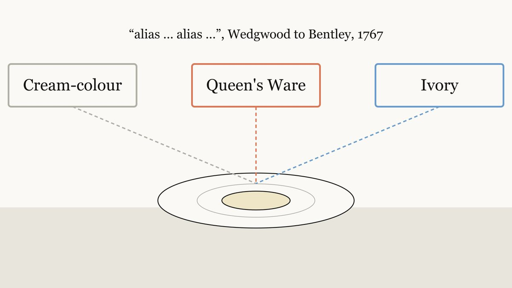

This post is part of a series about founders who built companies before venture capital existed as an industry. Each post asks one question: which of their moves would a founder today recognize?

Josiah Wedgwood (1730–1795) made pottery in Staffordshire, in the English Midlands. He did not invent cream-coloured earthenware, and he did not have outside investors. What makes him useful to a founder is that he wrote down his reasoning. Many of his letters to his brother John and to his partner Thomas Bentley were printed in Eliza Meteyard's two-volume *Life of Josiah Wedgwood* (1865–1866). This article relies mainly on those letters, and it says where a claim comes from a later historian instead.

## Wedgwood Took a Court Order That He Believed Other Potters Had Refused

A common story is that Wedgwood presented a caudle service to Queen Charlotte when the Prince of Wales was born in 1762, and that royal favour followed. Meteyard, who read the family papers, called that story [“a mere myth”](#ref-meteyard-v1-myth). She found no record of the gift, and the letters point the other way.

In 1765, Wedgwood told his brother about [an order from St James's](#ref-meteyard-v1-chetwynd). Deborah Chetwynd, “Sempstress and Laundress to the Queen,” wanted a tea service. The order reached Wedgwood through a Mr Smallwood of Newcastle, “I believe because nobody else wo[ul]d undertake it.” The request was hard: a gold ground with raised green flowers. Wedgwood had never fired gold onto his ware. He asked John to find out whether the gold had to be “burnt in” as on Chelsea porcelain, or only varnished on. He also asked John to “put on the best suit of cloathes you ever had in your life” and go to Court to ask.

A few weeks later Wedgwood saw a second chance in the same order. He wrote that he would be [“very proud of the honour of sending a box of patterns to the Queen”](#ref-meteyard-v1-patterns), including two sets of vases. He planned to fit existing engravings to them so that the vases would look “intended for Royalty—nor must you hint to the contrary.”

In startup language, this was a hard first order from a demanding customer, one that Wedgwood believed his competitors had turned down. Wedgwood treated the order as a product problem first (how to fire gold) and as a sales channel second (a box of samples for the Queen).

## Wedgwood Wrote Down Why the Royal Name Mattered

By 1767 the ware also had a royal name. In a letter to Bentley that year, Wedgwood wrote that [“the demand for the s[ai]d Cream-colour, alias Queen's Ware, alias Ivory, still increases.”](#ref-meteyard-v2-queensware) The phrase shows three names in use at once. It does not show who chose the name “Queen's Ware” or exactly when.

The same letter is the best evidence for what Wedgwood thought the royal name did. He asked how much of the ware's success came from “the mode of its introduction” and how much from “its real utility and beauty.” Then he stated the rule he took from it:

> if a Royal or Noble introduction be as necessary to the sales of an article of Luxury as real Elegance & beauty, then the Manufacturer, if he consults his own inter[est], will bestow as much pains & expence too, if necessary, in gaining the favour of these advantages as he wo[ul]d in bestowing the latter.

A founder today would call this a reference customer, or social proof. Wedgwood's version is more careful than the slogan. He did not say the name replaced quality. He said that for a luxury product, the endorsement and the quality might each be necessary, and that he should spend on both.

## The London Showroom Was Designed to Change Every Few Days

Wedgwood already had a room in Charles Street, Grosvenor Square. By the spring of 1767 he wanted a larger one. Bentley objected to a large room in Pall Mall that had been used for auctions and exhibitions, and Wedgwood agreed. His reason was about the customers: [“the nobility & gentry recommend one another to my rooms”](#ref-meteyard-v2-showroom), and they would stay away from a room where anyone could stroll in.

He did not want the space to hold stock. He wanted it to show complete table and dessert services “on two ranges of Tables, six or eight at least,” and sets of vases on the walls. He wanted to rearrange them often:

> Every new show, Exhibition, or rarity soon grows stale in London, & is no longer regarded after the first sight, unless utility, or some such variety as I have hinted at above, continue to recommend it to their notice.

He also reported a result. After he rearranged the room, [“the two first days after the alteration, we sold three complete setts of Vases, at 2 & 3 Guineas a sett”](#ref-meteyard-v2-showroom), besides many pairs. Some of those vases had been in the room for six, five, or twelve months, and “wanted nothing but arrangment to sell them.” Meteyard dates this undated letter to May 1767 from its contents.

The showroom idea travelled. In 1772 the firm prepared [show-rooms in Westgate Buildings, Bath](#ref-meteyard-v2-bath), for the spa season. In April 1774 it opened [new rooms in Greek Street, Soho](#ref-meteyard-v2-greekstreet). That June, the firm showed the large creamware service ordered for Catherine II of Russia there, with [admission by ticket](#ref-meteyard-v2-russian). Mary Delany visited on 7 June 1774. She found [“three rooms below and two above filled with it, laid out on tables”](#ref-delany-1774), and added that it was “well for the manufacturer … as his ingenuity and industry deserve encouragement.”

Today we would call the Greek Street show a launch event. The 1767 letter describes something closer to a product page that is always being tested: the same inventory, arranged again, sold faster.

## A Printed Catalogue Reached Buyers Who Had Never Seen the Goods

In 1773 Wedgwood and Bentley printed *A Catalogue of Cameos, Intaglios, Medals, and Bas-Reliefs; with a General Account of Vases and Other Ornaments*. The preface states the problem plainly. Many of their friends had not seen the new articles, and [“Multitudes of Persons of Curiosity and Taste in the Works of Art have never heard of”](#ref-catalogue-1773) them, which made “some Account or Catalogue of them desirable, and even necessary.” A [second, expanded edition](#ref-catalogue-1774) followed in 1774, and so did a [French edition](#ref-catalogue-1774-fr) that named the shop in Greek Street.

This catalogue covered the ornamental ware, not the everyday Queen's Ware. Its last page sent buyers of useful ware to one place: Queen's Ware [“continues to be sold, as usual, at his Warehouse, the Corner of Great Newport-Street, facing Long-Acre, and at no other Place in London”](#ref-catalogue-1773-queensware). A founder would recognize it as documentation and distribution at once: a buyer could choose from it without visiting London.

## Bentley Ran London While Wedgwood Ran the Works

Thomas Bentley lived in Liverpool when the partnership began. The partnership between the two men began with a narrow scope. Meteyard explains that it [related only to ornamental ware](#ref-meteyard-v2-partnership-scope). Wedgwood's cousin Thomas Wedgwood remained the partner and manager for the useful ware. In November 1768 Wedgwood wrote that [“the Partnership books should be opened on Monday the 14th”](#ref-meteyard-v2-books), when the first potters would start work at the new factory, Etruria. Meteyard reports that the works opened on [13 June 1769](#ref-meteyard-v2-etruria), and she marks this account as one that is “handed down” rather than documented in a letter.

The split later caused trouble. When teapots were made in antique shapes and painted with Etruscan figures, nobody could say whether they were useful ware or ornamental ware, and therefore which partnership owned them. Meteyard describes [this problem](#ref-meteyard-v2-partnership-scope) at length. Founders who split one company into product lines with different owners will recognize it.

Bentley later moved to London. Meteyard describes him running the firm's enamelling works at Chelsea, finding the Greek Street premises, and in [July 1774 moving his household](#ref-meteyard-v2-greekstreet) there from Chelsea.

## In 1772 the Firm Made More Than the Rich Would Buy

The years around 1772 were hard. Meteyard summarizes the problem in one line: [“more fine ornamental ware was in stock than the rich would buy.”](#ref-meteyard-v2-overproduction) Her proposed fix, drawn from the letters, was to make a cheaper class of vases for less wealthy buyers. Meanwhile Wedgwood stopped overtime at the ornamental works. On 8 September 1772 he wrote that “we have not work for them the common hours.” His skilled workers threatened to leave for a rival. The letter calls the rival “Mrs. P.”, and Meteyard names Palmer as the competitor who wanted to hire them. He did not want “to set our best hands adrift to the establishment of our antagonists.”

Wedgwood's cost accounting in this period is the best-known part of the story. Neil McKendrick's article [“Josiah Wedgwood and Cost Accounting in the Industrial Revolution”](#ref-mckendrick-1970) (1970) is the standard study of it. This article could not read McKendrick's text, or the 1772 letters he quotes, in a public copy. So it repeats no figure or quotation from that analysis. The letters printed by Meteyard show the business situation of 1772: stock that did not sell, skilled workers without enough work, and a cheaper product line as the proposed fix.

## Some Popular Claims Do Not Survive a Check

- **The caudle service of 1762.** Meteyard called the story of a gift to Queen Charlotte at the Prince of Wales's birth [a myth](#ref-meteyard-v1-myth). The surviving letters show an order that came to Wedgwood in 1765.
- **“Wedgwood named Queen's Ware after the Queen to market it.”** The 1767 letter shows that the name existed and that Wedgwood thought royal introduction helped sales. The V&A quotes an unsourced statement that the Queen was [“commanding it to be called Queensware”](#ref-vam-intro), and dates it to 1766. Another V&A record dates the [patronage and the name to 1765](#ref-vam-mug). Meteyard, for her part, notes that when Wedgwood invoiced a bookseller on [18 October 1766](#ref-meteyard-v1-invoice), he “had not yet received his appointment of Potter to her Majesty.” This article found no letter in which Wedgwood or the Queen chose the name, so the year and the person who chose it remain open.
- **Free delivery and a money-back guarantee.** The V&A says Wedgwood offered [“free delivery from his factory to London and free replacement of items broken in transit”](#ref-vam-intro). The V&A page does not give its source, and this article found no letter from the period that states these terms. Neil McKendrick's [1960 article on Wedgwood's salesmanship](#ref-mckendrick-1960) is the usual scholarly source for such sales terms, but no public copy was available to check. This article found no reliable source at all for a money-back guarantee, so it does not repeat that claim.
- **“The first focus groups.”** In a 2001 interview, Nancy Koehn said that Wedgwood [“conducted some of the first focus groups on record”](#ref-koehn-hbs) with aristocrats and gentry about new vases. The letters quoted here show something narrower and better documented: Wedgwood rearranged a room and counted what sold.

## Wedgwood's Moves Still Map onto a Startup Playbook

The analogies are loose, and the eighteenth century was not a software market. Still, four of Wedgwood's moves have clear modern counterparts.

1. **Take the hard first order.** Wedgwood accepted a court order that he believed others had refused, and then set out to learn how to fire gold to fulfil it. Early customers who ask for something hard often show you what the product needs.
2. **Write down why an endorsement works.** Wedgwood did not treat royal favour as luck. He asked whether it or quality drove sales, and concluded that he needed both. A developer tool that lists famous users should ask the same question.
3. **Treat the shop window as a product.** Wedgwood planned to change the showroom every few days, and he counted the sales that followed one rearrangement. Landing pages, registrar search results, and documentation home pages can be tested the same way.
4. **Give the operating partner the market.** Bentley worked in London, close to the buyers, while Wedgwood ran the works in Staffordshire. Each partner had one job, but the narrow first scope of the partnership caused disputes later.

For people who sell names, such as domain names, Wedgwood's naming letter is the most useful part. “Cream-colour,” “Queen's Ware,” and “Ivory” described one product. Wedgwood put all three names in one sentence, and then asked how much of the sales came from the way the ware was introduced.

## References

- Eliza Meteyard, *The Life of Josiah Wedgwood*, vol. 1 (London: Hurst and Blackett, 1865) — Original source: [pp. 369–370](https://archive.org/details/lifeofjosiahwedg0001eliz_l6l4/page/369/mode/1up?q=%22mere+myth%22). Meteyard writes that the presentation of a caudle service to Queen Charlotte at the birth of the Prince of Wales in 1762 “is a mere myth,” and in a footnote on p. 370 that “nothing can be discovered bearing out the assertion” — fetched 2026-11-11 (the source is itself an Internet Archive scan, so no separate Wayback snapshot was made)
- Josiah Wedgwood to John Wedgwood, undated letter (post-mark “A. P. 17”; Meteyard dates it to 1765 from later letters), printed in Meteyard, vol. 1 — Original source: [pp. 370–372](https://archive.org/details/lifeofjosiahwedg0001eliz_l6l4/page/370/mode/1up?q=%22Sempstress+and+Laundress%22). Supporting passages: “An ord[er] from St James's for a service of Staffordshire ware”; “Miss Deborah, alias Deb Chetwynd, Sempstress and Laundress to the Queen”; “I believe because nobody else wo[ul]d undertake it”; “Pray put on the best suit of cloathes you ever had in your life, & take the first opportunity of going to Court” — fetched 2026-11-11 (the source is itself an Internet Archive scan, so no separate Wayback snapshot was made)
- Josiah Wedgwood to John Wedgwood, 6 July 1765, printed in Meteyard, vol. 1 — Original source: [p. 373](https://archive.org/details/lifeofjosiahwedg0001eliz_l6l4/page/373/mode/1up?q=%22box+of+patterns%22). Supporting passage: “I shall be very proud of the honour of sending a box of patterns to the Queen … so that the design and they will appear to be made for each other, & intended for Royalty—nor must you hint to the contrary” — fetched 2026-11-11 (the source is itself an Internet Archive scan, so no separate Wayback snapshot was made)
- Meteyard, vol. 1, footnote to Wedgwood's invoice to Mr Becket, Burslem, 18 October 1766 — Original source: [p. 478](https://archive.org/details/lifeofjosiahwedg0001eliz_l6l4/page/478/mode/1up?q=%22Potter+to+her+Majesty%22). Supporting passage: the invoice “will show the retail prices then given for cream-ware, as also the important fact that Mr. Wedgwood had not yet received his appointment of Potter to her Majesty” — fetched 2026-11-11 (the source is itself an Internet Archive scan, so no separate Wayback snapshot was made)
- Josiah Wedgwood to Thomas Bentley, 1767 (day and month not given), printed in Meteyard, vol. 2 (1866) — Original source: [p. 56](https://archive.org/details/lifeofjosiahwedg0002eliz_n3z5/page/56/mode/1up?q=%22Royal+or+Noble%22). Supporting passages: “The demand for the s[ai]d Cream-colour, alias Queen's Ware, alias Ivory, still increases”; “if a Royal or Noble introduction be as necessary to the sales of an article of Luxury as real Elegance & beauty …” — fetched 2026-11-11 (the source is itself an Internet Archive scan, so no separate Wayback snapshot was made)
- Josiah Wedgwood to Thomas Bentley, undated, written at the Baptist Head Coffee House; Meteyard dates it to May 1767. Printed in Meteyard, vol. 2 — Original source: [pp. 32–34](https://archive.org/details/lifeofjosiahwedg0002eliz_n3z5/page/32/mode/1up?q=%22recommend+one+another%22). Supporting passages: “the nobility & gentry recommend one another to my rooms”; “Every new show, Exhibition, or rarity soon grows stale in London”; “The two first days after the alteration, we sold three complete setts of Vases, at 2 & 3 Guineas a sett” — fetched 2026-11-11 (the source is itself an Internet Archive scan, so no separate Wayback snapshot was made)
- Josiah Wedgwood to Thomas Bentley, 6 November 1768, printed in Meteyard, vol. 2 — Original source: [p. 83](https://archive.org/details/lifeofjosiahwedg0002eliz_n3z5/page/83/mode/1up?q=%22Partnership+books%22). Supporting passage: “The Partnership books should be opened on Monday the 14th inst., as some hands (Potters) will begin there at that time” — fetched 2026-11-11 (the source is itself an Internet Archive scan, so no separate Wayback snapshot was made)
- Meteyard, vol. 2 — Original source: [p. 110](https://archive.org/details/lifeofjosiahwedg0002eliz_n3z5/page/110/mode/1up?q=%22June+13%2C+1769%22). Supporting passage: “It is handed down, that on this bright summer's morning, June 13, 1769 …” — fetched 2026-11-11 (the source is itself an Internet Archive scan, so no separate Wayback snapshot was made)
- Meteyard, vol. 2 — Original source: [p. 190](https://archive.org/details/lifeofjosiahwedg0002eliz_n3z5/page/190/mode/1up?q=%22only+to+ornamental+ware%22). Supporting passage: “the partnership between Wedgewood and Bentley related only to ornamental ware, Mr. Thomas Wedgewood still remaining at the head of the ‘Useful Works’ as partner and manager” — fetched 2026-11-11 (the source is itself an Internet Archive scan, so no separate Wayback snapshot was made)
- Meteyard, vol. 2, quoting Wedgwood to Bentley, 2 June 1772 — Original source: [p. 254](https://archive.org/details/lifeofjosiahwedg0002eliz_n3z5/page/254/mode/1up?q=%22Westgate+Buildings%22). Supporting passage: “The show-rooms in Westgate Buildings, Mr. Bentley had chosen early in the year were not yet opened” — fetched 2026-11-11 (the source is itself an Internet Archive scan, so no separate Wayback snapshot was made)
- Meteyard, vol. 2, quoting Wedgwood to Bentley, 8 September 1772 — Original source: [pp. 263–264](https://archive.org/details/lifeofjosiahwedg0002eliz_n3z5/page/263/mode/1up?q=%22cheaper+class%22). Supporting passages: “more fine ornamental ware was in stock than the rich would buy”; “to manufacture a cheaper class of vases to meet the ornamental needs of the less wealthy”; Wedgwood: “we have not work for them the common hours”; “I do not think it is in such a desperate way that we should set our best hands adrift to the establishment of our antagonists” — fetched 2026-11-11 (the source is itself an Internet Archive scan, so no separate Wayback snapshot was made)
- Meteyard, vol. 2 — Original source: [pp. 290–291](https://archive.org/details/lifeofjosiahwedg0002eliz_n3z5/page/290/mode/1up?q=%22dissecting+room%22). Supporting passages: Wedgwood to Bentley, 14 November 1772, “I like the idea of the dissect[ing] room if a gallery can be had to it”; Meteyard: “In April 1774 the show rooms though yet incomplete were opened; and in July Mr. and Mrs. Bentley removed their household hither from Chelsea”; “we find Bentley and his enamellers at work upon a grand scale” — fetched 2026-11-11 (the source is itself an Internet Archive scan, so no separate Wayback snapshot was made)
- Meteyard, vol. 2 — Original source: [p. 293](https://archive.org/details/lifeofjosiahwedg0002eliz_n3z5/page/293/mode/1up?q=%22admission+was+by+tickets%22). Supporting passages: “advertisements were inserted in the chief papers to the effect that the service was on show at the new rooms of Wedgwood and Bentley in Greek Street, Soho, and that admission was by tickets”; footnote: published “through the month of June 1774 in the St. James's Chronicle, the Gazetteer, and the Public Advertiser” — fetched 2026-11-11 (the source is itself an Internet Archive scan, so no separate Wayback snapshot was made)
- Mary Delany to Mrs Port of Ilam, St James's Place, 7 June 1774, in Lady Llanover (ed.), *The Autobiography and Correspondence of Mary Granville, Mrs. Delany*, second series, vol. 1 (London: Richard Bentley, 1862) — Original source: [pp. 593–595](https://archive.org/details/autobiographycor01delauoft/page/594/mode/1up?q=%22Portland+House%22). Supporting passages: “I am just returned from viewing the Wedgewood-ware that is to be sent to the Empress of Russia”; “there are three rooms below and two above filled with it, laid out on tables”; “it is well for the manufacturer, which I am glad of, as his ingenuity and industry deserve encouragement” — fetched 2026-11-11 (the source is itself an Internet Archive scan, so no separate Wayback snapshot was made)
- Wedgwood and Bentley, *A Catalogue of Cameos, Intaglios, Medals, and Bas-Reliefs; with a General Account of Vases and Other Ornaments, after the Antique* (London, 1773) — Original source: [preface](https://archive.org/details/bim_eighteenth-century_a-catalogue-of-cameos-i_wedgwood-and-bentley_1773/page/n2/mode/1up?q=Multitudes), scan image 3. Supporting passage (long s modernized): “Multitudes of Persons of Curiosity and Taste in the Works of Art have never heard of, render some Account or Catalogue of them desirable, and even necessary” — fetched 2026-11-11 (the source is itself an Internet Archive scan, so no separate Wayback snapshot was made)
- Wedgwood and Bentley, *A Catalogue of Cameos, Intaglios, Medals, Busts, Small Statues, and Bas-Reliefs …*, “The second edition, with additions” (London, 1774) — Original source: [title page](https://archive.org/details/bim_eighteenth-century_a-catalogue-of-cameos-i_wedgwood-and-bentley_1774) — fetched 2026-11-11 (the source is itself an Internet Archive scan, so no separate Wayback snapshot was made)
- Wedgwood and Bentley, *Catalogue de camées, intaglios, médailles, bustes, petites statues, et bas-reliefs …* “qui se vendent à leur magazin dans Greek-Street, Soho, à Londres” (1774) — Original source: [catalogue record and scan](https://archive.org/details/bim_eighteenth-century_catalogue-de-cames-int_wedgwood-and-bentley_1774) — fetched 2026-11-11 (the source is itself an Internet Archive scan, so no separate Wayback snapshot was made)
- Wedgwood and Bentley, *A Catalogue of Cameos …* (London, 1773) — Original source: [closing note](https://archive.org/details/bim_eighteenth-century_a-catalogue-of-cameos-i_wedgwood-and-bentley_1773/page/n62/mode/1up?q=IMPROVEMENTS), scan image 63 of 64. Supporting passage (long s modernized): “The QUEEN's WARE of all Kinds, with Various IMPROVEMENTS, by Mr. WEDGWOOD, continues to be sold, as usual, at his Warehouse, the Corner of Great Newport-Street, facing Long-Acre, and at no other Place in London.” — fetched 2026-11-11 (the source is itself an Internet Archive scan, so no separate Wayback snapshot was made)
- Victoria and Albert Museum, secondary source — [“Wedgwood: An Introduction”](https://www.vam.ac.uk/articles/wedgwood-an-introduction#:~:text=free%20delivery%20from%20his%20factory%20to%20London). Supporting passages: “such as free delivery from his factory to London and free replacement of items broken in transit”; “To this manufacturer the Queen was pleased to give her name and patronage, commanding it to be called Queensware” (quoted on the page without a source, and placed in 1766) — fetched [2026-11-11](http://web.archive.org/web/20261004080712/https://www.vam.ac.uk/articles/wedgwood-an-introduction) (latest existing snapshot, dated 2026-10-04)
- Victoria and Albert Museum, secondary source — [object record O1767384, “Prince of Wales Investiture Mug”](https://collections.vam.ac.uk/item/O1767384/). Supporting passage: “Queen Charlotte's (1744–1818) patronage in 1765 was a significant factor in the growth of Wedgwood's reputation, naming his creamware as Queen's Ware and adopting the title ‘Potter to Her Majesty’” — fetched 2026-11-11 (no Wayback snapshot was available, and this session could not create one)
- Martha Lagace, “Brand Power: From Wedgwood to Dell,” interview with Nancy F. Koehn, *HBS Working Knowledge*, 16 April 2001, secondary source — [Original source](https://www.library.hbs.edu/working-knowledge/brand-power-from-wedgwood-to-dell-part-one#:~:text=Wedgwood%20conducted%20some%20of%20the%20first%20focus%20groups%20on%20record). Supporting passage: “Wedgwood conducted some of the first focus groups on record with aristocrats and gentry about new vases.” Koehn's book, *Brand New: How Entrepreneurs Earned Consumers' Trust from Wedgwood to Dell* (Harvard Business School Press, 2001), treats Wedgwood in chapter 2, “Josiah Wedgwood, 1730–1795” ([table of contents](https://www.kinokuniya.co.jp/f/dsg-02-9781578512218)). This article could not see a public copy of the book, so it gives no page numbers and cites no claim from the book itself — fetched 2026-11-11 (no Wayback snapshot was available, and this session could not create one)
- Neil McKendrick, “Josiah Wedgwood: An Eighteenth-Century Entrepreneur in Salesmanship and Marketing Techniques,” *Economic History Review* 12, no. 3 (1960): 408–433, secondary source — [bibliographic record](https://econpapers.repec.org/RePEc:bla:ehsrev:v:12:y:1960:i:3:p:408-433). Full text is behind a subscription; not read for this article — fetched 2026-11-11 (no Wayback snapshot was available, and this session could not create one)
- Neil McKendrick, “Josiah Wedgwood and Cost Accounting in the Industrial Revolution,” *Economic History Review* 23, no. 1 (1970): 45–67, secondary source — [bibliographic record](https://ideas.repec.org/a/bla/ehsrev/v23y1970i1p45-67.html). Full text is behind a subscription; not read for this article — fetched 2026-11-11 (no Wayback snapshot was available, and this session could not create one)
