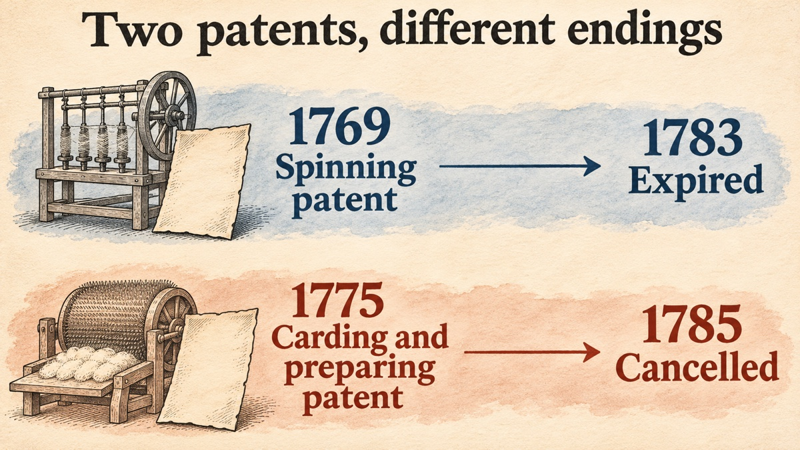

> **TL;DR:** Richard Arkwright did not invent the factory, and the courts did not accept that he invented all of his machines. What the record does show is a founder who found partners inside his first customer industry, built his own downstream demand when the obvious buyers refused his product, and sold licences on a patent that he had written to be hard to copy. The licence business collapsed in court in 1785. The operating business did not.

This post is part of a series on founders who worked before modern venture capital, which is usually dated from American Research and Development Corporation in 1946. Each post asks the same questions: what market did the founder face, which move did they make, what would we call that move today, and which popular stories about them fail a check against the sources.

## Arkwright described his own company as a five-year cash burn

In 1782 Arkwright printed a four-page pamphlet to ask Parliament for help after he lost a patent case. It reads like his own pitch deck. In it he says that it was [more than five years after his first patent, and after more than £12,000 had gone into machinery and buildings, before "any Profit accrued to himself and Partners"](#ref-case-1782-profit). By the time of the pamphlet he claimed that the business [employed "upwards of Five Thousand Persons" and "a Capital, on the whole, of not less than 200,000l."](#ref-case-1782-scale) These are Arkwright's own numbers, written to persuade legislators. Read them as a founder's claims, not as audited accounts.

Five years without profit, funded by partners and not by a fund, is the part of the story that makes Arkwright worth a look for anyone who thinks about product-market fit before institutional capital.

## The market had a spinning bottleneck, and the last inventor of a spinning machine had been run out of town

Edward Baines, writing in 1835, describes the cotton trade before the new machines as one where [the weaver "was continually pressing upon the spinner"](#ref-baines-bottleneck): a weaver's own household could not spin enough weft, so he spent time collecting yarn from neighbours and paid whatever price they asked. Demand for yarn was not the problem. Supply was.

Arkwright's own pamphlet adds the risk. It says that James Hargreaves built a machine around 1767 that spun many threads at once, and that [his machines "were burnt and destroyed, and himself driven out of Lancashire"](#ref-case-1782-hargreaves). Arkwright, also from Lancashire, then [went to Nottingham and took out a patent in 1769](#ref-case-1782-patent). Baines adds that Arkwright and his partner moved to Nottingham [because they feared "similar outrages" against their machine](#ref-baines-nottingham).

So the market was large and hungry, and the incumbents were willing to break machines.

## Arkwright raised money in three steps, and the third investor was his first customer's industry

Baines gives the sequence. Arkwright was [born in Preston and trained as a barber](#ref-baines-barber), and Baines describes him as [having no money of his own to develop the machine](#ref-baines-funding). The money came in three steps:

1. **A friend.** In Preston, Arkwright asked John Smalley, a liquor merchant and painter, for help. Baines writes that Smalley [joined Arkwright "with heart and purse"](#ref-baines-funding).
2. **A bank.** In Nottingham, the bankers Wright [advanced money "on condition of sharing in the profits"](#ref-baines-nottingham). When the machine took longer than expected, the bankers asked Arkwright to find other backers and sent him to Samuel Need.
3. **A strategic partner.** Need was the partner of Jedediah Strutt of Derby, who held a patent for an improved stocking frame. Baines says that Strutt [inspected the machine, called it "an admirable invention", and that both Need and Strutt then "entered into partnership with Arkwright"](#ref-baines-nottingham).

Baines took some of these details from William Strutt, Jedediah's son, through an earlier topographical work, so this is a family account at one remove, not a contract. I did not find the 1769 or 1771 partnership articles themselves in a public source, and I do not give any share split or amount.

What matters for the series is the type of the third investor. Need and Strutt were hosiers. In the 1782 pamphlet Arkwright says that the first use he and his partners found for their yarn was that they [wove it "into Stockings, which succeeded"](#ref-case-1782-gtm). Today we would call Strutt a strategic investor: someone from the customer industry who can test the product, judge the technology, and buy the output. That is my interpretation of the facts above, not a claim from the sources.

## The patent was a horse-powered machine, and Cromford came after Nottingham

The patent specification of 1769 was [enrolled on 15 July 1769](#ref-baines-patent). Arkwright's drawing describes a machine whose main shaft [receives "motion from a horse"](#ref-baines-patent), with pairs of rollers that turn at different speeds to draw the cotton thinner before the spindles twist it. Baines notes that in the patent Arkwright [described himself as "of Nottingham, clockmaker"](#ref-baines-clockmaker), which Baines calls "certainly an untrue description".

The partners first built a horse-driven mill in Nottingham. Baines says that horse power was [too expensive, so they built "another mill on a much larger scale at Cromford, in Derbyshire, which was turned by a water wheel"](#ref-baines-cromford), and that this is why the machine became known as the water frame. Baines quotes the engineer John Kennedy for the date of the first Cromford mill: [built "in 1771"](#ref-baines-1771). The UNESCO listing for the Derwent Valley Mills World Heritage Site gives the same year and adds a second step: Arkwright [built a water-powered spinning mill at Cromford in 1771, "and a second, larger mill in 1776-77"](#ref-unesco-1771).

Arkwright then took a second patent, [in December 1775, for carding and preparing machines](#ref-case-1782-second-patent). This detail matters later, because it was the 1775 patent, not the 1769 one, that the courts cancelled.

## When buyers refused the yarn, the partners built the demand themselves

The 1782 pamphlet tells a go-to-market story that any founder of a new kind of component will recognise. The yarn was good, but [the partners "found great Difficulty to introduce it into Public Use"](#ref-case-1782-gtm), and unsold stock built up. Their response came in steps:

- They used the yarn for stockings, their partners' own trade.
- They asked Lancashire manufacturers to weave it into calicoes, and the manufacturers [“absolutely refused”](#ref-case-1782-gtm).
- They then wove the calicoes themselves.
- Excise officers then [demanded the extra duty charged on calicoes, although this cloth was made in England](#ref-case-1782-excise), and printed calico was prohibited. The partners asked the excise commissioners for relief, failed, and then went to Parliament, which granted relief "against a strong Opposition of the Manufacturers in Lancashire".

In today's terms this is vertical integration forced by channel refusal. Arkwright could not sell an input into an industry that did not want it, so he became a customer of his own product, and then fought the tax rule that made the finished product uncompetitive. The lobbying step is the part that modern "full-stack startup" stories tend to leave out.

## Arkwright sold licences, and took shares in licensees

Once demand for the yarn exceeded what Arkwright and his partners could make, the 1782 pamphlet says that [Arkwright "sold to Numbers of Adventurers"](#ref-case-1782-licensing), in Derbyshire, Leicestershire, Nottinghamshire, Worcestershire, Staffordshire, Yorkshire, Hertfordshire and Lancashire, "many of his Patent Machines". He estimated that these buyers had spent [“at least 60,000l.”](#ref-case-1782-licensing) because of the grants.

Baines describes the same business from the outside. Arkwright [advertised the use of his patents publicly and gave permission "on receiving a certain sum for each spindle"; "in several cases he took shares in the mills erected"](#ref-baines-licensing). Baines adds that Arkwright made money from these licences, "but much more by the profits of his several manufactories".

Neither source that I read gives the per-spindle rate, so this post does not give one.

Today we would recognise this as a licensing model plus equity in licensees: a company that sells the right to use its technology, takes a running fee based on capacity, and sometimes swaps part of that fee for ownership. It is the same shape as some franchise and platform deals. The licence revenue depended on one fragile asset, which was the patent.

## Arkwright wrote his patent to be hard to copy, and that is how he lost it

Patent law then, as now, asked for a specification that would let others build the machine after the patent expired. Arkwright's pamphlet admits that, for the 1775 patent, he [“purposely”](#ref-case-1782-secrecy) left out a full description, because he feared foreigners would copy the machines, and that it was his "uniform Rule, to forbid the Admission of" foreigners into his works.

Baines reports trial evidence from the man who drafted the formal part of the specification: Arkwright [told him "he meant it to appear to operate as a specification, but to be as obscure as the nature of the case could possibly admit"](#ref-baines-obscure).

The sequence of cases, from Baines and the 1785 trial report:

- **1781.** Arkwright started [nine actions against unlicensed users; only the one against Colonel Mordaunt came to trial](#ref-baines-1781). The jury found against Arkwright because the specification was obscure.
- **1782.** Arkwright printed his pamphlet and asked Parliament to ["confirm, connect and consolidate, the Two Letters Patent"](#ref-case-1782-ask). Baines points out that the 1769 patent [would expire in 1783 and the 1775 patent at the end of 1789](#ref-baines-expiry), so Arkwright was in effect asking for eight more years on the first machine. Baines says Arkwright then dropped the application.
- **February 1785.** In the Court of Common Pleas, [Arkwright won an infringement case on the second patent on 17 February](#ref-baines-1785-feb).
- **June 1785.** Lancashire spinners [obtained a writ of *scire facias*](#ref-baines-1785-june) to cancel the 1775 patent. The trial took place in Westminster Hall [on 25 June 1785 before Mr Justice Buller](#ref-trial-1785-date). Crown counsel argued, [on four grounds](#ref-baines-1785-june), that the patent was a public inconvenience, that the machines were not new, that they were not Arkwright's invention, and that the specification did not disclose them. The printed report ends: ["The Jury, without a minute's hesitation, brought in their verdict FOR THE CROWN"](#ref-trial-1785-verdict).
- **November 1785.** Arkwright asked for a new trial. Lord Mansfield [refused the motion](#ref-trial-1785-new-trial), and on 14 November the Court of King's Bench [gave judgment to cancel the letters patent](#ref-trial-1785-new-trial).

Two observations, both my interpretation. First, the secrecy that protected the business against copying is exactly what destroyed the legal asset. Arkwright tried to keep both a trade secret and a patent on the same machine. Second, losing the patent did not end the company. Baines writes that after 1785 Arkwright "continued, notwithstanding, his prosperous career" and that [“for several years he fixed the price of cotton twist, all other spinners conforming to his prices”](#ref-baines-after). The durable advantage was the running mills, not the paper.

## Several popular claims do not survive a check against the sources

**"Arkwright's water-frame patent was revoked in 1785."** Not quite. The 1785 *scire facias* was against [the patent "granted on the sixteenth of December 1775"](#ref-trial-1785-title), the carding and preparing patent. The 1769 spinning patent had [already expired in 1783](#ref-baines-expiry).

**"Arkwright invented the water frame."** The inventor question was argued at the 1785 trial, and it stays open. A reed-maker named Thomas Highs (spelled "Hayes" in the trial report) testified that he told Arkwright ["he had got my invention"](#ref-trial-1785-hayes) through the clockmaker John Kay. Kay testified that he [met Arkwright at Warrington in 1767](#ref-trial-1785-kay). Arkwright's counsel attacked both men's credibility. The jury's general verdict did not say which of the Crown's grounds it accepted, so the verdict is not a finding that Highs was the inventor. Baines, after weighing both sides, [notes that "no witness but Kay" supports the story of a machine made for Highs, that Kay had quarrelled with Arkwright, and that Highs never publicly claimed the invention until 1785](#ref-baines-highs-doubt). Baines also [offers the alternative that Arkwright hired Kay to build a machine that Arkwright had designed](#ref-baines-highs). His own conclusion is that the machines were ["though invented by others, owed their perfection to his finishing hand"](#ref-baines-after). That is a judgement by an 1835 historian, not a settled fact.

**"John Kay helped Arkwright."** There were two men named John Kay in this story, and they are easy to mix up. The Kay who worked with Arkwright and testified in 1785 was a clockmaker from Warrington. The John Kay of the flying shuttle was [a native of Bury, Lancashire, whose shuttle Baines dates to 1738](#ref-baines-flying-shuttle). Nothing I read connects the flying-shuttle Kay to the water frame.

**"Cromford was the first factory."** Baines himself says that Arkwright [“did not absolutely originate”](#ref-baines-lombe) the factory system, and points to Thomas Lombe's silk mill on the Derwent at Derby, which Baines dates to 1719. UNESCO's wording is narrower and more defensible: the Derwent Valley saw ["the birth of the factory system"](#ref-unesco-factory-system), and ["the modern factory owes its origins to the mills at Cromford"](#ref-unesco-1771). Read "first factory" as "first site where water-powered cotton spinning became a system", not as the first factory of any kind.

**Licence fees and partner shares.** I found no public primary source for the size of Arkwright's per-spindle licence fee or for each partner's share in the 1769 or 1771 partnerships. Some modern summaries give figures. I have left them out.

## The lessons for founders today are about channel, investors and moats

These are my reading of the record, aimed at founders working on developer tools, domains and other infrastructure, where the product is often an input into someone else's product.

- **A component can be good and still have no buyer.** Arkwright's yarn was better than hand-spun yarn, and the Lancashire weavers still refused it. If your users are developers or registrars who would have to change their workflow to adopt you, plan for the case where they say no, and know which piece of the downstream product you would build yourself.
- **The best early investor may be the first customer's industry.** Strutt could judge the machine because he already made stockings. An investor who understands the use case reduces the risk that matters most before product-market fit, which is building something nobody uses.
- **Choose disclosure or secrecy, not both.** Arkwright wanted patent protection and also wanted the machine to stay secret. The courts treated the second choice as a defect in the first. For software teams the parallel is a licence or standard that promises openness while the real implementation stays closed. Partners notice, and so do courts.
- **Licensing revenue is only as strong as the right behind it.** A licensing business on an asset that a court, a registry or a platform can withdraw is a bet on that asset. Arkwright survived the loss because his own mills were profitable on their own.
- **Lobbying can be part of product-market fit.** The excise ruling made Arkwright's finished cloth uncompetitive until Parliament changed it. When a rule decides whether your product can sell at all, working on the rule is part of the job.

## References

Primary sources are the 1782 *Case* and the 1785 trial report. Baines (1835) is a secondary history; where this post relies on Baines alone, the text says so. Spelling in quotations from 18th-century print is modernised for the long s ("ſ" → "s"); the wording is unchanged. The scanned books on the Internet Archive do not support text fragments, so their links open a search inside the book or a page number. I could not create new Wayback Machine snapshots for this post; only the UNESCO page has an existing snapshot.

**Primary sources**

- Richard Arkwright and Co., *The Case of Mr. Richard Arkwright and Co. in Relation to Mr. Arkwright's Invention of an Engine for Spinning Cotton, &c. into Yarn* (London, 1782), 4 pp. Internet Archive scan of the British Library copy (Eighteenth Century Collections Online). Fetched 2026-11-11. Cited passages:
  - [p. 1, on Hargreaves](https://archive.org/details/bim_eighteenth-century_the-case-of-mr-richard-_richard-arkwright-and-co_1782?q=%22driven+out+of%22): "his Engines were burnt and destroyed, and himself driven out of Lancashire".
  - [p. 1, on the 1769 patent](https://archive.org/details/bim_eighteenth-century_the-case-of-mr-richard-_richard-arkwright-and-co_1782?q=%22Year+1769%22): "he retired to Nottingham, and obtained a Patent in the Year 1769".
  - [p. 2, on the 1775 patent](https://archive.org/details/bim_eighteenth-century_the-case-of-mr-richard-_richard-arkwright-and-co_1782?q=%22December+1775%22): "he procured a Patent for these also, in December 1775".
  - [p. 2, on years before profit](https://archive.org/details/bim_eighteenth-century_the-case-of-mr-richard-_richard-arkwright-and-co_1782?q=%22Five+Years%22): "upwards of Five Years had elapsed after obtaining his First Patent, and more than 12,000l. had been expended in Machinery and Buildings".
  - [p. 2, on the market's refusal](https://archive.org/details/bim_eighteenth-century_the-case-of-mr-richard-_richard-arkwright-and-co_1782?q=%22absolutely+refused%22): "Their first Trial was, in weaving it into Stockings, which succeeded; they then endeavoured to prevail on the Manufacturers in Lancashire to weave it into Callicoes, but they absolutely refused."
  - [p. 2, on the excise duty](https://archive.org/details/bim_eighteenth-century_the-case-of-mr-richard-_richard-arkwright-and-co_1782?q=%22Officers+of+Excise%22): "the Officers of Excise refusing to let them pass at the usual Duty of 3d. per Yard, insisting on the additional Duty of 3d. per Yard, as being Callicoes".
  - [p. 2, on sold grants](https://archive.org/details/bim_eighteenth-century_the-case-of-mr-richard-_richard-arkwright-and-co_1782?q=%22Adventurers%22): "Mr. Arkwright sold to Numbers of Adventurers … many of his Patent Machines. Upon a moderate Computation, the Money expended in consequence of such Grants amounts to at least 60,000l."
  - [p. 2, on the obscure specification](https://archive.org/details/bim_eighteenth-century_the-case-of-mr-richard-_richard-arkwright-and-co_1782?q=%22purposely%22): "he therefore, purposely, in Prevention of that Evil … omitted to give so full and particular a Description of his Inventions".
  - [p. 3, on scale](https://archive.org/details/bim_eighteenth-century_the-case-of-mr-richard-_richard-arkwright-and-co_1782?q=%22Five+Thousand%22): "a Business that already employs upwards of Five Thousand Persons, and a Capital, on the whole, of not less than 200,000l."
  - [p. 3, on the request to Parliament](https://archive.org/details/bim_eighteenth-century_the-case-of-mr-richard-_richard-arkwright-and-co_1782?q=%22consolidate%22): "to confirm, connect and consolidate, the Two Letters Patent".
- *The Trial of a Cause Instituted by Richard Pepper Arden, Esq; His Majesty's Attorney General, by Writ of Scire Facias, to Repeal a Patent Granted on the Sixteenth of December 1775, to Mr. Richard Arkwright* (London: Hughes and Walsh, 1785). Internet Archive scan (Eighteenth Century Collections Online). Fetched 2026-11-11. Cited passages:
  - [Title page](https://archive.org/details/bim_eighteenth-century_the-trial-of-a-cause-ins_arkwright-richard-sir_1785): "to repeal a Patent granted on the Sixteenth of December 1775".
  - [Opening of the trial](https://archive.org/details/bim_eighteenth-century_the-trial-of-a-cause-ins_arkwright-richard-sir_1785?q=%22Westminster-Hall%22): "At Westminster-Hall, 25th of June 1785. Mr. Justice Buller came into Court".
  - [Evidence of Thomas Hayes (Highs)](https://archive.org/details/bim_eighteenth-century_the-trial-of-a-cause-ins_arkwright-richard-sir_1785?q=%22got+my+invention%22): "I began to tell him he had got my invention, I told him, I had shewn the model of it to John Kay".
  - [Evidence of John Kay](https://archive.org/details/bim_eighteenth-century_the-trial-of-a-cause-ins_arkwright-richard-sir_1785?q=%22Warrington%22): asked where he met Arkwright, Kay answers "At Warrington" and gives the year as 1767.
  - [End of the summing-up](https://archive.org/details/bim_eighteenth-century_the-trial-of-a-cause-ins_arkwright-richard-sir_1785?q=%22FOR+THE+CROWN%22): "The Jury, without a minute's hesitation, brought in their verdict FOR THE CROWN".
  - [Motion of 10 November 1785](https://archive.org/details/bim_eighteenth-century_the-trial-of-a-cause-ins_arkwright-richard-sir_1785?q=%22rule+was+not+granted%22): "On the 10th of November 1785, the Court of King's Bench was moved … for a Rule, to shew cause why a new Trial should not be granted"; Lord Mansfield: "There is not a colour for it"; the report continues "The rule was not granted" and "Afterwards on the 14th of November 178[5], the Court of King's Bench gave Judgment to CANCEL the Letters Patent."

**Secondary sources**

- Edward Baines, Jun., *History of the Cotton Manufacture in Great Britain* (London: Fisher, Fisher, and Jackson, 1835). Internet Archive scan. Fetched 2026-11-11. Cited passages:
  - [p. 116](https://archive.org/details/historyofcottonm00bainrich/page/116/): "In the year 1738, Mr. John Kay, a native of Bury, in Lancashire … suggested a mode of throwing the shuttle".
  - [p. 115](https://archive.org/details/historyofcottonm00bainrich/page/115/): "The weaver was continually pressing upon the spinner."
  - [p. 145](https://archive.org/details/historyofcottonm00bainrich/page/145/): "He never publicly laid claim to the invention till 1785 … No witness but Kay speaks to his having made such a machine. No document attests it. … Kay, the only witness besides Highs himself, had quarrelled with and quitted Arkwright".
  - [p. 149](https://archive.org/details/historyofcottonm00bainrich/page/149/), on the Highs claim: "those who disbelieve it may adopt the conjecture, that Arkwright, not being a practical mechanic, engaged the clockmaker to construct the apparatus he had himself contrived."
  - [p. 148](https://archive.org/details/historyofcottonm00bainrich/page/148/): "He was born at Preston on the 23d of December, 1732, of poor parents … He was brought up to the trade of a barber".
  - [p. 150](https://archive.org/details/historyofcottonm00bainrich/page/150/): "Being altogether destitute of pecuniary means for prosecuting his invention, Arkwright repaired to his native place, Preston, and applied to a friend, Mr. John Smalley … he joined Arkwright with heart and purse."
  - [p. 151](https://archive.org/details/historyofcottonm00bainrich/page/151/): "Arkwright and Smalley, fearing similar outrages directed against their machine, went also to Nottingham … Messrs. Wright, bankers, who made advances on condition of sharing in the profits … both Mr. Need and Mr. Strutt entered into partnership with Arkwright." Footnote: "Some of the circumstances connected with Arkwright's settling at Nottingham, were communicated by the late Mr. William Strutt … to the editor of the Beauties of England and Wales."
  - [pp. 151–152](https://archive.org/details/historyofcottonm00bainrich/page/151/): "In the specification, which was enrolled on the 15th of July in that year"; "A, the Cogg Wheel and Shaft, which receive their motion from a horse."
  - [p. 153](https://archive.org/details/historyofcottonm00bainrich/page/153/): "Richard Arkwright, of Nottingham, clockmaker"; "they built another mill on a much larger scale at Cromford, in Derbyshire, which was turned by a water wheel, and from this circumstance the spinning machine was called the water-frame."
  - [p. 185](https://archive.org/details/historyofcottonm00bainrich/page/185/): "yet he did not absolutely originate it. Mills for the throwing of silk had existed in England … from the time of Sir Thomas Lombe, who, in 1719, erected a mill on the river Derwent, at Derby".
  - [p. 186](https://archive.org/details/historyofcottonm00bainrich/page/186/), quoting John Kennedy: "Mr. Arkwright's first mill was built (in 1771) at Cromford".
  - [p. 187](https://archive.org/details/historyofcottonm00bainrich/page/187/): "He offered the use of his patents by public advertisements, and gave many permission to use them on receiving a certain sum for each spindle. In several cases he took shares in the mills erected"; "he instituted nine actions in the year 1781; only one of which, that against Colonel Mordaunt, came to trial."
  - [p. 188](https://archive.org/details/historyofcottonm00bainrich/page/188/): "he meant it to appear to operate as a specification, but to be as obscure as the nature of the case could possibly admit."
  - [p. 191](https://archive.org/details/historyofcottonm00bainrich/page/191/): "His first patent, obtained in 1769, would expire in 1783 … and the second patent, obtained in 1775, would not expire till the end of the year 1789"; "tried in the court of Common Pleas on the 17th of February".
  - [pp. 191–192](https://archive.org/details/historyofcottonm00bainrich/page/192/): the Lancashire spinners "applied for and obtained from the lord chancellor a writ of scire facias"; "Mr. Bearcroft, the counsel for the crown, opposed the validity of the patent on four grounds".
  - [p. 193](https://archive.org/details/historyofcottonm00bainrich/page/193/): "those most useful machines, which, though invented by others, owed their perfection to his finishing hand"; "For several years he fixed the price of cotton twist, all other spinners conforming to his prices."
- UNESCO World Heritage Centre, [Derwent Valley Mills](https://whc.unesco.org/en/list/1030/), inscribed 2001. Fetched [2026-11-11](https://web.archive.org/web/20261031082852/https://whc.unesco.org/en/list/1030) (link goes to the nearest existing snapshot, 2026-10-31). Cited passages:
  - [Description](https://whc.unesco.org/en/list/1030/#:~:text=Richard%20Arkwright%20constructed%20a%20water-powered%20spinning%20mill%20at%20Cromford%20in%201771): "it was not until Richard Arkwright constructed a water-powered spinning mill at Cromford in 1771, and a second, larger mill in 1776-77 that the 'Arkwright System' was truly established"; "The modern factory owes its origins to the mills at Cromford".
  - [Criterion (ii)](https://whc.unesco.org/en/list/1030/#:~:text=The%20Derwent%20Valley%20saw%20the%20birth%20of%20the%20factory%20system): "The Derwent Valley saw the birth of the factory system".
