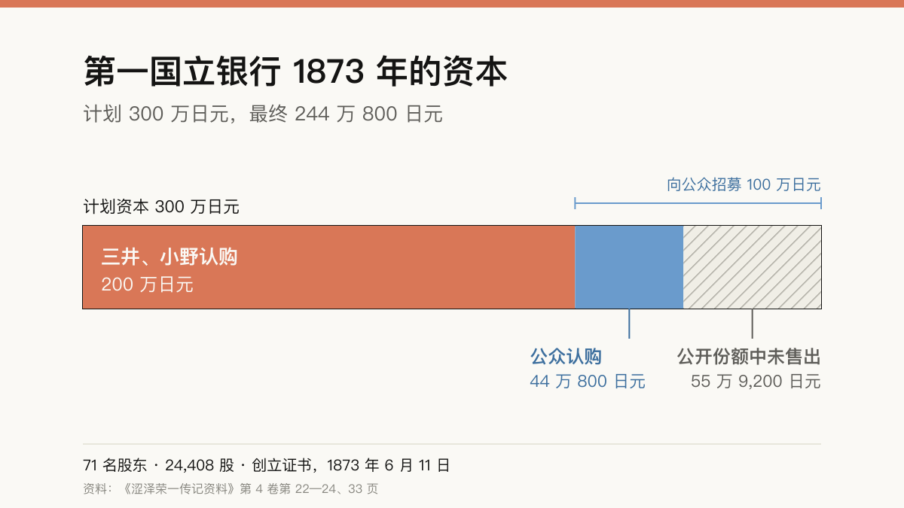

*本文属于“风投诞生之前的创业者”系列。现代风险投资一般从 1946 年成立的美国研究与发展公司（ARD）算起。这个系列想问：在那之前，谁的做法最像今天的创业者？系列缘起于 Namefi “爱迪生计划”里的一次产品市场匹配（PMF）讨论。*

2024 年 7 月 3 日，日本银行开始发行[新版一万日元纸币](#ref-boj-new-notes)，正面印的是[涩泽荣一](#ref-boj-focus)。日本银行的一篇介绍文章称他是“在实业界大显身手”的人。坊间的简介通常说他“创办了约 500 家企业”。保管他史料的涩泽荣一纪念财团说得更谨慎：他[参与过的公司约有 500 家，但并非每一家都是他“创办”的](#ref-foundation-qa-count)。

对创业者来说，涩泽最值得看的地方就在这句更正里。他很少独自持有一家公司，也很少亲自管日常经营。他一遍又一遍推销的，是一套结构：许多人各出一小笔钱，用成文的规则约束彼此，再请一位各方都信得过的人盯住经营者。在 19 世纪 70 年代的日本，几乎没有人见过这样的产品。本文按原始记录，看他怎样卖出这套结构，以及第一单为什么没有卖足。

## 有钱，却没有公司的国家

涩泽 1840 年生于今埼玉县深谷市的一户农家，少年时帮家里种地、养蚕，也[制作和贩卖蓝靛](#ref-foundation-bio)。1867 年，他随[德川庆喜的胞弟德川昭武](#ref-foundation-bio)赴法国，昭武代表将军出席[巴黎万国博览会](#ref-foundation-chrono)。1869 年，涩泽在呈给新政府的说明书里写道，自己当时的差事是[经管昭武个人的开销和一应杂务](#ref-dk-1869-statement)。

他在欧洲见到的两件事，后来在讲话里反复出现。第一件是可以买卖的证券。1887 年口述的回忆录里，他说 1868 年初用代表团省下的[约两万两备用金](#ref-dk-amayotan-bonds)买了法国公债和铁路债券。1910 年再讲这件事，金额变成了两万日元，细节也多了：一位法国政府派给昭武的军官告诉他，公债年息四五分，想卖时到交易所随时可卖，两人便[一起去交易所买进](#ref-dk-bond-origins)。半年后昭武奉命回国，涩泽只得卖出。政府公债价格几乎没动，铁路债券却涨了，按他的算法[赚了五六百日元](#ref-dk-bond-origins)。这些数字出自四十年后的记忆，不是账簿。他从这笔交易里得到的心得却很具体：政府和铁路公司都能凭一纸可流通的凭证向陌生人借钱，而铁路公司本身是[用合本法组织起来的](#ref-dk-1919-essay)。

第二件是身份。他在 1919 年的文章里写道，最触动他的是[工商业者与官吏、军人之间的关系](#ref-dk-1919-essay)，和日本完全不同。1903 年的一次演讲里，他讲到拿破仑三世派来照料昭武起居的法国上校，凡事都先听银行家的意见，再照办，并说这是当时[最让他惊奇的事](#ref-dk-1903-speech)。

把这两点放回 1873 年的日本，就是涩泽面对的市场。日本并不缺钱，只是钱多半集中在三井、小野这样的大商家手里，它们替[新政府经办官款汇兑](#ref-dk-first-bank-history)。普通百姓大多[还不明白银行是做什么的](#ref-dk-first-bank-history)。商人想办大事业，没有现成的组织形式可用，见了官员仍要低头。按我对史料的理解，最早想要股份公司的主要是政府：政府希望民间银行发行纸币，希望民间企业兴办实业。民间的需求还没有出现。

## 先写操作手册，再办第一家公司

涩泽起步时是写规则的官员。回国后他进入新政府，1871 年大藏省刊行了他编写的[《立会略则》](#ref-foundation-chrono)，与福地源一郎译述的《会社弁》一同发行。后来的传记初稿说，他写这本书，是想把自己[一贯主张的合本组织方法](#ref-dk-rikkai-ryakusoku)教给仍守旧习的商人。书里劝商人不要固执一己私见，要[同心协力，互相融通](#ref-dk-rikkai-ryakusoku)；又说公司是众人合力、共谋利益的组织，同时也能促进货物流通。同一份资料还记载，各府县申请设立公司时，大藏省就拿这两本书作审批的参照。

接着他参与起草了 1872 年底[颁布的《国立银行条例》](#ref-dk-first-bank-history)。第一银行自己的五十年史稿说，条例的调查和起草由时任大藏大丞兼纸币头的涩泽主持，把 National Bank 译成“国立银行”，[也是他定的](#ref-dk-first-bank-history)。这个译名至今让人误会。第一国立银行并不归国家所有，它是一家股份公司，创立证书上逐一列着民间股东的名字。

换成今天的话说，他在还没有一个客户的时候，就先写好了标准模板和投资条款。

## 第一轮募股没有募满

第一个客户是第一国立银行。人们常说这是涩泽创办的银行，原始记录给出的情况却不一样。

发起人来自三井和小野，不是涩泽。他们在《东京日日新闻》登出的招股公告列了五位发起人，包括三井八郎右卫门、小野善助和三野村利左卫门。计划资本 300 万日元，三井、小野两家已认购 2 万股，即 200 万日元，[其余 1 万股、100 万日元向公众招募](#ref-dk-first-bank-history)。

公众没有买账。银行的史稿解释说，当时多数百姓还不明白银行是做什么的，认购远未达到预期，最后只能以[244 万 800 日元这个零头数定为资本，股东共 71 人](#ref-dk-first-bank-history)。1873 年 6 月 11 日签署的创立证书也写着同样的数：[71 人，244 万 800 日元，24,408 股](#ref-dk-first-bank-charter)。扣掉发起人的 200 万日元，外部投资者在 100 万日元的公开份额里只认了 44 万 800 日元。

最值得创业者细看的，是涩泽在创立大会上的角色。他 5 月已辞去大藏省职务，但仍奉命留任办理公务，这天以股东身份出席。他提了三条：银行依条例经营；董事由三井、小野两家从自己人中推选；两家本身的生意与银行相近，人员也相同，难免公私混淆，所以另设“总监役”一职，从股东中选人担任，[专门稽查经营者](#ref-dk-first-bank-history)。大会推举他当董事，他以尚在官职为由推辞，第二天[签约就任总监役](#ref-dk-first-bank-meeting)。首任头取（行长）是[小野善助](#ref-dk-first-bank-history)，涩泽到 [1875 年](#ref-foundation-chrono)才当上头取。

于是，这家被财团称为[日本最早的商业银行](#ref-foundation-qa-bank)的银行，开张时的格局是：两家互相提防的大商家做基石投资人，公众认购冷淡，再由一位中立的外人坐在两家之上。涩泽卖的产品是这套结构，他的工作是做结构里那个大家都信得过的人。

## 同样的打法，重复了约 500 次

此后他在各行各业重复这套打法。财团的年谱列出了许多例子：1873 年的抄纸会社（后来的王子制纸），1885 年的日本邮船和东京瓦斯，1887 年的东京饭店（后来的帝国饭店），1888 年的札幌麦酒，1889 年的石川岛造船所。他的[身份从顾问、委员到创立委员长、董事长，各不相同](#ref-foundation-chrono)。

财团也说明了“约 500 家”是什么意思。他有时自己设立公司，更多时候是[给创办人出主意，帮他们筹钱、找人，有时替他们调解纠纷](#ref-foundation-qa-count)。“约 500”指他参与过设立或经营的公司，“约 600”指他参与过的社会公益团体。财团编的公司名称沿革图追踪这些机构到今天的后继者，目前共 [163 幅图](#ref-foundation-namecharts)，图中与涩泽直接相关的公司和团体名称有 721 个（含重复），都是从 [68 卷本《涩泽荣一传记资料》](#ref-denki-about)收录的事业里挑出来的。两个整数是财团对这些记录的概括，不是逐一核对过的名单。

财团还给出了这些公司的结局统计。约 500 家公司里，[约六成经过合并、国有化等，至今仍以某种形式存续](#ref-foundation-qa-survival)；约三成解散或根本没有办成；其余一成下落不明，大概已经消失。他参与创办的最后一家公司是 1928 年的日本航空输送，他[担任创立委员长，但首任社长另有其人](#ref-foundation-qa-last)。

1909 年，他辞去了大部分企业和团体的职务；1916 年[辞去第一银行头取，退出实业界](#ref-foundation-chrono)。

## 合本与独断之争

涩泽的打法有一位出名的对手。岩崎弥太郎执掌三菱，涩泽的传记作者说他[凡事由一人专断](#ref-dk-iwasaki-biography)。传记初稿把两人最有名的一次冲突定在 1880 年 8 月：岩崎请涩泽到[向岛的酒楼柏屋](#ref-dk-iwasaki-biography)，席间力陈个人经营的好处，说合本组织办不成事业。按初稿的说法，两人争到宴席冷场，涩泽拂袖而去。

涩泽晚年在 1926 至 1927 年的访谈里讲的版本要平和得多。岩崎提议两人联手，日本的实业什么都能办成。涩泽回答：“[当然要用合本法来办](#ref-dk-iwasaki-own-account)，照现在这样是不行的。”岩崎说合本法行不通，两人争不出结果，涩泽带着艺伎先走了。访谈者问两人是否就此结下深仇，涩泽说[并没有闹僵](#ref-dk-iwasaki-own-account)，只是想法不同。1916 年的一次讲话里，他把这段对立称为[个人主义与合本主义的冲突](#ref-dk-1916-speech)，并说当时根基尚浅的第一银行为此吃了不少苦头。

## 放到今天，他做的事该叫什么

以下是我的解读，不再是史料本身。

涩泽不是现代意义上的风险投资人。我没有找到证据表明他向外部出资人募集过一个基金，再分散投到一批公司里换取收益分成，而这正是 ARD 及其后继者的特点。史料也很少把他写成拿自家财富下重注的领投人，强调的始终是他的组织者角色。

用今天的词来对应，他的角色更像下面几种的组合：

- **标准制定者。**《立会略则》和银行条例是大家共用的模板，作用类似今天的标准融资文件和公开的创业手册。
- **联合投资的牵头人。**他把三井、小野这样的基石投资人和散户放进同一份股东名册，下一家公司再把两类人重新召集一遍。
- **独立董事。**总监役之所以存在，是因为两大股东互不信任对方的经营者。各方买的，是他的信用。
- **连续创办公司的人。**他像今天的创业工作室一样，按同一个模式办了许多公司；不同的是，他通常不掌握控制权，而且按财团自己的数字，约三成公司没有存活下来。

## 五条流行说法，经不起原样转述

拿常见的简版故事去对原始出处，有五处要改。

1. **“他创办了 500 家企业。”** 财团说的是他“参与”了约 500 家，并明确说不是每家都由他创办。这个数是对史料的概括。
2. **“他创办了日本第一家银行。”** 第一国立银行的发起人来自三井和小野。涩泽起草了银行赖以设立的条例，先任总监役，1875 年起任头取。这家银行经过多次合并，今天由[瑞穗银行](#ref-foundation-qa-bank)承继。传说还略去了一点：第一轮公开招股没有募满。
3. **“合本主义是他的口号。”** 我读到的段落里，他多半说“合本法”或“合本组织”，不过 1916 年的讲话里确实用过“合本主义”。在数字版里全文检索，“合本法”出现在 [53 页](#ref-dk-search-gapponho)，“合本主义”出现在 [10 页](#ref-dk-search-gapponshugi)。这些页面也包括编者按语和别人的话，所以数字反映的是整套史料的用词习惯，不单是涩泽本人的。把它说成一套“主义”，多半来自后来的推崇者。作家幸田露伴 1939 年演讲时说，涩泽年轻时就[常把“合本协力”挂在嘴上](#ref-rohan-1939)，并强调这和资本主义不是一回事。
4. **“《论语与算盘》是他写的书。”** 1916 年的初版是他的讲话汇编。国立国会图书馆的书目著录为[“涩泽荣一述，梶山彬编”](#ref-ndl-rongo-soroban)，东亚堂书房出版。
5. **“他在岩崎的游船宴上拂袖而去，从此成了仇人。”** 这是传记初稿的版本。他本人留下的口述说，两人意见不合，但没有闹僵。

我还删掉了一句常见说法：“日本银行称他为日本资本主义之父。”我读到的日本银行页面称他是在实业界大显身手的人，没有提到资本主义。

## 今天的创业者能学到什么

涩泽的第一轮募股提醒今天的创业者：一种新的组织形式，需要基石客户，也需要一个诚实的数字。公众不懂银行，公开份额卖出去不到一半，银行照样以 244 万 800 日元开了张。

他的做法还有三条至今管用，对做开发者工具或做需要别人信任的基础设施的人尤其如此：

- **先公开模板，再请人采用。**他先写手册和条例，再办银行。做开放标准、SDK、命名系统的人，工作顺序也是这样：共享的格式推广得比成品慢，但每一家新公司、每一个新用户都能直接从它起步。
- **设计让竞争者愿意共处的治理结构。**总监役解决的是两大股东之间一个具体的信任问题。夹在竞争者之间的产品，比如注册局、支付网络、软件包仓库，也需要把类似的中立制衡写进结构里。
- **公开统计结局。**财团“六成、三成、一成”的统计，比“500 家”这个大数更有信息量。肯把失败也算进去的记录，才更可信。

把涩泽说成“办了 500 家公司的人”，说得太简单了。原始记录里的他，先得在日本建立起足够的信任，才会有人愿意买一张股票。

## 参考资料

以下《涩泽荣一传记资料》各条均引自涩泽荣一纪念财团的数字版（含文字与页面图像），卷数、页码以纸本为准，引文用字照数字版原样。

- 日本银行 — [「改刷・改鋳」](https://www.boj.or.jp/note_tfjgs/note/n_note/index.htm#:~:text=2024%E5%B9%B47%E6%9C%883%E6%97%A5%E3%81%AB%E7%99%BA%E8%A1%8C%E3%82%92%E9%96%8B%E5%A7%8B)。原文：“新しい日本銀行券 2024年7月3日に発行を開始。” — 获取于 2026-11-11；未找到存档
- 日本银行“Focus BOJ” — [「改刷に向けた日本銀行の取り組み」，2024 年 6 月 25 日](https://www.boj.or.jp/about/annai/genba/focusboj/focusboj46.htm#:~:text=%E5%AE%9F%E6%A5%AD%E7%95%8C%E3%81%A7%E6%B4%BB%E8%BA%8D%E3%81%97%E3%81%9F%E6%B8%8B%E6%B2%A2%E6%A0%84%E4%B8%80)。“世界初の技術を搭載”一节：“一万円券の表面には実業界で活躍した渋沢栄一” — 获取于 2026-11-11；未找到存档
- 涩泽荣一纪念财团 — [渋沢栄一 Q&A，Q1](https://www.shibusawa.or.jp/eiichi/answer02.html#:~:text=%E3%81%9D%E3%82%8C%E3%82%89%E3%81%AE%E4%BC%9A%E7%A4%BE%E3%82%92%E3%81%99%E3%81%B9%E3%81%A6%E3%80%8C%E4%BD%9C%E3%81%A3%E3%81%9F%E3%80%8D%E3%82%8F%E3%81%91%E3%81%A7%E3%81%AF%E3%81%82%E3%82%8A%E3%81%BE%E3%81%9B%E3%82%93)。原文：“渋沢栄一が関わった会社は500と言われていますが、それらの会社をすべて「作った」わけではありません。自ら設立することもあれば、設立する人に助言したり、資金や人材を集めるのを助けたり、時には揉め事の仲裁をしたりしました。”同一回答给出社会公益团体约 600 个。 — 获取于 2026-11-11；[2026-05-19 存档](https://web.archive.org/web/20260519223029/https://www.shibusawa.or.jp/eiichi/answer02.html)
- 涩泽荣一纪念财团 — [渋沢栄一 Q&A，Q2](https://www.shibusawa.or.jp/eiichi/answer02.html#:~:text=%E7%B4%846%E5%89%B2%E3%81%AE%E4%BC%9A%E7%A4%BE%E3%81%AF)。约六成以某种形式存续，约三成解散或未成立，约一成去向不明，“おそらく消滅”。 — 获取于 2026-11-11；[2026-05-19 存档](https://web.archive.org/web/20260519223029/https://www.shibusawa.or.jp/eiichi/answer02.html)
- 涩泽荣一纪念财团 — [渋沢栄一 Q&A，Q3](https://www.shibusawa.or.jp/eiichi/answer02.html#:~:text=%E6%97%A5%E6%9C%AC%E6%9C%80%E5%88%9D%E3%81%AE%E5%95%86%E6%A5%AD%E9%8A%80%E8%A1%8C)。第一国立银行“1873（明治6）年日本最初の商業銀行として設立”，1896 年改称株式会社第一银行，几经合并，2013 年成为今天的瑞穗银行。 — 获取于 2026-11-11；[2026-05-19 存档](https://web.archive.org/web/20260519223029/https://www.shibusawa.or.jp/eiichi/answer02.html)
- 涩泽荣一纪念财团 — [渋沢栄一 Q&A，Q4](https://www.shibusawa.or.jp/eiichi/answer02.html#:~:text=%E5%89%B5%E6%A5%AD%E6%99%82%E3%81%AE%E7%A4%BE%E9%95%B7%E3%81%AF%E6%A0%84%E4%B8%80%E3%81%A7%E3%81%AF%E3%81%AA%E3%81%8F)。日本航空输送会社，1928 年 10 月 20 日设立，涩泽任创立委员长；“創業時の社長は栄一ではなく、西野恵之助です。” — 获取于 2026-11-11；[2026-05-19 存档](https://web.archive.org/web/20260519223029/https://www.shibusawa.or.jp/eiichi/answer02.html)
- 涩泽荣一纪念财团 — [渋沢栄一略歴](https://www.shibusawa.or.jp/eiichi/eiichi.html#:~:text=%E8%97%8D%E7%8E%89%E3%81%AE%E8%A3%BD%E9%80%A0%EF%BD%A5%E8%B2%A9%E5%A3%B2)。1840 年生于血洗岛（今埼玉县深谷市）；家业为种植、蓝玉制造贩卖和养蚕；随“徳川慶喜の実弟”德川昭武赴巴黎万博；1873 年辞去大藏省职务。 — 获取于 2026-11-11；[2026-07-14 存档](https://web.archive.org/web/20260714192000/https://www.shibusawa.or.jp/eiichi/eiichi.html)
- 涩泽荣一纪念财团 — [渋沢栄一年譜，2023 年 4 月 29 日更新](https://www.shibusawa.or.jp/eiichi/chrono.html)。所用各行：1867 年（“将軍名代・徳川昭武に従ってフランスへ出立”）；1871 年（“『立会略則』刊行”）；1873 年（“第一国立銀行創立・総監役”）；1875 年（“第一国立銀行頭取”）；1873—1889 年各公司条目；1909 年（“古稀に際し多くの企業・団体の役員を辞任”）；1916 年（“第一銀行の頭取等を辞め実業界を引退”）。 — 获取于 2026-11-11；[2026-07-14 存档](https://web.archive.org/web/20260714185528/https://www.shibusawa.or.jp/eiichi/chrono.html)
- 涩泽荣一纪念财团 — [渋沢栄一関連会社名・団体名変遷図](https://eiichi.shibusawa.or.jp/namechangecharts/#:~:text=%E7%8F%BE%E5%9C%A8%E5%90%88%E8%A8%88163%E5%9B%B3%E3%82%92%E6%8E%B2%E8%BC%89)，2026 年 7 月 23 日修订版。导言：共 163 幅图；汇总表：与涩泽直接相关的名称 721 个，“重出含む”。存档早于本次修订。 — 获取于 2026-11-11；[2025-12-15 存档](https://web.archive.org/web/20251215014939/https://eiichi.shibusawa.or.jp/namechangecharts/)
- 涩泽荣一纪念财团 — [『渋沢栄一伝記資料』とは](https://www.shibusawa.or.jp/eiichi/biography.html#:~:text=%E6%9C%AC%E7%B7%A8%E5%85%A858%E5%B7%BB%E3%80%81%E5%88%A5%E5%B7%BB%E5%85%A810%E5%B7%BB)。正编 58 卷、别卷 10 卷，1944—1971 年出版；数字版自 2016 年 11 月 11 日公开。 — 获取于 2026-11-11；[2026-07-14 存档](https://web.archive.org/web/20260714191747/https://www.shibusawa.or.jp/eiichi/biography.html)
- 《涩泽荣一传记资料》第 2 卷第 133—178 页（DK020007k）：涩泽笃太夫 1869 年致政府的说明书，见第 2 卷第 137 页。“私義は少将自個之入費取扱其他諸俗務全少将一身ニ関り候事共可取扱旨被申付” — [数字版](https://eiichi.shibusawa.or.jp/denkishiryo/digital/main/?DK020007k_text#:~:text=%E5%B0%91%E5%B0%86%E8%87%AA%E5%80%8B%E4%B9%8B%E5%85%A5%E8%B2%BB%E5%8F%96%E6%89%B1%E5%85%B6%E4%BB%96%E8%AB%B8%E4%BF%97%E5%8B%99)；获取于 2026-11-11；未找到存档
- 《涩泽荣一传记资料》第 1 卷第 612—615 页（DK010049k，第 1 件）：《雨夜谭》（涩泽口述，1887 年）卷三。“凡そ二万両ばかりを予備金を其年の二月頃に、仏蘭西の公債証書と鉄道債券とを買つて置きました” — [数字版](https://eiichi.shibusawa.or.jp/denkishiryo/digital/main/?DK010049k_text#:~:text=%E5%87%A1%E3%81%9D%E4%BA%8C%E4%B8%87%E4%B8%A1%E3%81%B0%E3%81%8B%E3%82%8A)；获取于 2026-11-11；未找到存档
- 《涩泽荣一传记资料》第 1 卷第 660—661 页（DK010049k，第 6 件）：《龙门杂志》第 265 号（1910 年 6 月）《本邦公債制度の起原》。“同人とブールスに行つて公債を買入れた……鉄道公債の方は相場が上つて居て五六百円儲つた勘定になりました” — [数字版](https://eiichi.shibusawa.or.jp/denkishiryo/digital/main/?DK010049k_text#:~:text=%E3%83%96%E3%83%BC%E3%83%AB%E3%82%B9%E3%81%AB%E8%A1%8C%E3%81%A4%E3%81%A6%E5%85%AC%E5%82%B5%E3%82%92%E8%B2%B7%E5%85%A5%E3%82%8C%E3%81%9F&text=%E4%BA%94%E5%85%AD%E7%99%BE%E5%86%86%E5%84%B2%E3%81%A4%E3%81%9F%E5%8B%98%E5%AE%9A)；获取于 2026-11-11；未找到存档
- 《涩泽荣一传记资料》第 1 卷第 661—663 页（DK010049k，第 7 件）：《明治宪政经济史论》（1919 年 4 月）《維新以後ニ於ケル経済界ノ発達》。“其外ニ合本法ニヨリ組織スル鉄道会社ガアツテ”；“商工業者ノ地位ト官吏若クハ軍人トノ関係ガ日本トハ全然相違シテ居ル” — [数字版](https://eiichi.shibusawa.or.jp/denkishiryo/digital/main/?DK010049k_text#:~:text=%E5%85%B6%E5%A4%96%E3%83%8B%E5%90%88%E6%9C%AC%E6%B3%95%E3%83%8B%E3%83%A8%E3%83%AA%E7%B5%84%E7%B9%94%E3%82%B9%E3%83%AB%E9%89%84%E9%81%93%E4%BC%9A%E7%A4%BE&text=%E5%95%86%E5%B7%A5%E6%A5%AD%E8%80%85%E3%83%8E%E5%9C%B0%E4%BD%8D%E3%83%88%E5%AE%98%E5%90%8F%E8%8B%A5%E3%82%AF%E3%83%8F%E8%BB%8D%E4%BA%BA%E3%83%88%E3%83%8E%E9%96%A2%E4%BF%82)；获取于 2026-11-11；未找到存档
- 《涩泽荣一传记资料》第 27 卷第 332—343 页（DK270101k）：1903 年 3 月 21 日在国家学会的演讲。“其長官が常に商人の意嚮を聞いて、御尤も、さうしませうと云ふ風にして万事を取扱つたのは最も私が奇異の想ひを為した” — [数字版](https://eiichi.shibusawa.or.jp/denkishiryo/digital/main/?DK270101k_text#:~:text=%E6%9C%80%E3%82%82%E7%A7%81%E3%81%8C%E5%A5%87%E7%95%B0%E3%81%AE%E6%83%B3%E3%81%B2%E3%82%92%E7%82%BA%E3%81%97%E3%81%9F)；获取于 2026-11-11；未找到存档
- 《涩泽荣一传记资料》第 3 卷第 245—247 页（DK030081k，第 1 件）：《青渊先生传初稿》（1919—1923 年）第七章，引《立会略则》。“かねての持論たる合本組織の方法を国民に教へ”；“心を合せ力を一にし、相互に融通すべし” — [数字版](https://eiichi.shibusawa.or.jp/denkishiryo/digital/main/?DK030081k_text#:~:text=%E3%81%8B%E3%81%AD%E3%81%A6%E3%81%AE%E6%8C%81%E8%AB%96%E3%81%9F%E3%82%8B%E5%90%88%E6%9C%AC%E7%B5%84%E7%B9%94%E3%81%AE%E6%96%B9%E6%B3%95&text=%E5%BF%83%E3%82%92%E5%90%88%E3%81%9B%E5%8A%9B%E3%82%92%E4%B8%80%E3%81%AB%E3%81%97)；获取于 2026-11-11；未找到存档
- 《涩泽荣一传记资料》第 4 卷第 28—34 页（DK040001k，第 11 件）：《第一银行五十年史稿》卷一第 29—55 页。三井、小野作为新政府御用汇兑方以及 1872 年条例：第 4 卷第 29—31 页；National Bank 的译名：第 4 卷第 29 页；招股公告、公募、71 名股东、创立大会提案与人事：第 4 卷第 33 页。“三井組小野組、島田組の輩は、幸にして新政府の御用為替方たるべき命を拝し”；“当時一般の民衆、尚いまだ銀行事務の何者たるかを解せざるもの多く”；“残りの一万株壱百万円を公募せるなり”；“合計二百四十四万八百円といふ端数を以て、資本額と定むるの余儀なきに至れり。この株数は二万四千四百八株にして株主の総数は七十一名なりき” — [数字版](https://eiichi.shibusawa.or.jp/denkishiryo/digital/main/?DK040001k_text#:~:text=%E5%BE%A1%E7%94%A8%E7%82%BA%E6%9B%BF%E6%96%B9%E3%81%9F%E3%82%8B%E3%81%B9%E3%81%8D%E5%91%BD%E3%82%92%E6%8B%9D%E3%81%97&text=%E3%83%8A%E3%82%B7%E3%83%A8%E3%83%8A%E3%83%AB%E3%83%90%E3%83%B3%E3%82%AF%E3%82%92%E5%9B%BD%E7%AB%8B%E9%8A%80%E8%A1%8C%E3%81%A8%E8%A8%B3%E3%81%97%E3%81%9F%E3%82%8B&text=%E9%8A%80%E8%A1%8C%E4%BA%8B%E5%8B%99%E3%81%AE%E4%BD%95%E8%80%85%E3%81%9F%E3%82%8B%E3%81%8B%E3%82%92%E8%A7%A3%E3%81%9B%E3%81%96%E3%82%8B%E3%82%82%E3%81%AE%E5%A4%9A%E3%81%8F&text=%E6%AE%8B%E3%82%8A%E3%81%AE%E4%B8%80%E4%B8%87%E6%A0%AA%E5%A3%B1%E7%99%BE%E4%B8%87%E5%86%86%E3%82%92%E5%85%AC%E5%8B%9F%E3%81%9B%E3%82%8B%E3%81%AA%E3%82%8A&text=%E6%A0%AA%E4%B8%BB%E3%81%AE%E7%B7%8F%E6%95%B0%E3%81%AF%E4%B8%83%E5%8D%81%E4%B8%80%E5%90%8D)；获取于 2026-11-11；未找到存档
- 《涩泽荣一传记资料》第 4 卷第 22—24 页（DK040001k，第 8 件）：《第一国立銀行創立証書》，1873 年 6 月 11 日。“総員七十一人 総金高 二百四十四万〇八百円 総株数 二万四千四百〇八株” — [数字版](https://eiichi.shibusawa.or.jp/denkishiryo/digital/main/?DK040001k_text#:~:text=%E7%B7%8F%E5%93%A1%E4%B8%83%E5%8D%81%E4%B8%80%E4%BA%BA)；获取于 2026-11-11；未找到存档
- 《涩泽荣一传记资料》第 4 卷第 5 页（DK040001k，纲文）：1873 年 6 月 11 日创立大会。“席上取締役ニ推薦セラレシモ尚官職ニアルヲ以テ辞シ、翌十二日総監役就任ニ関スル契約ヲ締結ス” — [数字版](https://eiichi.shibusawa.or.jp/denkishiryo/digital/main/?DK040001k_text#:~:text=%E7%BF%8C%E5%8D%81%E4%BA%8C%E6%97%A5%E7%B7%8F%E7%9B%A3%E5%BD%B9%E5%B0%B1%E4%BB%BB%E3%83%8B%E9%96%A2%E3%82%B9%E3%83%AB%E5%A5%91%E7%B4%84%E3%83%B2%E7%B7%A0%E7%B5%90%E3%82%B9)；获取于 2026-11-11；未找到存档
- 《涩泽荣一传记资料》第 8 卷第 17 页（DK080001k，第 15 件）：《青渊先生传初稿》第二十五章。“岩崎が専制の下に気儘に経営する”；“明治十三年八月、岩崎は一日先生を向島の酒楼柏屋に招きて饗応し……先生席を蹴つて去れり” — [数字版](https://eiichi.shibusawa.or.jp/denkishiryo/digital/main/?DK080001k_text#:~:text=%E5%90%91%E5%B3%B6%E3%81%AE%E9%85%92%E6%A5%BC%E6%9F%8F%E5%B1%8B)；获取于 2026-11-11；未找到存档
- 《涩泽荣一传记资料》第 8 卷第 17—18 页（DK080001k，第 16 件）：《雨夜谭会谈话笔记》上（1926 年 10 月—1927 年 11 月）第 84—86 页。“私は「当然合本法でやらねばならぬ、今のやうではいけない」と云つた”；“険悪になつたのではない。双方考へが異ふのだ。” — [数字版](https://eiichi.shibusawa.or.jp/denkishiryo/digital/main/?DK080001k_text#:~:text=%E5%BD%93%E7%84%B6%E5%90%88%E6%9C%AC%E6%B3%95%E3%81%A7%E3%82%84%E3%82%89%E3%81%AD%E3%81%B0%E3%81%AA%E3%82%89%E3%81%AC&text=%E9%99%BA%E6%82%AA%E3%81%AB%E3%81%AA%E3%81%A4%E3%81%9F%E3%81%AE%E3%81%A7%E3%81%AF%E3%81%AA%E3%81%84)；获取于 2026-11-11；未找到存档
- 《涩泽荣一传记资料》第 50 卷第 156—168 页（DK500026k）：1916 年 11 月 12 日喜寿祝贺会上的致辞，录自《龙门杂志》第 342 号，见第 50 卷第 163 页。“個人主義と合本主義との衝突とでも申しませうか、故岩崎弥太郎氏の一派と私の流義とが事々物々に意見を異にした” — [数字版](https://eiichi.shibusawa.or.jp/denkishiryo/digital/main/?DK500026k_text#:~:text=%E5%80%8B%E4%BA%BA%E4%B8%BB%E7%BE%A9%E3%81%A8%E5%90%88%E6%9C%AC%E4%B8%BB%E7%BE%A9%E3%81%A8%E3%81%AE%E8%A1%9D%E7%AA%81)；获取于 2026-11-11；未找到存档
- 《涩泽荣一传记资料》别卷第 8 第 305—318 页（DKB80105m）：幸田露伴《青淵先生の後半生》，《龙门杂志》第 616 号（1940 年 1 月），为 1939 年 11 月 28 日演讲的速记稿，见第 315 页。“元来青淵先生は若い時から、所謂合本協力といふことを頻りと言はれた”；“青淵先生のは資本主義ではなく合本主義で” — [数字版](https://eiichi.shibusawa.or.jp/denkishiryo/digital/main/?DKB80105m_text#:~:text=%E6%89%80%E8%AC%82%E5%90%88%E6%9C%AC%E5%8D%94%E5%8A%9B%E3%81%A8%E3%81%84%E3%81%B5%E3%81%93%E3%81%A8%E3%82%92%E9%A0%BB%E3%82%8A%E3%81%A8%E8%A8%80%E3%81%AF%E3%82%8C%E3%81%9F)；获取于 2026-11-11；未找到存档
- 数字版《涩泽荣一传记资料》 — [全文检索“合本法”](https://eiichi.shibusawa.or.jp/denkishiryo/digital/main/?cmd=search&word=%E5%90%88%E6%9C%AC%E6%B3%95&type=AND)。结果：20,548 页中 53 页。 — 获取于 2026-11-11；未找到存档
- 数字版《涩泽荣一传记资料》 — [全文检索“合本主義”](https://eiichi.shibusawa.or.jp/denkishiryo/digital/main/?cmd=search&word=%E5%90%88%E6%9C%AC%E4%B8%BB%E7%BE%A9&type=AND)。结果：20,548 页中 10 页。 — 获取于 2026-11-11；未找到存档
- 国立国会图书馆检索 — [《論語と算盤》（东亚堂书房，1916）](https://ndlsearch.ndl.go.jp/books/R100000136-I1970867909826468142)。责任说明：“渋沢栄一述 ; 梶山彬編”；出版 1916.9。 — 获取于 2026-11-11；未找到存档
