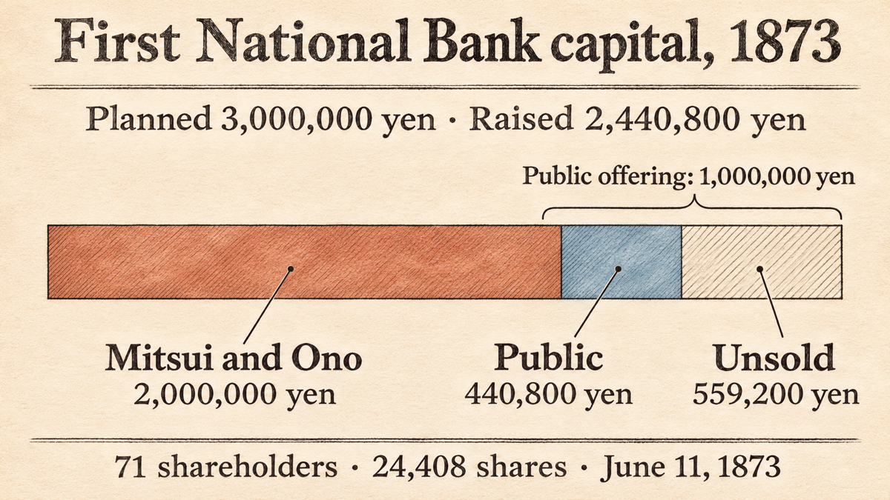

*This post is part of a series on founders before venture capital. Modern venture capital is usually dated from American Research and Development Corporation in 1946. The series asks who, before that, worked most like today's startup founders. It grew out of a product-market-fit discussion in Namefi's "Edison Project".*

On July 3, 2024, the Bank of Japan began issuing a [new 10,000-yen note](#ref-boj-new-notes). Its front shows [Shibusawa Eiichi](#ref-boj-focus), whom a Bank of Japan article introduces as a man active in the business world. The usual short biography says he founded about 500 companies. The foundation that keeps his papers is more careful: he was [involved in about 500 companies, but did not "create" all of them](#ref-foundation-qa-count).

That correction is the most useful thing about him for a founder. Shibusawa rarely owned a company outright and rarely ran one day to day. What he sold, again and again, was a structure. Many people put in small amounts of capital, written rules govern them, and someone all sides trust watches the managers. In the Japan of the 1870s almost nobody had seen that product. This post follows the records of how he sold it, and of how his first sale fell short.

## A country with money, but no companies

Shibusawa was born in 1840 into a farming family in what is now Fukaya, Saitama. As a boy he helped with the fields, the silkworms, and the family business of [making and selling indigo dye](#ref-foundation-bio). In 1867 he went to France with [Tokugawa Akitake](#ref-foundation-bio), the younger brother of the last shogun, who represented the shogun at the [Paris Exposition](#ref-foundation-chrono). In a statement to the new government in 1869, Shibusawa said his job had been to manage [the young lord's personal expenses and household affairs](#ref-dk-1869-statement).

Two things he saw in Europe come up again and again in his later talks. The first was a market for paper. In an account dictated in 1887, he says that early in 1868 he put [about 20,000 ryō of the mission's savings](#ref-dk-amayotan-bonds) into French government bonds and railway bonds. In a 1910 retelling he gives the sum as 20,000 yen and adds detail. A French officer assigned to the prince told him that bonds paid four or five percent a year and could be sold at the exchange at any time, so the two of them [went to the Bourse and bought](#ref-dk-bond-origins). When the prince was called home about half a year later, Shibusawa sold. The government bonds had barely moved, but the railway bonds had risen, and by his reckoning the trade [made five or six hundred yen](#ref-dk-bond-origins). These figures are his memory four decades later, not entries from an account book. The point he took from the trade was specific. A government and a railway company could both borrow from strangers with paper that anyone could trade, and the railway company itself was [organized by pooling capital](#ref-dk-1919-essay), the method he called *gappon-hō*.

The second thing was social rank. In a 1919 essay he wrote that he was struck by the [relationship between merchants and officials or soldiers](#ref-dk-1919-essay), which was nothing like Japan's. In a 1903 speech he described the French colonel who ran the prince's household asking a banker's opinion and going along with it, and said this was what [surprised him most](#ref-dk-1903-speech).

Put those two observations next to Japan in 1873 and you have the market he faced. The country had capital, but much of it sat with a few great merchant houses, such as Mitsui and Ono, that [handled money for the new government](#ref-dk-first-bank-history). Many ordinary people [did not yet understand what a bank did](#ref-dk-first-bank-history). A merchant who wanted to start a large business had no standard form to do it in, and still bowed to officials. As I read the sources, the early demand for joint-stock companies came mostly from the government, which wanted private banks to issue notes and private firms to build industry. Demand from the public had not appeared yet.

## The playbook came before the first company

Shibusawa began as an official who wrote the instructions. After returning to Japan he joined the new government, and in 1871 the Ministry of Finance published his handbook [*Rikkai ryakusoku*](#ref-foundation-chrono) ("A brief guide to forming companies") alongside a companion text by Fukuchi Gen'ichirō. A later biography draft says he wrote it to [teach the joint-stock method he had long argued for](#ref-dk-rikkai-ryakusoku) to merchants who still followed old habits. The handbook told merchants to put aside private opinion and [unite their hearts and combine their strength](#ref-dk-rikkai-ryakusoku). It defined a company as people who work together for shared profit and, by doing so, help goods circulate. The same source records that the ministry consulted these two books when prefectures asked whether to approve a new company.

He then worked on the National Bank Regulations, [issued in late 1872](#ref-dk-first-bank-history). The First Bank's own history draft says that, as a senior official, he was in charge of researching and drafting them, and that the Japanese name *kokuritsu ginkō* for "national bank" was [his choice](#ref-dk-first-bank-history). The name misleads readers to this day. The First National Bank was not owned by the state. It was a joint-stock company whose charter lists private shareholders by name.

In modern terms, he wrote the template and the term sheet before he had a single customer.

## The first offering fell short

The first customer was the First National Bank (Daiichi Kokuritsu Ginkō). It is often called a bank that Shibusawa founded. The records show a different arrangement.

The promoters were people from Mitsui and Ono, not Shibusawa. Their notice in the *Tōkyō Nichinichi Shinbun* named five promoters, including Mitsui Hachirōemon, Ono Zensuke and Minomura Rizaemon. Of a planned capital of 3,000,000 yen, Mitsui and Ono had already taken 20,000 shares, or 2,000,000 yen. The notice offered [the remaining 10,000 shares, 1,000,000 yen, to the public](#ref-dk-first-bank-history).

The public did not buy. The bank's history draft explains that many people still did not understand what a bank did, so applications fell short. The founders had to settle on the odd sum of [2,440,800 yen, held by 71 shareholders](#ref-dk-first-bank-history). The signed charter of June 11, 1873 gives the same totals: [71 people, 2,440,800 yen, 24,408 shares](#ref-dk-first-bank-charter). Subtracting the promoters' 2,000,000 yen, outside investors took 440,800 yen of the 1,000,000 yen on offer.

Shibusawa's part in the founding meeting is what founders should study. He had resigned from the ministry in May but was still on official duty, and he attended as a shareholder. He proposed three things. The bank would run under the regulations. Mitsui and Ono would pick the directors from their own people. And because both houses ran businesses like the bank's and shared staff, the bank would create a new post, *sōkan-yaku* (general superintendent), filled by a shareholder [able to check the managers](#ref-dk-first-bank-history). The meeting wanted him as a director. He declined because he still held office, and the next day he [signed a contract to serve as superintendent](#ref-dk-first-bank-meeting). The first president was [Ono Zensuke](#ref-dk-first-bank-history). Shibusawa became president in [1875](#ref-foundation-chrono).

So the bank that the foundation calls [Japan's first commercial bank](#ref-foundation-qa-bank) opened with two rival merchant houses as anchor investors, a weak public round, and a neutral outsider placed above both. Shibusawa's product was the structure, and his job was to be the trusted person inside it.

## The same move, about 500 times

From that base he did the same thing in other industries. The foundation's chronology lists, among many others, a paper mill (1873), the companies that became NYK Line and Tokyo Gas (1885), the Tokyo Hotel that became the Imperial Hotel (1887), Sapporo Brewery (1888) and the Ishikawajima shipyard (1889). His [roles ranged from adviser to founding chairman](#ref-foundation-chrono).

The foundation explains what "about 500" means. He sometimes founded the company himself. More often he [advised the founders, helped them raise money and find people, and sometimes settled their disputes](#ref-foundation-qa-count). "About 500" counts companies whose founding or management he took part in, and "about 600" counts the social and public organizations he worked with. The foundation's company-name charts trace these entities to their present-day successors. They show [163 charts](#ref-foundation-namecharts) and 721 organization names directly linked to him, counting repeats, all selected from the [68-volume *Shibusawa Eiichi denki shiryō*](#ref-denki-about). Both round numbers are the foundation's summaries of those records, not an audited list.

The foundation also gives outcome figures. Of the roughly 500 companies, [about 60 percent still operate in some form](#ref-foundation-qa-survival) after mergers or nationalization. About 30 percent dissolved or never got started, and what became of the last 10 percent is unknown, though they probably closed. The last company he helped start was Japan Air Transport in 1928. He [chaired its founding committee, but someone else was president](#ref-foundation-qa-last).

In 1909 he resigned from most of his corporate and organizational posts, and in 1916 he [retired from business](#ref-foundation-chrono) and left the First Bank presidency.

## Pooled capital against one-man control

Shibusawa's method had a well-known rival. Iwasaki Yatarō ran Mitsubishi, and Shibusawa's biographers describe him as [running it under his own command](#ref-dk-iwasaki-biography). A biography draft dates their best-known clash to August 1880, when Iwasaki invited Shibusawa to the [Kashiwaya restaurant in Mukōjima](#ref-dk-iwasaki-biography) and argued for one-man management over the joint-stock form. In that draft's telling they argued until the party went cold and Shibusawa walked out.

Shibusawa's own account, taken down in 1926–27, is calmer. Iwasaki proposed that the two of them could run Japanese business between them. Shibusawa answered that business "[must of course be done by *gappon-hō*](#ref-dk-iwasaki-own-account)". Iwasaki said joint stock would not work, and Shibusawa left, taking the geishas with him. When the interviewer asked whether the two had become bitter enemies, Shibusawa said things [had not turned hostile](#ref-dk-iwasaki-own-account). They just thought differently. In a 1916 speech he called the rivalry a [clash between individualism and *gappon-shugi*](#ref-dk-1916-speech), and said it caused the young First Bank a good deal of trouble.

## What we would call it today

From here I move from the record to my own reading of it.

Shibusawa was not a venture capitalist in the modern sense. I found no evidence that he raised a fund from outside investors and spread it across a portfolio for a share of the profits, which is what set ARD and its successors apart. Nor do the sources describe him mainly as a lead investor risking his own fortune. They stress his work as an organizer.

The closest modern names for what he did are a combination:

- **A standards author.** *Rikkai ryakusoku* and the bank regulations were shared templates. They did the job that standard financing documents and public playbooks do for founders today.
- **A syndicate lead.** He brought anchor investors (Mitsui and Ono) and small investors into one shareholder list, then recruited both again for the next company.
- **An independent director.** The superintendent post existed because the two largest shareholders could not trust each other's managers. His credibility was what they paid for.
- **A repeat company builder.** Like a venture studio, he started many companies on one pattern. Unlike a studio, he usually did not hold control, and by the foundation's own numbers about 30 percent of those companies did not last.

## Five popular claims that do not hold up as usually told

Checking the short version against the sources changed five things.

1. **"He founded 500 companies."** The foundation says he was *involved* in about 500, and states plainly that he did not create them all. The number is a rounded summary of his records.
2. **"He founded Japan's first bank."** The First National Bank's promoters came from Mitsui and Ono. Shibusawa drafted the regulations it was chartered under, then served as superintendent and, from 1875, as president. The bank's line of succession leads to today's [Mizuho Bank](#ref-foundation-qa-bank). The legend also leaves out that the first public offering missed its target.
3. **"*Gappon-shugi* was his slogan."** In the passages I read he usually said *gappon-hō* (the joint-stock method) or *gappon soshiki* (joint-stock organization), though he did use *gappon-shugi* in the 1916 speech. A full-text search of the digital edition finds the first term on [53 pages](#ref-dk-search-gapponho) and *gappon-shugi* on [10 pages](#ref-dk-search-gapponshugi). Those pages include editors' notes and other people's words, so the counts show the habit of the records, not of Shibusawa alone. Much of the framing as a doctrine came from admirers. The writer Kōda Rohan said in a 1939 lecture that Shibusawa [constantly spoke of "*gappon kyōryoku*"](#ref-rohan-1939), pooled capital and joint effort, and argued that it was not the same thing as capitalism.
4. **"He wrote *The Analects and the Abacus*."** The 1916 first edition collects his talks. The National Diet Library records it as [spoken by Shibusawa Eiichi and edited by Kajiyama Akira](#ref-ndl-rongo-soroban), published by Tōadō Shobō.
5. **"He stormed out of Iwasaki's boat party as an enemy."** That is the biography draft's version. His own recorded account says they disagreed without becoming hostile.

I also dropped a common line, that the Bank of Japan calls him "the father of Japanese capitalism". The Bank of Japan pages I read call him a man active in the business world and say nothing about capitalism.

## What founders can take from this

Shibusawa's first round tells a modern founder that a new kind of organization needs anchor customers and an honest number. The public did not understand banks, so more than half of the public allocation went unsold. The bank opened anyway, at 2,440,800 yen.

His method also suggests three habits that still apply, especially to people who build developer tools or infrastructure that others must trust:

- **Publish the template before you ask anyone to adopt it.** He wrote the handbook and the regulations first. Builders of open standards, SDKs and naming systems face the same order of work. A shared format wins adoption more slowly than a finished product, but every new company or user can start from it.
- **Design the governance that lets rivals share.** The superintendent post solved a specific problem between two shareholders. Products that sit between competitors, such as registries, payment networks or package indexes, need the same kind of neutral check built into their structure.
- **Count outcomes in public.** The foundation's split of 60, 30 and 10 percent tells you more than the headline 500. A record that counts its failures is easier to believe.

The story of Shibusawa as a man who founded 500 companies is too simple. The sources show someone who first had to build enough trust in Japan for anyone to want a share.

## References

All *Shibusawa Eiichi denki shiryō* items below are from the Shibusawa Eiichi Memorial Foundation's digital edition, which shows text and page images. Volume and page numbers refer to the printed edition. Spellings in the supporting quotations follow the digital edition.

- Bank of Japan — [改刷・改鋳 (New banknotes and coins)](https://www.boj.or.jp/note_tfjgs/note/n_note/index.htm#:~:text=2024%E5%B9%B47%E6%9C%883%E6%97%A5%E3%81%AB%E7%99%BA%E8%A1%8C%E3%82%92%E9%96%8B%E5%A7%8B). Supporting text: “新しい日本銀行券 2024年7月3日に発行を開始。” — fetched 2026-11-11; no archived copy found
- Bank of Japan, Focus BOJ — [改刷に向けた日本銀行の取り組み (The Bank's preparations for the new notes), June 25, 2024](https://www.boj.or.jp/about/annai/genba/focusboj/focusboj46.htm#:~:text=%E5%AE%9F%E6%A5%AD%E7%95%8C%E3%81%A7%E6%B4%BB%E8%BA%8D%E3%81%97%E3%81%9F%E6%B8%8B%E6%B2%A2%E6%A0%84%E4%B8%80). Section 世界初の技術を搭載: “一万円券の表面には実業界で活躍した渋沢栄一” — fetched 2026-11-11; no archived copy found
- Shibusawa Eiichi Memorial Foundation — [渋沢栄一 Q&A, Q1](https://www.shibusawa.or.jp/eiichi/answer02.html#:~:text=%E3%81%9D%E3%82%8C%E3%82%89%E3%81%AE%E4%BC%9A%E7%A4%BE%E3%82%92%E3%81%99%E3%81%B9%E3%81%A6%E3%80%8C%E4%BD%9C%E3%81%A3%E3%81%9F%E3%80%8D%E3%82%8F%E3%81%91%E3%81%A7%E3%81%AF%E3%81%82%E3%82%8A%E3%81%BE%E3%81%9B%E3%82%93). “渋沢栄一が関わった会社は500と言われていますが、それらの会社をすべて「作った」わけではありません。自ら設立することもあれば、設立する人に助言したり、資金や人材を集めるのを助けたり、時には揉め事の仲裁をしたりしました。” The same answer gives about 600 organizations for social and public work. — fetched 2026-11-11; [archived copy of 2026-05-19](https://web.archive.org/web/20260519223029/https://www.shibusawa.or.jp/eiichi/answer02.html)
- Shibusawa Eiichi Memorial Foundation — [渋沢栄一 Q&A, Q2](https://www.shibusawa.or.jp/eiichi/answer02.html#:~:text=%E7%B4%846%E5%89%B2%E3%81%AE%E4%BC%9A%E7%A4%BE%E3%81%AF). About 60 percent continue in some form; about 30 percent dissolved or were never established; about 10 percent unknown, “おそらく消滅”. — fetched 2026-11-11; [archived copy of 2026-05-19](https://web.archive.org/web/20260519223029/https://www.shibusawa.or.jp/eiichi/answer02.html)
- Shibusawa Eiichi Memorial Foundation — [渋沢栄一 Q&A, Q3](https://www.shibusawa.or.jp/eiichi/answer02.html#:~:text=%E6%97%A5%E6%9C%AC%E6%9C%80%E5%88%9D%E3%81%AE%E5%95%86%E6%A5%AD%E9%8A%80%E8%A1%8C). The First National Bank, “1873（明治6）年日本最初の商業銀行として設立”, became the First Bank in 1896 and, through later mergers, part of Mizuho Bank in 2013. — fetched 2026-11-11; [archived copy of 2026-05-19](https://web.archive.org/web/20260519223029/https://www.shibusawa.or.jp/eiichi/answer02.html)
- Shibusawa Eiichi Memorial Foundation — [渋沢栄一 Q&A, Q4](https://www.shibusawa.or.jp/eiichi/answer02.html#:~:text=%E5%89%B5%E6%A5%AD%E6%99%82%E3%81%AE%E7%A4%BE%E9%95%B7%E3%81%AF%E6%A0%84%E4%B8%80%E3%81%A7%E3%81%AF%E3%81%AA%E3%81%8F). Japan Air Transport, founded October 20, 1928; Shibusawa chaired the founding committee; “創業時の社長は栄一ではなく、西野恵之助です。” — fetched 2026-11-11; [archived copy of 2026-05-19](https://web.archive.org/web/20260519223029/https://www.shibusawa.or.jp/eiichi/answer02.html)
- Shibusawa Eiichi Memorial Foundation — [渋沢栄一略歴 (Short biography)](https://www.shibusawa.or.jp/eiichi/eiichi.html#:~:text=%E8%97%8D%E7%8E%89%E3%81%AE%E8%A3%BD%E9%80%A0%EF%BD%A5%E8%B2%A9%E5%A3%B2). Birth in 1840 at Chiaraijima (now Fukaya, Saitama); family work in farming, indigo and silkworms; travel to the Paris Exposition with Tokugawa Akitake, “徳川慶喜の実弟”; resignation from the Ministry of Finance in 1873. — fetched 2026-11-11; [archived copy of 2026-07-14](https://web.archive.org/web/20260714192000/https://www.shibusawa.or.jp/eiichi/eiichi.html)
- Shibusawa Eiichi Memorial Foundation — [渋沢栄一年譜 (Chronology), updated April 29, 2023](https://www.shibusawa.or.jp/eiichi/chrono.html). Rows used: 1867 (“将軍名代・徳川昭武に従ってフランスへ出立”); 1871 (“『立会略則』刊行”); 1873 (“第一国立銀行創立・総監役”); 1875 (“第一国立銀行頭取”); 1873–1889 company entries; 1909 (“古稀に際し多くの企業・団体の役員を辞任”); 1916 (“第一銀行の頭取等を辞め実業界を引退”). — fetched 2026-11-11; [archived copy of 2026-07-14](https://web.archive.org/web/20260714185528/https://www.shibusawa.or.jp/eiichi/chrono.html)
- Shibusawa Eiichi Memorial Foundation — [渋沢栄一関連会社名・団体名変遷図 (Company and organization name-change charts)](https://eiichi.shibusawa.or.jp/namechangecharts/#:~:text=%E7%8F%BE%E5%9C%A8%E5%90%88%E8%A8%88163%E5%9B%B3%E3%82%92%E6%8E%B2%E8%BC%89), revision of July 23, 2026. Intro paragraph: 163 charts; summary table: 721 names directly linked to Shibusawa, “重出含む”. The archived copy predates this revision. — fetched 2026-11-11; [archived copy of 2025-12-15](https://web.archive.org/web/20251215014939/https://eiichi.shibusawa.or.jp/namechangecharts/)
- Shibusawa Eiichi Memorial Foundation — [『渋沢栄一伝記資料』とは (About the biographical records)](https://www.shibusawa.or.jp/eiichi/biography.html#:~:text=%E6%9C%AC%E7%B7%A8%E5%85%A858%E5%B7%BB%E3%80%81%E5%88%A5%E5%B7%BB%E5%85%A810%E5%B7%BB). 58 main volumes and 10 supplementary volumes, published 1944–1971; digital edition public since November 11, 2016. — fetched 2026-11-11; [archived copy of 2026-07-14](https://web.archive.org/web/20260714191747/https://www.shibusawa.or.jp/eiichi/biography.html)
- *Shibusawa Eiichi denki shiryō*, vol. 2, pp. 133–178 (entry DK020007k): Shibusawa Tokudayū, statement to the government of 1869, on vol. 2 p. 137. “私義は少将自個之入費取扱其他諸俗務全少将一身ニ関り候事共可取扱旨被申付” — [digital edition](https://eiichi.shibusawa.or.jp/denkishiryo/digital/main/?DK020007k_text#:~:text=%E5%B0%91%E5%B0%86%E8%87%AA%E5%80%8B%E4%B9%8B%E5%85%A5%E8%B2%BB%E5%8F%96%E6%89%B1%E5%85%B6%E4%BB%96%E8%AB%B8%E4%BF%97%E5%8B%99); fetched 2026-11-11; no archived copy found
- *Shibusawa Eiichi denki shiryō*, vol. 1, pp. 612–615 (entry DK010049k, item 1): *Amayo-gatari* (Shibusawa's dictated memoir, 1887), book 3. “凡そ二万両ばかりを予備金を其年の二月頃に、仏蘭西の公債証書と鉄道債券とを買つて置きました” — [digital edition](https://eiichi.shibusawa.or.jp/denkishiryo/digital/main/?DK010049k_text#:~:text=%E5%87%A1%E3%81%9D%E4%BA%8C%E4%B8%87%E4%B8%A1%E3%81%B0%E3%81%8B%E3%82%8A); fetched 2026-11-11; no archived copy found
- *Shibusawa Eiichi denki shiryō*, vol. 1, pp. 660–661 (entry DK010049k, item 6): *Ryūmon zasshi* no. 265 (June 1910), “本邦公債制度の起原”. “同人とブールスに行つて公債を買入れた … 鉄道公債の方は相場が上つて居て五六百円儲つた勘定になりました” — [digital edition](https://eiichi.shibusawa.or.jp/denkishiryo/digital/main/?DK010049k_text#:~:text=%E3%83%96%E3%83%BC%E3%83%AB%E3%82%B9%E3%81%AB%E8%A1%8C%E3%81%A4%E3%81%A6%E5%85%AC%E5%82%B5%E3%82%92%E8%B2%B7%E5%85%A5%E3%82%8C%E3%81%9F&text=%E4%BA%94%E5%85%AD%E7%99%BE%E5%86%86%E5%84%B2%E3%81%A4%E3%81%9F%E5%8B%98%E5%AE%9A); fetched 2026-11-11; no archived copy found
- *Shibusawa Eiichi denki shiryō*, vol. 1, pp. 661–663 (entry DK010049k, item 7): *Meiji kensei keizai shiron* (April 1919), “維新以後ニ於ケル経済界ノ発達”. “其外ニ合本法ニヨリ組織スル鉄道会社ガアツテ” and “商工業者ノ地位ト官吏若クハ軍人トノ関係ガ日本トハ全然相違シテ居ル” — [digital edition](https://eiichi.shibusawa.or.jp/denkishiryo/digital/main/?DK010049k_text#:~:text=%E5%85%B6%E5%A4%96%E3%83%8B%E5%90%88%E6%9C%AC%E6%B3%95%E3%83%8B%E3%83%A8%E3%83%AA%E7%B5%84%E7%B9%94%E3%82%B9%E3%83%AB%E9%89%84%E9%81%93%E4%BC%9A%E7%A4%BE&text=%E5%95%86%E5%B7%A5%E6%A5%AD%E8%80%85%E3%83%8E%E5%9C%B0%E4%BD%8D%E3%83%88%E5%AE%98%E5%90%8F%E8%8B%A5%E3%82%AF%E3%83%8F%E8%BB%8D%E4%BA%BA%E3%83%88%E3%83%8E%E9%96%A2%E4%BF%82); fetched 2026-11-11; no archived copy found
- *Shibusawa Eiichi denki shiryō*, vol. 27, pp. 332–343 (entry DK270101k): Shibusawa's speech at the Kokka Gakkai, March 21, 1903. “其長官が常に商人の意嚮を聞いて、御尤も、さうしませうと云ふ風にして万事を取扱つたのは最も私が奇異の想ひを為した” — [digital edition](https://eiichi.shibusawa.or.jp/denkishiryo/digital/main/?DK270101k_text#:~:text=%E6%9C%80%E3%82%82%E7%A7%81%E3%81%8C%E5%A5%87%E7%95%B0%E3%81%AE%E6%83%B3%E3%81%B2%E3%82%92%E7%82%BA%E3%81%97%E3%81%9F); fetched 2026-11-11; no archived copy found
- *Shibusawa Eiichi denki shiryō*, vol. 3, pp. 245–247 (entry DK030081k, item 1): *Seien sensei den shokō* (biography draft, 1919–1923), ch. 7, quoting *Rikkai ryakusoku*. “かねての持論たる合本組織の方法を国民に教へ” and “心を合せ力を一にし、相互に融通すべし” — [digital edition](https://eiichi.shibusawa.or.jp/denkishiryo/digital/main/?DK030081k_text#:~:text=%E3%81%8B%E3%81%AD%E3%81%A6%E3%81%AE%E6%8C%81%E8%AB%96%E3%81%9F%E3%82%8B%E5%90%88%E6%9C%AC%E7%B5%84%E7%B9%94%E3%81%AE%E6%96%B9%E6%B3%95&text=%E5%BF%83%E3%82%92%E5%90%88%E3%81%9B%E5%8A%9B%E3%82%92%E4%B8%80%E3%81%AB%E3%81%97); fetched 2026-11-11; no archived copy found
- *Shibusawa Eiichi denki shiryō*, vol. 4, pp. 28–34 (entry DK040001k, item 11): *Daiichi Ginkō gojūnen shikō* (draft fiftieth-anniversary history of the First Bank), vol. 1, pp. 29–55. Merchant houses as government fiscal agents and the 1872 regulations: vol. 4 pp. 29–31. Translation of “National Bank”: vol. 4 p. 29. Public notice, offering, 71 shareholders, founding-meeting proposals and officers: vol. 4 p. 33. “三井組小野組、島田組の輩は、幸にして新政府の御用為替方たるべき命を拝し”; “当時一般の民衆、尚いまだ銀行事務の何者たるかを解せざるもの多く”; “残りの一万株壱百万円を公募せるなり”; “合計二百四十四万八百円といふ端数を以て、資本額と定むるの余儀なきに至れり。この株数は二万四千四百八株にして株主の総数は七十一名なりき” — [digital edition](https://eiichi.shibusawa.or.jp/denkishiryo/digital/main/?DK040001k_text#:~:text=%E5%BE%A1%E7%94%A8%E7%82%BA%E6%9B%BF%E6%96%B9%E3%81%9F%E3%82%8B%E3%81%B9%E3%81%8D%E5%91%BD%E3%82%92%E6%8B%9D%E3%81%97&text=%E3%83%8A%E3%82%B7%E3%83%A8%E3%83%8A%E3%83%AB%E3%83%90%E3%83%B3%E3%82%AF%E3%82%92%E5%9B%BD%E7%AB%8B%E9%8A%80%E8%A1%8C%E3%81%A8%E8%A8%B3%E3%81%97%E3%81%9F%E3%82%8B&text=%E9%8A%80%E8%A1%8C%E4%BA%8B%E5%8B%99%E3%81%AE%E4%BD%95%E8%80%85%E3%81%9F%E3%82%8B%E3%81%8B%E3%82%92%E8%A7%A3%E3%81%9B%E3%81%96%E3%82%8B%E3%82%82%E3%81%AE%E5%A4%9A%E3%81%8F&text=%E6%AE%8B%E3%82%8A%E3%81%AE%E4%B8%80%E4%B8%87%E6%A0%AA%E5%A3%B1%E7%99%BE%E4%B8%87%E5%86%86%E3%82%92%E5%85%AC%E5%8B%9F%E3%81%9B%E3%82%8B%E3%81%AA%E3%82%8A&text=%E6%A0%AA%E4%B8%BB%E3%81%AE%E7%B7%8F%E6%95%B0%E3%81%AF%E4%B8%83%E5%8D%81%E4%B8%80%E5%90%8D); fetched 2026-11-11; no archived copy found
- *Shibusawa Eiichi denki shiryō*, vol. 4, pp. 22–24 (entry DK040001k, item 8): 第一国立銀行創立証書 (charter), dated June 11, 1873. “総員七十一人 総金高 二百四十四万〇八百円 総株数 二万四千四百〇八株” — [digital edition](https://eiichi.shibusawa.or.jp/denkishiryo/digital/main/?DK040001k_text#:~:text=%E7%B7%8F%E5%93%A1%E4%B8%83%E5%8D%81%E4%B8%80%E4%BA%BA); fetched 2026-11-11; no archived copy found
- *Shibusawa Eiichi denki shiryō*, vol. 4, p. 5 (entry DK040001k, summary): founding meeting of June 11, 1873. “席上取締役ニ推薦セラレシモ尚官職ニアルヲ以テ辞シ、翌十二日総監役就任ニ関スル契約ヲ締結ス” — [digital edition](https://eiichi.shibusawa.or.jp/denkishiryo/digital/main/?DK040001k_text#:~:text=%E7%BF%8C%E5%8D%81%E4%BA%8C%E6%97%A5%E7%B7%8F%E7%9B%A3%E5%BD%B9%E5%B0%B1%E4%BB%BB%E3%83%8B%E9%96%A2%E3%82%B9%E3%83%AB%E5%A5%91%E7%B4%84%E3%83%B2%E7%B7%A0%E7%B5%90%E3%82%B9); fetched 2026-11-11; no archived copy found
- *Shibusawa Eiichi denki shiryō*, vol. 8, p. 17 (entry DK080001k, item 15): *Seien sensei den shokō*, ch. 25. “明治十三年八月、岩崎は一日先生を向島の酒楼柏屋に招きて饗応し … 先生席を蹴つて去れり” — [digital edition](https://eiichi.shibusawa.or.jp/denkishiryo/digital/main/?DK080001k_text#:~:text=%E5%90%91%E5%B3%B6%E3%81%AE%E9%85%92%E6%A5%BC%E6%9F%8F%E5%B1%8B); fetched 2026-11-11; no archived copy found
- *Shibusawa Eiichi denki shiryō*, vol. 8, pp. 17–18 (entry DK080001k, item 16): *Amayo-gatari kai danwa hikki* (record of interviews, October 1926 – November 1927), vol. 1, pp. 84–86. “私は「当然合本法でやらねばならぬ、今のやうではいけない」と云つた” and “険悪になつたのではない。双方考へが異ふのだ。” — [digital edition](https://eiichi.shibusawa.or.jp/denkishiryo/digital/main/?DK080001k_text#:~:text=%E5%BD%93%E7%84%B6%E5%90%88%E6%9C%AC%E6%B3%95%E3%81%A7%E3%82%84%E3%82%89%E3%81%AD%E3%81%B0%E3%81%AA%E3%82%89%E3%81%AC&text=%E9%99%BA%E6%82%AA%E3%81%AB%E3%81%AA%E3%81%A4%E3%81%9F%E3%81%AE%E3%81%A7%E3%81%AF%E3%81%AA%E3%81%84); fetched 2026-11-11; no archived copy found
- *Shibusawa Eiichi denki shiryō*, vol. 50, pp. 156–168 (entry DK500026k): speech at his 77th-birthday celebration, November 12, 1916, from *Ryūmon zasshi* no. 342; passage on vol. 50 p. 163. “個人主義と合本主義との衝突とでも申しませうか、故岩崎弥太郎氏の一派と私の流義とが事々物々に意見を異にした” — [digital edition](https://eiichi.shibusawa.or.jp/denkishiryo/digital/main/?DK500026k_text#:~:text=%E5%80%8B%E4%BA%BA%E4%B8%BB%E7%BE%A9%E3%81%A8%E5%90%88%E6%9C%AC%E4%B8%BB%E7%BE%A9%E3%81%A8%E3%81%AE%E8%A1%9D%E7%AA%81); fetched 2026-11-11; no archived copy found
- *Shibusawa Eiichi denki shiryō*, supplementary vol. 8, pp. 305–318 (entry DKB80105m): Kōda Rohan, “青淵先生の後半生”, *Ryūmon zasshi* no. 616 (January 1940), a lecture given on November 28, 1939; passage on p. 315. “元来青淵先生は若い時から、所謂合本協力といふことを頻りと言はれた” and “青淵先生のは資本主義ではなく合本主義で” — [digital edition](https://eiichi.shibusawa.or.jp/denkishiryo/digital/main/?DKB80105m_text#:~:text=%E6%89%80%E8%AC%82%E5%90%88%E6%9C%AC%E5%8D%94%E5%8A%9B%E3%81%A8%E3%81%84%E3%81%B5%E3%81%93%E3%81%A8%E3%82%92%E9%A0%BB%E3%82%8A%E3%81%A8%E8%A8%80%E3%81%AF%E3%82%8C%E3%81%9F); fetched 2026-11-11; no archived copy found
- Digital *Shibusawa Eiichi denki shiryō* — [full-text search for 合本法](https://eiichi.shibusawa.or.jp/denkishiryo/digital/main/?cmd=search&word=%E5%90%88%E6%9C%AC%E6%B3%95&type=AND). Result line: 53 of 20,548 pages. — fetched 2026-11-11; no archived copy found
- Digital *Shibusawa Eiichi denki shiryō* — [full-text search for 合本主義](https://eiichi.shibusawa.or.jp/denkishiryo/digital/main/?cmd=search&word=%E5%90%88%E6%9C%AC%E4%B8%BB%E7%BE%A9&type=AND). Result line: 10 of 20,548 pages. — fetched 2026-11-11; no archived copy found
- National Diet Library Search — [論語と算盤 (Tōadō Shobō, 1916)](https://ndlsearch.ndl.go.jp/books/R100000136-I1970867909826468142). Statement of responsibility: “渋沢栄一述 ; 梶山彬編”; issued 1916.9. — fetched 2026-11-11; no archived copy found
