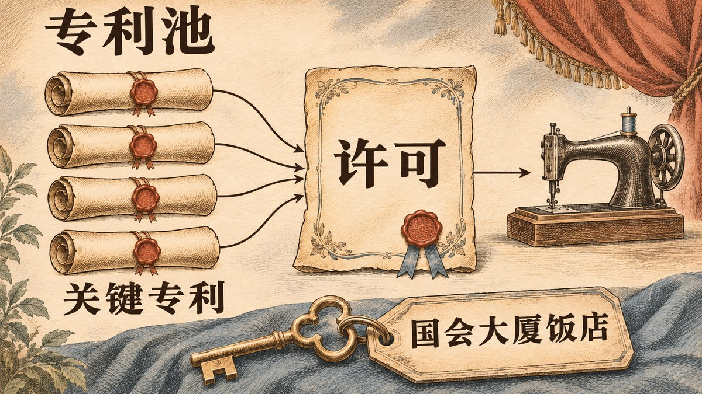
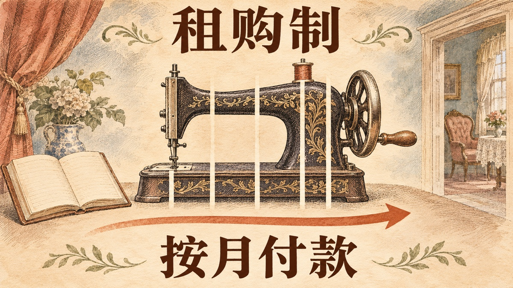

1851 年夏天，四十岁上下的纽约律师爱德华·克拉克（Edward Clark）刚刚成为艾萨克·梅里特·胜家（Isaac Merritt Singer）的合伙人，很快就后悔了。胜家脾气火爆，几乎没读过书，当过演员，同时和好几个女人维持着家庭。克拉克的妻子劝得很直白：[“卖掉股份，离那个下流胚远点。”](#ref-lyon-opening)克拉克没有走。此后十二年，两人一起把缝纫机变成了普通家庭买得起、用得上的东西。

本文属于“风投诞生之前的创业者”系列。本系列把 1946 年成立的美国研究与发展公司（American Research and Development Corporation）算作现代风投的起点。翻遍下文的出处，胜家公司早期的外部资金只有齐伯的四十美元和一笔从未兑付的期票。这个故事讲的是：产品已经能用，市场却还买不下去的时候，创业者能做什么。

## 1850 年的市场：机器能用，却卖不开

缝纫机不是一个人的发明。史密森学会纺织品策展人格蕾丝·罗杰斯·库珀（Grace Rogers Cooper）在她的缝纫机史开篇就说，实用缝纫机[“不是某一个人的天才成果”](#ref-cooper-not-one-man)。到 1850 年，伊莱亚斯·豪（Elias Howe）已经握有[针眼在针尖的机针配梭子打锁式线迹](#ref-cooper-combination)的专利，别的作坊也已经在造缝纫机。

胜家入行纯属偶然。1850 年他到波士顿推销一台雕刻印刷木活字的机器。据库珀记载，他在奥森·菲尔普斯（Orson Phelps）的作坊里展示这台机器，那家作坊当时正在生产另一种缝纫机；雕刻机无人问津，胜家便[转而琢磨缝纫机](#ref-cooper-singer-origin)。出版商乔治·齐伯（George Zieber）出了四十美元做样机。胜家后来在一场专利诉讼里作证说，样机十一天就造好了。美国专利局于 [1851 年 8 月 12 日授予他第 8,294 号专利](#ref-singer-patent-8294)。

机器能用，市场却有三道坎。

- **价格。** 彼得·莱昂（Peter Lyon）1958 年在《美国遗产》（*American Heritage*）杂志上写道，一台缝纫机要一百多美元，而当时美国家庭的年收入[大约五百美元](#ref-lyon-installment)。我没有找到 1851 年的一手价目表来核对这两个数字，读者只宜把它们当作莱昂的估计。
- **专利。** 豪以侵权为由[向胜家索赔两万五千美元](#ref-cooper-howe-suit)，还起诉了销售胜家机器的商号，法院在诉讼期间禁止这些商号继续销售。已经向豪买了许可的竞争对手趁机[打广告说，谁卖他们的机器都不用怕吃官司](#ref-cooper-howe-suit)。
- **信任。** 最用得上缝纫机的人，是在家做针线的妇女，而她们从来没有用过机器。莱昂提到当时[普遍存在一种偏见](#ref-lyon-demonstration)，认为女人用不好机器。

## 第一招：拿股份付律师费

胜家请不起律师。据莱昂记述，他先去找陪他办过专利申请的律师安布罗斯·乔丹（Ambrose Jordan），问对方愿不愿意[接下这场官司](#ref-lyon-jordan)以及往后的所有诉讼，报酬是公司的一份股份。乔丹看不上胜家的为人，拒绝了，转而把他介绍给自己的合伙人兼女婿克拉克。克拉克答应了。

库珀对股权来龙去脉的记载与此相合。她书中的一条脚注写道，胜家买下了菲尔普斯的股份，[又转卖给了克拉克](#ref-cooper-clark-footnote)。公司以 I. M. Singer & Co. 的名义经营。

其他早期出资人都没有留下来。据莱昂记载，布鲁克林一位做盐袋的商人巴尔齐兰·兰塞姆（Barzillan Ransom）曾开出最高一万美元的期票，[换取三分之一股份](#ref-lyon-ransom)，几个月后就退出了，期票始终没有兑付。齐伯后来患病，担心自己死后给遗孀留下债务，[以六千美元把股份卖给了胜家和克拉克](#ref-lyon-zieber)。莱昂引了齐伯事后的抱怨：他说自己被“抢了”。

放到今天的创业语境里，克拉克就是一位以劳务入股的联合创始人。初创公司付不起账单时，至今仍常用股权支付律师、设计师和早期工程师。胜家的例子也说明了这样做的另一面：拿股份的人从此以东家的身份关心公司，不再只是乙方。克拉克不只替公司打专利官司。莱昂写道，胜家把[生意上的事都交给了克拉克](#ref-lyon-business-end)：法律、专利、推销和广告。

## 第二招：用专利池结束专利战

1852 年到 1856 年，几家主要厂商互相起诉，几乎没有停过。胜家与豪如何和解，现存记载有两种说法：

- 库珀写道，1854 年 7 月 1 日，胜家和克拉克[付给豪一万五千美元，取得了许可](#ref-cooper-howe-license)。
- 莱昂则说，豪迫使胜家公司为过去的侵权支付两万八千美元，并且[此后每卖一台机器付十美元许可费](#ref-lyon-howe-settlement)。

我没有找到一手文件来判定哪个数字对，所以两说并存。

专利战在 1856 年收场。库珀把主意归功于格罗弗与贝克公司（Grover & Baker）的总裁奥兰多·波特（Orlando B. Potter）：他[提议组建“联合体”](#ref-cooper-combination)（Combination），由豪、惠勒与威尔逊公司（Wheeler & Wilson）、胜家公司和格罗弗与贝克公司把各自的关键专利放进一个池子。豪提了条件才同意，其中一条是至少要向二十四家厂商发放许可。池子外的厂商从此只需交一笔费用，[每台十五美元](#ref-cooper-combination-fee)，不必向四家分别付钱。各成员照旧各造各的机器，各自竞争。莱昂从克拉克这边讲了同一件事：克拉克在奥尔巴尼的联邦巡回法院提起诉讼，开庭前各方都住在同一家旅馆[国会大厦饭店](#ref-lyon-albany)（Congress Hall），连夜谈判，赶在开庭前签了协议。

联合体比豪的参与维持得更久。豪的专利 [1867 年到期](#ref-cooper-combination-end)，他随之退出；其余成员一直把联合体维持到 1877 年。

这一招今天叫**专利池**和**交叉许可**。对创业者来说，教训不只是“握手言和”。克拉克事先已经[买下了好几项早期专利](#ref-lyon-howe-settlement)，胜家公司手里才有筹码可换。只有每个成员都握着别人需要的东西，专利池才组得起来。

## 第三招：把机器卖给家里的主妇，并且当面演示

克拉克的销售办法，瞄准的是竞争对手没有重视的买家。莱昂记载，早在 1852 年，公司在百老汇的橱窗里就有一位年轻女子[当众演示缝纫机](#ref-lyon-demonstration)。库珀描写了 1850 年代中期胜家[装饰华丽的展厅](#ref-cooper-showrooms)：铺地毯，摆雕花胡桃木家具，维多利亚时代的体面女士走进去也不觉得失身份。

产品也跟着顾客走。约 1858 年的一份胜家宣传册推出了更小巧的“家用”机型，并且宣称机器装饰考究，[“可作客厅或闺房里的漂亮摆设”](#ref-cooper-family-machine)。库珀补充说，第一代家用机做得太小太轻，没卖出多少。可见胜家公司是在试探家庭市场，并非一出手就赢。

莱昂还把以旧换新也记在克拉克名下：[到 1856 年 2 月](#ref-lyon-trade-in)，任何旧缝纫机，不论哪家生产，都可以折价换购一台新的胜家机器。莱昂说折价五十美元。我没有找到当年的原始广告。

## 第四招：用分期付款降低第一笔支出

最有名的一招出现在 1856 年。库珀写道，缝纫机价格高、家庭收入低，于是[克拉克提议采用租购制](#ref-cooper-hire-purchase)（hire purchase）。莱昂把时间定在 [1856 年 9 月](#ref-lyon-installment)。哈佛商学院贝克图书馆引用了公司自办的报纸《I. M. Singer & Co.'s Gazette》1856 年的一句话：[“何不把缝纫机租给主妇，](#ref-hbs-gazette)再把租金抵作机器的价款？”

分期付款并非胜家公司首创。莱昂说，克拉克借鉴的是纽约的家具商和新英格兰的钟表商。真正的新意在于，一家制造商通过遍布全国的销售网络提供赊购。

今天这一招有好几个名字：**销售点融资**、**先买后付**，放到软件行业就是**订阅制**。它们做的是同一件事：替已经想买的顾客拿掉那一大笔首付。对创业公司来说，分期付款也改变了生意本身：公司从此持有应收账款，要判断信用风险，还要上门收钱。胜家公司后来专门[为此建起了一支销售队伍](#ref-godley-canvasser)。

## 第五招：到海外设厂，把服务送进顾客家里

胜家公司很早就看向海外。莱昂记载，[到 1867 年，第一家海外工厂](#ref-lyon-glasgow)已在格拉斯哥附近建成。雷丁大学的商业史学者安德鲁·戈德利（Andrew Godley）解释了这一步为什么要紧：南北战争之后美元升值，美国出口受挫，只有胜家公司[在苏格兰建起了低成本的工厂](#ref-godley-scottish)来供应海外市场。

戈德利依据公司档案所做的研究，还纠正了一个流行的说法：胜家在海外取胜，靠的并不是高明的广告。他的论文发现，胜家公司[既没有搞差别定价，也没有大规模投放广告](#ref-godley-abstract)，而且一向定高价。胜家的优势在零售体系。分期付款 [1873 年起才进入英国](#ref-godley-uk-1873)。1870 年代中期，胜家驻伦敦的代理人威廉·伍德拉夫（William Woodruff）发明了[上门推销员加收款员的制度](#ref-godley-canvasser)：公司员工到妇女家中演示机器、按期收款、提供售后服务。时任公司总裁的克拉克把这套制度推广到了美国和其他市场。

这套制度就是今天软件公司所说的**客户成功**或**开发者关系**：有专人负责让顾客在买下产品之后真的用得起来。

## 合伙关系的结局

克拉克和胜家始终互相看不顺眼。库珀写道，两人[一直合伙到 1863 年](#ref-cooper-1863)，那一年公司改组为股份公司，胜家退出日常经营，持有约四成股份。莱昂补充了拆伙时的一个细节：双方约定，只要另一方在世，[两人都不得出任新公司的总裁](#ref-lyon-1863)。胜家后来移居欧洲，1875 年去世。到 1870 年代后期，克拉克已是[公司总裁](#ref-godley-canvasser)。

## 经不起查证的流行说法

- **“缝纫机是胜家发明的。”** 不对。胜家改进了已有的机器，还向豪付费取得了许可。库珀的书记载了许多人的贡献。
- **“分期付款是胜家发明的。”** 有两处不对。分期付款早于胜家公司就已存在；把功劳记给这家公司的出处，点名的是克拉克，不是胜家。库珀前言里说缝纫机行业[开创了分期购买](#ref-cooper-preface)，说的是一个行业，不是某一个人。
- **“克拉克凭律师服务换得公司三分之一（或八分之三）的股份。”** 网上有的写三分之一，有的写八分之三。我没有找到一手的合伙协议。我手头最详细的出处莱昂没有给出比例；莱昂文中的“三分之一”属于兰塞姆，不属于克拉克。正文因此不写比例。
- **“首付五美元，月供五美元。”** 莱昂引了《科学美国人》（*Scientific American*）一位未署名作者的话，提到一百美元的机器[按月分期、每月五美元](#ref-lyon-scientific-american)。我没有找到那一期原刊。按本系列的规矩，正文不把首付和月供金额当作史实来写。
- **“赊购计划让销量一年翻了三倍。”** 贝克图书馆这样写了，但[没有给出出处](#ref-hbs-tripled)。我把这一条视为未经核实。
- **“胜家靠广告赢天下。”** 戈德利根据公司档案得出的结论正好相反：上门服务比广告要紧得多。

## 给今天创业者的启发

胜家和克拉克其实已经找到了产品市场契合点，只是被几道看不见的坎挡住了。妇女想要缝纫机，挡住成交的是三样东西：价格、官司风险，以及对没受过训练的人能否用好机器的怀疑。上面每一招都拆掉了其中一道坎。

1. **股权可以买来自己缺的本事。** 胜家会造机器，克拉克会打官司、会谈判、会卖货。两人缺一不可，中间的缺口也没有任何投资人来填。
2. **官司也能做成生意。** 联合体把诉讼变成了许可费收入。做开发者工具的公司如果卷进专利或标准之争，只要手里握着对方需要的权利，同样可以走这条路。
3. **先拿掉第一笔大额支出，再想好怎么收账。** 今天的域名交易里也能看到同样的做法。域名交易平台 Afternic 提供“先租后买”（lease to own），买家可以[在约定期限内按月付款购买域名](#ref-afternic-lto)，付款期间就能先用起来。卖家因此多了一批买得起的买家，同时也背上了收款风险，这正是克拉克在 1856 年做过的取舍。
4. **服务是产品的一部分。** 戈德利关于上门推销员的发现，适用于一切复杂产品：顾客买下之后得真的会用，出了故障得有人来修。

## 参考资料

参考资料按著作分组，每条注明原文定位。“读取”日期是我阅读该页面的日期。引文保留英文原文。

### 一手史料

- 艾萨克·胜家 — 原始来源：[美国第 8,294 号专利《缝纫机的改进》（Improvement in sewing-machines），1851 年 8 月 12 日授权](https://patents.google.com/patent/US8294A/en)，谷歌专利收录的专利全文。— 读取于 [2026-11-11](http://web.archive.org/web/20260511234444/https://patents.google.com/patent/US8294A/en)
- 哈佛商学院贝克图书馆，引用 1856 年《I. M. Singer & Co.'s Gazette》— 原始来源：[《轻松付款：分期销售的兴起》（Easy Payments: The Rise of Installment Selling）](https://www.library.hbs.edu/hc/credit/credit4b.html#:~:text=Why%20not%20rent%20a%20sewing%20machine%20to%20the%20housewife)。展览页面引文：“Why not rent a sewing machine to the housewife and apply the rental fee to the purchase price of the machine?” 我读到的是展览页面上的引文，没有读到《Gazette》原报。— 读取于 [2026-11-11](http://web.archive.org/web/20261102095328/https://www.library.hbs.edu/hc/credit/credit4b.html)

### 格蕾丝·罗杰斯·库珀，《缝纫机的发明》（*The Invention of the Sewing Machine*，史密森学会美国国家博物馆第 254 号公报，1968 年）

书的扉页注明库珀为美国国家博物馆纺织品策展人。1968 年版已进入公有领域，全文见[古腾堡计划（第 32677 号电子书）](https://www.gutenberg.org/ebooks/32677)；史密森学会 1976 年出版了修订版。胜家相关段落在第 2 章“成功机器的要素”（原书第 17–38 页），联合体在第 3 章（第 39–42 页）。电子书目录页存档：读取于 [2026-11-11](http://web.archive.org/web/20260412234343/https://www.gutenberg.org/ebooks/32677)。网页存档服务没有收录 HTML 全文页，我也没有另行存档。

- 前言 — [原文](https://www.gutenberg.org/files/32677/32677-h/32677-h.htm#:~:text=not%20the%20result%20of%20one%20man)：“The practical sewing machine is not the result of one man's genius.” — 读取于 2026-11-11
- 前言 — [原文](https://www.gutenberg.org/files/32677/32677-h/32677-h.htm#:~:text=pioneered%20installment%20buying%20and%20patent%20pooling)：缝纫机“pioneered installment buying and patent pooling”。— 读取于 2026-11-11
- 第 2 章胜家一节 — [原文](https://www.gutenberg.org/files/32677/32677-h/32677-h.htm#:~:text=his%20attention%20to%20the%20sewing%20machine)：胜家 1850 年带着活字雕刻机来到波士顿，在菲尔普斯的作坊展示，随后“turned his attention to the sewing machine”。同一节引用了胜家在专利诉讼中的证词，讲到齐伯出的四十美元和十一天造出样机。— 读取于 2026-11-11
- 第 2 章 — [原文](https://www.gutenberg.org/files/32677/32677-h/32677-h.htm#:~:text=enlisting%20the%20legal%20aid%20of%20Edward%20Clark)：“Howe demanded $25,000 for infringement of his patent. Singer and Zieber decided to fight, enlisting the legal aid of Edward Clark, a lawyer and financier.” 下一段写道，竞争对手“purchased licenses from Howe and advertised that anyone could sell their machines without fear of a suit”。— 读取于 2026-11-11
- 第 2 章 — [原文](https://www.gutenberg.org/files/32677/32677-h/32677-h.htm#:~:text=they%20paid%20him%20%2415%2C000%20and%20took%20out%20a%20license)：“On July 1, 1854, they paid him $15,000 and took out a license.” — 读取于 2026-11-11
- 第 2 章脚注 60 — [原文](https://www.gutenberg.org/files/32677/32677-h/32677-h.htm#:~:text=sold%20it%20to%20Edward%20Clark)：“Singer purchased Phelps' interest in the company in 1851 and sold it to Edward Clark.” — 读取于 2026-11-11
- 第 2 章 — [原文](https://www.gutenberg.org/files/32677/32677-h/32677-h.htm#:~:text=lavishly%20decorated)：胜家“pioneered in the use of lavishly decorated sewing-machine showrooms”，那是“places in which Victorian women were not ashamed to be seen”。— 读取于 2026-11-11
- 第 2 章图 32 图注 — [原文](https://www.gutenberg.org/files/32677/32677-h/32677-h.htm#:~:text=a%20beautiful%20ornament%20in%20the%20parlor)：约 1858–59 年的宣传册称新家用机为“a beautiful ornament in the parlor or boudoir”。— 读取于 2026-11-11
- 第 2 章 — [原文](https://www.gutenberg.org/files/32677/32677-h/32677-h.htm#:~:text=Clark%20suggested%20the%20adoption%20of%20the%20hire-purchase%20plan)：“Since the cost of sewing machines was quite high and the average family income was low, Clark suggested the adoption of the hire-purchase plan.” — 读取于 2026-11-11
- 第 2 章 — [原文](https://www.gutenberg.org/files/32677/32677-h/32677-h.htm#:~:text=He%20received%2040%20percent%20of%20the%20stock)：“Singer and Clark continued to be partners until 1863 when a corporation was formed.... He received 40 percent of the stock.” — 读取于 2026-11-11
- 第 3 章 — [原文](https://www.gutenberg.org/files/32677/32677-h/32677-h.htm#:~:text=advanced%20in%201856%20the%20idea%20of%20a)：波特“advanced in 1856 the idea of a 'Combination'”；入池专利包括“The grooved, eye-pointed needle used with a shuttle to form the lockstitch (E. Howe patent, held by E. Howe)”；豪要求“at least twenty-four manufacturers were to be licensed”。— 读取于 2026-11-11
- 第 3 章 — [原文](https://www.gutenberg.org/files/32677/32677-h/32677-h.htm#:~:text=The%20fee%20was%20%2415%20per%20machine)：“The fee was $15 per machine.... The advantage to the licensee was that he was required to pay only one fee.” — 读取于 2026-11-11
- 第 3 章 — [原文](https://www.gutenberg.org/files/32677/32677-h/32677-h.htm#:~:text=Howe%20remained%20a%20member%20until%20his%20patent%20ran%20out%20in%201867)：“Howe remained a member until his patent ran out in 1867. The other members continued the 'Combination' until 1877.” — 读取于 2026-11-11

### 彼得·莱昂，《艾萨克·胜家和他的神奇缝纫机》（Isaac Singer and His Wonderful Sewing Machine），《美国遗产》第 9 卷第 6 期（1958 年 10 月）

莱昂引用了公司信件，但没有注明档案位置。莱昂与库珀说法不一致的地方，正文都已注明。存档：读取于 [2026-11-11](http://web.archive.org/web/20260620122614/https://www.americanheritage.com/isaac-singer-and-his-wonderful-sewing-machine)。

- [原文](https://www.americanheritage.com/isaac-singer-and-his-wonderful-sewing-machine#:~:text=Sell%20out%2C)：克拉克是“a respectable forty-year-old lawyer”，时间是 1851 年夏天；他的妻子说：“Sell out,” she urged him, “and leave the nasty brute.” — 读取于 2026-11-11
- [原文](https://www.americanheritage.com/isaac-singer-and-his-wonderful-sewing-machine#:~:text=in%20return%20for%20a%20one-third%20share%20in%20the%20business)：兰塞姆开出“promissory notes worth up to $10,000 in return for a one-third share in the business”，“By May he had withdrawn—without having paid his notes.” — 读取于 2026-11-11
- [原文](https://www.americanheritage.com/isaac-singer-and-his-wonderful-sewing-machine#:~:text=handle%20the%20case)：“Would Jordan, Singer inquired, handle the case—and any subsequent litigation—for a share in the business? Jordan refused.... Instead, he referred him to his junior partner and son-in-law, Edward Clark.” — 读取于 2026-11-11
- [原文](https://www.americanheritage.com/isaac-singer-and-his-wonderful-sewing-machine#:~:text=he%20consented%20to%20sell%20his%20interest%20in%20the%20company%20to%20Singer%20and%20Clark)：齐伯“consented to sell his interest in the company to Singer and Clark for $6,000”。— 读取于 2026-11-11
- [原文](https://www.americanheritage.com/isaac-singer-and-his-wonderful-sewing-machine#:~:text=to%20pay%20a%20license%20fee%20of%20%2410%20on%20every%20machine%20sold%20in%20the%20future)：到 1854 年，豪迫使胜家公司“to pay $28,000 in settlement of past claims and, furthermore, to pay a license fee of $10 on every machine sold in the future”。同段写道“Clark had cunningly purchased the rights to a number of early patents”。和解金额与库珀的一万五千美元不一致。— 读取于 2026-11-11
- [原文](https://www.americanheritage.com/isaac-singer-and-his-wonderful-sewing-machine#:~:text=Congress%20Hall)：克拉克在奥尔巴尼联邦巡回法院起诉，各方住在“the same hotel, Congress Hall”，开庭前草签协议。莱昂另写道十五美元许可费中五美元归豪、五美元归胜家、其余两家各得两美元五十美分；莱昂的脚注说豪的专利“expired in 1860”，库珀则说豪的专利 1860 年获得延期、1867 年到期。正文采用库珀的说法。— 读取于 2026-11-11
- [原文](https://www.americanheritage.com/isaac-singer-and-his-wonderful-sewing-machine#:~:text=As%20early%20as%201852%20there%20was%20a%20girl%20in%20the%20company%E2%80%99s%20Broadway%20shopwindow)：莱昂先问如何“overcome the prevailing prejudice that women were too stupid to be trusted with a machine”，接着写道：“As early as 1852 there was a girl in the company's Broadway shopwindow, demonstrating how simple the machine was to operate.” — 读取于 2026-11-11
- [原文](https://www.americanheritage.com/isaac-singer-and-his-wonderful-sewing-machine#:~:text=By%20February%2C%201856%2C%20Clark%20announced)：“By February, 1856, Clark announced that any 'inferior or wholly worthless' machine ... could be traded in against a new Singer for a cash value of fifty dollars.” — 读取于 2026-11-11
- [原文](https://www.americanheritage.com/isaac-singer-and-his-wonderful-sewing-machine#:~:text=In%20September%2C%201856%2C%20Clark)：“How to sell an appliance costing more than $100 at a time when the American family's average annual income was in the neighborhood of $500? In September, 1856, Clark, taking his cue from New York furniture manufacturers and New England clockmakers, introduced the concept of installment buying.” — 读取于 2026-11-11
- [原文](https://www.americanheritage.com/isaac-singer-and-his-wonderful-sewing-machine#:~:text=He%20left%20Clark%20to%20attend%20to%20the%20business%20end)：“He left Clark to attend to the business end: the legal questions, the patent problems, the merchandising and the primitive advertising.” — 读取于 2026-11-11
- [原文](https://www.americanheritage.com/isaac-singer-and-his-wonderful-sewing-machine#:~:text=A%20psychological%20fact%2C%20possibly%20new)：莱昂引用《科学美国人》一位作者关于“monthly installments of five dollars”的话，没有给出期号和日期，我也没有找到原刊。— 读取于 2026-11-11
- [原文](https://www.americanheritage.com/isaac-singer-and-his-wonderful-sewing-machine#:~:text=neither%20was%20permitted%20to%20be%20president)：1863 年 7 月两人解除合伙，“neither was permitted to be president of the new corporation so long as the other should live”。— 读取于 2026-11-11
- [原文](https://www.americanheritage.com/isaac-singer-and-his-wonderful-sewing-machine#:~:text=By%201867%20the%20first%20foreign%20factory%20had%20been%20built%2C%20near%20Glasgow)：“By 1867 the first foreign factory had been built, near Glasgow.” — 读取于 2026-11-11

### 安德鲁·戈德利，《把缝纫机卖到全世界：胜家的国际营销战略，1850–1914》（Selling the sewing machine around the world: Singer's international marketing strategies, 1850–1914，雷丁大学工作论文）

这篇工作论文使用了胜家公司档案。修订版（时段延至 1920 年）刊于《企业与社会》（*Enterprise & Society*）第 7 卷第 2 期（2006 年），第 266–314 页。大学原网址现已跳转到“页面不存在”，下列链接指向存档的 PDF（共 42 页）。

- [PDF 第 1 页，摘要](https://web.archive.org/web/20240205173120/https://www.reading.ac.uk/Econ/Econ/workingpapers/emdp422.pdf#page=1)：“Despite its reputation for marketing sophistication, Singer did not engage in price discrimination strategies, extensive advertising campaigns, or pre-emptive investments in retail networks.” — 读取于 2026-11-11（存档副本）
- [PDF 第 11 页](https://web.archive.org/web/20240205173120/https://www.reading.ac.uk/Econ/Econ/workingpapers/emdp422.pdf#page=11)：“Postwar dollar appreciation threatened sales in these nascent markets and Singer alone developed a low cost manufacturing base with its Scottish factories.” — 读取于 2026-11-11（存档副本）
- [PDF 第 20 页](https://web.archive.org/web/20240205173120/https://www.reading.ac.uk/Econ/Econ/workingpapers/emdp422.pdf#page=20)：“The key innovation in Singer's retail network was not installment purchasing ... it was the invention of the canvasser/ collector system by the London agent, William Woodruff, in the mid-1870s.” 克拉克与麦肯齐（George McKenzie）“ensured it was soon the standard practice”。— 读取于 2026-11-11（存档副本）
- [PDF 第 40 页，注 27](https://web.archive.org/web/20240205173120/https://www.reading.ac.uk/Econ/Econ/workingpapers/emdp422.pdf#page=40)：“Installment purchasing introduced first in the UK from 1873”，出处为胜家档案中伍德拉夫 1877 年 5 月 19 日致克拉克的信。— 读取于 2026-11-11（存档副本）

### 其他来源

- 哈佛商学院贝克图书馆 — 原始来源：[《轻松付款：分期销售的兴起》](https://www.library.hbs.edu/hc/credit/credit4b.html#:~:text=tripled%20sales%20in%20just%20one%20year)。页面称胜家的赊购计划“tripled sales in just one year”，没有给出数字出处。— 读取于 [2026-11-11](http://web.archive.org/web/20261102095328/https://www.library.hbs.edu/hc/credit/credit4b.html)
- Afternic — 原始来源：[《先租后买域名》（Lease to Own Domains）](https://www.afternic.com/lease-to-own#:~:text=pay%20for%20a%20domain%20using%20monthly%20payments%20over%20a%20set%20term)：“Lease to Own provides buyers with the option to pay for a domain using monthly payments over a set term.” — 读取于 [2026-11-11](http://web.archive.org/web/20261103181524/https://www.afternic.com/lease-to-own)

### 未查阅的资料

露丝·布兰登（Ruth Brandon）的传记《资本家的浪漫：胜家与缝纫机》（*A Capitalist Romance: Singer and the Sewing Machine*，1977 年）是篇幅最完整的标准传记。我没能读到这本书，本文没有任何内容依赖它。
