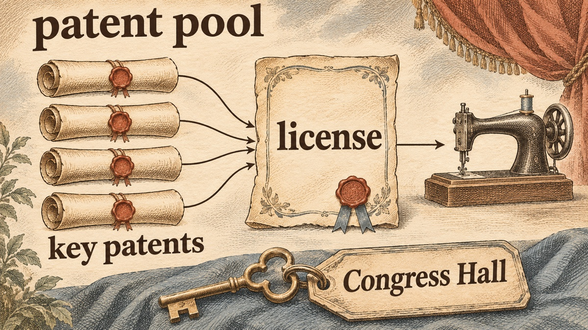
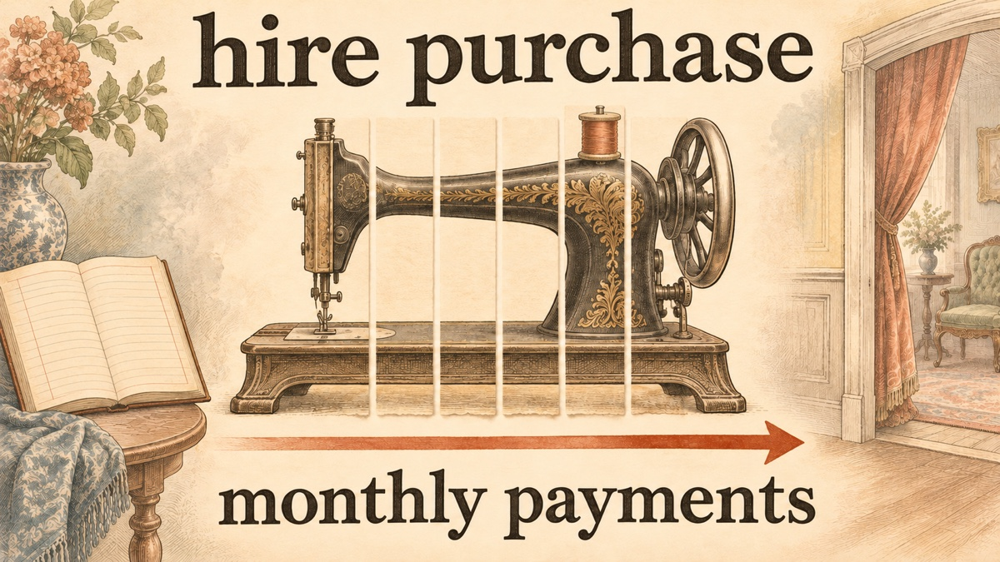

In the summer of 1851, Edward Clark, a New York lawyer of about forty, had just become a partner of Isaac Merritt Singer. He soon wanted out. Singer was loud, barely schooled, a former actor, and supported several households at once. Clark's wife gave him [blunt advice](#ref-lyon-opening): "Sell out, and leave the nasty brute." Clark stayed. Over the next twelve years, the two men built the company that made the sewing machine an ordinary household purchase.

This post is part of a series on founders who worked before modern venture capital. The series counts modern VC from the American Research and Development Corporation, founded in 1946. Apart from Zieber's forty dollars and some promissory notes that were never paid, I found no outside investor in the sources below. Their story is about what founders do when the product works but the market will not yet buy it.

## The market in 1850: a working machine that would not sell

The sewing machine was not one person's invention. Grace Rogers Cooper, the Smithsonian's textile curator, opens her history of the machine by saying the practical sewing machine is ["not the result of one man's genius"](#ref-cooper-not-one-man). By 1850 Elias Howe held the patent on the [eye-pointed needle and shuttle lockstitch](#ref-cooper-combination), and other shops were already building machines.

Singer came to the business by accident. In 1850 he was in Boston to promote a machine for carving printers' type. Cooper reports that he showed it in Orson Phelps's Boston shop, where another sewing machine design was being manufactured, and then [turned his attention to the sewing machine](#ref-cooper-singer-origin). George Zieber, a publisher, put up forty dollars for a model. Singer's own account, given later in a patent suit, says he built it in eleven days. The U.S. Patent Office granted his patent, [No. 8,294, on August 12, 1851](#ref-singer-patent-8294).

The machine worked. The market had three problems.

- **Price.** Peter Lyon, writing in *American Heritage* in 1958, puts the price above $100 at a time when an American family earned [about $500 a year](#ref-lyon-installment). I found no primary price list for 1851 to check those two numbers, so treat them as Lyon's estimate.
- **Patents.** Howe demanded [$25,000 from Singer](#ref-cooper-howe-suit) for infringement. He also sued firms that sold Singer machines, and the court stopped those firms from selling while the suits ran. Rivals who had bought Howe licenses [advertised that anyone could sell their machines](#ref-cooper-howe-suit) without fear of a suit.
- **Trust.** The buyers who could use the machine most, women sewing at home, had never owned a machine. Lyon describes a [prevailing prejudice](#ref-lyon-demonstration) that women could not be trusted with one.

## Move one: pay the lawyer in equity

Singer had no money for lawyers. According to Lyon, he asked Ambrose Jordan, the attorney who had helped with his patent application, whether he would [handle the case](#ref-lyon-jordan), and any later litigation, for a share of the business. Jordan refused because he disliked Singer, and passed the work to his junior partner and son-in-law, Edward Clark. Clark accepted.

Cooper's account of the ownership trail agrees on the outcome. A footnote in her book says Singer bought Phelps's interest and [sold it to Edward Clark](#ref-cooper-clark-footnote). The firm traded as I. M. Singer & Co.

The other early backers did not last. Lyon reports that Barzillan Ransom, a Brooklyn maker of salt bags, offered promissory notes worth up to $10,000 [for a one-third share](#ref-lyon-ransom) and withdrew a few months later without paying. Zieber, sick and afraid of dying in debt, [sold his interest to Singer and Clark](#ref-lyon-zieber) for $6,000. Lyon quotes Zieber's later complaint that he had been "robbed."

In today's terms, Clark was a co-founder who invested labor in place of cash. Startups still pay lawyers, designers, and early engineers with equity when they cannot pay invoices. The Singer case shows the side effect: the person paid in equity now cares about the business as an owner, not as a vendor. Clark did not just defend the patent. Lyon writes that Singer [left Clark to attend to the business end](#ref-lyon-business-end): law, patents, sales, and advertising.

## Move two: end the patent war with a pool

Between 1852 and 1856, the main manufacturers sued each other constantly. The record of how Singer settled with Howe has two versions.

- Cooper says that on July 1, 1854, Singer and Clark [paid Howe $15,000 and took a license](#ref-cooper-howe-license).
- Lyon says Howe forced the firm to pay $28,000 for past claims and [a $10 license fee on every future machine](#ref-lyon-howe-settlement).

I could not reconcile the two figures from a primary document, so I give both.

The war ended in 1856. Cooper credits Orlando B. Potter, president of Grover & Baker, with [proposing the "Combination"](#ref-cooper-combination): Howe, Wheeler & Wilson, I. M. Singer & Co., and Grover & Baker would pool their key patents. Howe agreed on conditions, including that at least twenty-four manufacturers would receive licenses. Other makers paid one fee, [$15 per machine](#ref-cooper-combination-fee), in place of four. Each member still built and sold its own machine. Lyon tells the same event from Clark's side: the parties met at [Congress Hall](#ref-lyon-albany), a hotel in Albany, before a court hearing in a suit Clark had brought, and they signed during the night.

The pool outlived Howe's participation. Howe stayed in until his patent [ran out in 1867](#ref-cooper-combination-end), and the other members kept the Combination going until 1877.

The modern names for this move are a **patent pool** and **cross-licensing**. The lesson for a founder is narrower than "make peace." Clark had first [bought the rights to several early patents](#ref-lyon-howe-settlement), so Singer had claims to trade. A pool only works when each member brings something the others need.

## Move three: sell to the woman at home, and show her

Clark's sales methods were aimed at the buyer that competitors overlooked. Lyon reports that by 1852 a young woman in the company's Broadway window [demonstrated the machine to crowds](#ref-lyon-demonstration). Cooper describes Singer showrooms of the mid-1850s as [lavishly decorated](#ref-cooper-showrooms), with carpets and carved walnut, places where Victorian women would not be ashamed to be seen.

The product followed the customer. A Singer brochure from about 1858 announced a smaller "Family" machine, [decorated as "a beautiful ornament in the parlor or boudoir"](#ref-cooper-family-machine). Cooper adds that the first version was too small and light and sold poorly. The firm was testing the home market, not winning it at once.

Lyon also credits Clark with a trade-in offer. [By February 1856](#ref-lyon-trade-in), any older machine, from any maker, could be traded in toward a new Singer. Lyon gives the credit as fifty dollars. I did not find the original advertisement.

## Move four: lower the price at the door with hire purchase

The best-known move came in 1856. Cooper writes that because machines were expensive and family income low, [Clark suggested the hire-purchase plan](#ref-cooper-hire-purchase). Lyon dates the plan to [September 1856](#ref-lyon-installment). Baker Library at Harvard Business School quotes the company's own newspaper, *I. M. Singer & Co.'s Gazette*, in 1856: ["Why not rent a sewing machine to the housewife](#ref-hbs-gazette) and apply the rental fee to the purchase price of the machine?"

Hire purchase was not new. Lyon says Clark took the idea from New York furniture makers and New England clockmakers. What was new was a manufacturer using credit across a national sales network.

The modern names are **financing at the point of sale**, **buy now, pay later**, and, in software, the **subscription**. Each one removes the large first payment that stops a buyer who already wants the product. For a founder, hire purchase also changes the business. The company now holds receivables, must judge credit risk, and must collect. Singer later built [a whole sales staff for that job](#ref-godley-canvasser).

## Move five: build abroad, and put service in the customer's home

Singer looked abroad early. Lyon reports that [by 1867 the first foreign factory](#ref-lyon-glasgow) stood near Glasgow. Andrew Godley, a business historian at the University of Reading, explains why it mattered: after the Civil War the dollar rose, which hurt American exports, and Singer alone [built low-cost Scottish factories](#ref-godley-scottish) to serve foreign markets.

Godley's work, based on the company's archives, also corrects a popular story. Singer did not win abroad through clever advertising. His paper finds that Singer [did not engage in price discrimination or extensive advertising campaigns](#ref-godley-abstract). The firm charged premium prices. Its advantage was a retail system. Installment purchase reached Britain [from 1873](#ref-godley-uk-1873). In the mid-1870s William Woodruff, the London agent, invented the [canvasser and collector system](#ref-godley-canvasser): company staff visited women at home to demonstrate machines, collect payments, and give after-sales service. Clark, by then company president, made it the standard practice in the United States and elsewhere.

That system is what software companies now call **customer success** or **developer relations**: staff whose job is to make sure a customer can actually use the product after the sale.

## How the partnership ended

Clark and Singer never liked each other. Cooper says they [stayed partners until 1863](#ref-cooper-1863), when they formed a corporation and Singer withdrew from active work with about 40 percent of the stock. Lyon adds a detail from the dissolution: neither man was [permitted to be president](#ref-lyon-1863) while the other lived. Singer retired to Europe and died in 1875. By the late 1870s Clark was [company president](#ref-godley-canvasser).

## Popular claims that do not hold up

- **"Singer invented the sewing machine."** False. Singer improved existing machines and paid Howe for a license. Cooper's history describes many contributors.
- **"Singer invented installment buying."** False, twice over. Installments were older than Singer, and the source that credits the firm names Clark, not Singer. Cooper's preface says the sewing machine industry [pioneered installment buying](#ref-cooper-preface), which is a claim about the industry, not one person.
- **"Clark received exactly one third (or three eighths) of the business for his legal work."** Some web pages give one third, and some give three eighths. I found no primary partnership agreement. Lyon, my most detailed source, gives no fraction. The one-third figure in Lyon belongs to Ransom, not Clark. I left the fraction out.
- **"Five dollars down and five dollars a month."** Lyon quotes an unnamed *Scientific American* writer who mentions [monthly installments of five dollars](#ref-lyon-scientific-american) on a $100 machine. I could not find the original issue. Following this series' rule, I do not state a down payment or a monthly amount as fact.
- **"The credit plan tripled sales in one year."** Baker Library states this [without a citation](#ref-hbs-tripled). I treat it as unverified.
- **"Singer won through advertising."** Godley's archive work argues the opposite: service in the home mattered more than advertising.

## What a founder today can take from this

Singer and Clark had product–market fit with a hidden obstacle. Women wanted the machine. Three things blocked the sale: price, legal risk, and doubt that a machine would work in an untrained buyer's hands. Each move above removed one obstacle.

1. **Equity can buy the skill you lack.** Singer could build. Clark could litigate, negotiate, and sell. Neither could have succeeded alone, and no investor funded the gap.
2. **A legal fight can become a business.** The Combination turned lawsuits into license income. A developer-tools company in a patent or standards fight has the same option if it holds rights the other side needs.
3. **Remove the first payment, then plan for the collections.** Domain sales show the same pattern today. Afternic, a domain marketplace, offers lease-to-own, so a buyer can [pay for a domain in monthly payments](#ref-afternic-lto) over a set term and use it at once. The seller gets more buyers and takes on collection risk, which is the trade Clark made in 1856.
4. **Service is part of the product.** Godley's finding about the canvassers applies to any complex product. The customer must be able to use it after the sale, and someone must be there when it breaks.

## References

Sources are listed by work. Each item names its locator. Fetch dates are the dates I read the page.

### Primary sources

- Isaac M. Singer — Original source: [U.S. Patent No. 8,294, "Improvement in sewing-machines," issued August 12, 1851](https://patents.google.com/patent/US8294A/en), Google Patents record with the full patent text. — fetched [2026-11-11](http://web.archive.org/web/20260511234444/https://patents.google.com/patent/US8294A/en)
- Baker Library, Harvard Business School, quoting *I. M. Singer & Co.'s Gazette* (1856) — Original source: ["Easy Payments: The Rise of Installment Selling"](https://www.library.hbs.edu/hc/credit/credit4b.html#:~:text=Why%20not%20rent%20a%20sewing%20machine%20to%20the%20housewife). The exhibit page quotes: "Why not rent a sewing machine to the housewife and apply the rental fee to the purchase price of the machine?" I read the quotation on the exhibit page, not in the *Gazette* itself. — fetched [2026-11-11](http://web.archive.org/web/20261102095328/https://www.library.hbs.edu/hc/credit/credit4b.html)

### Grace Rogers Cooper, *The Invention of the Sewing Machine* (Smithsonian Institution, U.S. National Museum Bulletin 254, 1968)

The title page lists Cooper as curator of textiles at the U.S. National Museum. The 1968 edition is in the public domain on [Project Gutenberg (eBook #32677)](https://www.gutenberg.org/ebooks/32677); the Smithsonian published a revised edition in 1976. The Singer passages are in chapter 2, "Elements of a Successful Machine" (book pp. 17–38). The Combination is chapter 3 (pp. 39–42). Archive of the book's catalog page: fetched [2026-11-11](http://web.archive.org/web/20260412234343/https://www.gutenberg.org/ebooks/32677). The archive service had no copy of the HTML text, and I did not create one.

- Preface — [passage](https://www.gutenberg.org/files/32677/32677-h/32677-h.htm#:~:text=not%20the%20result%20of%20one%20man): "The practical sewing machine is not the result of one man's genius." — fetched 2026-11-11
- Preface — [passage](https://www.gutenberg.org/files/32677/32677-h/32677-h.htm#:~:text=pioneered%20installment%20buying%20and%20patent%20pooling): the sewing machine "pioneered installment buying and patent pooling." — fetched 2026-11-11
- Chapter 2, Singer section — [passage](https://www.gutenberg.org/files/32677/32677-h/32677-h.htm#:~:text=his%20attention%20to%20the%20sewing%20machine): Singer came to Boston in 1850 with a type-carving machine, exhibited it in Phelps's shop, then "turned his attention to the sewing machine." The same section quotes Singer's patent-suit testimony on Zieber's forty dollars and the eleven-day build. — fetched 2026-11-11
- Chapter 2 — [passage](https://www.gutenberg.org/files/32677/32677-h/32677-h.htm#:~:text=enlisting%20the%20legal%20aid%20of%20Edward%20Clark): "Howe demanded $25,000 for infringement of his patent. Singer and Zieber decided to fight, enlisting the legal aid of Edward Clark, a lawyer and financier." The next paragraph adds that rivals "purchased licenses from Howe and advertised that anyone could sell their machines without fear of a suit." — fetched 2026-11-11
- Chapter 2 — [passage](https://www.gutenberg.org/files/32677/32677-h/32677-h.htm#:~:text=they%20paid%20him%20%2415%2C000%20and%20took%20out%20a%20license): "On July 1, 1854, they paid him $15,000 and took out a license." — fetched 2026-11-11
- Chapter 2, footnote 60 — [passage](https://www.gutenberg.org/files/32677/32677-h/32677-h.htm#:~:text=sold%20it%20to%20Edward%20Clark): "Singer purchased Phelps' interest in the company in 1851 and sold it to Edward Clark." — fetched 2026-11-11
- Chapter 2 — [passage](https://www.gutenberg.org/files/32677/32677-h/32677-h.htm#:~:text=lavishly%20decorated): Singer "pioneered in the use of lavishly decorated sewing-machine showrooms," "places in which Victorian women were not ashamed to be seen." — fetched 2026-11-11
- Chapter 2, caption of figure 32 — [passage](https://www.gutenberg.org/files/32677/32677-h/32677-h.htm#:~:text=a%20beautiful%20ornament%20in%20the%20parlor): brochure of about 1858–59 describing the new Family machine as "a beautiful ornament in the parlor or boudoir." — fetched 2026-11-11
- Chapter 2 — [passage](https://www.gutenberg.org/files/32677/32677-h/32677-h.htm#:~:text=Clark%20suggested%20the%20adoption%20of%20the%20hire-purchase%20plan): "Since the cost of sewing machines was quite high and the average family income was low, Clark suggested the adoption of the hire-purchase plan." — fetched 2026-11-11
- Chapter 2 — [passage](https://www.gutenberg.org/files/32677/32677-h/32677-h.htm#:~:text=He%20received%2040%20percent%20of%20the%20stock): "Singer and Clark continued to be partners until 1863 when a corporation was formed.... He received 40 percent of the stock." — fetched 2026-11-11
- Chapter 3 — [passage](https://www.gutenberg.org/files/32677/32677-h/32677-h.htm#:~:text=advanced%20in%201856%20the%20idea%20of%20a): Orlando B. Potter "advanced in 1856 the idea of a 'Combination'"; the pooled patents included "The grooved, eye-pointed needle used with a shuttle to form the lockstitch (E. Howe patent, held by E. Howe)"; Howe required that "at least twenty-four manufacturers were to be licensed." — fetched 2026-11-11
- Chapter 3 — [passage](https://www.gutenberg.org/files/32677/32677-h/32677-h.htm#:~:text=The%20fee%20was%20%2415%20per%20machine): "The fee was $15 per machine.... The advantage to the licensee was that he was required to pay only one fee." — fetched 2026-11-11
- Chapter 3 — [passage](https://www.gutenberg.org/files/32677/32677-h/32677-h.htm#:~:text=Howe%20remained%20a%20member%20until%20his%20patent%20ran%20out%20in%201867): "Howe remained a member until his patent ran out in 1867. The other members continued the 'Combination' until 1877." — fetched 2026-11-11

### Peter Lyon, "Isaac Singer and His Wonderful Sewing Machine," *American Heritage* 9, no. 6 (October 1958)

Lyon draws on company letters that he quotes but does not cite by archive location. Where Lyon and Cooper disagree, the post says so. Archive: fetched [2026-11-11](http://web.archive.org/web/20260620122614/https://www.americanheritage.com/isaac-singer-and-his-wonderful-sewing-machine).

- [Passage](https://www.americanheritage.com/isaac-singer-and-his-wonderful-sewing-machine#:~:text=Sell%20out%2C): Clark, "a respectable forty-year-old lawyer," in the summer of 1851; his wife: "Sell out," she urged him, "and leave the nasty brute." — fetched 2026-11-11
- [Passage](https://www.americanheritage.com/isaac-singer-and-his-wonderful-sewing-machine#:~:text=in%20return%20for%20a%20one-third%20share%20in%20the%20business): Ransom tendered "promissory notes worth up to $10,000 in return for a one-third share in the business" and "By May he had withdrawn—without having paid his notes." — fetched 2026-11-11
- [Passage](https://www.americanheritage.com/isaac-singer-and-his-wonderful-sewing-machine#:~:text=handle%20the%20case): "Would Jordan, Singer inquired, handle the case—and any subsequent litigation—for a share in the business? Jordan refused.... Instead, he referred him to his junior partner and son-in-law, Edward Clark." — fetched 2026-11-11
- [Passage](https://www.americanheritage.com/isaac-singer-and-his-wonderful-sewing-machine#:~:text=he%20consented%20to%20sell%20his%20interest%20in%20the%20company%20to%20Singer%20and%20Clark): Zieber "consented to sell his interest in the company to Singer and Clark for $6,000." — fetched 2026-11-11
- [Passage](https://www.americanheritage.com/isaac-singer-and-his-wonderful-sewing-machine#:~:text=to%20pay%20a%20license%20fee%20of%20%2410%20on%20every%20machine%20sold%20in%20the%20future): by 1854 Howe forced the firm "to pay $28,000 in settlement of past claims and, furthermore, to pay a license fee of $10 on every machine sold in the future." The same paragraph says "Clark had cunningly purchased the rights to a number of early patents." The settlement figures conflict with Cooper's $15,000. — fetched 2026-11-11
- [Passage](https://www.americanheritage.com/isaac-singer-and-his-wonderful-sewing-machine#:~:text=Congress%20Hall): the parties to a suit Clark brought in the U.S. circuit court at Albany stayed at "the same hotel, Congress Hall," and initialed the agreement before court sat. Lyon also splits the $15 fee as $5 to Howe, $5 to Singer, and $2.50 to each other company; Lyon's footnote says Howe's patent "expired in 1860," while Cooper says Howe's patent was extended in 1860 and ran out in 1867. I follow Cooper on that date. — fetched 2026-11-11
- [Passage](https://www.americanheritage.com/isaac-singer-and-his-wonderful-sewing-machine#:~:text=As%20early%20as%201852%20there%20was%20a%20girl%20in%20the%20company%E2%80%99s%20Broadway%20shopwindow): Lyon asks how "to overcome the prevailing prejudice that women were too stupid to be trusted with a machine," then answers: "As early as 1852 there was a girl in the company's Broadway shopwindow, demonstrating how simple the machine was to operate." — fetched 2026-11-11
- [Passage](https://www.americanheritage.com/isaac-singer-and-his-wonderful-sewing-machine#:~:text=By%20February%2C%201856%2C%20Clark%20announced): "By February, 1856, Clark announced that any 'inferior or wholly worthless' machine ... could be traded in against a new Singer for a cash value of fifty dollars." — fetched 2026-11-11
- [Passage](https://www.americanheritage.com/isaac-singer-and-his-wonderful-sewing-machine#:~:text=In%20September%2C%201856%2C%20Clark): "How to sell an appliance costing more than $100 at a time when the American family's average annual income was in the neighborhood of $500? In September, 1856, Clark, taking his cue from New York furniture manufacturers and New England clockmakers, introduced the concept of installment buying." — fetched 2026-11-11
- [Passage](https://www.americanheritage.com/isaac-singer-and-his-wonderful-sewing-machine#:~:text=He%20left%20Clark%20to%20attend%20to%20the%20business%20end): "He left Clark to attend to the business end: the legal questions, the patent problems, the merchandising and the primitive advertising." — fetched 2026-11-11
- [Passage](https://www.americanheritage.com/isaac-singer-and-his-wonderful-sewing-machine#:~:text=A%20psychological%20fact%2C%20possibly%20new): Lyon quotes a *Scientific American* writer on "monthly installments of five dollars." Lyon gives no issue or date, and I did not find the original. — fetched 2026-11-11
- [Passage](https://www.americanheritage.com/isaac-singer-and-his-wonderful-sewing-machine#:~:text=neither%20was%20permitted%20to%20be%20president): in July 1863 the partners dissolved the partnership, and "neither was permitted to be president of the new corporation so long as the other should live." — fetched 2026-11-11
- [Passage](https://www.americanheritage.com/isaac-singer-and-his-wonderful-sewing-machine#:~:text=By%201867%20the%20first%20foreign%20factory%20had%20been%20built%2C%20near%20Glasgow): "By 1867 the first foreign factory had been built, near Glasgow." — fetched 2026-11-11

### Andrew Godley, "Selling the sewing machine around the world: Singer's international marketing strategies, 1850–1914" (University of Reading working paper)

The working paper uses Singer company archives. A revised version, covering 1850–1920, appeared in *Enterprise & Society* 7, no. 2 (2006), pp. 266–314. The university's original URL now redirects to a "page not found" page, so the links below go to the archived PDF (42 pages).

- [PDF page 1, abstract](https://web.archive.org/web/20240205173120/https://www.reading.ac.uk/Econ/Econ/workingpapers/emdp422.pdf#page=1): "Despite its reputation for marketing sophistication, Singer did not engage in price discrimination strategies, extensive advertising campaigns, or pre-emptive investments in retail networks." — fetched 2026-11-11 (archived copy)
- [PDF page 11](https://web.archive.org/web/20240205173120/https://www.reading.ac.uk/Econ/Econ/workingpapers/emdp422.pdf#page=11): "Postwar dollar appreciation threatened sales in these nascent markets and Singer alone developed a low cost manufacturing base with its Scottish factories." — fetched 2026-11-11 (archived copy)
- [PDF page 20](https://web.archive.org/web/20240205173120/https://www.reading.ac.uk/Econ/Econ/workingpapers/emdp422.pdf#page=20): "The key innovation in Singer's retail network was not installment purchasing ... it was the invention of the canvasser/ collector system by the London agent, William Woodruff, in the mid-1870s." Edward Clark and George McKenzie "ensured it was soon the standard practice." — fetched 2026-11-11 (archived copy)
- [PDF page 40, note 27](https://web.archive.org/web/20240205173120/https://www.reading.ac.uk/Econ/Econ/workingpapers/emdp422.pdf#page=40): "Installment purchasing introduced first in the UK from 1873," citing Woodruff's letter to Clark of 19 May 1877 in the Singer archive. — fetched 2026-11-11 (archived copy)

### Other sources

- Baker Library, Harvard Business School — Original source: ["Easy Payments: The Rise of Installment Selling"](https://www.library.hbs.edu/hc/credit/credit4b.html#:~:text=tripled%20sales%20in%20just%20one%20year). The page says Singer's credit plan "tripled sales in just one year" and gives no source for the figure. — fetched [2026-11-11](http://web.archive.org/web/20261102095328/https://www.library.hbs.edu/hc/credit/credit4b.html)
- Afternic — Original source: ["Lease to Own Domains"](https://www.afternic.com/lease-to-own#:~:text=pay%20for%20a%20domain%20using%20monthly%20payments%20over%20a%20set%20term): "Lease to Own provides buyers with the option to pay for a domain using monthly payments over a set term." — fetched [2026-11-11](http://web.archive.org/web/20261103181524/https://www.afternic.com/lease-to-own)

### Not consulted

Ruth Brandon's biography *A Capitalist Romance: Singer and the Sewing Machine* (1977) is the standard book-length account. I did not have access to it, and nothing in this post relies on it.
