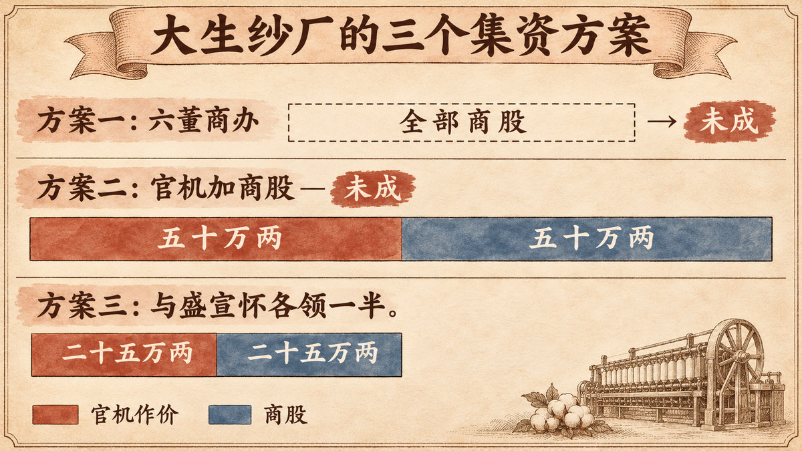

本文属于“风投诞生之前的创业者”系列。现代风险投资一般从 1946 年 ARD 成立算起，这个系列每篇讲一位在那之前创业的人，问的都是同一个问题：没有风投基金的年代，谁的做法最像今天的创业者？

张謇（1853—1926）是个特别的人选。他不是商人出身，而是读书人。他在 1894 年[通过了科举的最高一级考试](#ref-britannica-zhang-jian)，而且是那一科的[状元](#ref-li-2017-p47)。第二年，他开始筹办纱厂。此后四年里，他碰到的麻烦，今天的创业者大多不陌生：钱招不齐，合伙人中途退出，官府还要插一手。

## 1895 年，市场开了门，钱却没有跟进来

1895 年以前，中国人不能想开工厂就开工厂。Goetzmann 和 Köll 指出，清廷的政策[不允许本国人独立开办私营工业企业](#ref-gk-2005-p159)，大型工业项目都要靠李鸿章这样的重臣庇护。

甲午战败改变了这一点。《马关条约》允许外国人[在通商口岸设厂制造](#ref-gk-2005-p159)，朝廷也就再难禁止本国人办工业。纺纱业的变化最明显：1890 年到 1894 年，全国[只办成了五家纱厂](#ref-gk-2005-p160)，其中四家有官方背景；到 1916 年，新开的纱厂有三十家在运转，全部由商人经营。

市场的门开了，缺的是本钱，以及一套能让民间资金放心投进工厂的规矩。1904 年以前，中国[没有要求登记的公司法](#ref-gk-2005-p166)。大生后来的一位大股东说，纱厂早年的组织[既不限责，也不受任何法律约束](#ref-gk-2005-p166)。

## 张謇两次招股都没招齐

江苏省档案馆收藏的大生纱厂创办档案，记录了[从 1895 年筹办、集股，到 1899 年开车、盈利](#ref-jiangsu-archives-dasheng)的全过程。两江总督张之洞[以庇护人的身份出面](#ref-gk-2005-p165)，1895 年以官商合办的名义发起这家纱厂。Goetzmann 和 Köll 也写道，张之洞给的支持仅止于此，他[拿不出大生急需的资金](#ref-gk-2005-p165)。

最初的方案是商办，设六位董事，通州、上海各三位。姚震宇、何新易根据张謇的年谱和函牍梳理了此后的经过。光绪二十二年（1896 年）七月，六董在上海开会，[沪方樊芬与通方陈维镛退出](#ref-yao-he-2007-p25)。沪方董事潘华茂、郭勋又一再说股本难招。

这时，署理江宁布政使桂嵩庆告诉张謇一个消息：张之洞在湖广总督任上[购买的四万锭纱机存放在上海，久置将废，官府愿意作价五十万两，招商承领](#ref-yao-he-2007-p25)。张謇随即[提议用官机把各方拢在一起](#ref-yao-he-2007-p25)。新方案是官机作价五十万两，再招商股五十万两。

这一次又没有成功。沪方董事后来[声称十六万元股款已经招足，却不肯交出](#ref-yao-he-2007-p26)，甚至[有人说要散股悔约](#ref-yao-he-2007-p26)。最后的办法是把项目一分为二：张謇和盛宣怀各领一半官机，各作价二十五万两，各自再招商股二十五万两，分设两厂。约款写明[“由张绅、盛绅出名订约，合领官机，各主一厂”](#ref-yao-he-2007-p26)。姚、何二位把这种形式称为“绅领商办”：官产由士绅领取，经营交给商人。

这段经历，张謇后来在 1907 年大生纱厂第一次股东会上[亲自向股东作了详细说明](#ref-li-2017-p47)。据李玉考证，筹建纱厂的五年间，张謇[没有花过公司一文钱](#ref-li-2017-p50)，生活全靠书院讲席的微薄薪俸。

## 他的办法：把闲置资产折成股本，经营权握在自己手里

放到今天的语境里，张謇做了三件事。

**第一，把搁浅资产变成股本。** 对官府来说，那批纱机是收不回来的沉没成本；对张謇来说，那批纱机抵得上一半本钱，又不用掏现银。今天也有类似的做法：一家公司把闲置的硬件、搁置的代码库或者一份授权许可拿出来入股。代价是引进了一个官方股东。不过，张謇在光绪二十二年十一月与桂嵩庆签的合同里写明，[“厂中用人、理财各事，全归商董经理”](#ref-yao-he-2007-p25)，官方只派一名官董到厂查账。

**第二，用固定回报吸引股东。** 和 1895 年以后创办的其他企业一样，大生按股本[每年支付八厘的固定利息](#ref-gk-2005-p168)，也就是“官利”。Goetzmann 和 Köll 认为，这种普通股更像今天的优先股。纱厂还没赚钱，官利就要照付。张謇自己讲过崇明分厂的账：[开车以前拿股本付官利，开车以后借钱付官利](#ref-li-2017-p52)。股东拿到了稳定的收入，企业却失去了扩张需要的现金。

**第三，不靠多数股权也能控制公司。** 1907 年，大生一厂的股本是[六十三万两，股东五百五十三户](#ref-gk-2005-p173)，其中能和张家挂上钩的户头合计四万零三百两，约占 6.4%。公司章程是张謇 1897 年亲手写的，两位作者认为这份章程[写得高度专断，带着家长作风](#ref-gk-2005-p174)。上海的总账房只对张謇一人负责。

用今天的话说，这是一家创始人控制的公司，有一个战略投资人，股份带着类似优先股的固定回报。最接近的现代类比不是拿了风投的初创公司，而是公私合作项目：创始人出经营方案，政府出闲置资产，小股东出现金。

## 一家纱厂长成了一个集团，集团却被创始人的其他抱负拖累

纱厂在 [1899 年开车并开始盈利](#ref-jiangsu-archives-dasheng)。1907 年召开第一次股东会，大生由此改为[股份有限公司](#ref-gk-2005-p166)。按张謇 1907 年的报告，大生的官利[“无年不付，余利自庚子始”](#ref-li-2017-p52)，也就是从 1900 年起，官利之外还有红利可分。

此后，张謇一路向外扩张。1901 年，他发布了[《通海垦牧公司集股章程启》](#ref-li-2017-p49)。他自己讲过其中的道理：纱厂需要棉花，棉花离不开农业，[所以办垦牧公司](#ref-li-2017-p48)；棉籽可以榨油，所以又办油厂。1905 年，他[用大生集团的盈利建起南通博物苑](#ref-cssn-museum)，就在他出资创办的南通师范学校西边。

股东看在眼里。1907 年的股东会上，一位大股东直说，补贴师范学校的开支[是总理个人的功德，跟公司没有关系](#ref-gk-2005-p173)。他手里没有多数股权，事情也就不了了之。

结局是债务。Goetzmann 和 Köll 列举了几个原因：公司资金被转进私人户头，给经营不善的子公司放风险贷款，一战后纱价下跌，扩张太快以致负债过重。几样叠在一起，[1922 年大生已濒临破产](#ref-gk-2005-p175)。1924 年，债权银行组成银团接管大生，第一次请外部审计查账，并撤去张謇的董事职务。孟森评点这段历史只用了一句话：张謇[“一手握公司、地方两任，遂以填入地方之赀为亏公司之累”](#ref-li-2017-p52)。

## 三种流行说法经不起查证

**“张謇是纯粹的民营企业家。”** 史料不支持这个说法。纱厂起家的本钱有一半是官机，1897 年和 1903 年的股票上仍然写着，纱厂[依约永远由官员和士绅共同经营](#ref-gk-2005-p165)。Goetzmann 和 Köll 查遍档案，没有找到正式解除这一身份的文件。

**“大生是当时中国唯一盈利的民营纱厂。”** 《不列颠百科全书》写道，大生[成了中国唯一一家盈利的私营纱厂](#ref-britannica-zhang-jian)。百科全书没有给出数据，笔者也没有找到比较全国纱厂盈亏的一手资料，所以这个说法只能存疑。

**“银行团 1925 年接管大生。”** 不少中文资料把债权人接管的时间写成 1925 年。Goetzmann 和 Köll 的研究依据南通档案，写的是 [1924 年](#ref-gk-2005-p175)。笔者无法亲自查阅档案，本文采用 1924 年，并在这里注明两种说法。

还有两件事笔者没能核实，因此正文没有采用：一是 1899 年开车时商股实际到账多少现银；二是南通博物苑是“中国第一座公共博物馆”的说法。后一种说法出现在笔者引用的[《学习时报》文章](#ref-cssn-museum)里，但笔者没有找到能定论的一手出处。

有一个数字需要小心。Goetzmann 和 Köll 写道，大生一厂的资本在 [1903 年到 1914 年间一直是一百一十三万两](#ref-gk-2005-p169)，而 1907 年的股本是六十三万两。两数相差五十万两，正好等于前面说的官机作价。两位作者没有这样对账，这只是笔者的推算，需要档案来确认。

## 今天的创业者能从张謇身上学到什么

**闲置资产可以充当种子轮。** 五十万两现银，张謇招不齐；二十五万两的旧纱机，他领得到。不妨留意别人已经核销掉的资产：硬件、数据、没人用的域名、无人维护的开源项目。资产的主人也许更看重一家能运转起来的公司。

**固定回报换来信任，也让企业少了腾挪的余地。** 在没有公司法的年代，八厘官利让外面的钱敢进来，也逼着大生借钱付利。今天用收入分成或保底回报去促成一轮融资，签字之前，先算一算光景不好的年份要付出什么代价。

**有控制、没有问责，迟早出事。** 张謇凭 6.4% 的股份掌控整个集团。这份控制力让他办成了学校和博物苑，也让资金在关联企业之间流动而无人过问。股东没能管住这些资金，最后出手叫停的是债权银行。

**扩张的每一步都要记在账上。** 棉花、榨油、航运、教育，每家新公司都有充分的理由。理由一条条都站得住，加在一起却成了一个人照看不过来的摊子。

张謇像一位创业者，因为他只用当时实际能拿到的市场和资金。他的经历也提醒后人：让他起步的那套结构，后来也让大生难以收场。

## 参考资料

- 江苏档案信息网 — [《珍档赏析：大生纱厂创办初期档案》](https://www.dajs.gov.cn/art/2021/10/8/art_123_9651.html#:~:text=1899%E5%B9%B4%E5%BC%80%E8%BD%A6)，出自江苏省档案局、江苏省档案馆合编《江苏珍贵档案图鉴》。原文：“从1895年筹办、集股，1899年开车、盈利，到1907年召开第一次股东会议成立大生纺织公司的全过程”。档案馆藏品目录，介绍一手档案。— 获取于 [2026-11-11](https://web.archive.org/web/20251007103235/http://www.dajs.gov.cn/art/2021/10/8/art_123_9651.html)
- Encyclopaedia Britannica — [Zhang Jian](https://www.britannica.com/money/Zhang-Jian#:~:text=in%201894%20he%20passed%20the%20top%20level%20of%20the%20civil%20service%20examination)，第 2 段。原文：“in 1894 he passed the top level of the civil service examination”；“became the only private mill in China operating at a profit”。二手资料（百科全书）。— 获取于 [2026-11-11](https://web.archive.org/web/20260115111813/https://www.britannica.com/money/Zhang-Jian)
- William N. Goetzmann、Elisabeth Köll，[“The History of Corporate Ownership in China: State Patronage, Company Legislation, and the Issue of Control”](https://www.nber.org/system/files/chapters/c10269/c10269.pdf#page=12)，收入 Randall K. Morck 编 *A History of Corporate Governance around the World*（芝加哥大学出版社，2005），第 159 页。原文：“the government policy that did not allow Chinese nationals to open private industrial enterprises independently”；《马关条约》允许外国人“engage in manufacturing operations in Chinese treaty ports”。二手资料。— 获取于 [2026-11-11](https://web.archive.org/web/20260218123224/https://www.nber.org/system/files/chapters/c10269/c10269.pdf)
- Goetzmann、Köll（2005），[第 160 页](https://www.nber.org/system/files/chapters/c10269/c10269.pdf#page=13)。原文：“Between 1890 and 1894 only a total of five cotton-spinning mills had been successfully established (all but one with government involvement), while by 1916 thirty new mills were in operation”。二手资料。— 获取于 [2026-11-11](https://web.archive.org/web/20260218123224/https://www.nber.org/system/files/chapters/c10269/c10269.pdf)
- Goetzmann、Köll（2005），[第 165 页](https://www.nber.org/system/files/chapters/c10269/c10269.pdf#page=18)。原文：张之洞“lent his support as the patron in the beginning and officially initiated the Dasheng cotton mills as an operation under joint government-merchant management in 1895”；“was unable to offer Dasheng crucial financial support”；1897 年和 1903 年的股票写明纱厂“by contract set up for perpetuity to be jointly managed by officials and gentry”。股票文字为英译，中文原文笔者未见。二手资料，依据南通纺织博物馆和南通市档案馆藏品。— 获取于 [2026-11-11](https://web.archive.org/web/20260218123224/https://www.nber.org/system/files/chapters/c10269/c10269.pdf)
- Goetzmann、Köll（2005），[第 166 页](https://www.nber.org/system/files/chapters/c10269/c10269.pdf#page=19)。原文：郑孝胥在 1907 年股东会上说“Formerly all the organization of this mill was unlimited and untouched by any law”（正文据英译转述，中文原话笔者未见）；脚注 15：“there was no company law with required registration before 1904”；纱厂“had now taken on the form of a stockholding company with limited liability”。二手资料。— 获取于 [2026-11-11](https://web.archive.org/web/20260218123224/https://www.nber.org/system/files/chapters/c10269/c10269.pdf)
- Goetzmann、Köll（2005），[第 168 页](https://www.nber.org/system/files/chapters/c10269/c10269.pdf#page=21)。原文：股东“received guaranteed interest payments at a fixed rate of 8 percent on their share investment”（作者引 Köll 2003，第 130 页）；“the common shares resembled what we now think of as preferred shares”。二手资料。— 获取于 [2026-11-11](https://web.archive.org/web/20260218123224/https://www.nber.org/system/files/chapters/c10269/c10269.pdf)
- Goetzmann、Köll（2005），[第 169 页](https://www.nber.org/system/files/chapters/c10269/c10269.pdf#page=22)。原文：“The capital of the Dasheng No. 1 Cotton Mill remained unchanged at 1.13 million taels between 1903 and 1914”。二手资料。— 获取于 [2026-11-11](https://web.archive.org/web/20260218123224/https://www.nber.org/system/files/chapters/c10269/c10269.pdf)
- Goetzmann、Köll（2005），[第 173 页](https://www.nber.org/system/files/chapters/c10269/c10269.pdf#page=26)。原文：“the capital stock of 630,000 taels was subscribed by altogether 553 shareholders”；张家相关户头“40,300 taels or altogether 6.4 percent”；郑孝胥说师范学校补贴“have nothing to do with the company”（正文据英译转述）。二手资料，依据南通市档案馆 B 402-111-2、B 402-111-445。— 获取于 [2026-11-11](https://web.archive.org/web/20260218123224/https://www.nber.org/system/files/chapters/c10269/c10269.pdf)
- Goetzmann、Köll（2005），[第 174 页](https://www.nber.org/system/files/chapters/c10269/c10269.pdf#page=27)。原文：“Dasheng's corporate charter, a lengthy document written by Zhang Jian in a highly autocratic and paternalistic fashion in 1897”；总账房负责人“was accountable only to Zhang Jian and not to the shareholders”。二手资料。— 获取于 [2026-11-11](https://web.archive.org/web/20260218123224/https://www.nber.org/system/files/chapters/c10269/c10269.pdf)
- Goetzmann、Köll（2005），[第 175 页](https://www.nber.org/system/files/chapters/c10269/c10269.pdf#page=28)。原文：这些做法“led Dasheng close to bankruptcy in 1922”；银行“imposed various financial and managerial reforms, including the first external audit ever and Zhang Jian's removal as director, after taking over Dasheng in a bank consortium in 1924.”二手资料。— 获取于 [2026-11-11](https://web.archive.org/web/20260218123224/https://www.nber.org/system/files/chapters/c10269/c10269.pdf)
- 姚震宇、何新易，[《清末企业官商关系实例考证及启示》](https://tsjyb.jsbc.edu.cn/_upload/article/files/75/69/7346c62b453cbd4126bdc45fd5a0/ee8468dc-1a55-4783-a5ad-4e93506c5773.pdf#page=1)，《商业时代》2007 年第 33 期，第 25 页。原文（作者引张謇年谱）：“沪方樊芬与通方陈维镛退出六董”；“所购四万锭纱机庋沪久将废，作价五十万，招商承领”；“謇始议用官机以束合之”；同年十一月初二与桂嵩庆所签合同：“厂中用人、理财各事，全归商董经理”。二手资料。该文把光绪二十二年换算为 1898 年，光绪二十二年对应的是 1896 年，本文采用 1896 年。— 获取于 2026-11-11（无存档快照）
- 姚震宇、何新易（2007），[第 26 页](https://tsjyb.jsbc.edu.cn/_upload/article/files/75/69/7346c62b453cbd4126bdc45fd5a0/ee8468dc-1a55-4783-a5ad-4e93506c5773.pdf#page=2)。原文：“称十六万元股款已全，不愿交出”；“复有股散悔约之言”；“由张绅、盛绅出名订约，合领官机，各主一厂”。二手资料。— 获取于 2026-11-11（无存档快照）
- 李玉，[《论张謇的实业诚信观》](http://www.mgzx.org.cn/uploads/2018/05/081418524610.pdf#page=1)，《安徽史学》2017 年第 2 期，第 47 页。原文：“张謇甲午之后新科夺魁，状元及第”；大生纱厂的创业艰难“由他自己在该厂 1907 年第一次召开股东大会时做了详细说明”。二手资料。— 获取于 [2026-11-11](https://web.archive.org/web/20260513153550/http://www.mgzx.org.cn/uploads/2018/05/081418524610.pdf)
- 李玉（2017），[第 48 页](http://www.mgzx.org.cn/uploads/2018/05/081418524610.pdf#page=2)。原文（张謇自述）：“嗣因纱厂必需棉花，棉花必待农业，于是设垦牧公司。又因棉子制油为副业而设油厂”。二手资料。— 获取于 [2026-11-11](https://web.archive.org/web/20260513153550/http://www.mgzx.org.cn/uploads/2018/05/081418524610.pdf)
- 李玉（2017），[第 49 页](http://www.mgzx.org.cn/uploads/2018/05/081418524610.pdf#page=3)，注释引《通海垦牧公司集股章程启》，清光绪二十七年五月初一日（1901 年），《张謇全集》第 5 册，第 25 页。二手资料。— 获取于 [2026-11-11](https://web.archive.org/web/20260513153550/http://www.mgzx.org.cn/uploads/2018/05/081418524610.pdf)
- 李玉（2017），[第 50 页](http://www.mgzx.org.cn/uploads/2018/05/081418524610.pdf#page=4)。原文：“在大生纱厂筹建的五年期间，他没有花过公司一文钱，生计全赖自己担任书院讲席所得微薄俸金”。二手资料。— 获取于 [2026-11-11](https://web.archive.org/web/20260513153550/http://www.mgzx.org.cn/uploads/2018/05/081418524610.pdf)
- 李玉（2017），[第 52 页](http://www.mgzx.org.cn/uploads/2018/05/081418524610.pdf#page=6)。原文：1907 年报告（《张謇全集》第 4 册，第 131 页）：“无年不付，余利自庚子始”；《大生崇明分厂十年事述》（1913）：“未开车前……即以股本给官利”“开车以后……乃借本以给官利”；孟森《吴君寄尘墓志》：“啬翁一手握公司、地方两任，遂以填入地方之赀为亏公司之累”。二手资料。— 获取于 [2026-11-11](https://web.archive.org/web/20260513153550/http://www.mgzx.org.cn/uploads/2018/05/081418524610.pdf)
- 邓田田，《学习时报》，中国社会科学网转载 — [《南通博物苑》](https://cssn.cn/kgxc/kgxc_kgsb/202207/t20220728_5431549.shtml#:~:text=%E4%BB%A5%E5%A4%A7%E7%94%9F%E9%9B%86%E5%9B%A2%E7%9A%84%E8%B5%A2%E5%88%A9%E4%B8%BA%E5%90%8E%E7%9B%BE)。原文：“1905年，他以大生集团的赢利为后盾，在他所出资创办的南通师范学校之西，修建了……南通博物苑”。二手资料（报纸）。— 获取于 2026-11-11（无存档快照）

## 延伸阅读

- Elisabeth Köll，*From Cotton Mill to Business Empire: The Emergence of Regional Enterprises in Modern China*（哈佛大学亚洲中心，2003）。这是研究大生的标准英文专著。笔者写作时无法打开全文，本文没有任何论断直接依据此书。
- 《张謇全集》（江苏古籍出版社，1994；2012 年新版）。上文引用的张謇原话，都转引自李玉和姚、何两篇论文。
