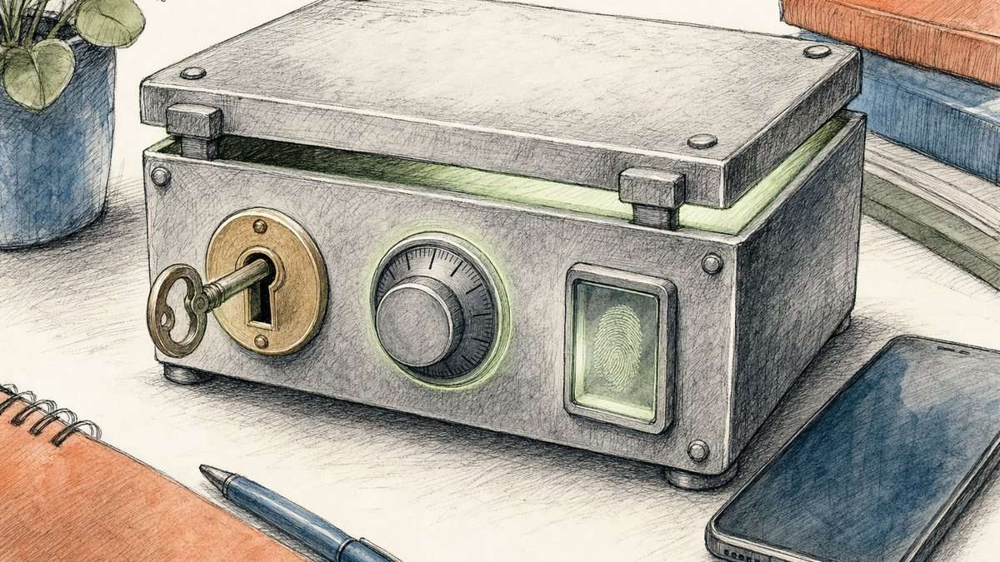

You type a card number into a shop's checkout page and press "Pay". Most of the time the order goes through at once. Sometimes your bank's app pops up and asks you to confirm the purchase, or a text message brings a six-digit code. Both outcomes come from the same protocol: 3-D Secure, usually shortened to 3DS.

In one sentence, 3DS lets the shop ask the bank that issued your card whether the person at the keyboard is really you, before the payment goes to that bank for approval. EMVCo, the body that maintains the current specification, describes it as a way for the merchant and the issuer [to exchange data about the transaction, the payment method and the device](#ref-emvco-3ds-overview) so that the issuer can authenticate the consumer.

This post walks through who takes part, how the two generations of the protocol differ, why most checks are invisible, who pays when fraud gets through, and why Europe turned the check into law.

## The "three domains" are the three parties in every check

The "3-D" stands for three domains. The PCI Security Standards Council lists them as [the merchant/acquirer domain, the issuer domain, and the interoperability domain](#ref-pci-3ds-faq). Mastercard's program guide gives each a one-line job: the acquirer domain is [where transactions are initiated](#ref-mc-idc-three-domains), the interoperability domain is where they are switched between the other two, and the issuer domain is where they are authenticated.

Each domain runs one piece of software:

| Domain | Who runs it | Component | What the component does |
| --- | --- | --- | --- |
| Acquirer | The shop, its payment provider or its bank | 3DS Server | Collects checkout data and sends the authentication request |
| Interoperability | The card network | Directory Server (DS) | Routes the request to the right issuer |
| Issuer | The bank that issued the card | Access Control Server (ACS) | Decides whether to approve, challenge or reject |

Mastercard's guide describes the ACS as [operating authentication software in the issuer domain](#ref-mc-idc-roles) and the 3DS Server as operating in the acquirer domain, where it communicates with the Directory Server. The PCI 3DS security standard covers [exactly these three components](#ref-pci-3ds-faq-components): 3DS Server, Directory Server and ACS.

Authentication and authorization are separate steps. Authentication answers "is this the cardholder?" Authorization answers "will the bank pay?" Mastercard's guide defines authentication as identifying the cardholder [prior to authorization](#ref-mc-idc-liability), and says its results are included in the authorization message that follows.

## Each card network sells 3DS under its own brand

Shoppers rarely see the name "3-D Secure". They see a network brand:

- **Visa Secure.** Visa describes Visa Secure as [its global EMV 3-D Secure program](#ref-visa-secure). Visa also says it [pioneered the original 3-D Secure protocol](#ref-visa-secure-origin) more than 15 years ago.
- **Mastercard Identity Check.** Mastercard's program guide says Identity Check is the next-generation program [with its origin from Mastercard SecureCode](#ref-mc-idc-origin), the earlier brand.
- **American Express SafeKey.** Amex describes SafeKey as a solution that [leverages the global industry standard, EMV 3-D Secure](#ref-amex-safekey).

The brands share one protocol. A shop's 3DS Server talks to each network's Directory Server, and the cardholder's bank answers through its ACS.

## EMV 3DS replaced the original protocol

The first protocol, version 1.0.2, is what most people mean by "3DS1". Visa's sunset notice calls it [the original version of the specification](#ref-visa-3ds1-sunset), introduced more than 15 years before that notice.

Visa says it [worked with other payment brands](#ref-visa-secure-origin) to build the next generation, EMV 3-D Secure, and EMVCo now maintains it. The updated specification [was published in October 2016](#ref-visa-3ds1-sunset), and Visa credits it with a smoother user experience, richer data exchange for fraud decisions, and support across payment channels and devices. People often call it "3DS2" because its version numbers start at 2. EMVCo lists support for [app-based purchases on mobile and other consumer devices](#ref-emvco-3ds-faq-specs) among the things the specification provides.

Visa then retired the old version. Its notice says that [effective 15 October 2022, Visa will discontinue support of 3-D Secure 1.0.2](#ref-visa-3ds1-sunset) and all related technology.

Europe's banking regulator gave a policy reason for moving on. The European Banking Authority wrote in 2019 that EMV 3DS 1.0, although it supports strong authentication, is [not fully adapted to PSD2](#ref-eba-op-2019-06-p23) and cannot carry the exemptions that EU law allows. EMVCo itself says version 2.1 supports those rules but recommends [v2.2 (or higher)](#ref-emvco-3ds-faq-version) for the full feature set.

## Most checks finish without the shopper seeing anything

EMV 3DS has two paths, and the issuer chooses between them.

**The frictionless flow.** The ACS looks at the data the shop sent and approves without asking the shopper anything. EMVCo's white paper says that in this flow the cardholder's identity is [verified automatically by the Issuer](#ref-emvco-wp-frictionless) with no extra steps. The risk check uses, among other things, the transaction details, the cardholder's history with the merchant, and [technical information such as device location or IP address](#ref-emvco-wp-frictionless-data). EMVCo's summary of the result: for many transactions, [consumers simply click "Buy"](#ref-emvco-3ds-faq-how) and the payment is approved.

**The challenge flow.** When the ACS sees a higher risk, it asks the shopper to prove who they are. EMVCo's FAQ lists [a one-time passcode, knowledge-based questions, biometrics, or other methods](#ref-emvco-3ds-faq-how). The white paper adds out-of-band approval, where the shopper confirms [using their mobile banking application](#ref-emvco-wp-challenge).

In my reading, this split is the practical gain over 3DS1: more data per request lets the issuer approve the safe majority silently and save the questions for the risky few. EMVCo frames the goal as authentication [without adding unnecessary friction](#ref-emvco-3ds-overview) that often leads to abandoned purchases.

## A successful check moves the fraud loss to the issuer

One reason shops accept an extra step that can cost them customers is the liability shift.

When the real cardholder disputes an online charge as fraud, the shop normally carries the loss. With 3DS, the networks move that loss to the issuer in defined cases. Amex states that SafeKey [transfers liability for fraud chargebacks on SafeKey authenticated transactions](#ref-amex-safekey-liability) from the merchant to the issuer. Mastercard's 2019 program guide defines [two types of liability shift](#ref-mc-idc-liability):

- **Fully authenticated.** Both the merchant and the issuer take part, and the issuer's ACS authenticates the cardholder.
- **Merchant only, also called "Attempts".** The merchant tried, but the issuer's card range does not take part, the cardholder is not enrolled, or the ACS cannot be reached.

Visa's 3DS1 sunset notice shows the same idea in table form. A fully authenticated transaction carried [fraud liability with issuer (ECI 05)](#ref-visa-3ds1-sunset), and such transactions are blocked from fraud-related disputes. The ECI, or Electronic Commerce Indicator, is a code that records the authentication outcome.

Three cautions apply here:

1. **The shift covers fraud disputes.** Amex and Visa both word it in terms of fraud chargebacks or fraud-related disputes. A dispute about goods that never arrived is a different kind of dispute, so authentication does not settle it.
2. **The rules belong to each network, not to the protocol.** EMVCo's specification defines the messages. Liability lives in network rulebooks, and Mastercard tells issuers to [always check the Chargeback Guide](#ref-mc-idc-liability) for the current rules.
3. **Sending data alone is not authentication.** Mastercard's "Identity Check Insights" lets a merchant share 3DS data without asking for authentication, and in that case [there is no fraud liability shift to the issuer](#ref-mc-idc-insights).

## Europe made strong authentication a legal requirement

In the European Union, the second factor at checkout is not optional. The revised Payment Services Directive, PSD2, requires it, and the EBA [encouraged protocols such as EMV 3DS](#ref-eba-op-2019-06-p23) as the way for card payments to carry it.

Article 97 of PSD2 requires a payment service provider to apply strong customer authentication (SCA) when the payer [initiates an electronic payment transaction](#ref-psd2-art97). For remote payments, the authentication must [dynamically link the transaction to a specific amount and a specific payee](#ref-psd2-art97-2). PSD2 defines SCA as two or more independent elements from three categories: knowledge, [something only the user knows](#ref-psd2-art4-30); possession, something only the user has; and inherence, something the user is.

The detailed rules sit in Commission Delegated Regulation (EU) 2018/389, the regulatory technical standards on SCA. They [apply from 14 September 2019](#ref-rts-art38). Card e-commerce got extra time: the EBA said national supervisors' flexibility [should end on 31 December 2020](#ref-eba-op-2019-11). The UK set its own date after Brexit. The Financial Conduct Authority [extended its deadline for SCA in e-commerce to 14 March 2022](#ref-fca-sca-deadline).

### 3DS is the channel, and the bank's check is the SCA

3DS and SCA are not the same thing. SCA is a legal standard for how the payer is authenticated. 3DS is the message protocol that carries the request and the result between shop and bank. The EBA said this plainly: protocols such as EMV 3DS [provide a means for merchants to support the use of SCA](#ref-eba-op-2019-06-p23). It also said that the card details printed on the card, used [in combination with a communication protocol such as EMV 3-D Secure](#ref-eba-op-2019-06-p43), do not meet SCA. The two independent elements have to come from the authentication the issuer runs, for example a fingerprint check inside the bank's app on a registered phone.

### Exemptions let low-risk payments skip the challenge

The regulation also lists cases where a provider may skip SCA. The ones that matter most for card checkout are:

- **Low-value payments.** A remote payment of [no more than EUR 30](#ref-rts-art16) may skip SCA. The regulation also caps what can pile up since the last SCA, with two counters to choose from: EUR 100 in total, or five payments in a row.
- **Transaction risk analysis.** A provider may skip SCA for a payment it identifies as [posing a low level of risk](#ref-rts-art18). The provider's card-fraud rate must stay under a reference rate set by amount band. In the Annex, the band up to EUR 500 has a [reference fraud rate of 0.01 %](#ref-rts-annex).
- **Trusted beneficiaries.** A payer may add a merchant to a list, and later payments to that merchant [may skip SCA](#ref-rts-art13).
- **Recurring payments.** The first payment in a series of fixed-amount payments to the same payee needs SCA, but [all subsequent payment transactions](#ref-rts-art14) in the series may skip it.

EMV 3DS 2.2 and later can carry these requests. In the authentication request, a shop can set a challenge indicator such as [05 for "transactional risk analysis is already performed"](#ref-emvco-wp-exemptions) or 10 for "use low value exemption". The issuer still decides: the white paper says the ACS evaluates the risk and takes the exemption request into account.

## Passkeys can now answer the challenge

Recent work connects 3DS to passkeys, the FIDO credentials that phones and laptops store. EMVCo has a white paper, written with the FIDO Alliance, on [using FIDO authentication data in 3DS messages](#ref-emvco-3ds-overview-fido).

The browser piece is Secure Payment Confirmation (SPC), a W3C specification. The W3C describes SPC as a Web API that produces [cryptographic evidence that the user has confirmed transaction details](#ref-w3c-spc); as of its 13 October 2026 version it is still a Candidate Recommendation Draft. EMVCo's white paper explains how a 3DS challenge can use SPC. The browser shows the merchant, the payment instrument and the total amount in its own window, and the cardholder confirms with the authenticator built into the device. In my reading, a signed record of merchant and amount is a close fit for PSD2's rule that remote authentication must be linked to an amount and a payee. EMVCo notes that SPC [is available for browsers built using Chromium software](#ref-emvco-wp-spc), such as Chrome and Edge, so it is not yet a universal option.

## What this means on each side of the checkout

The following is my reading of the sources above, not a quotation from them.

- **Shoppers.** A bank prompt during checkout is normal and usually legitimate. If a prompt appears for a purchase you did not start, decline it and call the number on the back of the card. In Europe, small purchases and repeat purchases from a trusted shop may go through without any prompt, and that is also normal.
- **Merchants.** 3DS trades a small amount of checkout friction for protection against fraud chargebacks. More and better data in the request raises the chance of a frictionless approval. The exact liability depends on each network's current rules, so check them with your payment provider instead of assuming.
- **Issuers.** The issuer owns the decision. Good risk models keep most payments frictionless, and passkey-based challenges can make the remaining ones faster than one-time codes.

## References

- EMVCo — [EMV 3-D Secure](https://www.emvco.com/emv-technologies/3-d-secure/#:~:text=enables%20the%20exchange%20of%20data%2C%20or%20messages%2C%20between%20the%20merchant%20and%20the%20issuer), section "What is EMV 3-D Secure (EMV 3DS)?". Supporting passage: "EMV 3DS enables the exchange of data, or messages, between the merchant and the issuer to authenticate the consumer and approve the transaction. The data includes information about the transaction, payment method and device. Using this data, issuers can identify and prevent fraudulent card transactions quickly and accurately, without adding unnecessary friction to the payment process that often leads to abandoned purchases."; same section: "EMVCo maintains the EMV 3DS Specifications and supporting approval processes" — fetched [2026-11-12](https://web.archive.org/web/20261106011616/https://www.emvco.com/emv-technologies/3-d-secure/)
- EMVCo — [EMV 3-D Secure, FAQ "How does EMV 3DS work?"](https://www.emvco.com/emv-technologies/3-d-secure/#:~:text=consumers%20must%20authenticate%20themselves%20using%20a%20challenge). Supporting passage: "For many transactions, this means consumers simply click "Buy" and the payment is approved. For higher-risk transactions, issuers may choose to require further authentication ... consumers must authenticate themselves using a challenge, such as a one-time passcode, knowledge-based questions, biometrics, or other methods." — fetched [2026-11-12](https://web.archive.org/web/20261106011616/https://www.emvco.com/emv-technologies/3-d-secure/)
- EMVCo — [EMV 3-D Secure, FAQ "What do the EMV 3DS Specifications provide?"](https://www.emvco.com/emv-technologies/3-d-secure/#:~:text=Support%20app%2Dbased%20purchases%20on%20mobile%20and%20other%20consumer%20devices). Supporting passage: "Support app-based purchases on mobile and other consumer devices" — fetched [2026-11-12](https://web.archive.org/web/20261106011616/https://www.emvco.com/emv-technologies/3-d-secure/)
- EMVCo — [EMV 3-D Secure, FAQ "Does it matter which version of EMV 3DS is used to meet PSD2 SCA requirements?"](https://www.emvco.com/emv-technologies/3-d-secure/#:~:text=EMVCo%20recommends%20that%20v2.2). Supporting passage: "While EMV 3DS 2.1 supports SCA, EMVCo recommends that v2.2 (or higher) should be considered to access the optimum functionality." — fetched [2026-11-12](https://web.archive.org/web/20261106011616/https://www.emvco.com/emv-technologies/3-d-secure/)
- EMVCo — [EMV 3-D Secure, section "EMV 3DS Resources"](https://www.emvco.com/emv-technologies/3-d-secure/#:~:text=Use%20of%20FIDO%20Data%20in%203DS%20Messages%20Whitepaper). Supporting passage: "Developed in collaboration with FIDO Alliance, this EMVCo Whitepaper provides guidance ... on how FIDO Authentication Data can be used in EMV 3DS messages to reduce fraud and friction" — fetched [2026-11-12](https://web.archive.org/web/20261106011616/https://www.emvco.com/emv-technologies/3-d-secure/)
- EMVCo — [EMV 3-D Secure White Paper v2.0 (March 2025), "Improving Risk Analysis and Frictionless Flow: Business Overview"](https://www.emvco.com/dynamic/emv-3-d-secure-whitepaper-v2/improving-risk-emv-3-d-secure-whitepaper-v2-analysis-and-frictionless-flow/business-overview/#:~:text=verified%20automatically%20by%20the%20Issuer). Supporting passage: "In the Frictionless Flow, the Cardholder's identity is verified automatically by the Issuer without the need for additional authentication steps or Cardholder interaction." — fetched [2026-11-12](https://web.archive.org/web/20260609180619/https://www.emvco.com/dynamic/emv-3-d-secure-whitepaper-v2/improving-risk-emv-3-d-secure-whitepaper-v2-analysis-and-frictionless-flow/business-overview/)
- EMVCo — [EMV 3-D Secure White Paper v2.0, same page, list of risk inputs](https://www.emvco.com/dynamic/emv-3-d-secure-whitepaper-v2/improving-risk-emv-3-d-secure-whitepaper-v2-analysis-and-frictionless-flow/business-overview/#:~:text=technical%20information%20such%20as%20device%20location%20or%20IP%20address). Supporting passage, a bulleted list of inputs to the real-time risk assessment: "details of the transaction (amount, currency, Merchant, recurring or non-recurring…)", "the Cardholder's transaction history and relation with the Merchant", "technical information such as device location or IP address" — fetched [2026-11-12](https://web.archive.org/web/20260609180619/https://www.emvco.com/dynamic/emv-3-d-secure-whitepaper-v2/improving-risk-emv-3-d-secure-whitepaper-v2-analysis-and-frictionless-flow/business-overview/)
- EMVCo — [EMV 3-D Secure White Paper v2.0, "Challenge Flow: Business Overview"](https://www.emvco.com/dynamic/emv-3-d-secure-whitepaper-v2/challenge-flow/business-overview/#:~:text=entering%20a%20one%2Dtime%20code%20sent%20to%20their%20mobile%20device). Supporting passage: "This may include entering a one-time code sent to their mobile device or validating the transaction using their mobile banking application (Out-of-Band Authentication)." — fetched [2026-11-12](https://web.archive.org/web/20260415000743/https://www.emvco.com/dynamic/emv-3-d-secure-whitepaper-v2/challenge-flow/business-overview/)
- EMVCo — [EMV 3-D Secure White Paper v2.0, "Improving Risk Analysis and Frictionless Flow: Technical Features", section "Exemptions", Table 2.8](https://www.emvco.com/dynamic/emv-3-d-secure-whitepaper-v2/improving-risk-emv-3-d-secure-whitepaper-v2-analysis-and-frictionless-flow/technical-features/#:~:text=No%20challenge%20requested%20%28use%20low%20value%20exemption%29). Supporting passages: "05 = No challenge requested (transactional risk analysis is already performed)"; "10 = No challenge requested (use low value exemption)"; "The ACS evaluates the risk associated with the transaction, taking into account the request for an exemption (if present)." — fetched [2026-11-12](https://web.archive.org/web/20260513012845/https://www.emvco.com/dynamic/emv-3-d-secure-whitepaper-v2/improving-risk-emv-3-d-secure-whitepaper-v2-analysis-and-frictionless-flow/technical-features/)
- EMVCo — [EMV 3-D Secure White Paper v2.0, "Challenge Flow: WebAuthn and SPC"](https://www.emvco.com/dynamic/emv-3-d-secure-whitepaper-v2/challenge-flow/webauthn-and-spc/#:~:text=SPC%20is%20available%20for%20browsers%20built%20using%20Chromium%20software). Supporting passages: "It enables a consistent authentication experience across websites/Merchants and provides cryptographic evidence that the Cardholder has accepted the terms of the transaction. These terms include the Merchant details, the payment instrument, and the total amount of the transaction."; "SPC is available for browsers built using Chromium software (such as Microsoft Edge or Google Chrome)." — fetched [2026-11-12](https://web.archive.org/web/20260513005805/https://www.emvco.com/dynamic/emv-3-d-secure-whitepaper-v2/challenge-flow/webauthn-and-spc/)
- PCI Security Standards Council — [FAQs for PCI 3DS Core Security Standard (November 2017)](https://listings.pcisecuritystandards.org/documents/FAQs_for_PCI_3DS_Core_Security_Standard.pdf#page=2), PDF p. 2, Q1. Supporting passage: "The three domains consist of the merchant/acquirer domain, issuer domain, and the interoperability domain (for example, Payment Systems)." — fetched [2026-11-12](https://web.archive.org/web/20261029090308/https://listings.pcisecuritystandards.org/documents/FAQs_for_PCI_3DS_Core_Security_Standard.pdf)
- PCI Security Standards Council — [FAQs for PCI 3DS Core Security Standard](https://listings.pcisecuritystandards.org/documents/FAQs_for_PCI_3DS_Core_Security_Standard.pdf#page=2), PDF p. 2, Q2. Supporting passage: "3DS Server (3DSS) • 3DS Directory Server (DS) • 3DS Access Control Server (ACS)" — fetched [2026-11-12](https://web.archive.org/web/20261029090308/https://listings.pcisecuritystandards.org/documents/FAQs_for_PCI_3DS_Core_Security_Standard.pdf)
- Mastercard — [Mastercard Identity Check Program Guide (19 November 2019)](https://static.developer.mastercard.com/content/identity-check/uploads/files/mastercardidentitycheckprogram.pdf), Chapter 1, "3-Domain Model", printed pp. 26–27. Supporting passage: "Acquirer Domain – this is where transactions are initiated ... Interoperability Domain – this is where transactions are switched between acquirer and issuer domain ... Issuer Domain – this is where transactions are authenticated" — fetched [2026-11-12](https://web.archive.org/web/20250613073105/https://static.developer.mastercard.com/content/identity-check/uploads/files/mastercardidentitycheckprogram.pdf)
- Mastercard — [Mastercard Identity Check Program Guide](https://static.developer.mastercard.com/content/identity-check/uploads/files/mastercardidentitycheckprogram.pdf), Chapter 2, table of program participants. Supporting passages: "Access Control Server (ACS) ... is responsible for operating authentication software in issuer domain."; "3-D Secure Server ... is responsible for operating authentication software in Acquirer domain."; "Communicate between 3-D Secure requestor and Directory Server and ensure messaging is secure."; "Directory Server ... is responsible for operating in Interoperability domain." — fetched [2026-11-12](https://web.archive.org/web/20250613073105/https://static.developer.mastercard.com/content/identity-check/uploads/files/mastercardidentitycheckprogram.pdf)
- Mastercard — [Mastercard Identity Check Program Guide](https://static.developer.mastercard.com/content/identity-check/uploads/files/mastercardidentitycheckprogram.pdf), Chapter 1, "Program Participant Impact". Supporting passage: "The Mastercard Identity Check™ authentication program is the next generation program with its origin from Mastercard SecureCode™." — fetched [2026-11-12](https://web.archive.org/web/20250613073105/https://static.developer.mastercard.com/content/identity-check/uploads/files/mastercardidentitycheckprogram.pdf)
- Mastercard — [Mastercard Identity Check Program Guide](https://static.developer.mastercard.com/content/identity-check/uploads/files/mastercardidentitycheckprogram.pdf), section "Identity Check Insights Process and Technical Readiness". Supporting passage: "In an Identity Check Insights transaction message, because the issuer is not receiving an authentication request, there is no fraud liability shift to the issuer." — fetched [2026-11-12](https://web.archive.org/web/20250613073105/https://static.developer.mastercard.com/content/identity-check/uploads/files/mastercardidentitycheckprogram.pdf)
- Mastercard — [Mastercard Identity Check Program Guide](https://static.developer.mastercard.com/content/identity-check/uploads/files/mastercardidentitycheckprogram.pdf), Chapter 4, "Liability Shift Rule Summary" and "Transaction Processing Matrix", printed p. 98. Supporting passages: "Issuers should always check the Chargeback Guide for the current liability shift rules."; "There are two types of liability shifts, merchant only (also known as "Attempts"), and fully authenticated"; "Authentication is the process of identifying the cardholder, prior to authorization. The results of the authentication are included in the authorization to help create a trusted transaction between merchant, acquirers and issuers." — fetched [2026-11-12](https://web.archive.org/web/20250613073105/https://static.developer.mastercard.com/content/identity-check/uploads/files/mastercardidentitycheckprogram.pdf)
- Visa — [Visa Will Discontinue Support of 3-D Secure 1.0.2 (Visa Business News, Article ID AI10745, 4 February 2021)](https://usa.visa.com/dam/VCOM/global/support-legal/documents/visa-will-discontinue-support-of-3d-secure.pdf), single page. Supporting passages: "Effective 15 October 2022, Visa will discontinue support of 3-D Secure 1.0.2 and related technology."; "3DS 1.0.2 is the original version of the specification that was introduced over 15 years ago."; "An updated version of the specification, EMV® 3DS, was published in October 2016, and provides for a seamless user experience, enhanced data exchange for better fraud management and authorization decision making, and support across multiple payment channels and devices."; in the table, the row "Fully authenticated (Issuer participates)" reads "Fraud liability with issuer (Electronic Commerce Indicator [ECI] 05)" in the column for 3DS 1.0.2 before 16 October 2021; "These transactions will be blocked from fraud-related disputes" — fetched [2026-11-12](https://web.archive.org/web/20250607012559/https://usa.visa.com/dam/VCOM/global/support-legal/documents/visa-will-discontinue-support-of-3d-secure.pdf)
- Visa — [Visa Secure with EMV 3-D Secure](https://www.visa.com/en-us/products/visa-secure#:~:text=global%20EMV%203%2DD%20Secure%20program). Supporting passage: "Visa Secure is Visa's global EMV 3-D Secure program that makes authentication simple, lowers friction for consumers and helps prevent card-not-present fraud." — fetched [2026-11-12](https://web.archive.org/web/20261105004812/https://www.visa.com/en-us/products/visa-secure)
- Visa — [Visa Secure with EMV 3-D Secure](https://www.visa.com/en-us/products/visa-secure#:~:text=Visa%20pioneered%20the%20original%203%2DD%20Secure%20protocol). Supporting passages: "Visa pioneered the original 3-D Secure protocol more than 15 years ago to protect eCommerce transactions by providing an additional layer of identity verification before authorization."; "Visa worked with other payment brands to develop the next generation of the protocol—EMV 3-D Secure." — fetched [2026-11-12](https://web.archive.org/web/20261105004812/https://www.visa.com/en-us/products/visa-secure)
- American Express — [American Express SafeKey](https://network.americanexpress.com/globalnetwork/v4/products/safekey#:~:text=leverages%20the%20global%20industry%20standard). Supporting passage: "American Express SafeKey is a security solution that leverages the global industry standard, EMV® 3-D Secure, to detect and reduce online fraud" — fetched [2026-11-12](https://web.archive.org/web/20261028160113/https://network.americanexpress.com/globalnetwork/v4/products/safekey)
- American Express — [American Express SafeKey, merchant benefits](https://network.americanexpress.com/globalnetwork/v4/products/safekey#:~:text=Transfers%20liability%20for%20fraud%20chargebacks). Supporting passage: "Transfers liability for fraud chargebacks on SafeKey authenticated transactions from the Merchant to the Issuer" — fetched [2026-11-12](https://web.archive.org/web/20261028160113/https://network.americanexpress.com/globalnetwork/v4/products/safekey)
- Directive (EU) 2015/2366 (PSD2) — [Article 97(1)](https://eur-lex.europa.eu/legal-content/EN/TXT/HTML/?uri=CELEX:32015L2366#:~:text=initiates%20an%20electronic%20payment%20transaction). Supporting passage: "Member States shall ensure that a payment service provider applies strong customer authentication where the payer: ... (b) initiates an electronic payment transaction" — fetched [2026-11-12](https://web.archive.org/web/20261007125109/https://eur-lex.europa.eu/legal-content/EN/TXT/HTML/?uri=CELEX:32015L2366)
- Directive (EU) 2015/2366 (PSD2) — [Article 97(2)](https://eur-lex.europa.eu/legal-content/EN/TXT/HTML/?uri=CELEX:32015L2366#:~:text=dynamically%20link%20the%20transaction%20to%20a%20specific%20amount%20and%20a%20specific%20payee). Supporting passage: "for electronic remote payment transactions, payment service providers apply strong customer authentication that includes elements which dynamically link the transaction to a specific amount and a specific payee." — fetched [2026-11-12](https://web.archive.org/web/20261007125109/https://eur-lex.europa.eu/legal-content/EN/TXT/HTML/?uri=CELEX:32015L2366)
- Directive (EU) 2015/2366 (PSD2) — [Article 4(30)](https://eur-lex.europa.eu/legal-content/EN/TXT/HTML/?uri=CELEX:32015L2366#:~:text=something%20only%20the%20user%20knows). Supporting passage: "'strong customer authentication' means an authentication based on the use of two or more elements categorised as knowledge (something only the user knows), possession (something only the user possesses) and inherence (something the user is) that are independent" — fetched [2026-11-12](https://web.archive.org/web/20261007125109/https://eur-lex.europa.eu/legal-content/EN/TXT/HTML/?uri=CELEX:32015L2366)
- Commission Delegated Regulation (EU) 2018/389 — [Article 38(2)](https://eur-lex.europa.eu/legal-content/EN/TXT/HTML/?uri=CELEX:32018R0389#:~:text=shall%20apply%20from%2014%20September%202019). Supporting passage: "This Regulation shall apply from 14 September 2019." — fetched [2026-11-12](https://web.archive.org/web/20260522102750/https://eur-lex.europa.eu/legal-content/EN/TXT/HTML/?uri=CELEX%3A32018R0389)
- Commission Delegated Regulation (EU) 2018/389 — [Article 16, "Low-value transactions"](https://eur-lex.europa.eu/legal-content/EN/TXT/HTML/?uri=CELEX:32018R0389#:~:text=does%20not%20exceed%20EUR%2030). Supporting passage: "(a) the amount of the remote electronic payment transaction does not exceed EUR 30; and (b) the cumulative amount of previous remote electronic payment transactions initiated by the payer since the last application of strong customer authentication does not exceed EUR 100; or (c) the number of previous remote electronic payment transactions ... does not exceed five consecutive individual remote electronic payment transactions." — fetched [2026-11-12](https://web.archive.org/web/20260522102750/https://eur-lex.europa.eu/legal-content/EN/TXT/HTML/?uri=CELEX%3A32018R0389)
- Commission Delegated Regulation (EU) 2018/389 — [Article 18, "Transaction risk analysis"](https://eur-lex.europa.eu/legal-content/EN/TXT/HTML/?uri=CELEX:32018R0389#:~:text=posing%20a%20low%20level%20of%20risk). Supporting passage: "Payment service providers shall be allowed not to apply strong customer authentication where the payer initiates a remote electronic payment transaction identified by the payment service provider as posing a low level of risk" — fetched [2026-11-12](https://web.archive.org/web/20260522102750/https://eur-lex.europa.eu/legal-content/EN/TXT/HTML/?uri=CELEX%3A32018R0389)
- Commission Delegated Regulation (EU) 2018/389 — [Annex, reference fraud rates](https://eur-lex.europa.eu/legal-content/EN/TXT/HTML/?uri=CELEX:32018R0389), table row "EUR 500 — 0,01 (remote electronic card-based payments)". Other rows: EUR 250 — 0,06; EUR 100 — 0,13. — fetched [2026-11-12](https://web.archive.org/web/20260522102750/https://eur-lex.europa.eu/legal-content/EN/TXT/HTML/?uri=CELEX%3A32018R0389)
- Commission Delegated Regulation (EU) 2018/389 — [Article 13(2), "Trusted beneficiaries"](https://eur-lex.europa.eu/legal-content/EN/TXT/HTML/?uri=CELEX:32018R0389#:~:text=list%20of%20trusted%20beneficiaries%20previously%20created%20by%20the%20payer). Supporting passage: "Payment service providers shall be allowed not to apply strong customer authentication ... where the payer initiates a payment transaction and the payee is included in a list of trusted beneficiaries previously created by the payer." — fetched [2026-11-12](https://web.archive.org/web/20260522102750/https://eur-lex.europa.eu/legal-content/EN/TXT/HTML/?uri=CELEX%3A32018R0389)
- Commission Delegated Regulation (EU) 2018/389 — [Article 14, "Recurring transactions"](https://eur-lex.europa.eu/legal-content/EN/TXT/HTML/?uri=CELEX:32018R0389#:~:text=for%20the%20initiation%20of%20all%20subsequent%20payment%20transactions). Supporting passages: "Payment service providers shall apply strong customer authentication when a payer creates, amends, or initiates for the first time, a series of recurring transactions with the same amount and with the same payee."; "... shall be allowed not to apply strong customer authentication ... for the initiation of all subsequent payment transactions included in the series" — fetched [2026-11-12](https://web.archive.org/web/20260522102750/https://eur-lex.europa.eu/legal-content/EN/TXT/HTML/?uri=CELEX%3A32018R0389)
- European Banking Authority — [Opinion on the elements of strong customer authentication under PSD2 (EBA-Op-2019-06, 21 June 2019)](https://www.eba.europa.eu/sites/default/files/documents/10180/2622242/4bf4e536-69a5-44a5-a685-de42e292ef78/EBA%20Opinion%20on%20SCA%20elements%20under%20PSD2%20.pdf#page=6), paragraph 23, PDF p. 6. Supporting passage: "communication protocols such as EMV® 3-D Secure provide a means for merchants to support the use of SCA. ... For those reasons, the EBA encourages the use of such communication protocols and expedient onboarding. Older protocols such as EMV® 3-D Secure version 1.0, although supporting the use of SCA, are not fully adapted to PSD2. For instance, they do not include the possibility of using exemptions or use all forms of SCA approaches." — fetched [2026-11-12](https://web.archive.org/web/20260906162828/https://www.eba.europa.eu/sites/default/files/documents/10180/2622242/4bf4e536-69a5-44a5-a685-de42e292ef78/EBA%20Opinion%20on%20SCA%20elements%20under%20PSD2%20.pdf)
- European Banking Authority — [Opinion on the elements of strong customer authentication under PSD2 (EBA-Op-2019-06)](https://www.eba.europa.eu/sites/default/files/documents/10180/2622242/4bf4e536-69a5-44a5-a685-de42e292ef78/EBA%20Opinion%20on%20SCA%20elements%20under%20PSD2%20.pdf#page=10), paragraph 43, PDF p. 10. Supporting passage: "a number of existing approaches within e-commerce, for card payments in particular, would not be compliant with SCA. This includes approaches in which card details printed in full on the card are used as stand-alone elements or used in combination with a communication protocol such as EMV® 3-D Secure or with only one compliant SCA element (such as SMS OTP)." — fetched [2026-11-12](https://web.archive.org/web/20260906162828/https://www.eba.europa.eu/sites/default/files/documents/10180/2622242/4bf4e536-69a5-44a5-a685-de42e292ef78/EBA%20Opinion%20on%20SCA%20elements%20under%20PSD2%20.pdf)
- European Banking Authority — [Opinion on the deadline for the migration to SCA for e-commerce card-based payment transactions (EBA-Op-2019-11, 16 October 2019)](https://www.eba.europa.eu/sites/default/files/documents/10180/2622242/e8b3ec84-c1c6-4e9a-96ea-3575361dc230/Opinion%20on%20the%20deadline%20for%20the%20migration%20to%20SCA.pdf#page=4), paragraph 23, PDF p. 4. Supporting passage: "the EBA is of the view that the supervisory flexibility should end on 31 December 2020, which should be sufficient for issuing PSPs, acquiring PSPs and their merchants to migrate to SCA-compliant approaches and solutions." — fetched 2026-11-12 (no archive snapshot)
- Financial Conduct Authority — [Deadline extension for Strong Customer Authentication (statement, first published 20 May 2021)](https://www.fca.org.uk/news/statements/deadline-extension-strong-customer-authentication#:~:text=extended%20our%20deadline%20for%20implementing%20Strong%20Customer%20Authentication). Supporting passage: "We have extended our deadline for implementing Strong Customer Authentication (SCA) for e-commerce transactions to 14 March 2022." — fetched [2026-11-12](https://web.archive.org/web/20261006230338/https://www.fca.org.uk/news/statements/deadline-extension-strong-customer-authentication)
- W3C — [Secure Payment Confirmation, Candidate Recommendation Draft, 13 October 2026](https://www.w3.org/TR/secure-payment-confirmation/#:~:text=produce%20cryptographic%20evidence%20that%20the%20user%20has%20confirmed%20transaction%20details), Abstract. Supporting passage: "Secure Payment Confirmation (SPC) is a Web API to support streamlined authentication during a payment transaction. It is designed to scale authentication across merchants, to be used within a wide range of authentication protocols, and to produce cryptographic evidence that the user has confirmed transaction details." — fetched [2026-11-12](https://web.archive.org/web/20261022053951/https://www.w3.org/TR/secure-payment-confirmation/)
