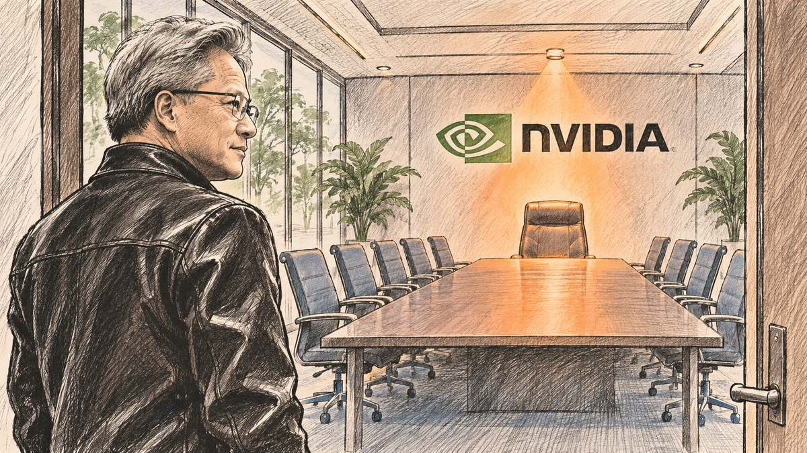
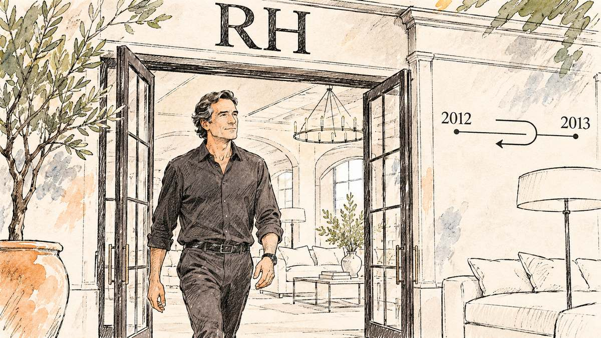
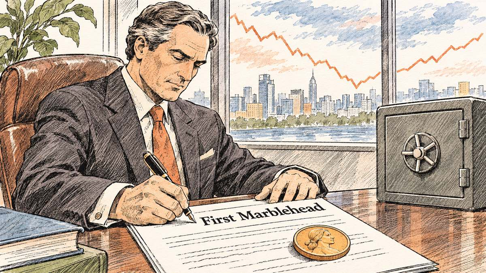
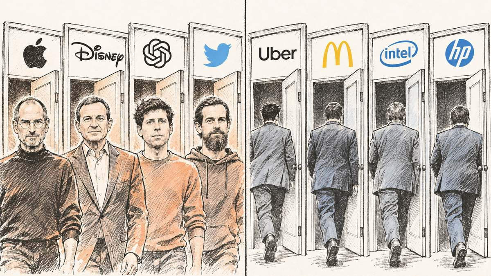
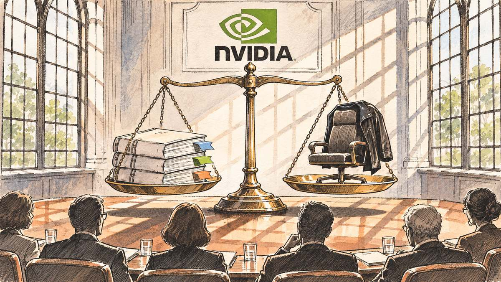

2026 年 11 月 8 日，星期日。NVIDIA 的员工收到一封 CEO 发来的邮件。

第一句是：“我欠我的家人和你们所有人一个道歉。”第二句是：“[我对妻子不忠](#ref-nv-message)。”

写信的人是黄仁勋（Jensen Huang）。他 [1993 年参与创办 NVIDIA](#ref-nv-10k-huang)，从公司成立起就担任总裁和 CEO。三十多年里，NVIDIA 从游戏显卡做起，做到了今天的 AI 芯片。

同一天，NVIDIA 董事会发了一份声明。声明说，有报道称黄仁勋“[成为外国情报活动的目标](#ref-nv-board-1108)”，董事会决定启动独立调查；目前“没有理由相信”国家安全或公司机密受损；董事会“对 Jensen 和他的管理团队有信心”。

两天后，独立董事（不在公司任职、与管理层没有利益关系的董事）[请来 Joon H. Kim 主持调查](#ref-nv-board-1110)。Kim 当过纽约南区（SDNY，管辖曼哈顿等地的联邦检察机构）的代理联邦检察官，他现在在纽约的 Wachtell, Lipton, Rosen & Katz 律师事务所执业。

11 月 11 日，星期三，《纽约时报》又报出一件事。据 NBC News 转述，《纽约时报》援引五名 NVIDIA 前员工称，黄仁勋和[一位直接向他汇报的已婚高管](#ref-nbc-1112)有婚外关系。NBC 写道，这“似乎违反了 NVIDIA 的行为准则”，并注明 NBC 未能独立核实。NVIDIA 公开的行为准则，把“[个人关系](#ref-nv-coc)”列在可能造成利益冲突的情形里。

同一天，董事会接受了黄仁勋的辞职。

11 月 12 日，NVIDIA 向美国证券交易委员会（SEC）提交了一份 8-K。8-K 是美国上市公司发生重大事件后必须在几天内提交的临时公告，高管和董事变动写在其中的 Item 5.02。这份 8-K 只有几句话：[黄仁勋辞去总裁、CEO 和董事职务，即时生效](#ref-nv-8k)；CFO Colette Kress 兼任临时 CEO；董事 Harvey C. Jones 出任董事会主席。

在美国公司里，董事长和 CEO 常由一人兼任。NVIDIA 过去没有设董事长，Jones 是这家公司[历史上第一位董事会主席](#ref-nv-pr)。

新闻稿的最后一段写道：“[Jensen 对 NVIDIA 的贡献意义深远](#ref-nv-pr)……董事会和公司感谢 Jensen 对公司和整个行业不可估量的贡献。”

*手绘示意，非真实场景。*

---

这件事有三层。

第一层是家事。黄仁勋在信里写：“[我的行为伤害了她和我们的孩子。我所做的事没有任何借口。](#ref-nv-message)”商业成就抵消不了这一层。

第二层是公司治理。CEO 和下属的关系，涉及权力不对等：下属的薪酬、晋升、考核，最终都归 CEO 管。这里面有利益冲突，也有该不该向董事会披露的问题。双方自愿，不等于不违规。

第三层是国家安全。这一层目前只有媒体报道和董事会启动调查的声明，没有任何结论。本文不讨论。

三层说完，剩下一个问题：

如果 NVIDIA 找遍内外部候选人，发现没有人比黄仁勋更合适，他还能不能回来？

本文不讨论他是否值得原谅，也不认为成就可以抵消错误。本文只问一个商业和法律问题：如果调查做完，责任追完，补救做完，董事会重新任命他，有没有可能是一个符合公司长期利益、经得起审查的决定？

历史上有人走过这条路。

## 一、Restoration Hardware：九个月

2012 年秋天，Restoration Hardware 正准备在纽约上市。这家公司卖高端家具和家居用品，今天改名叫 RH。

它的招股书里有一段话。招股书是公司公开发行股票前向 SEC 提交、向投资者披露重大信息的文件，写错要承担法律责任。

这段话说：有人披露 CEO Gary Friedman 和一名公司员工有私人关系，“[双方描述为自愿](#ref-rh-424b4)”。董事会由非管理层董事（不在公司担任管理职务的董事）组成特别委员会，请独立律师协助调查。委员会认定，Friedman 的行为“不符合董事会对高管行为的期望”，并且“[未遵守公司的某些政策](#ref-rh-424b4-finding)”。

2012 年 10 月 20 日，Friedman [辞去董事长、联合 CEO 和董事](#ref-rh-424b4-resign)。联合 CEO 是指两个人共同担任 CEO。他留了一个顾问身份，头衔叫“[Creator and Curator](#ref-rh-424b4-curator)”，大意是“创造者和策展人”。

2013 年 7 月 2 日，RH 向 SEC 提交 8-K：董事会[任命 Friedman 为联合 CEO 和董事长](#ref-rh-8k-2013)。距离他辞职，九个月。

半年后，另一位联合 CEO Carlos Alberini 离职，去当服装品牌 Lucky Brand 的 CEO，[2014 年 1 月 31 日正式离任](#ref-rh-8k-alberini)。从那以后，Friedman [以董事长兼 CEO 的身份](#ref-rh-proxy-2014)掌管 RH。

*手绘示意，非真实场景。人物不对应任何真人。*

这是和 NVIDIA 最接近的先例：创始人型的领导者，因为和员工的关系离开，董事会做过正式调查，最后又把他请了回来。

公开文件没有写的是：董事会当时比较过哪些候选人，给了 Friedman 什么处分，怎么评估法律风险。这些空白，本文不补。

## 二、First Marblehead：1 美元年薪

First Marblehead 是一家波士顿公司，[为私人教育贷款提供外包服务](#ref-fmd-2005-pr)，也就是帮银行设计、发放和打包出售学生贷款。

2005 年 9 月 27 日，联合创始人 Daniel Meyers [辞去 CEO、董事长和董事](#ref-fmd-2005-8k)。公司公告说，董事会得知他[和一家大客户的前员工互赠礼物](#ref-fmd-2005-pr)，礼物总价值[约 32,000 美元](#ref-fmd-2005-pr-amount)。钱是他自己出的，公司没有发现动用公款。董事会接受了他的辞职。

三年后，2008 年金融危机来了。First Marblehead 在 2008 财年[亏损约 2.35 亿美元](#ref-fmd-2008-pr-loss)。

2008 年 9 月 1 日，Meyers [重新出任总裁、CEO 和董事](#ref-fmd-2008-8k)。

他的合同是这样的：[年薪 1 美元](#ref-fmd-2008-pr-pay)；公司每个财年为他计提 100 万美元，但要等公司经营现金流转正、并且实现经营利润之后才支付；另外授予他 600 万股期权，行权价分三档，6 美元、12 美元和 16 美元。期权是指在未来按约定价格买入股票的权利，股价涨过行权价，期权才值钱。

首席独立董事 William Berkley 代表董事会说：“[我们相信，现在没有人比我们的联合创始人 Dan Meyers 更适合领导 First Marblehead。](#ref-fmd-2008-pr)”

*手绘示意，非真实场景。人物不对应任何真人。*

董事会没有说三年前的事不算数，只是在一个新的环境里重新算了一笔账，再把 Meyers 的回报和公司能否复苏绑在一起。

## 三、更多人没有回来

Friedman 和 Meyers 是例外。

**Intel，2018 年 6 月。** CEO Brian Krzanich 辞职。Intel 的新闻稿说，内外部律师的调查确认，他[过去和一名员工的自愿关系](#ref-intel-2018)违反了公司的禁止亲密关系政策，这项政策“适用于所有经理”。这里面没有性骚扰，只是违反政策。Intel 在 2019 年 1 月[任命 Bob Swan 为正式 CEO](#ref-intel-2019)。Krzanich 没有回去。他在 2018 年 11 月[出任 CDK Global 的 CEO](#ref-cdk-2018)，这是一家为汽车经销商做软件的公司。

**McDonald's，2019 年 11 月。** 董事会认定 CEO Steve Easterbrook 和一名员工的自愿关系[违反公司政策、“判断失当”](#ref-mcd-2019)，将他解职。

公司当时按“无因解雇”处理。无因解雇是指公司不以员工过错为由解雇，员工通常可以保留遣散费和部分股权。

2020 年 8 月，McDonald's 发现他[还和另外三名员工有性关系](#ref-mcd-2020)，并且对公司和董事会撒谎、销毁信息。公司在特拉华州衡平法院起诉了他。衡平法院（Court of Chancery）是特拉华州专门审理公司纠纷的法院。

2021 年 12 月，双方和解。Easterbrook 交回了[价值超过 1.05 亿美元的股权和现金](#ref-mcd-2021)。

2023 年 1 月，SEC 认定他在离职原因上误导投资者，[罚款 40 万美元，五年内不得担任上市公司高管或董事](#ref-sec-2023-4)。SEC 同时认定，McDonald's 动用裁量权按“无因”处理他的离职，让他保住了[价值超过 4,000 万美元](#ref-sec-2023-4-mcd)的待遇，却没有向股东披露这一决定。

关系让 Easterbrook 丢了工作。撒谎让他赔掉了一亿多美元，也让董事会自己的程序受到监管审查。

**Priceline，2016 年 4 月。** Priceline 是在线旅游公司，今天叫 Booking Holdings。CEO Darren Huston 辞职。8-K 说，他和一名[不归他直接管理的员工](#ref-pcln-2016)有私人关系，调查认定他违反了公司的行为准则，他[不会获得任何遣散费](#ref-pcln-2016-severance)。

**HP，2010 年 8 月。** HP 宣布，调查没有发现 CEO Mark Hurd 违反性骚扰政策，但[发现他违反了公司的《商业行为准则》](#ref-hp-2010)。Hurd 离开 HP，一个月后[出任 Oracle 总裁兼董事](#ref-orcl-2010)。

这些董事会没有因为业绩给 CEO 豁免。

## 四、离开的原因决定了能不能回来

把范围放宽到所有离职，回来的人不少。

**Apple。** 乔布斯（Steve Jobs）1985 年离开自己创办的公司。1996 年 12 月 20 日，Apple [宣布收购](#ref-aapl-1996)他后来创办的 NeXT；1997 年 9 月 16 日，Apple [任命他为临时 CEO](#ref-aapl-1997)。2000 年 1 月，他[正式出任 CEO](#ref-aapl-2000)。

**Disney。** 2020 年 2 月，Bob Iger 把 CEO [交给 Bob Chapek](#ref-dis-2020)，自己改任执行董事长。2022 年 11 月 20 日，董事会解除 Chapek 的职务，Iger [同意回来担任两年 CEO](#ref-dis-2022)。

**OpenAI。** 2023 年 11 月 17 日，OpenAI 宣布，董事会认为 Sam Altman“[在与董事会沟通中不始终坦诚](#ref-openai-2023)”，解除其 CEO 职务。几天后，董事会决定重新聘用他，[并改组董事会](#ref-openai-return)。2024 年 3 月，WilmerHale 律所的外部审查结束。结论是：前董事会解雇他属于其“广泛的裁量权”，但[他的行为“并不必然要求将其免职”](#ref-openai-2024)。

**Twitter。** Jack Dorsey [2007 年到 2008 年任 CEO](#ref-twtr-s1)，之后改任董事长。2015 年 7 月他[出任临时 CEO](#ref-twtr-2015-interim)，同年 9 月 30 日董事会[任命他为正式 CEO](#ref-twtr-2015-ceo)。

也有回不去的。

**Uber。** Travis Kalanick [2010 年 11 月至 2017 年 6 月任 CEO](#ref-uber-s1)，此后没有回任，[2019 年底离开董事会](#ref-uber-2019)。

**American Apparel。** 创始人 Dov Charney 2014 年 6 月[被停职](#ref-app-2014-suspend)，同年 12 月[被以正当理由解雇](#ref-app-2014-terminate)。他与公司的投资方签了协议，[承诺不再担任公司的董事、高管或员工](#ref-app-2015-10q)。2015 年 10 月，公司[申请破产重组](#ref-app-2015-ch11)（美国《破产法》第 11 章，允许公司在法院监督下继续经营并重组债务）。

**Martha Stewart。** 这位美国家政和生活方式品牌的创始人，2003 年 6 月因股票交易案被起诉，[辞去自己公司的董事长和 CEO](#ref-mslo-10k)。2004 年 3 月她被定罪，[判处五个月监禁](#ref-mslo-10k)。她与 SEC 和解，[五年内不得担任上市公司董事](#ref-sec-lr19794)。禁令期满后，2011 年 9 月她[回到公司董事会](#ref-mslo-2011)，2012 年 5 月[出任非执行董事长](#ref-mslo-2013)。

乔布斯和 Iger 回来，是因为公司需要他们，他们当初的离开与操守无关。Easterbrook 回不来，是因为他骗了董事会和投资者。

有一项研究可以参考。2020 年，四位学者在《MIT 斯隆管理评论》发表文章，统计了 1992 年到 2017 年间标普 1500 指数成分公司的 [167 位“回旋镖 CEO”](#ref-smr-2020)，也就是离开后又回到原公司的 CEO。标普 1500 指数大致覆盖美国大、中、小市值的主要上市公司。

他们发现：回旋镖 CEO 任内，公司股票的年度表现平均[比他们第一任期低 10.1%](#ref-smr-2020-perf)。创始人在全部 CEO 样本中只占 4%，[在回旋镖 CEO 中占 44%](#ref-smr-2020-founders)。

回来的人里，将近一半是创始人。回来的人，平均没有干得更好。

*手绘示意，非真实场景。左：回到原公司的 CEO；右：没有回去的 CEO。*

## 五、董事会需要一个经得起审查的理由

假设调查结束。结论是黄仁勋违反了公司政策，但没有法律上的任职障碍。董事会比较了内外部候选人，认为没有人比他更合适。

董事会能不能请他回来？

先看权力。NVIDIA [1993 年在加州注册，1998 年改在特拉华州注册](#ref-nv-10k)。很多美国上市公司注册在特拉华州，那里的公司法和判例都很成熟，还有专门的衡平法院。

特拉华州《普通公司法》（DGCL）第 141(a) 条规定，[公司事务由董事会管理或在董事会指导下进行](#ref-dgcl-141)；第 142(b) 条规定，[高管按章程或董事会的决定产生](#ref-dgcl-142)。NVIDIA 的章程写明，所有高管“[任职以董事会的意愿为准](#ref-nv-bylaws)”，职位出缺由董事会填补。章程中没有禁止重新聘用前任高管的条款。

权力在董事会。责任也在董事会。

美国公司法里，董事对公司和股东负有“信义义务”（fiduciary duty），主要是两项：注意义务（duty of care），要求董事在充分了解信息后再做决定；忠实义务（duty of loyalty），要求董事为公司利益行事，不夹带私利。特拉华州最高法院在 2006 年的 Stone v. Ritter 案中说明，[忠实义务也包括善意行事](#ref-stone-ritter)。

董事会做了决定，结果不好，会不会被追究？这里要说“商业判断规则”（business judgment rule）。这是特拉华州法院的一项推定：法院推定，董事做商业决定时“[充分知情、出于善意，并真诚相信该行动符合公司的最大利益](#ref-disney-2006-bjr)”。股东要推翻这项推定，必须证明董事违反了注意义务或忠实义务。法院审查的是决策过程，[不替董事评判结果的好坏](#ref-brehm-2000)。

最接近的判例来自 Disney。1995 年，Disney 聘请好莱坞经纪人 Michael Ovitz 担任总裁，[十四个月后让他离开](#ref-disney-2006-ovitz)，Ovitz 拿到的补偿价值约 1.3 亿美元。股东提起派生诉讼。派生诉讼是指股东代表公司起诉董事或高管。2006 年，特拉华州最高法院判定，Disney 董事会[聘用 Ovitz 以及后来让他以“非过错”方式离职](#ref-disney-2006-holding)，都是受保护的商业判断。

放到 NVIDIA：假设黄仁勋回来，一位股东起诉董事会，董事会怎么答？

“Jensen 是天才”，这句话在法庭上没有分量。“股东都想要他回来”，这句话也没有用，股东支持不能让违法的事变得合法。

董事会能站住的回答只有一种：调查已经完成；处分、补救和监督措施已经落实；候选人已经比较过；决定由独立董事在充分知情的情况下出于善意做出，认为符合公司的长期利益。

商业判断规则的保护不是自动的。证据和程序扎实，才可能得到保护。董事会不能因为喜欢黄仁勋、担心股价或者面对股东压力就忽视风险；也要评估不请他回来，公司要承担什么经营成本。

*手绘示意，非真实场景。*

董事会需要的是一个经得起审查的商业决定，不是一场股东运动。

## 六、回归至少需要六个条件

1. 独立调查查清事实，确认没有法律上的任职障碍。
2. 黄仁勋承担责任，接受处分，解决全部利益冲突。
3. 董事会评估过替代人选，结论有证据支持。
4. 股东、核心员工和商业伙伴的态度，为董事会的判断提供信息。
5. 决定由独立董事在充分知情的程序下做出，配套监督和风控。
6. 黄仁勋本人愿意回来，并接受上述条件。

股东支持不是充分条件，也未必是法律上的必要条件。股东[在年会上选举董事](#ref-dgcl-211)，[任命 CEO 的是董事会](#ref-dgcl-142)。请黄仁勋回来，不一定要先开股东大会改选董事。这是根据法条做的推论，没有判决这样明说。

## 七、有，但很少

正常卸任或与董事会冲突后回归的 CEO，不罕见。乔布斯、Iger、Altman 都是。

因违反行为准则离职后回归的，少得多。Intel、McDonald's、Priceline 的 CEO 都没有回去。

但 Friedman 和 Meyers 回去了。美国公司治理里没有“违规的 CEO 永远不得回归”的规则。

能回来的概率有多大，现有的公开数据算不出来。MIT 那项研究告诉我们回来的人里创始人占了将近一半，但没有告诉我们，因违规离开的人里有几个回来了。

最大的变数是国家安全调查。如果调查发现严重违法，一切都不同。排除这种情形，黄仁勋回归在法理上并非不可想象。

黄仁勋的商业贡献不能抹去他的错误。承认他的错误，也不意味着董事会永远不能重新评估他的商业价值。两件事可以同时成立。

一个人能否得到原谅，和一家公司是否能够重新聘任他，是两个不同的问题。

有多少 CEO 能够重来？

有，但远没有想象中容易。

## 参考资料

本文作者不是律师，本文不构成法律意见。下列资料均在 2026-11-12 读取。SEC 文件中的原文引文以 EDGAR 版本为准。判例引文取自哈佛大学 Caselaw Access Project 的判例汇编扫描版，个别字词有扫描错误。

### NVIDIA

- NVIDIA — [Form 8-K, Item 5.02](https://www.sec.gov/Archives/edgar/data/1045810/000104581026000082/nvda-20261111.htm#:~:text=accepted%20the%20resignation%20of%20Jen%2DHsun%20Huang)，2026-11-12 提交。原文：“the Board of Directors, or the Board, of NVIDIA Corporation accepted the resignation of Jen-Hsun Huang, as NVIDIA’s President, Chief Executive Officer and member of the Board, effective immediately.” — 2026-11-12 读取；[2026-11-12 存档](http://web.archive.org/web/20261112144435/https://www.sec.gov/Archives/edgar/data/1045810/000104581026000082/nvda-20261111.htm)
- NVIDIA — [NVIDIA Announces CEO Transition](https://www.sec.gov/Archives/edgar/data/1045810/000104581026000082/nvidiaannouncesceotransiti.htm#:~:text=contributions%20to%20NVIDIA%20are%20profound)，8-K 附件 99.1，2026-11-12。原文：“Harvey C. Jones Appointed First-Ever Chair of the Board”；“Jensen’s contributions to NVIDIA are profound.” — 2026-11-12 读取；[2026-11-12 存档](http://web.archive.org/web/20261112144523/https://www.sec.gov/Archives/edgar/data/1045810/000104581026000082/nvidiaannouncesceotransiti.htm)
- NVIDIA Newsroom — [A Message to Our Company](https://nvidianews.nvidia.com/news/a-message-to-our-company#:~:text=I%20was%20unfaithful%20to%20my%20wife)，2026-11-08，黄仁勋致员工邮件全文。原文：“I owe my family and all of you an apology. I was unfaithful to my wife. My actions hurt her and our children. There is no excuse for what I did.” — 2026-11-12 读取；[2026-11-12 存档](http://web.archive.org/web/20261112135514/https://nvidianews.nvidia.com/news/a-message-to-our-company)
- NVIDIA Newsroom — [Statement From NVIDIA Board of Directors](https://nvidianews.nvidia.com/news/statement-from-nvidia-board-of-directors#:~:text=target%20of%20a%20foreign%20intelligence%20effort)，2026-11-08。原文：“While the Board has no reason to believe that either national security or NVIDIA secrets were compromised”；“The Board has confidence in Jensen and his leadership team” — 2026-11-12 读取；[2026-11-12 存档](http://web.archive.org/web/20261112135451/https://nvidianews.nvidia.com/news/statement-from-nvidia-board-of-directors)
- NVIDIA Newsroom — [Statement From the Independent Members of the NVIDIA Board](https://nvidianews.nvidia.com/news/statement-from-the-independent-members-of-the-nvidia-board#:~:text=Joon%20H.%20Kim)，2026-11-10。原文：“have retained former acting U.S. Attorney of the Southern District of New York Joon H. Kim and his firm Wachtell, Lipton, Rosen & Katz” — 2026-11-12 读取；[2026-11-12 存档](http://web.archive.org/web/20261112151700/https://nvidianews.nvidia.com/news/statement-from-the-independent-members-of-the-nvidia-board)
- Rob Wile、Steve Kopack、Brian Cheung，NBC News — [Nvidia CEO Jensen Huang resigns after reports of affair and extramarital relationships](https://www.nbcnews.com/tech/tech-news/nvidia-ceo-jensen-huang-resigns-reports-extramarital-relationships-rcna608402#:~:text=married%20healthcare%20executive%20who%20reported%20to%20him)，2026-11-12。原文：“On Wednesday, The New York Times, citing five people who worked at Nvidia, reported that Huang had an extramarital relationship with a married healthcare executive who reported to him, which appears to run afoul of Nvidia’s code of conduct. NBC News has not independently verified the claims.” — 2026-11-12 读取；未找到存档快照
- NVIDIA — [Code of Conduct（外部版）](https://images.nvidia.com/aem-dam/en-zz/Solutions/about-us/NVIDIA-Code-of-Conduct-External.pdf)，© 2023，PDF，“Integrity and Fairness”一节“We avoid conflicts of interest”。原文：“The following types of activities may create a conflict of interest”，所列项目包括 “Investments or personal relationships”。 — 2026-11-12 读取；[2026-06-05 存档](http://web.archive.org/web/20260605221326/https://images.nvidia.com/aem-dam/en-zz/Solutions/about-us/NVIDIA-Code-of-Conduct-External.pdf)
- NVIDIA — [Form 10-K（财年截至 2026-01-25）](https://www.sec.gov/Archives/edgar/data/1045810/000104581026000021/nvda-20260125.htm#:~:text=Jen%2DHsun%20Huang%20co%2Dfounded%20NVIDIA%20in%201993)，高管介绍。原文：“Jen-Hsun Huang co-founded NVIDIA in 1993 and has served as our President, Chief Executive Officer, and a member of the Board of Directors since our inception.” — 2026-11-12 读取；[2026-11-03 存档](http://web.archive.org/web/20261103043402/https://www.sec.gov/Archives/edgar/data/1045810/000104581026000021/nvda-20260125.htm)
- 同一份 10-K — [公司注册地](https://www.sec.gov/Archives/edgar/data/1045810/000104581026000021/nvda-20260125.htm#:~:text=NVIDIA%20was%20incorporated%20in%20California%20in%20April%201993%20and%20reincorporated%20in%20Delaware%20in%20April%201998)。原文：“NVIDIA was incorporated in California in April 1993 and reincorporated in Delaware in April 1998.” — 2026-11-12 读取；[2026-11-03 存档](http://web.archive.org/web/20261103043402/https://www.sec.gov/Archives/edgar/data/1045810/000104581026000021/nvda-20260125.htm)
- NVIDIA — [Amended and Restated Bylaws](https://www.sec.gov/Archives/edgar/data/1045810/000104581024000069/exhibit31-amendedandrestat.htm#:~:text=All%20officers%20shall%20hold%20office%20at%20the%20pleasure%20of%20the%20Board%20of%20Directors)，2024-03-12 修订，8-K 附件 3.1，第 29 条。原文：“All officers shall hold office at the pleasure of the Board of Directors” — 2026-11-12 读取；[2026-09-29 存档](http://web.archive.org/web/20260929093245/https://www.sec.gov/Archives/edgar/data/1045810/000104581024000069/exhibit31-amendedandrestat.htm)

### Restoration Hardware（RH）

- Restoration Hardware Holdings — [招股书 424B4](https://www.sec.gov/Archives/edgar/data/1528849/000119312512449830/d70987d424b4.htm#:~:text=described%20by%20the%20parties%20as%20consensual)，2012-11-05，风险因素一节。原文：“following an investigation by a special committee of non-management directors of the board assisted by independent counsel prompted by disclosure that Mr. Friedman and a Company employee were engaged in a personal relationship, described by the parties as consensual.” — 2026-11-12 读取；[2020-07-28 存档](http://web.archive.org/web/20200728062726/https://www.sec.gov/Archives/edgar/data/1528849/000119312512449830/d70987d424b4.htm)
- 同一份招股书 — [调查结论](https://www.sec.gov/Archives/edgar/data/1528849/000119312512449830/d70987d424b4.htm#:~:text=failed%20to%20comply%20with%20certain%20Company%20policies)。原文：“The investigation concluded that Mr. Friedman engaged in activities that were inconsistent with the board of directors’ expectations for executive conduct … and failed to comply with certain Company policies.” — 2026-11-12 读取；存档同上
- 同一份招股书 — [辞职日期](https://www.sec.gov/Archives/edgar/data/1528849/000119312512449830/d70987d424b4.htm#:~:text=director%20of%20the%20Company%20effective%20as%20of%20October%2020%2C%202012)。原文：“resigned from these positions and as a director of the Company effective as of October 20, 2012.” — 2026-11-12 读取；存档同上
- 同一份招股书 — [顾问头衔](https://www.sec.gov/Archives/edgar/data/1528849/000119312512449830/d70987d424b4.htm#:~:text=in%20a%20role%20described%20as%20the%20Creator%20and%20Curator)。原文：“an advisory services agreement that provides for Mr. Friedman to advise the Company in a role described as the Creator and Curator” — 2026-11-12 读取；存档同上
- Restoration Hardware Holdings — [Form 8-K](https://www.sec.gov/Archives/edgar/data/1528849/000119312513282187/d563998d8k.htm#:~:text=From%20October%202012%20until%20July%201%2C%202013)，2013-07-03。原文：“On July 2, 2013, the board of directors … appointed Gary Friedman, 55, as the Company’s Co-Chief Executive Officer, Creator and Curator, and as Chairman” — 2026-11-12 读取；未找到存档快照
- Restoration Hardware Holdings — [Form 8-K](https://www.sec.gov/Archives/edgar/data/1528849/000119312513471810/d615698d8k.htm#:~:text=The%20resignation%20will%20be%20effective%20as%20of%20January%2031%2C%202014)，2013-12-12；去向见[附件 99.2 新闻稿](https://www.sec.gov/Archives/edgar/data/1528849/000119312513471810/d615698dex992.htm)（Lucky Brand）。原文：“The resignation will be effective as of January 31, 2014.” — 2026-11-12 读取；附件 99.2 [2013-12-15 存档](http://web.archive.org/web/20131215165436/http://www.sec.gov:80/Archives/edgar/data/1528849/000119312513471810/d615698dex992.htm)
- Restoration Hardware Holdings — [2014 年代理声明（DEF 14A）](https://www.sec.gov/Archives/edgar/data/1528849/000119312514201383/d657600ddef14a.htm#:~:text=Gary%20Friedman%20is%20Chairman%20of%20the%20Board%20and%20Chief%20Executive%20Officer)。代理声明是公司召开股东大会前发给股东的说明文件。原文：“Gary Friedman is Chairman of the Board and Chief Executive Officer of the Company. From July 2013 to January 2014, Mr. Friedman served as Co-Chief Executive Officer with Mr. Alberini” — 2026-11-12 读取；[2015-04-22 存档](http://web.archive.org/web/20150422000926/http://www.sec.gov:80/Archives/edgar/data/1528849/000119312514201383/d657600ddef14a.htm)

### First Marblehead

- The First Marblehead Corporation — [Form 8-K](https://www.sec.gov/Archives/edgar/data/1262279/000110465905046871/a05-17097_18k.htm#:~:text=Daniel%20Maxwell%20Meyers%20resigned%2C%20effective%20immediately)，2005-10-03。原文：“On September 27, 2005, Daniel Maxwell Meyers resigned, effective immediately, as Chief Executive Officer, Chairman of the Board of Directors, and a director” — 2026-11-12 读取；未找到存档快照
- 同一份 8-K — [附件 99.1 新闻稿](https://www.sec.gov/Archives/edgar/data/1262279/000110465905046871/a05-17097_1ex99d1.htm#:~:text=exchanged%20gifts%20with%20a%20former%20employee%20of%20a%20major%20client)，2005-09-27。原文：“a leading provider of outsourcing services for private, non-governmental education lending”；“The Board of Directors accepted Mr. Meyers’ resignation after learning that he had exchanged gifts with a former employee of a major client of the firm.” — 2026-11-12 读取；未找到存档快照
- 同一份新闻稿 — [礼物金额](https://www.sec.gov/Archives/edgar/data/1262279/000110465905046871/a05-17097_1ex99d1.htm#:~:text=aggregate%20value%20of%20approximately%20%2432%2C000)。原文：“he purchased the gifts with his personal funds, and that the gifts had an aggregate value of approximately $32,000. The Company has reviewed its records and believes that no corporate funds were involved in this matter.” — 2026-11-12 读取
- The First Marblehead Corporation — [Form 8-K](https://www.sec.gov/Archives/edgar/data/1262279/000110465908053517/a08-21859_18k.htm#:~:text=The%20Board%20elected%20Mr.%20Meyers%20as%20President%20and%20Chief%20Executive%20Officer)，2008-08-18。原文：“The Board elected Mr. Meyers as President and Chief Executive Officer and as a member of the Board, effective September 1, 2008” — 2026-11-12 读取；未找到存档快照
- 同一份 8-K — [附件 99.2 新闻稿](https://www.sec.gov/Archives/edgar/data/1262279/000110465908053517/a08-21859_1ex99d2.htm#:~:text=no%20better%20person%20to%20now%20lead%20First%20Marblehead)，2008-08-18。原文：“We believe there is no better person to now lead First Marblehead than our co-founder Dan Meyers.” — 2026-11-12 读取；未找到存档快照
- 同一份新闻稿 — [薪酬条款](https://www.sec.gov/Archives/edgar/data/1262279/000110465908053517/a08-21859_1ex99d2.htm#:~:text=annual%20base%20salary%20of%20%241.00)。原文：“Mr. Meyers will receive an annual base salary of $1.00, provided that the Company will accrue an amount equal to $1,000,000 per fiscal year”；期权共 600 万股，行权价 6、12、16 美元各 200 万股。 — 2026-11-12 读取
- 同一份新闻稿 — [2008 财年亏损](https://www.sec.gov/Archives/edgar/data/1262279/000110465908053517/a08-21859_1ex99d2.htm#:~:text=a%20net%20loss%20of%20approximately%20%24235%20million)。原文：“a net loss of approximately $235 million, or approximately $2.46 per diluted share, for the 2008 fiscal year” — 2026-11-12 读取

### Intel、McDonald's、Priceline、HP

- Intel — Intel CEO Brian Krzanich Resigns; Board Appoints Bob Swan as Interim CEO，2018-06-21。原网址已失效，读取的是[存档版本](http://web.archive.org/web/20180621132220/https://newsroom.intel.com/news-releases/intel-ceo-brian-krzanich-resigns-board-appoints-bob-swan-interim-ceo/#:~:text=past%20consensual%20relationship%20with%20an%20Intel%20employee)。原文：“Intel was recently informed that Mr. Krzanich had a past consensual relationship with an Intel employee. An ongoing investigation by internal and external counsel has confirmed a violation of Intel’s non-fraternization policy, which applies to all managers.” — 2026-11-12 读取
- Intel — [Intel Names Robert Swan CEO](https://www.sec.gov/Archives/edgar/data/50863/000119312519023301/d702987dex991.htm#:~:text=has%20named%20Robert%20%28Bob%29%20Swan%20Chief%20Executive%20Officer)，8-K 附件 99.1，2019-01-31 — 2026-11-12 读取；[2026-01-10 存档](http://web.archive.org/web/20260110005011/https://www.sec.gov/Archives/edgar/data/50863/000119312519023301/d702987dex991.htm)
- CDK Global — [8-K 附件 99.2 新闻稿](https://www.sec.gov/Archives/edgar/data/1609702/000117184318007674/exh_992.htm#:~:text=has%20joined%20CDK%20Global%20as%20president%20and%20chief%20executive%20officer)，2018-11-07。原文：“Brian Krzanich, 58, former chief executive officer of Intel, has joined CDK Global as president and chief executive officer (CEO)” — 2026-11-12 读取；未找到存档快照
- McDonald's — [8-K 附件新闻稿](https://www.sec.gov/Archives/edgar/data/63908/000089882219000080/pressrelease1.htm#:~:text=violated%20company%20policy%20and%20demonstrated%20poor%20judgment)，2019-11-04。原文：“the Board’s determination that he violated company policy and demonstrated poor judgment involving a recent consensual relationship with an employee.” — 2026-11-12 读取；[2026-05-29 存档](http://web.archive.org/web/20260529074032/https://www.sec.gov/Archives/edgar/data/63908/000089882219000080/pressrelease1.htm)
- McDonald's — [Form 8-K](https://www.sec.gov/Archives/edgar/data/63908/000089882220000056/mcd8k.htm#:~:text=sexual%20relationships%20with%20three%20additional%20Company%20employees)，2020-08-10。原文：“the Board concluded that Mr. Easterbrook lied to the Company and the Board and destroyed information regarding inappropriate personal behavior and in fact had been involved in sexual relationships with three additional Company employees” — 2026-11-12 读取；未找到存档快照
- McDonald's — [8-K 附件 99.1 新闻稿](https://www.sec.gov/Archives/edgar/data/63908/000006390821000042/exhibit991-12162021.htm#:~:text=with%20a%20current%20value%20of%20over%20%24105%20million)，2021-12-16。原文：“Mr. Easterbrook has returned equity awards and cash, with a current value of over $105 million” — 2026-11-12 读取；[2024-07-04 存档](http://web.archive.org/web/20240704190400/https://www.sec.gov/Archives/edgar/data/63908/000006390821000042/exhibit991-12162021.htm)
- SEC — [Press Release 2023-4](https://www.sec.gov/newsroom/press-releases/2023-4#:~:text=five%2Dyear%20officer%20and%20director%20bar%20and%20a%20%24400%2C000%20civil%20penalty)，2023-01-09。原文：“Easterbrook has consented to entry of the SEC’s cease-and-desist order, which imposes a five-year officer and director bar and a $400,000 civil penalty.” — 2026-11-12 读取；旧网址 [2024-03-02 存档](http://web.archive.org/web/20240302173724/https://www.sec.gov/news/press-release/2023-4)
- 同一份新闻稿 — [对 McDonald's 的认定](https://www.sec.gov/newsroom/press-releases/2023-4#:~:text=separation%20agreement%20valued%20at%20more%20than%20%2440%20million)。原文：“a separation agreement valued at more than $40 million” — 2026-11-12 读取
- The Priceline Group — [Form 8-K](https://www.sec.gov/Archives/edgar/data/1075531/000107553116000093/a8-kapril2016.htm#:~:text=who%20was%20not%20under%20his%20direct%20supervision)，2016-04-28。原文：“a personal relationship that Mr. Huston had with an employee of the Company who was not under his direct supervision. The investigation determined that Mr. Huston had acted contrary to the Company’s Code of Conduct” — 2026-11-12 读取；[2022-12-21 存档](http://web.archive.org/web/20221221211459/http://www.sec.gov/Archives/edgar/data/1075531/000107553116000093/a8-kapril2016.htm)
- 同一份 8-K — [遣散费](https://www.sec.gov/Archives/edgar/data/1075531/000107553116000093/a8-kapril2016.htm#:~:text=Mr.%20Huston%20will%20not%20receive%20any%20severance%20payments)。原文：“Mr. Huston will not receive any severance payments” — 2026-11-12 读取
- HP — [8-K 附件 99.1 新闻稿](https://www.sec.gov/Archives/edgar/data/47217/000104746910007177/a2199755zex-99_1.htm#:~:text=but%20did%20find%20violations%20of%20HP)，2010-08-06。原文：“The investigation determined that there was no violation of HP’s sexual harassment policy, but did find violations of HP’s Standards of Business Conduct.” — 2026-11-12 读取；[2026-01-09 存档](http://web.archive.org/web/20260109190652/https://www.sec.gov/Archives/edgar/data/47217/000104746910007177/a2199755zex-99_1.htm)
- Oracle — [Form 8-K](https://www.sec.gov/Archives/edgar/data/1341439/000119312510205818/d8k.htm#:~:text=was%20appointed%20as%20a%20President%20of%20Oracle)，2010-09。原文：“Mark V. Hurd, 53, was appointed as a President of Oracle and was elected as a director of Oracle on September 6, 2010.” — 2026-11-12 读取；[2021-05-25 存档](http://web.archive.org/web/20210525003739/https://www.sec.gov/Archives/edgar/data/1341439/000119312510205818/d8k.htm)

### Apple、Disney、OpenAI、Twitter、Uber、American Apparel、Martha Stewart

- Apple — [Form 8-K](https://www.sec.gov/Archives/edgar/data/320193/0000320193-96-000027.txt)，1996-12-24 提交（纯文本文件）。原文：“Apple Computer, Inc. today announced its intention to purchase NeXT Software Inc., in a friendly acquisition for $400 million.” — 2026-11-12 读取；[2023-11-18 存档](http://web.archive.org/web/20231118161023/http://www.sec.gov/Archives/edgar/data/320193/0000320193-96-000027.txt)
- Apple — [Form 8-K](https://www.sec.gov/Archives/edgar/data/320193/0000320193-97-000018.txt)，1997-09-24 提交，内含新闻稿“Apple Names Steve Jobs Interim CEO”。原文：“Apple’s new Board of Directors formalized the role of Steve Jobs by naming him interim Chief Executive Officer” — 2026-11-12 读取；[2025-05-16 存档](http://web.archive.org/web/20250516082346/https://www.sec.gov/Archives/edgar/data/320193/0000320193-97-000018.txt)
- Apple — [2000 财年 10-K](https://www.sec.gov/Archives/edgar/data/320193/0000912057-00-053623.txt)（纯文本文件）。原文：“In January 2000, Mr. Jobs accepted the position of Chief Executive Officer, which he had previously held on an interim basis.” — 2026-11-12 读取；索引页 [2026-08-24 存档](http://web.archive.org/web/20260824041549/https://www.sec.gov/Archives/edgar/data/320193/000091205700053623/0000912057-00-053623-index.htm)
- The Walt Disney Company — [Form 8-K 及附件 99.1 新闻稿](https://www.sec.gov/Archives/edgar/data/1744489/000174448920000054/0001744489-20-000054-index.htm)，2020-02-25。原文：“Bob Chapek has been named Chief Executive Officer” — 2026-11-12 读取；[2021-06-13 存档](http://web.archive.org/web/20210613173640/https://www.sec.gov/Archives/edgar/data/1744489/000174448920000054/0001744489-20-000054-index.htm)
- The Walt Disney Company — [Form 8-K 及附件 99.1 新闻稿](https://www.sec.gov/Archives/edgar/data/1744489/000174448922000200/0001744489-22-000200-index.htm)，2022-11-21 提交。原文：“has agreed to serve as Disney’s CEO for two years” — 2026-11-12 读取；[2026-10-07 存档](http://web.archive.org/web/20261007042140/https://www.sec.gov/Archives/edgar/data/1744489/000174448922000200/0001744489-22-000200-index.htm)
- OpenAI — [OpenAI announces leadership transition](https://openai.com/index/openai-announces-leadership-transition/#:~:text=not%20consistently%20candid%20in%20his%20communications%20with%20the%20board)，2023-11-17。原文：“the board, which concluded that he was not consistently candid in his communications with the board” — 2026-11-12 读取（经存档）；[2026-10-30 存档](http://web.archive.org/web/20261030101426/https://openai.com/index/openai-announces-leadership-transition/)
- OpenAI — [Sam Altman returns as CEO, OpenAI has a new initial board](https://openai.com/index/sam-altman-returns-as-ceo-openai-has-a-new-initial-board/#:~:text=The%20new%20initial%20board%20will%20consist%20of%20Bret%20Taylor)，2023-11-29。原文：“The new initial board will consist of Bret Taylor (Chair), Larry Summers, and Adam D’Angelo.” — 2026-11-12 读取（经存档）；[2026-11-01 存档](http://web.archive.org/web/20261101105630/https://openai.com/index/sam-altman-returns-as-ceo-openai-has-a-new-initial-board/)
- OpenAI — [Review completed & Altman, Brockman to continue to lead OpenAI](https://openai.com/index/review-completed-altman-brockman-to-continue-to-lead-openai/#:~:text=his%20conduct%20did%20not%20mandate%20removal)，2024-03-08。原文：“WilmerHale found that the prior Board acted within its broad discretion to terminate Mr. Altman, but also found that his conduct did not mandate removal.” — 2026-11-12 读取（经存档）；[2026-10-22 存档](http://web.archive.org/web/20261022234120/https://openai.com/index/review-completed-altman-brockman-to-continue-to-lead-openai/)
- Twitter — [S-1](https://www.sec.gov/Archives/edgar/data/1418091/000119312513390321/d564001ds1.htm#:~:text=Mr.%20Dorsey%20served%20as%20our%20President%20and%20Chief%20Executive%20Officer%20from%20May%202007%20to%20October%202008)，2013-10-03。原文：“Mr. Dorsey served as our President and Chief Executive Officer from May 2007 to October 2008.” — 2026-11-12 读取
- Twitter — [Form 8-K](https://www.sec.gov/Archives/edgar/data/1418091/000119312515220557/d941786d8k.htm#:~:text=to%20serve%20as%20Interim%20Chief%20Executive%20Officer)，2015-06-11。原文：“Richard Costolo has decided to step down as Chief Executive Officer of Twitter, effective July 1, 2015.” — 2026-11-12 读取；[2026-09-09 存档](http://web.archive.org/web/20260909042536/https://www.sec.gov/Archives/edgar/data/1418091/000119312515220557/d941786d8k.htm)
- Twitter — [Form 8-K](https://www.sec.gov/Archives/edgar/data/1418091/000156459015008279/twtr-8k_20150930.htm#:~:text=appointed%20Jack%20Dorsey)，2015-10-05 提交。原文：“On September 30, 2015, the Board of Directors … appointed Jack Dorsey, Co-Founder and interim Chief Executive Officer, as Chief Executive Officer.” — 2026-11-12 读取；[2026-07-02 存档](http://web.archive.org/web/20260702071717/https://www.sec.gov/Archives/edgar/data/1418091/000156459015008279/twtr-8k_20150930.htm)
- Uber — [S-1](https://www.sec.gov/Archives/edgar/data/1543151/000119312519103850/d647752ds1.htm#:~:text=From%20November%202010%20to%20June%202017)，2019-04-11。原文：“From November 2010 to June 2017, Mr. Kalanick served as our Chief Executive Officer.” — 2026-11-12 读取；[2026-11-01 存档](http://web.archive.org/web/20261101153125/https://www.sec.gov/Archives/edgar/data/1543151/000119312519103850/d647752ds1.htm)
- Uber — [Form 8-K](https://www.sec.gov/Archives/edgar/data/1543151/000155278119000515/e19531_uber-8k.htm#:~:text=effective%20as%20of%20December%2031%2C%202019)，2019-12-26。原文：“Travis Kalanick informed Uber Technologies, Inc. … of his intention to resign as a member of the Company’s board of directors, effective as of December 31, 2019.” — 2026-11-12 读取；未找到存档快照
- American Apparel — [Form 8-K](https://www.sec.gov/Archives/edgar/data/1336545/000133654514000086/a8-k_departureofprincipalo.htm#:~:text=the%20Board%20suspended%20Mr.%20Charney)，2014-06。原文：“Effective immediately, the Board suspended Mr. Charney” — 2026-11-12 读取；[2014-10-17 存档](http://web.archive.org/web/20141017173555/http://www.sec.gov:80/Archives/edgar/data/1336545/000133654514000086/a8-k_departureofprincipalo.htm)
- American Apparel — [Form 8-K](https://www.sec.gov/Archives/edgar/data/1336545/000134100414001117/aa8k.htm#:~:text=voted%20to%20terminate%20Dov%20Charney)，2014-12-19。原文：“On December 15, 2014, the Board of Directors also voted to terminate Dov Charney, former President and Chief Executive Officer, for cause” — 2026-11-12 读取；[2015-03-30 存档](http://web.archive.org/web/20150330042456/http://www.sec.gov:80/Archives/edgar/data/1336545/000134100414001117/aa8k.htm)
- American Apparel — [2015 年第二季度 10-Q](https://www.sec.gov/Archives/edgar/data/1336545/000133654515000120/app0630201510-q.htm#:~:text=Mr.%20Charney%20agreed%20not%20to%20serve%20as%20a%20director)。原文：“In the Standstill Agreement, however, Mr. Charney agreed not to serve as a director, officer, or employee” — 2026-11-12 读取
- American Apparel — [Form 8-K](https://www.sec.gov/Archives/edgar/data/1336545/000133654515000135/a8k-currentreport.htm#:~:text=filed%20voluntary%20petitions)，2015-10。原文：“On October 5, 2015 (the “Petition Date”), American Apparel, Inc. … filed voluntary petitions in the United States Bankruptcy Court for the District of Delaware” — 2026-11-12 读取；[2016-05-25 存档](http://web.archive.org/web/20160525133608/http://www.sec.gov:80/Archives/edgar/data/1336545/000133654515000135/a8k-currentreport.htm)
- Martha Stewart Living Omnimedia — [2004 财年 10-K](https://www.sec.gov/Archives/edgar/data/1091801/000095012305003245/y06775e10vk.txt)（纯文本文件）。原文：“Following the indictment, Ms. Stewart resigned her positions as Chairman and Chief Executive Officer”；“On July 16, 2004, Ms. Stewart was sentenced to five months in prison and two years of supervised release” — 2026-11-12 读取；[2025-12-23 存档](http://web.archive.org/web/20251223010053/https://www.sec.gov/Archives/edgar/data/1091801/000095012305003245/y06775e10vk.txt)
- SEC — [Litigation Release No. 19794](https://www.sec.gov/enforcement-litigation/litigation-releases/lr-19794#:~:text=five%20year%20bar%20from%20serving%20as%20a%20director%20of%20a%20public%20company)，2006-08-07。原文：“Stewart also agrees to a five year bar from serving as a director of a public company and a five year limitation on the scope of her service as an officer or employee of a public company.” — 2026-11-12 读取；旧网址 [2023-03-09 存档](http://web.archive.org/web/20230309052956/https://www.sec.gov/litigation/litreleases/2006/lr19794.htm)
- Martha Stewart Living Omnimedia — [Form 8-K](https://www.sec.gov/Archives/edgar/data/1091801/000095012311086495/c22691e8vk.htm#:~:text=appointed%20Martha%20Stewart%2C%20its%20Founder)，2011-09。原文：“On September 22, 2011, Martha Stewart Living Omnimedia, Inc. … appointed Martha Stewart, its Founder, Chief Editorial, Media and Content Officer, to fill the vacancy so created.” — 2026-11-12 读取；[2012-02-10 存档](http://web.archive.org/web/20120210093658/http://www.sec.gov/Archives/edgar/data/1091801/000095012311086495/c22691e8vk.htm)
- Martha Stewart Living Omnimedia — [2013 年代理声明（DEF 14A）](https://www.sec.gov/Archives/edgar/data/1091801/000119312513293290/d567849ddef14a.htm#:~:text=the%20Board%20appointed%20Ms.%20Stewart%20Non%2DExecutive%20Chairman)。原文：“On May 23, 2012, the Board appointed Ms. Stewart Non-Executive Chairman of the Board.” — 2026-11-12 读取；未找到存档快照

### 回旋镖 CEO 研究

- John B. Bingham、Walter Hendricks、Taylor Howell、Kalin Kolev，MIT Sloan Management Review — [Boomerang CEOs: What Happens When the CEO Comes Back?](https://sloanreview.mit.edu/article/boomerang-ceos-what-happens-when-the-ceo-comes-back/#:~:text=167%20boomerang%20CEOs)，2020-09-17。原文：“we collected and analyzed data on the performance of 167 boomerang CEOs of companies listed on the S&P Composite 1500 index from 1992 to 2017. We then compared their tenures with those of more than 6,000 other (non-boomerang) CEOs” — 2026-11-12 读取；[2026-05-02 存档](http://web.archive.org/web/20260502180505/https://sloanreview.mit.edu/article/boomerang-ceos-what-happens-when-the-ceo-comes-back/)
- 同一篇文章 — [股票表现](https://sloanreview.mit.edu/article/boomerang-ceos-what-happens-when-the-ceo-comes-back/#:~:text=was%2010.1%25%20lower%20than%20their%20first%2Dstint%20counterparts)。原文：“On average, the annual stock performance of companies led by boomerang CEOs was 10.1% lower than their first-stint counterparts.” — 2026-11-12 读取
- 同一篇文章 — [创始人占比](https://sloanreview.mit.edu/article/boomerang-ceos-what-happens-when-the-ceo-comes-back/#:~:text=they%20accounted%20for%2044%25%20of%20the%20boomerang%20CEOs)。原文：“While founders made up only 4% of our overall CEO sample, they accounted for 44% of the boomerang CEOs.” — 2026-11-12 读取

### 特拉华州法律

- Delaware Code, Title 8 — [§ 141(a)](https://delcode.delaware.gov/title8/c001/sc04/index.html#:~:text=shall%20be%20managed%20by%20or%20under%20the%20direction%20of%20a%20board%20of%20directors)。原文：“The business and affairs of every corporation organized under this chapter shall be managed by or under the direction of a board of directors” — 2026-11-12 读取；[2026-10-31 存档](http://web.archive.org/web/20261031175335/https://delcode.delaware.gov/title8/c001/sc04/index.html)
- Delaware Code, Title 8 — [§ 142(b)](https://delcode.delaware.gov/title8/c001/sc04/index.html#:~:text=Officers%20shall%20be%20chosen%20in%20such%20manner)。原文：“Officers shall be chosen in such manner and shall hold their offices for such terms as are prescribed by the bylaws or determined by the board of directors or other governing body.” — 2026-11-12 读取；存档同上
- Delaware Code, Title 8 — [§ 211(b)](https://delcode.delaware.gov/title8/c001/sc07/index.html#:~:text=an%20annual%20meeting%20of%20stockholders%20shall%20be%20held%20for%20the%20election%20of%20directors)。原文：“an annual meeting of stockholders shall be held for the election of directors” — 2026-11-12 读取；[2026-11-04 存档](http://web.archive.org/web/20261104062341/https://delcode.delaware.gov/title8/c001/sc07/index.html)
- Stone v. Ritter, 911 A.2d 362, 370 (Del. 2006) — [Caselaw Access Project](https://static.case.law/a2d/911/html/0362-01.html#:~:text=the%20fiduciary%20duty%20of%20loyalty%20is%20not%20limited%20to%20cases%20involving)。原文：“the fiduciary duty of loyalty is not limited to cases involving a financial or other cognizable fiduciary conflict of interest. It also encompasses cases where the fiduciary fails to act in good faith.” — 2026-11-12 读取；未找到存档快照
- In re Walt Disney Co. Derivative Litigation, 906 A.2d 27, 52 (Del. 2006) — [Caselaw Access Project](https://static.case.law/a2d/906/html/0027-01.html#:~:text=in%20making%20a%20business%20decision%20the%20directors%20of%20a%20corporation%20acted%20on%20an%20informed%20basis)。判决援引 Aronson v. Lewis, 473 A.2d 805, 812 (Del. 1984)：“a presumption that in making a business decision the directors of a corporation acted on an informed basis, in good faith and in the honest belief that the action taken was in the best interests of the company.” — 2026-11-12 读取；未找到存档快照
- 同一判决 — [事实部分](https://static.case.law/a2d/906/html/0027-01.html#:~:text=only%20fourteen%20months%20after%20he%20commenced%20employment)。原文：“In December 1996, only fourteen months after he commenced employment, Ovitz was terminated without cause, re-suiting in a severance payout to Ovitz valued at approximately $130 million.”（“re-suiting”为扫描原样） — 2026-11-12 读取
- 同一判决，906 A.2d at 73 — [结论](https://static.case.law/a2d/906/html/0027-01.html#:~:text=to%20hire%20Ovitz%20as%20President%2C%20and%20then%20to%20terminate%20him)。原文：“the decisions of the Disney defendants to approve the OEA, to hire Ovitz as President, and then to terminate him on an NFT basis, were protected business judgments, made without any violations of fiduciary duty.” — 2026-11-12 读取
- Brehm v. Eisner, 746 A.2d 244, 264 (Del. 2000) — [Caselaw Access Project](https://static.case.law/a2d/746/html/0244-01.html#:~:text=Due%20care%20in%20the%20decisionmaking%20context%20is%20process%20due%20care%20only)。原文：“Courts do not measure, weigh or quantify directors’ judgments. … Due care in the decisionmaking context is process due care only.” — 2026-11-12 读取；未找到存档快照
